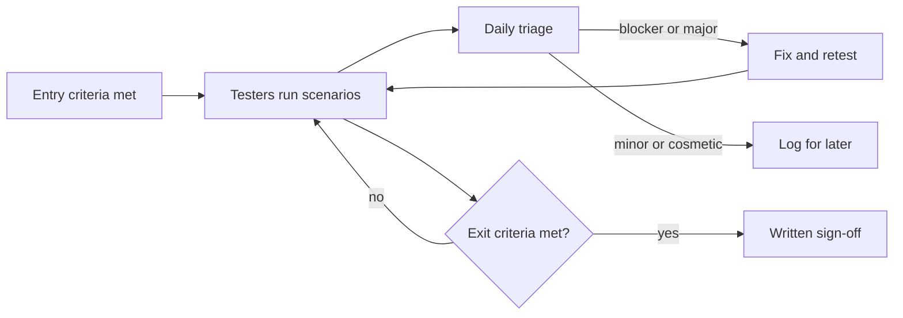

# Acceptance with the Customer

## Start with the demo sign-off

Orwell Housing, the housing association from the first lesson in this module, commissioned a new repairs scheduling screen, and Kofi, the forward deployed engineer, demonstrated it to the repairs manager, Gareth, on 50 tidy test jobs. Every search worked and every assignment saved, and Gareth replied: "Looks good, happy to go live." On Monday the schedulers used it on real work. A search for a tenant called O'Neill returned nothing, because the apostrophe broke the search, the migrated job history held 1,100 duplicate jobs, and nobody had written down how to go back to the old screen. Orwell scheduled from spreadsheets for three days. Gareth had accepted a demonstration, not the system: no scheduler had tried it, no real data had passed through it and nothing on the release list had evidence behind it. Call this **the demo sign-off**.

> **What you'll learn**
>
> - Explain what user acceptance testing is for, and who does it.
> - Plan acceptance with real scenarios, real users and representative data.
> - Run it with daily triage and agreed severity rules.
> - Build a release checklist where every line points to evidence.
> - Get a sign-off that names what was accepted and on what conditions.

## What acceptance is for

**User acceptance testing (UAT)** is the customer confirming that the system does what they need, in their own work, before it goes live. Your own tests check that the system does what you built it to do. UAT checks that what you built is what they needed. Those are different questions, and only the customer can answer the second.

Two roles matter:

- **Testers** are the people who will use the system: Orwell's schedulers and call handlers, not their manager.
- **The accepter** is the person with authority to say yes for the business: here, Gareth. He decides from the testers' results, not from a demonstration.

Acceptance criteria should already exist from the requirements. If they do not, write them with the customer before UAT starts, as the site's [requirements you can test](/learn/forward-deployed/requirements-and-solution-design/requirements-you-can-test) lesson describes. UAT against criteria nobody wrote down turns into a debate about taste.

## Planning UAT

A UAT plan fits on one page. It answers five questions.

| Question | Orwell's answer |
| --- | --- |
| Which scenarios? | 12 scenarios from real work: the morning assignment, an emergency mid-day, a tenant calling about a job, a reassignment when an engineer is sick, and edge cases such as apostrophes, Welsh names and jobs with no address |
| Who tests? | Two schedulers, one call handler and one repairs supervisor |
| On what data? | An anonymised copy of last month's jobs, plus the migrated history, loaded the way go-live will load it |
| Where? | A test environment configured like production, with the same single sign-on and roles |
| When and for how long? | Five working days, with testers released from half their normal work |

*Table 1: Orwell's UAT plan on one page.*

**Representative data** is the line most often cut. Clean test data hides exactly the problems real data has: apostrophes, duplicates, missing fields, odd dates. Use a copy of real data, anonymised under the customer's rules, and include whatever the migration produces. The fixtures in [testing what the customer will break](/learn/fde-building-in-the-estate/building-for-operators/testing-what-the-customer-will-break) catch known messes early. UAT on real data finds the ones nobody has seen yet.

Set **entry criteria** too: your own tests pass, known issues are listed, and testers have had a short training session. Starting UAT on a build that crashes wastes the customer's people.

## Running it: triage and severity

Testers record each problem with the scenario, what they did, what they expected and what happened. A short triage meeting each day, with the FDE, a tester and the accepter, gives each problem a severity:

- **Blocker.** The scenario cannot be completed, or data is wrong or lost. Must be fixed before go-live.
- **Major.** The scenario can be completed only with a workaround. Fix, or agree the workaround in writing.
- **Minor.** It works, but it is awkward. Schedule a fix after go-live.
- **Cosmetic.** Wording or layout. Fix when convenient.

Agree the **exit criteria** before testing starts, not on the last day: no open blockers, every major fixed or with an agreed workaround, every scenario passed at least once on the final build. Each fix is retested by the tester who found it, and the full scenario set runs once more on the final build.

Figure 1 shows the flow with its gates.

*Figure 1: UAT with gates. Testing starts only when entry criteria hold and ends only when the agreed exit criteria are met.*

The walkthrough replays Orwell's UAT as it should have run.

Five days of UAT for Orwell's scheduling screen. Each step shows what happens and what it produces.

<button type="button" data-step="0" aria-pressed="false" aria-controls="uat-step-0">1. Prepare</button><button type="button" data-step="1" aria-pressed="false" aria-controls="uat-step-1">2. Run</button><button type="button" data-step="2" aria-pressed="false" aria-controls="uat-step-2">3. Triage</button><button type="button" data-step="3" aria-pressed="false" aria-controls="uat-step-3">4. Sign off</button>

<section id="uat-step-0" class="step-panel" aria-labelledby="uat-heading-0"><h4 id="uat-heading-0">1. Prepare</h4><dl><dt>What happens</dt><dd>12 scenarios agreed, anonymised data and migrated history loaded, four testers trained for an hour.</dd><dt>Produces</dt><dd>A one-page plan and agreed exit criteria.</dd></dl></section><section id="uat-step-1" class="step-panel" aria-labelledby="uat-heading-1"><h4 id="uat-heading-1">2. Run the scenarios</h4><dl><dt>What happens</dt><dd>Schedulers do a real morning's assignment on last month's jobs. On day one, a search for O'Neill returns nothing.</dd><dt>Produces</dt><dd>14 problems logged over five days, each with steps to reproduce.</dd></dl></section><section id="uat-step-2" class="step-panel" aria-labelledby="uat-heading-2"><h4 id="uat-heading-2">3. Triage daily</h4><dl><dt>What happens</dt><dd>1 blocker (apostrophe search), 3 major (including the 1,100 duplicate jobs), 6 minor and 4 cosmetic.</dd><dt>Produces</dt><dd>Blocker and majors fixed and retested by the testers who found them.</dd></dl></section><section id="uat-step-3" class="step-panel" aria-labelledby="uat-heading-3"><h4 id="uat-heading-3">4. Sign off</h4><dl><dt>What happens</dt><dd>All 12 scenarios pass on the final build. Gareth signs, listing the 10 open minor and cosmetic items.</dd><dt>Produces</dt><dd>A written acceptance naming the build, the results and the conditions.</dd></dl></section>

<button type="button" data-walk="previous">Previous</button>

<button type="button" data-walk="next">Next step</button>

The walkthrough is a scripted illustration. Both Monday failures appear on day one, when they cost a fix instead of three days of spreadsheets.

## The release checklist, with evidence

A release checklist is only as good as the evidence behind each line. "Tested: yes" is an opinion. "Tested: run 418, 512 tests passed, link" is evidence. Google's SRE book describes launch checklists in the same spirit: each item is a question with an answer someone can check.

| Item | Evidence | Owner |
| --- | --- | --- |
| Automated tests pass on the release build | Link to the test run for that build | FDE |
| UAT accepted | Signed acceptance naming the build | Repairs manager |
| Data migration reconciled | Counts of jobs before and after, duplicates checked | FDE and data owner |
| Accessibility checked | Keyboard and screen-reader check results | FDE |
| Performance at peak | Load test at the Monday 08:00 rate | FDE |
| Security and access reviewed | Roles tested, security review closed | Customer IT security |
| Rollback ready | The steps, and a test of them in the test environment | FDE and customer IT |
| Support ready | Runbook, contacts, schedulers trained | Customer service lead |
| Monitoring live | Dashboards and alerts for errors and failed jobs | FDE |

*Table 2: Orwell's release checklist. Each line names its evidence and an owner.*

The site's [run a readiness review](/learn/production-ai/evaluation-and-release-gates/run-a-readiness-review) lesson covers the same discipline for AI systems, where evaluation results join the evidence.

## A sign-off that means something

A useful sign-off is written, specific and conditional where needed. It names:

- **What was accepted.** The build or version number, not "the system".
- **What was tested.** The scenarios and their results.
- **What is still open.** Each known issue, with its workaround and the date it will be fixed.
- **Any conditions.** For example, "go-live only after the migration reconciliation is rerun on the final data".
- **Who accepts.** A named person with authority for the business.

An email saying "looks good" fails every line. Gareth's later sign-off named build 2.3.1, 12 scenarios passed and 10 open items, which gave both sides a shared record of what go-live included.

## Limits of this lesson

- **Contracts may define acceptance.** Some engagements tie payment to acceptance with its own terms. Follow the contract, and involve the account team.
- **UAT does not replace your testing.** Customers find what they need. They should not be finding crashes.
- **Composite engagement.** Orwell Housing, its staff and its figures are illustrative, not a real customer.

## Interview angle

Each answer is an outline to say in about two minutes. Open each question and try it aloud before reading.

Interview question 1. How do you make sure the system is tested on data that looks like the customer's, and where do fixtures, mocks and user acceptance testing each fit?

- **Answer:** Get an anonymised sample of real data early and build fixtures from it, one per kind of mess, so unit and integration tests see duplicates, bad encodings and odd dates. Use mocks for speed, but check them against the real service with contract tests. Then run UAT with real users on an anonymised copy of production data and the migrated history, because that finds the messes nobody has seen yet.
- **Trade-off:** Real data needs the customer's approval and anonymising, which takes time. Clean data is fast and hides the failures that matter.
- **Follow-up to expect:** "They will not share production data." Ask for a masked extract or generate data from real distributions.
- **Go deeper:** [testing what the customer will break](/learn/fde-building-in-the-estate/building-for-operators/testing-what-the-customer-will-break).

## References

1. Google, [Reliable Product Launches at Scale](https://sre.google/sre-book/reliable-product-launches/), Site Reliability Engineering, accessed 17 November 2026. Launch checklists and launch coordination.
2. The site's [run a readiness review](/learn/production-ai/evaluation-and-release-gates/run-a-readiness-review) lesson, for evidence-based go-live decisions.
3. The site's [requirements you can test](/learn/forward-deployed/requirements-and-solution-design/requirements-you-can-test) lesson, for writing acceptance criteria.
4. The author's own field experience, the basis for the UAT plan, severity rules and sign-off contents.

## Key takeaways

- UAT is the customer confirming the system meets their need. Your tests cannot answer that.
- Testers are the people who will use it. The accepter is the person with authority.
- Plan real scenarios on representative, anonymised data in a production-like environment.
- Agree severity and exit criteria before testing, and triage daily.
- Every checklist line points to evidence, and the sign-off names the build, results and open items.

## Check yourself

1. Why did Gareth's sign-off fail to protect Orwell?

He accepted a demonstration on 50 tidy jobs. No scheduler tested it, no real data passed through it, and the email named no build, results or conditions.

2. Why agree exit criteria before UAT starts?

On the last day, deadline pressure turns every blocker into a debate. Criteria agreed in advance make the decision a check.

3. What turns a checklist line from an opinion into evidence?

A link or record someone else can check, such as a test run for the release build or a signed acceptance.

