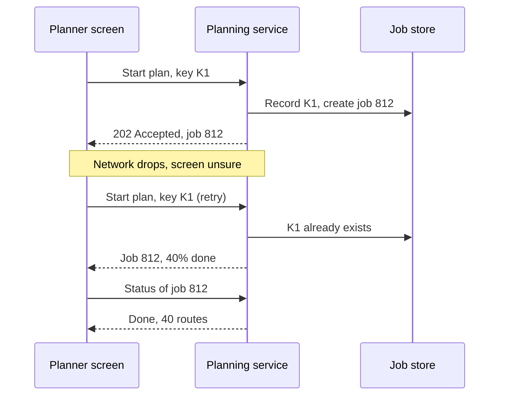

# Honest Async Interfaces

## Start with the second click

Quorn Logistics, a fictional parcel carrier, plans the next day's delivery routes each evening. A planner presses "Plan routes" for a depot, and the planning service works out routes for about 2,000 parcels across 40 vans. It takes about four minutes.

The button called the service and waited. A proxy in Quorn's network closed any request after 60 seconds. After a minute, the screen showed "Something went wrong. Please try again." The planner, Tom, tried again. Then twice more. The planning service had never stopped: it received four requests and ran four plans. The last two to finish wrote different route sheets. Some drivers printed one version and some the other, and 130 parcels went out on two vans.

The error message was false. Nothing had gone wrong except the wait, and the screen told Tom to repeat an action that was still running. Call this **the second click**.

> **What you'll learn**
>
> - Design the loading, empty, validation and error states every screen has.
> - Tell an empty result apart from data that has not loaded or cannot be seen.
> - Write error messages that say what happened and what to do next.
> - Make a repeated submit safe with an idempotency key.
> - Run long operations as jobs with real progress.

## Every screen has more than one state

Designers draw the happy path: a list full of data. The operator also meets the screen while it loads, when there is nothing to show, when input is wrong and when a call fails. Each state needs its own design.

| State | What the operator needs to know | Quorn example |
| --- | --- | --- |
| Loading | That work is happening, and roughly how long it takes | "Loading tomorrow's parcels" with a skeleton of the table |
| Empty | Why there is nothing, and what to do | "No parcels booked for Leicester tomorrow yet. Bookings close at 18:00." |
| Validation | Which input is wrong, beside the field, in words | "Van capacity must be between 1 and 400 parcels" |
| Error | What failed, whether anything was saved and what to do | "Route plan not started. Nothing was saved. Try again or call the duty manager." |
| Partial | Which parts worked and which did not | "38 of 40 vans planned. 2 vans had no driver assigned." |

*Table 1: Five states to design for every operator screen.*

A spinner covers the first second or two. Beyond that, say what is loading. Keep what the operator already sees on screen while fresh data loads, instead of blanking the page.

## Empty is three different things

An empty table can mean three things, and the operator acts differently on each:

- **There is no data.** No parcels are booked yet. Say so, and say when there will be.
- **The filter hides it.** The planner filtered to one van that has nothing assigned. Show the active filter and a way to clear it.
- **The person cannot see it.** The data exists but their role does not cover that depot. Say that access is limited, without showing what is hidden.

A fourth case is not empty at all: the data failed to load. Showing "No parcels" when the request failed is the worst version, because the operator believes it. Treat a failed load as an error state, never as an empty one.

## Errors the operator can act on

A good error message answers three questions: what happened, whether anything was saved, and what to do next. "Something went wrong" answers none of them. The GOV.UK Design System's guidance on error messages asks for the same: explain what went wrong and how to fix it, in plain words.

For **validation errors**, check input as early as possible and show the message beside the field, with a summary at the top when there are several. Keep everything the operator typed. Losing a long form to one bad date teaches people to stop trusting the screen.

For **system errors**, be honest about uncertainty. After a network error, the screen often does not know whether the server received the request. Saying "failed" when the work may be running is how Quorn got four plans. The honest message is "We lost contact while starting the plan. Checking whether it started..." followed by a status check, not a retry.

## Making the second click safe

Disabling the button after one click helps, but it does not solve the problem. A page refresh, a second browser tab or a client retry library can all send the request again. The fix belongs on the server.

An **idempotency key** is a unique value the client generates once per intended action and sends with the request. The server records each key with its result. When a request arrives with a key it has seen, the server returns the original result instead of doing the work again. Stripe's API documents this pattern for payment creation, where a duplicate charge is the same failure as Quorn's duplicate plan.

At Quorn, the key represents "plan Leicester depot for 18 November". Every retry of that intent carries the same key. Figure 1 shows the flow.

*Figure 1: An idempotent start for a long job. The retry carries the same key, so the service returns the existing job instead of starting a second plan.*

Two details matter in practice. Store the key and the job record in the same transaction. A crash then cannot record one without the other. And decide how long keys live: long enough to cover any realistic retry, such as 24 hours for an evening plan. The site's [durability and idempotency](/learn/production-ai/agentic-workflow-platforms/durability-and-idempotency) lesson covers the mechanism in more depth.

## Long-running work as a job

Any operation that can take longer than a few seconds should not hold a request open. Run it as a **job**:

1. **Accept and return at once.** The server records the job and replies with its ID. HTTP has a status for this, 202 Accepted, which says the request was accepted for processing that has not finished.
2. **Report real progress.** Show stages the work passes through, such as "Loading parcels, Assigning vans, Ordering stops, Writing route sheets", with counts where you have them. Do not show a bar that moves on a timer.
3. **Let the operator leave.** The job continues if the page closes. A job list shows running and recent jobs, and a notification arrives when one finishes.
4. **Allow cancelling where it is safe.** Cancel before route sheets are written. After that, cancelling would leave a half-written plan, so the button disappears.
5. **Show partial results as they are.** If 2 vans fail, show 38 planned routes and the 2 problems, and let the planner fix those two.

The screen learns about progress by polling the job's status every few seconds or by a server push, such as server-sent events. Polling is simpler and works through most proxies. Push gives faster updates at the cost of keeping connections open.

The walkthrough replays Quorn's evening with the job design.

Replay Tom's evening with the plan run as a job. Each step shows what the screen says and what the service does.

<button type="button" data-step="0" aria-pressed="false" aria-controls="quorn-step-0">1. Start</button><button type="button" data-step="1" aria-pressed="false" aria-controls="quorn-step-1">2. Drop</button><button type="button" data-step="2" aria-pressed="false" aria-controls="quorn-step-2">3. Retry</button><button type="button" data-step="3" aria-pressed="false" aria-controls="quorn-step-3">4. Finish</button>

<section id="quorn-step-0" class="step-panel" aria-labelledby="quorn-heading-0"><h4 id="quorn-heading-0">1. Start the plan</h4><dl><dt>Screen</dt><dd>"Plan started for Leicester. About 4 minutes. You can leave this page."</dd><dt>Service</dt><dd>Records key K1 and job 812 together, replies 202 in under a second.</dd></dl></section><section id="quorn-step-1" class="step-panel" aria-labelledby="quorn-heading-1"><h4 id="quorn-heading-1">2. The network drops</h4><dl><dt>Screen</dt><dd>"Connection lost. Your plan is still running on the server. Reconnecting..."</dd><dt>Service</dt><dd>Job 812 keeps running. Nothing on the server depends on the browser.</dd></dl></section><section id="quorn-step-2" class="step-panel" aria-labelledby="quorn-heading-2"><h4 id="quorn-heading-2">3. Tom presses the button again</h4><dl><dt>Screen</dt><dd>"This plan is already running: 40% done, assigning vans."</dd><dt>Service</dt><dd>Finds key K1, returns job 812. No second plan starts.</dd></dl></section><section id="quorn-step-3" class="step-panel" aria-labelledby="quorn-heading-3"><h4 id="quorn-heading-3">4. The job finishes</h4><dl><dt>Screen</dt><dd>"38 of 40 vans planned. 2 vans need a driver." Links to each problem.</dd><dt>Service</dt><dd>Writes one set of route sheets, marked with job 812.</dd></dl></section>

<button type="button" data-walk="previous">Previous</button>

<button type="button" data-walk="next">Next step</button>

The walkthrough is a scripted illustration. One plan runs, and every message on the screen is true when it is shown.

## Limits of this lesson

- **The server mechanics are outlined.** Job queues, workers and key storage belong to backend design. This lesson covers what the operator sees and what makes it true.
- **Idempotency keys need a stable intent.** If the operator changes the inputs, that is a new action with a new key.
- **Fictional data.** Quorn Logistics and its figures are illustrative.

## Interview angle

Each answer is an outline to say in about two minutes. Open each question and try it aloud before reading.

Interview question 1. What states do you design for on a screen that loads and submits data, beyond the happy path?

- **Answer:** Loading, with what is loading and roughly how long. Empty, saying why: no data, a filter, or no access. Validation, beside the field, keeping what was typed. Error, saying what failed, whether anything was saved and what to do. Partial, showing which parts worked. A failed load is an error, never shown as empty.
- **Trade-off:** Each state costs design and test time. Skipping them leaves operators guessing, and guesses become duplicate actions and support calls.
- **Follow-up to expect:** "How do you test them?" Force each state in a test environment: slow responses, empty data, errors.

Interview question 2. An operator starts a long batch operation, the network drops and they press the button again. What happens, and how should it work?

- **Answer:** Without protection, the server may run the work twice, because the first request kept going. Make the start idempotent: the screen sends a key generated once per intended action, and the server returns the existing job for a repeated key. Run the work as a job that returns an ID at once, show real progress, and after a network error check the job's status instead of saying it failed.
- **Trade-off:** Keys and job records add storage and a little complexity. Duplicate runs cost far more to unwind.
- **Follow-up to expect:** "What if they change the inputs and press again?" That is a new intent with a new key, so it may need a warning.

## References

1. IETF, [RFC 9110: HTTP Semantics](https://www.rfc-editor.org/rfc/rfc9110), accessed 17 November 2026. The 202 Accepted status for work accepted but not yet complete.
2. Stripe, [Idempotent requests](https://docs.stripe.com/api/idempotent_requests), accessed 17 November 2026. Idempotency keys for safely retrying requests.
3. GOV.UK Design System, [Error message](https://design-system.service.gov.uk/components/error-message/), accessed 17 November 2026. Writing errors that explain what went wrong and how to fix it.
4. Nielsen Norman Group, [Designing empty states in complex applications](https://www.nngroup.com/articles/empty-state-interface-design/), accessed 17 November 2026. Using empty states to explain and guide.

## Key takeaways

- Design loading, empty, validation, error and partial states for every screen.
- Never show a failed load as an empty result.
- Errors say what happened, whether anything was saved and what to do next.
- Make repeated submits safe on the server with an idempotency key per intent.
- Run long operations as jobs: return an ID, show real stages, let people leave.

## Check yourself

1. Why did Quorn's error message cause the duplicate plans?

It said the action failed when the plan was still running. Tom followed the instruction to try again, and each retry started a new plan.

2. Why is disabling the button after one click not enough?

Refreshes, second tabs and automatic retries can still send the request again. Only the server can recognise a repeat, using the idempotency key.

3. What should a screen show when a list request fails?

An error that says the list could not load and what to do, never an empty list that the operator would read as "no data".

