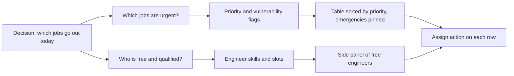

# Screens Built Around Decisions

## Start with page three

Orwell Housing, a housing association with 14,000 homes, asked for "one dashboard for everything", and Kofi, the forward deployed engineer, built it: 22 charts, a map and a table of every open repair job, sorted by the date the job was created. On a cold Monday in January, an 84-year-old tenant who lived alone reported no heating, which made the job an emergency under Orwell's own policy. It was row 61. Priya, the scheduler, worked from the top of the list and filled the day's engineer slots with older routine jobs, and the emergency sat on page three until the tenant's daughter phoned at 16:00. Every fact Priya needed was on the screen, and none of it was arranged around the decision she was making: which jobs go to which engineers today. Call this **the dashboard of everything**.

> **What you'll learn**
>
> - Start a screen from the decision it supports, not from the data you have.
> - Choose between a form, a dashboard, a table and search for each decision.
> - Answer a request for "one dashboard for everything" without refusing it.
> - Give each role its own view, enforced on the server.
> - Build screens that keyboard, screen-reader and low-vision users can operate.

## Start from the decision

Before drawing a screen, write down three things:

1. **Who decides.** A named role, such as the repairs scheduler, not "users".
2. **What they decide, and how often.** Priya assigns about 120 jobs a day to 30 engineers, every morning and again after lunch.
3. **What they need to see to decide well.** Urgency, tenant vulnerability, location, the skill the job needs and engineer availability.

Anything on the screen that does not serve those three answers competes for attention with what does. Figure 1 shows the chain from decision to screen element.

*Figure 1: From one decision to the screen. Each element on the screen traces back to a question the scheduler asks.*

The trace also tells you what to leave off. Orwell's 22 charts answered questions the scheduler never asked at 08:00.

## Four screen types, four kinds of decision

Each common screen type suits a different decision. Pick by the decision, then design the details.

| Screen | Supports | Design it so that | Orwell example |
| --- | --- | --- | --- |
| Form | Recording a decision or a fact | Every field is needed, defaults are sensible and errors appear next to the field | Logging a new repair from a phone call |
| Dashboard | Noticing that something needs attention | Each number has a threshold and a link to the items behind it | Emergency jobs not assigned within 2 hours |
| Table | Working through many items in order | The default sort matches the order of work, with filters and saved views | The scheduler's job list |
| Search | Finding one known item fast | It matches what the operator has in hand, such as an address or job reference | A tenant calling to ask about a job |

*Table 1: Four screen types and the decision each supports.*

Two rules carry most of the value:

- **A dashboard number should lead somewhere.** "7 emergencies unassigned" is useful when it is red above zero and opens the list of those 7 jobs. A chart with no threshold and no link reports, but it does not prompt anyone to act.
- **A table's default sort is a decision.** Sorting by creation date says "oldest first". Orwell's policy said "emergencies first, then by deadline". The default should follow the policy.

Search deserves the same thought. A tenant on the phone knows her address and maybe a job reference. She rarely knows the internal job ID. Match partial addresses and postcodes, and let an exact job reference jump straight to the job.

## "One dashboard for everything"

The request is common and comes from a real need: people want one place to look. Refusing it outright loses the room. Instead, ask whose decisions it should support, and list them:

- The scheduler decides assignments every morning.
- The repairs manager decides each week whether to bring in contractors.
- The director decides each quarter whether the repairs budget is on track.

Three decisions at three frequencies need three views. Offer one entry point, with each role landing on its own view and able to switch. That meets the wish for "one place" without one screen trying to serve everyone.

The switcher compares Orwell's single dashboard with two role views over the same Monday's data.

Monday 08:00. Orwell has 412 open jobs, 9 of them emergencies, and 30 engineers on shift. Compare what each screen puts first.

<button type="button" data-mode="everything" aria-pressed="false" aria-controls="everything-result">One dashboard</button>
<button type="button" data-mode="scheduler" aria-pressed="false" aria-controls="scheduler-result">Scheduler view</button>
<button type="button" data-mode="manager" aria-pressed="false" aria-controls="manager-result">Manager view</button>

<section id="everything-result" class="mode-panel" data-announcement="One dashboard selected. Emergencies are spread across pages."><h4>One dashboard</h4><ul><li>22 charts, a map and a table of 412 jobs sorted by creation date.</li><li>The 9 emergencies are spread across pages one to five.</li><li>The scheduler works from the top and fills slots with older routine jobs.</li></ul>
All the facts are present. The order of work is wrong.
</section>
<section id="scheduler-result" class="mode-panel" data-announcement="Scheduler view selected. Nine emergencies pinned at the top."><h4>Scheduler view</h4><ul><li>The 9 emergencies are pinned at the top, vulnerable tenants flagged.</li><li>Then jobs by deadline, filtered to today's areas.</li><li>A side panel shows free engineers with matching skills, and each row has an assign button.</li></ul>
The screen follows the morning decision, row by row.
</section>
<section id="manager-result" class="mode-panel" data-announcement="Manager view selected. Weekly backlog against capacity."><h4>Manager view</h4><ul><li>Backlog by trade against engineer capacity for the next two weeks.</li><li>Jobs past deadline, by area, each number linking to its list.</li><li>A threshold line: above 60 overdue jobs, consider contractors.</li></ul>
The same data, arranged for a weekly decision about capacity.
</section>

The figures are illustrative. The point is the order: each view puts first what its role decides first.

## Role-based views, enforced on the server

**Role-based views** show each role the data and actions its job needs. At Orwell, a call handler sees a tenant's open jobs and can log a new one. A scheduler can also assign engineers. Only a repairs manager can approve a contractor order over £5,000.

Hiding a button is a design choice. It is not a security control. If the server accepts an "approve contractor order" request from any logged-in user, anyone with a browser's developer tools can send it. OWASP lists broken access control as the top web application risk, and its guidance is to enforce access in trusted server-side code and to deny by default. Design the view per role, and check the same role rules on every request the server receives.

Keep the role model small. Three to five roles that match real jobs are easier to test and to explain to the customer's IT team than a role per person. Agree them with the customer early, because they often map to groups in the customer's identity system.

## Accessible to everyone who operates it

Operators include people who use a keyboard instead of a mouse, a screen reader, high magnification or colour filters. Some work on a tablet in a van. An internal tool is still a workplace, and in many countries employers and public bodies have legal duties here.

The Web Content Accessibility Guidelines (WCAG) 2.2 at level AA is the usual target. In an operator screen, the checks that catch most problems are:

- **Keyboard first.** Every action works with the keyboard, with a visible focus indicator. A scheduler assigning 120 jobs moves faster without a mouse anyway.
- **Not colour alone.** Orwell's red "emergency" row also needs a text label or icon with a name. WCAG's "use of colour" criterion covers this.
- **Labels and errors in words.** Every field has a visible label, and every error says what is wrong and how to fix it.
- **Contrast and zoom.** Text meets the contrast ratio, and the layout still works at 200% zoom.
- **Tables that read correctly.** Use real table markup with header cells, so a screen reader announces "Priority: emergency" and not a bare word.

Test with a keyboard and a screen reader before user acceptance, not after. Fixes are cheap while the screen is a draft.

## Limits of this lesson

- **Visual design is out of scope.** This lesson covers what goes on a screen and in what order, not typography or visual style.
- **Access control is taught in outline.** Where each permission check belongs on the server is in the site's [authorise every object](/learn/engineering-foundations/apis-and-backend/authorise-every-object) lesson.
- **Accessibility law varies by country.** Check the customer's obligations with their legal or accessibility lead.
- **Composite engagement.** Orwell Housing, its tenant and its figures are illustrative, not a real customer.

## Interview angle

Each answer is an outline to say in about two minutes. Open each question and try it aloud before reading.

Interview question 1. A customer asks you to build a screen for their operations team. How do you design it?

- **Answer:** Start from the decision, not the data. Find who decides, what they decide and how often, and what they need to see. Then pick the screen type: a form to record, a table to work through items, a dashboard to notice exceptions, search to find one item. Set the default sort to the order of work, link every dashboard number to its items, and sit with a user doing the real task before building more.
- **Trade-off:** Designing around one decision makes a screen narrower. A screen built around all the data serves nobody well.
- **Follow-up to expect:** "They insist on one dashboard for everything." One entry point, one view per role's decision.

Interview question 2. Call handlers, schedulers and managers all use the same repairs system, and managers approve large spend. How do you handle roles, accessibility and approval in the screens?

- **Answer:** Give each role a view built for its decisions, from a small set of roles agreed with the customer. Enforce every permission on the server, denying by default, because hidden buttons protect nothing. Show approvals as a queue for the approver, with the amount and reason up front. Target WCAG 2.2 level AA: keyboard operation, labels, contrast and never colour alone, and test with a screen reader before acceptance.
- **Trade-off:** More roles fit people's jobs more closely but multiply what must be tested.
- **Follow-up to expect:** "Someone needs two roles." Allow several roles per person, and check separation of duties so nobody approves their own request.
- **Go deeper:** [human review and approval](/learn/fde-building-in-the-estate/building-for-operators/human-review-and-approval).

## References

1. W3C, [Web Content Accessibility Guidelines (WCAG) 2.2](https://www.w3.org/TR/WCAG22/), accessed 17 November 2026. The success criteria and conformance levels, including use of colour.
2. OWASP, [A01:2021 Broken Access Control](https://owasp.org/Top10/2021/A01_2021-Broken_Access_Control/), accessed 17 November 2026. Server-side enforcement and deny by default.
3. GOV.UK, [Making your service accessible: an introduction](https://www.gov.uk/service-manual/helping-people-to-use-your-service/making-your-service-accessible-an-introduction), accessed 17 November 2026. Practical accessibility guidance for public services.
4. The site's [stakeholder and workflow maps](/learn/forward-deployed/customer-discovery/stakeholder-and-workflow-maps) lesson, for finding who decides what before you design.

## Key takeaways

- Every screen element should trace back to a question a named role asks.
- Pick form, dashboard, table or search by the decision, not by habit.
- Make a table's default sort follow the customer's order of work.
- Answer "one dashboard for everything" with one entry point and one view per role.
- Enforce roles on the server, and build to WCAG 2.2 level AA from the first draft.

## Check yourself

1. Why did Orwell's emergency job wait until 16:00 when every fact about it was on the screen?

The table sorted by creation date, so the emergency sat on page three while the scheduler worked from the top. The screen held the data but did not follow the order of the decision.

2. What makes a dashboard number useful to an operator?

A threshold that says when it needs attention, and a link to the items behind it, so the person can act on what they see.

3. Why is hiding the approve button from call handlers not enough?

Anyone can send the request to the server without the button. The server must check the role on every request and refuse by default.

