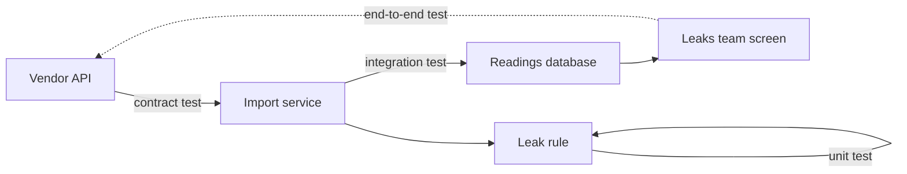

# Testing What the Customer Will Break

## Start with the green mock

Rydal Water, a water company, reads 210,000 smart meters through a vendor's platform. Sana, the forward deployed engineer, built an import that pulls daily readings and texts any home whose use jumps far above its normal pattern, and wrote 340 tests for it, all green. Most called a mock of the vendor's API written from the vendor's documentation in March. In September, the vendor rolled out a meter model that reported litres instead of cubic metres, with a new `unit` field to say so. The mock had no `unit` field, the import read 1,240 litres as 1,240 cubic metres, and overnight 3,100 households were warned of a major leak. The tests had checked the code against a picture of the vendor that had stopped being true. Call this **the green mock**.

> **What you'll learn**
>
> - Choose unit, integration, contract and end-to-end tests by what each catches.
> - Build fixtures from the customer's messy data: duplicate IDs, bad Unicode, invalid dates.
> - Keep mocks honest with contract tests and checks against the real service.
> - Test malformed rows and an unavailable service on purpose.
> - Inject failures in a safe environment before production does it for you.

## Four kinds of test, four kinds of failure

Each kind of test answers a different question. A good plan uses each where it is cheapest to catch a given failure.

| Test | Checks | Catches | Cost | Rydal example |
| --- | --- | --- | --- | --- |
| Unit | One function or class, with no network or database | Logic errors in parsing, rules and calculations | Milliseconds each | The leak rule flags use over three times the 30-day average |
| Integration | Your code with a real database, queue or file system | Wrong queries, transactions, migrations, encoding | Seconds each | Readings land in the database once, with the right meter |
| Contract | That your code and another service agree on the shape and meaning of messages | A vendor or team changing a field, type or unit | Seconds, plus coordination | The import and the vendor agree that every reading has a `unit` |
| End-to-end | A whole user journey through deployed parts | Wiring, configuration and the paths people take | Minutes each, often flaky | A reading arrives, a leak is flagged, a handler sees it on screen |

*Table 1: Four kinds of test and the failures each is cheapest at catching.*

The usual shape is many unit tests, fewer integration and contract tests, and a handful of end-to-end tests for the journeys that matter most. Martin Fowler's site describes this as the test pyramid. The shape is a guide, not a target: in integration-heavy FDE work, contract and integration tests often catch more real failures than extra unit tests do.

Figure 1 shows where each kind of test sits in Rydal's import.

*Figure 1: Rydal's import with each kind of test at the boundary it protects. Unit tests sit inside the leak rule, contract tests at the vendor edge and one end-to-end test spans the journey.*

## Fixtures from the customer's messy data

A **fixture** is fixed test data that a test runs against. Fixtures written by the team from imagination are tidy. The customer's data is not. Build fixtures from anonymised samples of real exports, and add one fixture for every kind of mess you find.

| Mess | Example at Rydal | What the test checks |
| --- | --- | --- |
| Duplicate IDs | A replaced meter reports under the old and new device with the same meter ID for a day | Readings are kept per device, and use is not counted twice |
| Bad Unicode | A Welsh address, "Pen Llŷn", arrives as "Pen LlÅ·n", and a file starts with a byte-order mark | Text is decoded as UTF-8, the marker is stripped, the address matches |
| Invalid dates | 31/02/2026, a reading at 01:30 on the night the clocks go back, and 03/04/2026 | Impossible dates are rejected, times carry an offset, the date format is fixed by the contract |
| Odd values | A negative reading, or a meter whose total drops after it rolls over | Negatives are quarantined, rollovers are handled as a rule |
| Empty and short rows | A blank line at the end of a file, a row with 4 of 7 fields | The row is quarantined with a reason, the rest of the file loads |

*Table 2: Fixtures built from messy data, one per kind of failure seen in real exports.*

Ask the customer for a sample early, under their data rules, and anonymise it before it enters the test suite. Every production incident caused by bad data becomes a new fixture. The same mess then never breaks the import twice.

## Mocks that drift from the vendor

A **mock** stands in for a real service during tests. It makes tests fast and repeatable, and it is often the only option when the vendor has no test environment. Its weakness is that it records what you believed about the vendor on the day you wrote it.

Three habits keep a mock honest:

- **Contract tests.** Write down what your code expects from the vendor, field by field, and check that both the mock and the real service meet it. In consumer-driven contract testing, as the Pact tools support, the consumer publishes its expectations and the provider's build verifies them. With an external vendor who will not run your checks, run them yourself against their sandbox.
- **Scheduled checks against the real service.** Once a day, call the vendor's sandbox or a read-only production endpoint and compare responses with the contract. Fowler's note on contract tests describes this: test doubles stay fast, and a separate, less frequent test checks they still match reality.
- **Checks in production.** Validate every response at runtime against the contract. An unknown field or unit should stop the batch and alert the team before anyone is texted. A new `unit` field is schema drift, and [schema drift and late data](/learn/fde-building-in-the-estate/customer-data-pipelines/schema-drift-and-late-data) covers how a pipeline detects and handles it.

The switcher replays Rydal's September change under each level of protection.

The vendor starts sending a new `unit` field, with litres for the new meter model. Compare when each level of protection notices.

<button type="button" data-mode="mock-only" aria-pressed="false" aria-controls="mock-only-result">Mock only</button>
<button type="button" data-mode="contract" aria-pressed="false" aria-controls="contract-result">Daily contract check</button>
<button type="button" data-mode="runtime" aria-pressed="false" aria-controls="runtime-result">Plus runtime validation</button>

<section id="mock-only-result" class="mode-panel" data-announcement="Mock only selected. 3,100 false leak texts."><h4>Mock only</h4><ul><li>All 340 tests stay green.</li><li>The import reads litres as cubic metres overnight.</li><li>3,100 households get a false leak warning.</li></ul>
Nobody notices until the call centre does.
</section>
<section id="contract-result" class="mode-panel" data-announcement="Daily contract check selected. Caught in the sandbox if the vendor ships there first."><h4>Daily contract check</h4><ul><li>The vendor's sandbox gets the change a week before production.</li><li>The daily check fails on the unknown `unit` field.</li><li>The team updates the contract, the mock and the import before release.</li></ul>
Caught early, if the vendor ships to the sandbox first.
</section>
<section id="runtime-result" class="mode-panel" data-announcement="Runtime validation selected. Batch stopped before any text is sent."><h4>Plus runtime validation</h4><ul><li>Even if the change reaches production unannounced, each response is checked.</li><li>The first reading in litres fails the contract and the batch stops.</li><li>The team is alerted. No household is texted.</li></ul>
A late import is far cheaper than 3,100 false alarms.
</section>

## Malformed rows and an unavailable service

Two failures arrive in every real integration, and both deserve tests of their own.

**Malformed rows.** One bad row should not block 200,000 good ones. Validate each row, load the valid ones and **quarantine** the rest: store them with the reason they failed, count them, and show the count to an operator who can fix or dismiss them. Set a limit too. If more than 2% of a file fails, stop and alert, because that usually means the format changed, not that the data got worse. Test both sides: a file with 3 bad rows loads with 3 in quarantine, and a file with 30% bad rows stops. The code for per-row validation and quarantine is in [data handling for real exports](/learn/fde-building-in-the-estate/working-in-customer-code/data-handling-for-real-exports).

**An unavailable service.** The vendor's API will time out, return errors and go down for maintenance. Test that the import:

- Times out each call instead of waiting for ever.
- Retries with backoff and some randomness, a limited number of times.
- Stops calling for a while after repeated failures, a circuit breaker, so it does not pile load on a struggling service.
- Resumes from where it stopped, without loading any reading twice.
- Tells the operator the truth: "Readings last updated at 02:00. Vendor unavailable since 02:15."

## Failure injection

Some failures are hard to reach with ordinary tests: a vendor that answers in 25 seconds instead of 200 milliseconds, a database that drops connections, a disk that fills up. **Failure injection** causes these on purpose, in a controlled environment, and checks the system behaves as designed.

Start small and in a test environment:

1. **Pick one failure** from the design, such as "the vendor returns 503 for ten minutes".
2. **State what should happen.** The import retries, opens the circuit breaker, alerts after 15 minutes and resumes without duplicates.
3. **Inject it** with a proxy that adds errors or delay between the import and a stub of the vendor.
4. **Compare** what happened with what should have happened, and fix the gaps.

The Principles of Chaos Engineering describe the same loop for production systems: form a hypothesis about steady state, introduce a real-world event and look for a difference. In a customer's estate, run it in their test environment first, and only touch production with the customer's written agreement.

## Limits of this lesson

- **Test tooling is not covered.** Frameworks and proxies differ by stack. The choices here apply whichever tools the customer uses.
- **Evaluating AI output is a separate subject.** Testing a model's answers needs evaluation sets, covered in the site's [evaluation pyramid](/learn/production-ai/evaluation-and-release-gates/the-evaluation-pyramid) lesson.
- **Composite engagement.** Rydal Water, its vendor and its figures are illustrative, not a real customer.

## Interview angle

Each answer is an outline to say in about two minutes. Open each question and try it aloud before reading.

Interview question 1. What is the difference between unit, integration, contract and end-to-end tests, and where do you use each?

- **Answer:** Unit tests check one piece of logic with no network, fast and many. Integration tests check your code with a real database or queue, catching wrong queries and encoding. Contract tests check two services agree on messages, catching a changed field or unit. End-to-end tests run a whole journey and catch wiring. Put each failure where it is cheapest to catch, with few end-to-end tests for the journeys that matter.
- **Trade-off:** End-to-end tests give the most confidence per test but are slow and flaky. Unit tests are fast but miss the boundaries.
- **Follow-up to expect:** "Which matters most in customer integrations?" Contract and integration tests, at the boundaries you do not control.
- **Go deeper:** [the evaluation pyramid](/learn/production-ai/evaluation-and-release-gates/the-evaluation-pyramid).

Interview question 2. All your tests pass against a mock of the vendor's API, but production breaks after the vendor changes something. How do you stop that happening again?

- **Answer:** Write the contract down, field by field, including units and formats. Check the mock and the real service against it: a daily run against the vendor's sandbox, and validation of every live response, stopping the batch on anything unknown. Subscribe to the vendor's change notices. Turn the incident into a fixture and a contract test.
- **Trade-off:** Runtime validation can stop a batch on a harmless new field. That costs a late import. Silent misreading costs customers.
- **Follow-up to expect:** "The vendor has no sandbox." Use a read-only call in production, or record real responses regularly and compare them.

Interview question 3. A daily import receives a file with some malformed rows while the vendor's API it enriches from is down. What should the system do, and how do you test it?

- **Answer:** Validate each row, load the good ones and quarantine the bad ones with reasons, stopping the whole file if more than an agreed share fails. For the API, time out each call, retry with backoff, open a circuit breaker after repeated failures and hold enrichment until it recovers, without loading anything twice. Show operators the real state. Test each with fixtures and an injected outage.
- **Trade-off:** Loading partial files keeps work moving but leaves gaps to chase. Rejecting the whole file is cleaner but stops everything for one row.
- **Follow-up to expect:** "Who fixes quarantined rows?" A named operator, from a screen with the reason shown.

## References

1. Ham Vocke on Martin Fowler's site, [The Practical Test Pyramid](https://martinfowler.com/articles/practical-test-pyramid.html), accessed 17 November 2026. Test layers, including contract tests.
2. Martin Fowler, [Contract Test](https://martinfowler.com/bliki/ContractTest.html), accessed 17 November 2026. Checking that test doubles still match the real service.
3. Pact, [Pact documentation](https://docs.pact.io/), accessed 17 November 2026. Consumer-driven contract testing.
4. Principles of Chaos Engineering, [Principles of Chaos Engineering](https://principlesofchaos.org/), accessed 17 November 2026. Hypothesis-driven failure experiments.

## Key takeaways

- Put each failure in the test type that catches it cheapest: unit, integration, contract or end-to-end.
- Build fixtures from anonymised real data, and add one for every mess production shows you.
- Keep mocks honest with written contracts, scheduled checks against the vendor and runtime validation.
- Quarantine bad rows with reasons, with a limit that stops a broken file.
- Inject failures in a test environment, against a stated expectation, before production does.

## Check yourself

1. Why were all 340 of Rydal's tests green on the night of the false alarms?

Most tests called a mock written in March. The mock had no `unit` field and always returned cubic metres, so it no longer matched the vendor.

2. Why stop a file when more than 2% of its rows fail validation?

A high failure rate usually means the format changed. Loading the rest could load misread data, so an operator should look first.

3. What does a failure-injection experiment need before you inject anything?

A stated expectation of what the system should do, so that you can compare the result with it.

