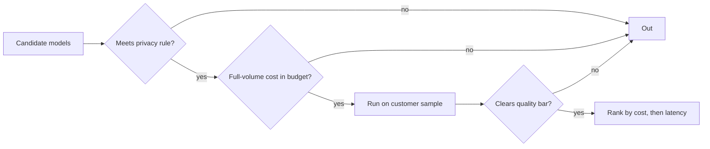
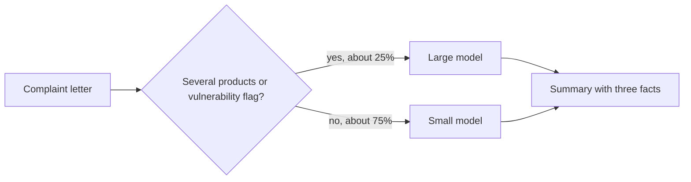

# Picking a Model for a Customer

## Start with the leaderboard pick

Arden Bank, a retail bank, receives about 120,000 written complaints a month, and regulators expect each one logged with three facts: what went wrong, what the customer asks for, and the date the bank must reply by. Tom, the forward deployed engineer, picked a model from the top of a public leaderboard and built a summariser in four weeks. In week five the bank's security team found the provider's endpoint ran outside the region Arden allows for customer data, and the work stopped. While it waited, a case handler checked 50 summaries against the letters: the model often missed the customer's request when a letter raised two problems. Call this **the leaderboard pick**: a model chosen on someone else's test, before the customer's limits were written down.

> **What you'll learn**
>
> - Write the four limits that decide a model choice: quality, latency, cost and privacy.
> - Separate hard limits that rule a model out from scores that rank the rest.
> - Compare a cheaper, weaker model with a stronger, slower one on the customer's sample.
> - Cost a workload from token counts and price per million tokens.

## The four limits

Every model choice for a customer answers four questions. Write the answer to each before you look at any model.

| Limit | Question to ask | Arden's answer |
| --- | --- | --- |
| Quality | What must the output get right, and how is that checked? | All three regulatory facts correct on at least 92% of a labelled sample |
| Latency | Does a person wait for the answer, and how long can they wait? | Summaries are written when a complaint arrives and read later, so nobody waits |
| Cost | What can the customer spend each month, and on what volume? | Up to $1,500 a month at 120,000 complaints |
| Privacy | Where may the data go, who may keep it, and may it train a model? | Processed in an approved region, not stored by the provider, never used for training |

*Table 1: The four limits, with the answers Arden's complaints lead gave in the first week.*

Two of these are **hard limits**. A model that breaks the privacy rule is out, however well it scores. A model whose cost at full volume breaks the budget is out too. The other two are **scores**: among the models that pass the hard limits, you rank by quality first and latency second.

Latency deserves a second question. Arden's summaries run in the background. A six-second response harms nobody. A feature that drafts a reply while the handler watches is different. There, the 95th percentile (p95) response time matters, because the slowest one in twenty calls is the one a handler remembers.

Figure 1 shows the order: filter on hard limits, then test, then rank.

*Figure 1: Hard limits filter the list before any testing. The survivors run on the customer's own sample, and the cheapest model that clears the bar wins.*

## Test on the customer's sample, not a leaderboard

A public benchmark measures a model on someone else's task. It tells you which models are worth trying, not which one fits. The test that decides is an **evaluation set**: a few hundred of the customer's real inputs, each with the output a domain expert accepts.

At Arden, two senior case handlers labelled 400 complaints from the last quarter. For each one they wrote the three regulatory facts. A complaint passes only if the summary gets all three right. They chose the sample to include the hard cases on purpose: letters that raise two problems, letters from customers flagged as vulnerable, and letters with no clear request.

Four habits keep the test fair:

- **Same prompt structure for every model.** Adjust only what a model's documentation requires, and record each change.
- **Score the facts, not the prose.** A fluent summary that misses the redress request fails.
- **Count tokens with each model's own counter.** Tokenisers differ. The same letter can cost a different number of tokens on each model.
- **Measure latency at the expected volume,** not from one call at a quiet hour.

Anthropic's guidance on building evaluations and OpenAI's evals guide describe the same pattern: task-specific cases, a clear grading rule and reruns after every change. [Evaluating on the customer's work](/learn/fde-building-in-the-estate/ai-delivery-in-customer-estates/evaluating-on-the-customers-work) covers how to sample and label the set, and [golden sets and sample size](/learn/production-ai/evaluation-and-release-gates/golden-sets-and-sample-size) how many cases a given confidence needs.

## A cheaper model against a stronger one

Two models passed Arden's hard limits. Call them Large and Small. Large is stronger and slower, and it costs 12 times as much per token. Small is fast and cheap.

A third design came out of reading Small's failures. Most of them were letters that named more than one product or came from customers flagged as vulnerable. A rule can spot both before any model runs. So the team tested a routed design: the rule sends those letters to Large and everything else to Small. About a quarter of Arden's complaints match the rule. Figure 2 shows the path.

*Figure 2: The routed design. A rule picks the model before any call is made. The expensive model sees only the letters that need it.*

The rule routes on the input, not on the output. Asking Small first and escalating when its answer looks wrong sounds cheaper, but it relies on spotting a bad answer, which is the hard part. The switcher compares the three designs on the same 400 complaints.

Compare three designs on Arden's 400 labelled complaints. The bar is 92% with all three facts correct, within $1,500 a month.

<button type="button" data-mode="large" aria-pressed="false" aria-controls="large-result">Large only</button>
<button type="button" data-mode="small" aria-pressed="false" aria-controls="small-result">Small only</button>
<button type="button" data-mode="routed" aria-pressed="false" aria-controls="routed-result">Routed</button>

<section id="large-result" class="mode-panel" data-announcement="Large only selected. 94% pass at $990 a month."><h4>Large only</h4><ul><li>Pass rate: 94%, 376 of 400.</li><li>p95 latency: 6.5 seconds.</li><li>Monthly cost at 120,000 complaints: $990.</li></ul>
It clears the bar and fits the budget. It pays the top price for letters a cheaper model handles.
</section>
<section id="small-result" class="mode-panel" data-announcement="Small only selected. 86% pass at about $83 a month."><h4>Small only</h4><ul><li>Pass rate: 86%, 344 of 400.</li><li>p95 latency: 1.8 seconds.</li><li>Monthly cost: about $83.</li></ul>
It fails the bar. Most of its misses are letters with several products or a vulnerability flag.
</section>
<section id="routed-result" class="mode-panel" data-announcement="Routed selected. 93% pass at about $309 a month."><h4>Routed</h4><ul><li>Pass rate: 93%, 372 of 400.</li><li>p95 latency: 6.5 seconds on the routed quarter, 1.8 seconds on the rest.</li><li>Monthly cost: about $309.</li></ul>
It clears the bar at under a third of the Large-only cost, with one rule to maintain.
</section>

The routed design wins on Arden's numbers, though not by much on quality. If the bar were 94%, Large only would be the answer, and the extra $681 a month would be the price of that last point. Put the choice to the customer in those terms.

> **Key distinction:** The cheaper model is not the cheaper design if it fails the bar. Compare designs that pass, then pick on cost.

Routing between models in production, with fallbacks and prompt discipline, is covered in [model routing and prompt discipline](/learn/production-ai/cost-and-latency/model-routing-and-prompt-discipline).

## Cost a workload from token counts

Model prices are quoted per million tokens, with input and output priced separately. Output usually costs several times more than input. To cost a workload, you need four numbers: requests a month, input tokens per request, output tokens per request and the two prices.

Arden's letters average 1,500 input tokens once the instructions are added, and the summaries average 250 output tokens. The prices below are illustrative. Check the provider's current price list before quoting a figure.

| Line | Large | Small |
| --- | --- | --- |
| Requests a month | 120,000 | 120,000 |
| Input tokens a month (× 1,500) | 180 million | 180 million |
| Output tokens a month (× 250) | 30 million | 30 million |
| Price per million, input and output | $3 and $15 | $0.25 and $1.25 |
| Input cost | 180 × $3 = $540 | 180 × $0.25 = $45 |
| Output cost | 30 × $15 = $450 | 30 × $1.25 = $37.50 |
| Monthly total | $990 | $82.50 |

*Table 2: Costing Arden's summaries from token counts. Routing a quarter of letters to Large costs 0.25 × $990 + 0.75 × $82.50, about $309.*

Then adjust the total for what the worksheet leaves out:

- **Retries and failures.** Calls that time out and run again still cost tokens.
- **Evaluation runs.** Every prompt change reruns the 400-letter set on each model in use.
- **Growth.** Ask for next year's volume, not this month's.
- **Prompt caching.** Some providers charge less for a repeated prompt prefix, such as fixed instructions. Check whether the discount applies before counting on it.

Adding 10% for retries and evaluation runs takes Large only to about $1,089 a month, still inside Arden's budget. Measure the token counts on real letters with the provider's counting tool. A guess of "about a page" can be wrong by a factor of two. After launch, judge the bill by what each completed task costs, failures included, as [AI cost per successful task](/learn/fde-deploying-in-the-estate/reliability-performance-and-cost/ai-cost-per-successful-task) shows.

## Limits of this lesson

- **Composite engagement.** Arden Bank, Tom, the 400-letter sample, the two models and every price are illustrative, not a real customer. They show the method, not real model prices or results.
- **One sample.** A quarter's letters may miss seasonal complaints, such as a fee change in January. Re-test when the input mix changes.
- **Models change.** Providers update and retire models. A result from this quarter needs rerunning when a model version changes.

## Interview angle

Each answer is an outline to say in about two minutes. Open the question and try it aloud before reading.

Interview question 1. A customer asks which model to use for their task. How do you decide?

- **Answer:** Write down four limits first: the quality bar on their own sample, whether anyone waits for the answer, the monthly budget at full volume, and where data may go. Rule out models that break privacy or budget. Run the rest on a few hundred labelled examples from the customer, with the same prompt structure, and pick the cheapest that clears the bar.
- **Trade-off:** The strongest model on a public benchmark may not be the best on the customer's inputs, and it costs more on every call for the life of the system.
- **Follow-up to expect:** "Two models tie on quality." Pick on p95 latency where someone waits, then on how easy it is to switch provider later.

## References

1. Anthropic, [Create strong empirical evaluations](https://docs.claude.com/en/docs/test-and-evaluate/develop-tests), accessed 17 November 2026. Task-specific evaluation sets and grading rules.
2. OpenAI, [Evals guide](https://platform.openai.com/docs/guides/evals), accessed 17 November 2026. Running candidate prompts and models against a labelled dataset.
3. Anthropic, [Token counting](https://docs.claude.com/en/docs/build-with-claude/token-counting), accessed 17 November 2026. Counting tokens for a request before sending it.
4. The site's [rules, classical ML or an LLM](/learn/fde-building-in-the-estate/choosing-the-ai-approach/rules-ml-or-an-llm) lesson, for measuring baselines on one labelled sample.

## Key takeaways

- Write the four limits before looking at models: quality, latency, cost and privacy.
- Privacy and full-volume cost rule models out. Quality and latency rank the rest.
- Test on the customer's labelled sample, and include the hard cases on purpose.
- Route on the input with a rule. The expensive model sees only the inputs that need it.
- Cost a workload as requests times tokens times price, input and output separately, then add for retries, evaluation runs and growth.

## Check yourself

1. Why does p95 latency not decide Arden's summary model, and when would it?

Summaries are written when a complaint arrives and read later. Nobody waits for them. It would decide a feature where a handler watches the answer appear, such as drafting a reply.

2. Why route on the letter before the call instead of escalating Small's answers that look wrong?

Escalating on the output depends on detecting a bad answer, which is the hard problem. A rule on the input, such as several products named, is cheap, testable and decided before any tokens are spent.

3. Arden's volume doubles next year. What happens to the Large-only cost, and does it still fit the budget?

Token counts double. The cost doubles to about $1,980 a month, or about $2,178 with 10% added. That breaks the $1,500 budget, while the routed design at about $619 still fits.

