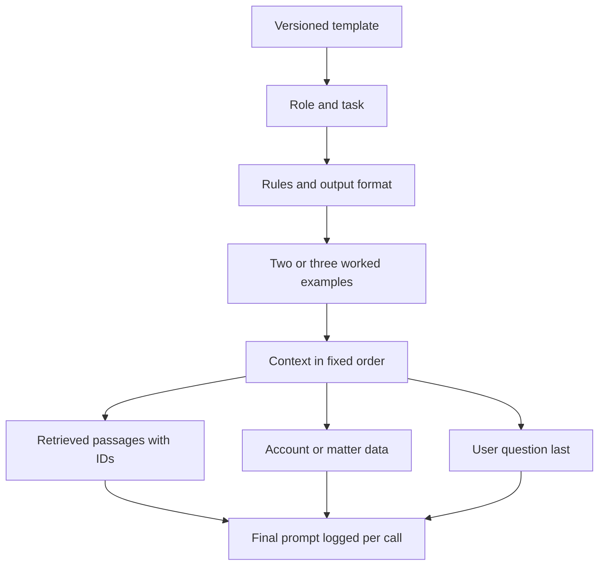
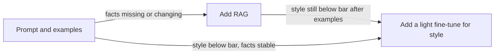

# Prompting, RAG or Fine-tuning

## Start with facts baked into weights

Oakham Legal, a fictional law firm, wanted a tool that answers its associates' questions about the firm's employment practice notes. Partners cared about two things: the answer must reflect the current notes, and it must read like the firm's own advice.

A contractor fine-tuned a model on 3,000 past advice notes. The partners liked the tone at once. In January, the firm revised its guidance on notice periods. The tool kept giving the old guidance, with confidence and in perfect house style. It cited nothing. Associates could not check it. Updating it meant collecting new examples and retraining.

The contractor had used training to supply facts that change. Call this **facts baked into weights**: knowledge put into the model's parameters where nobody can update or check it between training runs.

> **What you'll learn**
>
> - Classify failures by cause before choosing a technique.
> - Build a prompt as a versioned template with an ordered context.
> - Name the evidence that justifies retrieval-augmented generation (RAG) and fine-tuning.
> - Combine techniques when a task needs both current facts and a consistent style.

## Read the failures before choosing

Each technique fixes a different cause of failure. So the first step is a small evaluation set, about 100 to 200 real questions with accepted answers, and an honest look at why the current attempt fails on each one.

| What you see | Likely cause | Technique that addresses it |
| --- | --- | --- |
| Ignores a rule, wrong format, wrong length | Unclear or missing instructions | Better prompting: clear rules, examples, an output format |
| Wrong or out-of-date facts, or facts the model never saw | Knowledge the model lacks or that changes | RAG: retrieve the source and put it in the prompt |
| Right facts, wrong tone or structure, despite examples | A style or narrow skill that prompting cannot hold | Fine-tuning on clean examples |
| Right facts in the prompt, wrong conclusion | The task needs more reasoning | A stronger model, or the task broken into steps |

*Table 1: Failure causes and the technique that addresses each. Most failure sets mix several causes. Count them.*

At Oakham, the team relabelled 200 failed answers. Most were out-of-date facts. A handful were style. Count by cause, and fix the largest group first.

## Prompting first, as a template

Prompting is the cheapest technique to change and test. It comes first. In a customer system, treat the prompt as a **template** under version control, filled by code in a fixed order. Figure 1 shows the parts.

*Figure 1: A prompt assembled from a versioned template. The fixed parts come first, the variable context follows in a set order, and the exact final prompt is logged.*

Four rules keep the template reliable:

- **Fix the order.** The same inputs always produce the same prompt. A test result means something.
- **Cap each part.** Give retrieved passages and history a token budget each, and say what happens when they overflow.
- **Label the sources.** Every passage carries an ID. An answer can cite it and you can trace it.
- **Log the final prompt.** When an answer changes, diff the logged prompts before guessing.

Each edit to the template reruns the evaluation set. The site's [deterministic context assembly](/learn/production-ai/context-engineering/deterministic-context-assembly) lesson covers the assembly in depth, and the [prompt engineering patterns](/learn/prompt-and-context-engineering/prompt-engineering-patterns/prompt-engineering-patterns-overview) module covers the instructions themselves.

## When RAG earns its place

**Retrieval-augmented generation** searches the customer's documents for passages relevant to the question and puts them in the prompt. The model answers from the passages instead of from memory. The original RAG paper framed this as pairing a model with an external, updatable source of knowledge.

Add RAG when the evidence shows:

- **Missing or private facts.** The answers need documents the model never saw, such as Oakham's practice notes.
- **Changing facts.** The source changes more often than you could retrain, and the answer must follow it the same day.
- **A need to check.** Users must see the source behind each claim.

RAG brings its own failures: the search misses the right passage, returns an out-of-date copy, or shows a user a document they may not open. Evaluate retrieval separately from the answer. You know which half failed.

## When fine-tuning earns its place

**Fine-tuning** trains a model further on examples of the input and output you want. It changes how the model behaves, not what the customer's documents say today.

The evidence that justifies it:

- **Prompting has plateaued.** Clear rules and examples in the prompt still leave style or format failures above the bar.
- **The examples exist.** Hundreds to thousands of clean, reviewed pairs, not raw history full of exceptions.
- **The task is stable.** The style or skill will not change next quarter.
- **Volume pays for it.** A tuned model can need shorter prompts, which matters at high volume.

The costs are a training pipeline, an evaluation run for every retrain, and knowledge frozen at training time. The site's [when fine-tuning earns its cost](/learn/production-ai/model-adaptation-and-serving/when-fine-tuning-earns-its-cost) lesson is the deep dive.

## Combining them

The techniques stack. Figure 2 shows the order in which evidence moves you up.

*Figure 2: Start with the prompt. Retrieval fixes facts. Fine-tuning is for style or skill that the prompt and its examples cannot hold.*

Oakham's team tested three designs on 200 questions written by associates. The bar was 90% correct on current guidance and 85% on the partners' style rubric.

Compare three designs on Oakham's 200 test questions. The bar is 90% correct on current guidance and 85% on style.

<button type="button" data-mode="tuned" aria-pressed="false" aria-controls="tuned-result">Fine-tuned only</button>
<button type="button" data-mode="rag" aria-pressed="false" aria-controls="rag-result">RAG, plain prompt</button>
<button type="button" data-mode="combined" aria-pressed="false" aria-controls="combined-result">RAG and style examples</button>

<section id="tuned-result" class="mode-panel" data-announcement="Fine-tuned only selected. 71% correct, 92% style."><h4>Fine-tuned only</h4><ul><li>Correct on current guidance: 71%, 142 of 200.</li><li>Style: 92%.</li><li>No citations, so associates cannot check an answer.</li></ul>
It fails on facts. Every guidance change needs a retrain.
</section>
<section id="rag-result" class="mode-panel" data-announcement="RAG with a plain prompt selected. 90% correct, 64% style."><h4>RAG, plain prompt</h4><ul><li>Correct: 90%, 180 of 200.</li><li>Style: 64%.</li><li>Every answer cites the practice note it used.</li></ul>
It meets the facts bar and fails on style.
</section>
<section id="combined-result" class="mode-panel" data-announcement="RAG with style examples selected. 91% correct, 88% style."><h4>RAG and style examples</h4><ul><li>Correct: 91%, 182 of 200.</li><li>Style: 88%, with three short partner-approved answers in the prompt.</li><li>Cited, and updated the day a note changes.</li></ul>
It meets both bars with no training run.
</section>

Examples in the prompt were enough for Oakham. If style had stayed below the bar, the next step would have been a light fine-tune for style only, with retrieval still supplying the facts. Facts stay in documents you can update. Style can live in weights, because it changes slowly.

> **Key distinction:** Retrieval changes what the model knows for this call. Fine-tuning changes how it behaves on every call. Use each for the job it does.

## Limits of this lesson

- **Fictional figures.** Oakham Legal and every result in the switcher are illustrative. They show the method, not expected scores.
- **Rubrics need care.** A style score depends on who grades and how. Agree the rubric with the partners and check that two graders agree.
- **Not legal advice.** The practice-note example is a teaching device, not guidance on any law.

## Interview angle

Each answer is an outline to say in about two minutes. Open each question and try it aloud before reading.

Interview question 1. How do you decide between better prompting, RAG and fine-tuning for a customer?

- **Answer:** Build a small evaluation set and classify the failures by cause. Instruction and format failures go to prompting first. Missing, private or changing facts go to RAG. Fine-tune only when style or a narrow skill stays below the bar after clear instructions and examples, and when you have hundreds of clean examples for a stable task.
- **Trade-off:** Fine-tuning freezes knowledge at training time and adds a retraining cycle. RAG keeps facts current but adds retrieval failures to evaluate.
- **Follow-up to expect:** "They already have 10,000 past examples." Check how clean they are, and whether the failures are about style at all.
- **Go deeper:** [When fine-tuning earns its cost](/learn/production-ai/model-adaptation-and-serving/when-fine-tuning-earns-its-cost).

Interview question 2. How do you build the prompt and context for a customer task so it stays reliable over time?

- **Answer:** Keep a versioned template with fixed parts first: role, task, rules, output format and a few examples. Fill the variable parts in code, in a fixed order, from named sources: retrieved passages with IDs, account data, then the user's question. Give each part a token cap, and log the final prompt for every call.
- **Trade-off:** A strict template is easy to test and review but slower to change, because every edit reruns the evaluation set.
- **Follow-up to expect:** "Answers changed after a small edit." Diff the logged prompts, then rerun the evaluation set on both versions.
- **Go deeper:** [Deterministic context assembly](/learn/production-ai/context-engineering/deterministic-context-assembly).

## References

1. Anthropic, [Prompt engineering overview](https://docs.claude.com/en/docs/build-with-claude/prompt-engineering/overview), accessed 17 November 2026. Clear instructions, examples and testing against success criteria.
2. Patrick Lewis and others, [Retrieval-Augmented Generation for Knowledge-Intensive NLP Tasks](https://arxiv.org/abs/2005.11401), arXiv, accessed 17 November 2026. A model paired with an updatable external source of knowledge.
3. OpenAI, [Fine-tuning guide](https://platform.openai.com/docs/guides/fine-tuning), accessed 17 November 2026. When to fine-tune, and preparing example pairs.
4. The site's [when fine-tuning earns its cost](/learn/production-ai/model-adaptation-and-serving/when-fine-tuning-earns-its-cost) lesson.

## Key takeaways

- Classify failures by cause before choosing a technique, and fix the largest group first.
- Treat the prompt as a versioned template filled in a fixed order, with capped parts, labelled sources and a log.
- Use RAG for facts that are missing, private or changing, and evaluate retrieval separately.
- Fine-tune only for style or skill that prompting cannot hold, with clean examples and a stable task.
- Keep facts in documents and style in prompts or weights, and combine them when a task needs both.

## Check yourself

1. Why did the fine-tuned tool keep giving Oakham's old guidance?

The guidance was learned into the model's weights at training time. Changing it needs new examples and a retrain, and the tool cited nothing. Nobody could see the answer was out of date.

2. A model ignores the required output format on 30% of answers. Which technique comes first?

Prompting: a clear format rule, an example and, where the provider supports it, a structured output setting. Fine-tuning is for failures that remain after that.

3. In the combined design, why do the facts come from retrieval while style comes from examples?

Facts change and must be checked. They belong in documents that can be updated and cited. Style changes slowly. Examples in the prompt, or a light fine-tune, can hold it.

