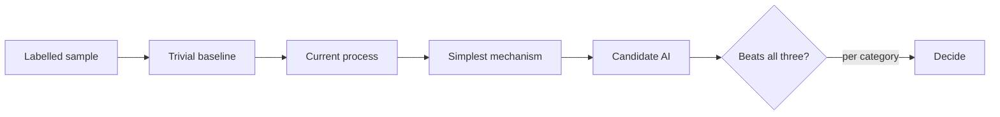
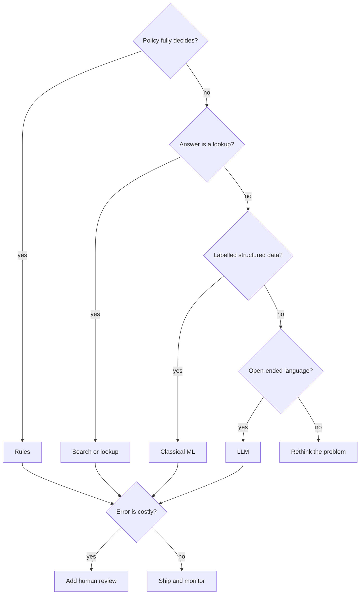
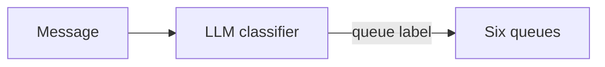
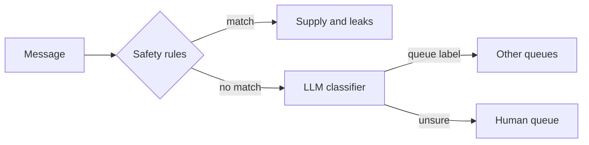

# Rules, Classical ML or an LLM

## Start with the inbox nobody measured

Brookmere Water, a fictional regional utility, asks for "AI to sort the customer inbox". About 9,000 messages arrive each month. Agents read each one and move it to one of six queues: billing, meter readings, payment plans, moving home, complaints, and supply and leaks.

A previous vendor shipped an LLM classifier in two weeks. It looked accurate in the demo. Three months later a burst-main report sat in the billing queue for a day, and nobody could say whether the old process would have caught it. Nobody had measured the old process.

That failure has a name worth reusing: **AI before baseline**. A model arrived before anyone knew what it had to beat.

> **What you'll learn**
>
> - Define rules, classical machine learning and LLMs by what each needs and how each fails.
> - Build the three baselines every AI proposal must beat.
> - Split one customer request across several mechanisms.
> - Recognise when AI is the wrong tool and say so with evidence.

## Three families of mechanism

A **rule** is logic a person wrote down: if the message mentions "no water", send it to supply and leaks. **Classical machine learning (ML)** learns a mapping from labelled examples, usually over structured features such as account age or past arrears. A **large language model (LLM)** reads open text and produces text, and it can follow a written instruction without task-specific training.

Table 1 compares them on the questions a customer will ask you.

| Question | Rules | Classical ML | LLM |
| --- | --- | --- | --- |
| What does it need first? | A policy someone can state | Hundreds to thousands of labelled rows | A clear instruction and test examples |
| How does it fail? | Misses wording nobody anticipated | Drifts when the data changes | Plausible but wrong output, varies by run |
| Can you explain a decision? | Yes, line by line | Partly, through features | Only through its stated reasons, which may not match its computation |
| How does a change ship? | Edit and test the rule | Relabel and retrain | Edit the prompt and rerun the evaluation set |
| Cost per decision | Near zero | Near zero once trained | Tokens on every call |

*Table 1: The three mechanisms compared on what they need, how they fail and what they cost.*

The table shows no winner. Each column is the right answer to a different kind of decision, and the next step is finding out which kind Brookmere has.

## Build the baseline before the model

A **baseline** is a measured result that a new mechanism must beat on the same data. Google's Rules of Machine Learning opens with the same advice: launching with a heuristic first is normal, and the heuristic often gets you a large share of the benefit.

You need three baselines, measured on one labelled sample:

- **Trivial**: the result of doing almost nothing, such as sending every message to the largest queue. scikit-learn ships this as a "dummy" estimator for the same purpose.
- **Current process**: what people achieve today, from records the customer already keeps.
- **Simplest mechanism**: the cheapest automated approach that could work, often the rules the customer already runs.

Figure 1 shows the order of work.

*Figure 1: Measure three baselines on one sample before testing a candidate model. Compare per category, not only overall.*

At Brookmere, two senior agents labelled 600 messages from the last quarter. The team lead settled their 31 disagreements. Supply and leaks made up 24 of the 600, or 4%. Table 2 holds the results.

| Mechanism | Overall accuracy | Supply and leaks found | Who pays |
| --- | --- | --- | --- |
| Everything to billing (trivial) | 41% | 0 of 24 | Nobody, and every leak is missed |
| Agents today (from the reassignment log) | 91% | Not recorded | About 100 agent hours a month |
| Existing keyword rules | 78% | 22 of 24 | Nothing new |
| LLM classifier, pilot prompt | 90% | 21 of 24 | About $22 a month in tokens |

*Table 2: Illustrative baselines on Brookmere's 600-message sample. Agent hours assume 40 seconds of triage per message.*

Two findings stand out. The pilot LLM is slightly worse than the agents overall and worse than the rules on leaks. And the customer had never measured how often agents catch leaks, the one category with a safety consequence.

The second finding is a failure mode of its own: the **averaged-away category**. An overall accuracy of 90% says nothing about 24 messages that matter more than the other 576 put together.

> **Pitfall:** A single accuracy number hides the rare category with the worst consequences. Report recall for that category on its own line, every time.

## Split the request by decision type

"Sort the inbox" contains several decisions, and each belongs to a different mechanism. Figure 2 is a decision ladder you can run with a customer.

*Figure 2: The decision ladder. Take the first rung that fits each decision, then add review where an error is expensive.*

The walkthrough applies the ladder to Brookmere's request.

Follow Brookmere's request through the ladder. Each stage shows the decision, the evidence and what changes.

<button type="button" data-step="0" aria-pressed="false" aria-controls="ladder-step-0">1. Request</button><button type="button" data-step="1" aria-pressed="false" aria-controls="ladder-step-1">2. Measure</button><button type="button" data-step="2" aria-pressed="false" aria-controls="ladder-step-2">3. Split</button><button type="button" data-step="3" aria-pressed="false" aria-controls="ladder-step-3">4. Set the bar</button><button type="button" data-step="4" aria-pressed="false" aria-controls="ladder-step-4">5. Route doubt</button>

<section id="ladder-step-0" class="step-panel" aria-labelledby="ladder-heading-0"><h4 id="ladder-heading-0">1. Hear the request as a set of decisions</h4><dl><dt>Input</dt><dd>"AI to sort the inbox."</dd><dt>Decision</dt><dd>List what sorting means: pick a queue, spot a safety issue, find the account.</dd><dt>What changes</dt><dd>One request becomes three decisions with different stakes.</dd></dl></section><section id="ladder-step-1" class="step-panel" aria-labelledby="ladder-heading-1"><h4 id="ladder-heading-1">2. Measure what happens today</h4><dl><dt>Input</dt><dd>600 labelled messages and the reassignment log.</dd><dt>Decision</dt><dd>Record the trivial, current and rules baselines.</dd><dt>What changes</dt><dd>The bar is now 91% overall and 22 of 24 leaks, the best of today's numbers.</dd></dl></section><section id="ladder-step-2" class="step-panel" aria-labelledby="ladder-heading-2"><h4 id="ladder-heading-2">3. Give each decision its rung</h4><dl><dt>Input</dt><dd>The three decisions.</dd><dt>Decision</dt><dd>Safety keywords and account flags go to rules. The account match is a lookup in the billing system. The queue for free text goes to an LLM.</dd><dt>What changes</dt><dd>The LLM handles only the decision rules cannot express.</dd></dl></section><section id="ladder-step-3" class="step-panel" aria-labelledby="ladder-heading-3"><h4 id="ladder-heading-3">4. Agree the bar with the customer</h4><dl><dt>Input</dt><dd>Table 2.</dd><dt>Decision</dt><dd>Ship only if leaks found reach 23 of 24 and overall accuracy matches the agents.</dd><dt>What changes</dt><dd>The pilot has a pass condition the operations manager signed.</dd></dl></section><section id="ladder-step-4" class="step-panel" aria-labelledby="ladder-heading-4"><h4 id="ladder-heading-4">5. Send doubt to people</h4><dl><dt>Input</dt><dd>Messages the LLM marks as unsure.</dd><dt>Decision</dt><dd>Route them to a short human queue instead of guessing.</dd><dt>What changes</dt><dd>Agents triage a small share of mail instead of all of it.</dd></dl></section>

<button type="button" data-walk="previous">Previous</button>

<button type="button" data-walk="next">Next step</button>

The stepper is a scripted illustration. Its numbers come from Table 2 and are illustrative.

## Compare one model against rules plus a model

Brookmere's team proposed two designs. Both read the same 600 messages.

### Approach A: one LLM for everything

Every message goes to the LLM, which returns one of six queues. Figure 3 shows the path.

*Figure 3: Approach A. One model reads every message and picks the queue, including supply and leaks.*

The design is simple to build and explain. Leak detection now depends on the prompt, and a prompt change made for billing can quietly change leak recall.

### Approach B: rules first, then the LLM

Safety rules read every message first. A rule match goes straight to supply and leaks. Everything else goes to the LLM, which may also answer "unsure". Figure 4 shows the path.

*Figure 4: Approach B. Deterministic rules own the safety decision. The LLM sorts the rest and can decline.*

The switcher shows what each design did with the 24 leak messages and the full sample.

Compare the same 600 messages under each design.

<button type="button" data-mode="llm-only" aria-pressed="false" aria-controls="llm-only-result">One LLM</button>
<button type="button" data-mode="rules-first" aria-pressed="false" aria-controls="rules-first-result">Rules first</button>

<section id="llm-only-result" class="mode-panel" data-announcement="One LLM selected. 21 of 24 leaks found."><h4>One LLM result</h4><ul><li>Leaks found: 21 of 24.</li><li>Overall accuracy: 90%.</li><li>A missed leak can only be explained by the model's stated reason.</li></ul>
It fails the agreed bar on leaks.
</section>
<section id="rules-first-result" class="mode-panel" data-announcement="Rules first selected. 23 of 24 leaks found."><h4>Rules-first result</h4><ul><li>Leaks found: 23 of 24. The rules catch 22, and the LLM catches one phrased as "the tap is only dribbling".</li><li>Overall accuracy: 91%, with 5% of messages marked unsure and sent to agents.</li><li>Every leak routing decision can be traced to a rule or a logged model call.</li></ul>
It meets the agreed bar.
</section>

Approach B wins on the decision that carries risk, and token cost does not separate them. At an illustrative $3 per million input tokens and $15 per million output tokens, 700 input and 20 output tokens per message cost about $0.0024, or about $22 for 9,000 messages. Check the provider's current price list before quoting a figure.

> **Key distinction:** Cost per call rarely decides the mechanism at this volume. What decides it is the recall on the costly category and whether the customer can explain a wrong decision.

## When AI is the wrong tool

Some requests should end with no model at all. Say so early, with evidence from the baselines.

- **Policy decides it**: a written rule fully determines the answer, such as a refund cap. Encode the rule.
- **It is a lookup**: the answer sits in a system of record. Search it or query it.
- **The process is the problem**: perfect routing does not shorten a three-day backlog caused by understaffed queues.
- **The volume is tiny**: ten messages a day fit a shared mailbox rule and a person.
- **No error can be explained or reviewed**: a regulated decision with no review step needs rules a person can audit.

At Brookmere, the account lookup in step 3 needed no AI at all. A customer who hears that from you early trusts your later recommendation for the LLM.

## Limits of this lesson

- **Fictional data.** Brookmere, its 600-message sample and every figure in Table 2 and the switcher are illustrative. They show the method, not expected results for any real inbox.
- **One sample.** A single quarter can miss seasonal mail, such as winter burst pipes. Re-measure after a season changes.
- **Agent baseline.** The reassignment log undercounts errors that agents never corrected.

## Interview angle

Each answer below is an outline to say in about two minutes. Open each question and try it aloud before reading.

Interview question 1. A customer asks for "AI" to sort their incoming work. How do you choose between rules, a trained model and an LLM?

- **Answer:** Measure three baselines on one labelled sample first. Then ask, per decision, whether a written policy decides it (rules), whether stable labelled history exists (a trained model) or whether it needs open text understood (an LLM).
- **Trade-off:** Rules are cheap and auditable but brittle. A trained model needs labels and retraining. An LLM handles new wording but costs more per call and needs an evaluation set.
- **Follow-up to expect:** "What if there is no labelled data?" Label a few hundred examples by hand, and say how long that takes.

Interview question 2. Keyword rules already route 80% of a customer's tickets correctly. The sponsor still wants an LLM. What do you do?

- **Answer:** Find where the other 20% fail and what those errors cost. If the failures cluster in one costly category, add a model only for that slice behind the rules. If they spread evenly and cost little, tune the rules.
- **Trade-off:** Adding a model satisfies the sponsor but adds a dependency, a cost line and an evaluation burden for a small gain.
- **Follow-up to expect:** "The sponsor insists." Show both designs on the same sample, with recall on the costly category, and let the numbers decide.

Interview question 3. Walk me through splitting one workflow across rules, a trained model and an LLM.

- **Answer:** Use an illustrative insurance claims intake. Rules check policy validity and coverage limits. A trained model scores fraud risk from years of labelled claims. An LLM reads the free-text incident description and extracts the fields an adjuster needs, with a way to say "unsure".
- **Trade-off:** Three mechanisms mean three things to monitor. Each one is the cheapest that meets its own decision's bar.
- **Follow-up to expect:** "Which part fails first in production?" The LLM extraction, on unusual descriptions. Route its low-confidence output to a person.

## References

1. Martin Zinkevich, [Rules of Machine Learning](https://developers.google.com/machine-learning/guides/rules-of-ml), Google for Developers, accessed 17 November 2026. Rule 1 on launching with heuristics before ML.
2. scikit-learn, [Dummy estimators](https://scikit-learn.org/stable/modules/model_evaluation.html#dummy-estimators), accessed 17 November 2026. Trivial baselines for classifiers.
3. Anthropic, [Create strong empirical evaluations](https://docs.claude.com/en/docs/test-and-evaluate/develop-tests), accessed 17 November 2026. Task-specific evaluation sets and grading.
4. OpenAI, [Evals guide](https://platform.openai.com/docs/guides/evals), accessed 17 November 2026. Running a prompt against a labelled dataset.

## Key takeaways

- Measure the trivial, current and simplest-mechanism baselines on one labelled sample before testing a model.
- Report the costly category on its own line. Overall accuracy hides it.
- Split a request into decisions and give each the first ladder rung that fits.
- Let rules own decisions a policy defines, and let the LLM handle open text with a way to decline.
- Say when AI is the wrong tool, and show the baseline that proves it.

## Check yourself

1. A pilot LLM scores 94% overall against the agents' 91%. Why is that not enough to ship it at Brookmere?

The overall figure can hide the supply-and-leak category. The agreed bar also requires leak recall of 23 of 24 on the same sample, measured on its own line.

2. The customer has no record of how often agents misroute mail. How do you build a current-process baseline?

Use records they already keep, such as the reassignment log, and label a sample by hand. State what the log misses, such as errors nobody corrected.

3. Which part of Brookmere's request needed no AI, and why does saying so help?

Matching a message to its account is a lookup in the billing system. Naming it early shows the customer you choose mechanisms on evidence, which makes the later LLM recommendation easier to accept.

