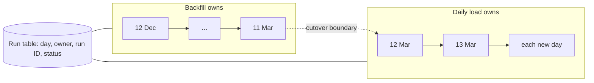

# Backfills While Live

## Start with the day that counted twice

Kilbride Energy, the fictional supplier from the first lesson, moved its meter files to a new storage location. For 90 days the provider kept writing to the old one. The daily batch, reading the new location, loaded nothing for those days and raised no alarm.

When the gap was found, the files were safe in the old location. An engineer wrote a backfill job: read every file from the start of the gap to the latest one, and insert the readings. He started it on a Tuesday afternoon.

Three things went wrong. The job ran into Wednesday's 06:00 daily load, and both read Tuesday's file, so Tuesday counted twice. The backfill took most of the warehouse's capacity, so the daily load finished five hours late and the billing assistant showed stale data all morning. And for three of the 90 days the provider had later sent corrected files, which the backfill ignored in favour of the originals.

The backfill and the daily load wrote to the same tables with no agreed boundary. Call this **the backfill that fought the daily load**.

> **What you'll learn**
>
> - Fix the boundary between the backfill and the live load before either runs.
> - Write each day so it can be rerun safely, without overwriting newer data.
> - Keep the live load first in line for capacity and the source.
> - Validate each day against the source, and record lineage people can check.

## Draw the boundary first

A **backfill** loads historical data that the normal pipeline missed or never had. Running one while the daily load continues is safe only if each day has exactly one owner.

Pick a **cutover date** and write it down. Kilbride chose 12 March. The daily load owns 12 March and every day after it. The backfill owns the 90 days before it, 12 December to 11 March. Neither touches the other's days. They can never write the same partition.

Figure 1 shows the split.

*Figure 1: One owner per day. A run table records which job owns each day and whether it is done.*

Count the days. 12 December to 11 March is 20 days in December, 31 in January, 28 in February and 11 in March: 90 in a non-leap year. Ending on 10 March would have left a one-day gap. An off-by-one error at the boundary doubles or skips a day. Write both ends down and check the count.

A **run table** with one row per day, its owner, its last run ID and its status makes the boundary visible. Either job refuses to write a day it does not own.

## Write so any day can be rerun

Backfills fail halfway. Each unit of work, here one day, must be safe to run again.

- **Replace whole partitions.** Store readings partitioned by reading date. Load a day into a staging table, then swap it into place in one step. A rerun replaces the day. It never adds to it.
- **Keep the newest version.** The provider resends corrected files with a higher version number. When two files cover the same meter and half-hour, keep the reading from the highest version. Never let an older original overwrite a correction.
- **Work in small units.** One day at a time means a failure costs one day's rerun, not the whole job.

These rules make the backfill **idempotent**: running it twice gives the same result as running it once. The mechanics of idempotent writes and checkpoints are taught in [durability and idempotency](/learn/production-ai/agentic-workflow-platforms/durability-and-idempotency).

## Protect the live load

The daily load serves users today. The backfill serves history. When they compete, the daily load wins.

- **Separate capacity.** Run the backfill on its own compute, or cap its concurrency so the daily load always has room.
- **Keep out of the daily window.** Kilbride's daily load runs from 06:00 to about 07:30. The backfill runs from 20:00 to 05:00 and stops cleanly at the end of a day's unit.
- **Respect the source.** Here the files were already in storage. If the backfill reads from a customer's database or API, throttle it, use a read replica, and agree the hours with its owner.

The arithmetic sets expectations. 90 days at 19.2 million readings a day is about 1.73 billion rows. At four days an hour, a nine-hour night loads 36 days, so the backfill needs three nights: 36, 36 and 18 days. Tell the customer it will finish on the third morning, not "soon".

## Validate, then publish

The walkthrough follows one backfilled day from file to the billing view.

One day in Kilbride's backfill, 4 January, from the old storage location to the billing assistant.

<button type="button" data-step="0" aria-pressed="false" aria-controls="bf-step-0">1. Claim</button><button type="button" data-step="1" aria-pressed="false" aria-controls="bf-step-1">2. Stage</button><button type="button" data-step="2" aria-pressed="false" aria-controls="bf-step-2">3. Reconcile</button><button type="button" data-step="3" aria-pressed="false" aria-controls="bf-step-3">4. Swap</button><button type="button" data-step="4" aria-pressed="false" aria-controls="bf-step-4">5. Record</button>

<section id="bf-step-0" class="step-panel" aria-labelledby="bf-heading-0"><h4 id="bf-heading-0">1. Claim the day</h4><dl><dt>Action</dt><dd>Check the run table: 4 January is owned by the backfill and not yet done. Mark it running with a new run ID.</dd><dt>Guards against</dt><dd>Two jobs writing the same day.</dd></dl></section><section id="bf-step-1" class="step-panel" aria-labelledby="bf-heading-1"><h4 id="bf-heading-1">2. Load into staging</h4><dl><dt>Action</dt><dd>Read the original file and any corrections for 4 January. Keep the highest version per meter and half-hour.</dd><dt>Guards against</dt><dd>An old original replacing a correction.</dd></dl></section><section id="bf-step-2" class="step-panel" aria-labelledby="bf-heading-2"><h4 id="bf-heading-2">3. Reconcile against the source</h4><dl><dt>Action</dt><dd>Compare row counts and a checksum with the files. Expect about 19.2 million rows, 48 per meter. Flag meters with fewer.</dd><dt>Guards against</dt><dd>A partial or corrupt load reaching users.</dd></dl></section><section id="bf-step-3" class="step-panel" aria-labelledby="bf-heading-3"><h4 id="bf-heading-3">4. Swap the partition</h4><dl><dt>Action</dt><dd>Replace the 4 January partition with the staged one in one step.</dd><dt>Guards against</dt><dd>Users seeing half a day, and duplicates on a rerun.</dd></dl></section><section id="bf-step-4" class="step-panel" aria-labelledby="bf-heading-4"><h4 id="bf-heading-4">5. Record lineage and mark done</h4><dl><dt>Action</dt><dd>Write the run ID, source files, their checksums, code version and "backfill" against the day. Mark it done.</dd><dt>Guards against</dt><dd>Nobody being able to say where a number came from.</dd></dl></section>

<button type="button" data-walk="previous">Previous</button>

<button type="button" data-walk="next">Next step</button>

The walkthrough is a scripted illustration. Reconciliation as a standing check, not only during a backfill, is taught in the [distributed systems essentials](/learn/engineering-foundations/distributed-systems-essentials) module.

## Lineage so people trust the numbers

After a gap, people doubt the data. Billing agents at Kilbride had told customers "we have no readings for you" for three months. They needed to know which figures were new, where they came from and whether they matched the source.

**Lineage** records where each piece of data came from and what produced it. For a pipeline, record per partition:

- **Source.** The file names or query, and a checksum of each input.
- **Process.** The job, its code version and its run ID.
- **Time and kind.** When it loaded, and whether it came from the daily load or a backfill.
- **Checks.** The reconciliation result: rows expected, rows loaded, meters flagged.

With that in place, the billing assistant could say "readings for 4 January were loaded on 14 March from the provider's file, version 2". A billing agent can repeat that to a customer. An auditor can trace it. Open standards such as OpenLineage define a common shape for these records that the customer's other tools can read.

## Limits of this lesson

- **Partitions by event date assume late data is handled.** If readings for a day keep arriving, combine this with the open-period rules in [schema drift and late data](/learn/fde-building-in-the-estate/customer-data-pipelines/schema-drift-and-late-data).
- **Some sources cannot be re-read.** If the history exists only in a system that limits extracts, the backfill may take weeks. Measure the rate before promising a date.
- **Fictional data.** Kilbride Energy and its figures are illustrative.

## Interview angle

Each answer is an outline to say in about two minutes. Open the question and try it aloud before reading.

Interview question 1. You must fill 90 missing days while the daily load keeps running. How do you do it without double counting or slowing the live data?

- **Answer:** Fix a cutover date: the daily load owns it and everything after, the backfill owns the 90 days before, recorded in a run table both jobs check. Partition by date and backfill one day at a time into staging, keeping the newest version of each record. Reconcile counts and checksums against the source, then swap the partition in one step. Run the backfill on separate or capped capacity outside the daily window. Record lineage per day so people can see what was backfilled.
- **Trade-off:** Capping the backfill protects the live load but stretches it over more nights.
- **Follow-up to expect:** "It fails on day 47." Rerun day 47. Earlier days are done and marked.

## References

1. OpenLineage, [OpenLineage documentation](https://openlineage.io/docs/), accessed 17 November 2026. An open standard for recording jobs, runs and datasets as lineage.
2. Martin Kleppmann, [Designing Data-Intensive Applications](https://dataintensive.net/), accessed 17 November 2026. Rebuilding derived data by reprocessing history.
3. The site's [incremental loads and watermarks](/learn/fde-building-in-the-estate/customer-data-pipelines/incremental-loads-and-watermarks) lesson, for ordering writes and checkpoints.
4. The author's own field experience, the basis for the run table and the cutover boundary.

## Key takeaways

- Fix a cutover date so every day has exactly one owner, and count the days at both ends.
- Replace whole partitions from staging, and never let older data overwrite a correction.
- Give the live load priority for capacity and the source, and size the backfill in nights.
- Reconcile each day against the source before publishing it.
- Record lineage per partition so people can trust and trace the filled days.

## Check yourself

1. Why did Tuesday count twice in Kilbride's first backfill?

The backfill and the daily load both read Tuesday's file and inserted its readings, because nothing said which job owned that day.

2. Why replace a partition instead of inserting rows into it?

Replacing makes a rerun give the same result. Inserting adds the rows again each time the day is rerun.

3. How many nights does a 90-day backfill take at four days an hour in a nine-hour window?

Nine hours at four days an hour is 36 days a night, so three nights: 36, 36 and 18.

