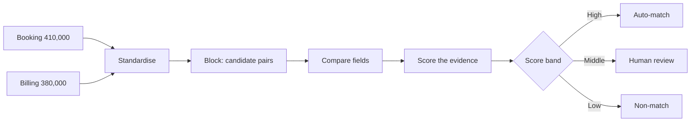

# Duplicates and Entity Resolution

## Start with the merged father and son

Maddox Health, a group of private clinics, wanted one view of each patient for its reception assistant. Patients lived in two systems with no shared identifier: 410,000 records in booking and 380,000 in billing. Ruth, the forward deployed engineer, matched them with a rule: if two of name, postcode and home phone agree, the records are the same person. It merged about 290,000 pairs in one night. Six weeks later a receptionist read out a penicillin allergy to a patient who had none. The record belonged to his son, who shared his name, address and landline. Their dates of birth differed by 30 years, and the rule never looked. Call this **the confident merge**: counting agreements and ignoring a disagreement that should have stopped the match.

> **What you'll learn**
>
> - Remove exact duplicates by key or content.
> - Match the same person across systems: standardise, block, compare, score and decide.
> - Weigh conflicting evidence instead of counting agreements.
> - Keep every merge reversible, and unmerge cleanly.

## Exact duplicates are a key problem

An **exact duplicate** is the same record delivered more than once. Pipelines create them constantly: a retried request, an export that overlaps the previous one, a replay after a crash. Removing them is **deduplication**, and it needs a key that identifies the record.

| Cause | Key to deduplicate on | Keep |
| --- | --- | --- |
| Retry or replay of the same event | Event or transaction ID | One copy |
| Overlapping exports of a changing table | Primary key | The row with the latest version or timestamp |
| Files with no stable ID | Hash of the normalised content | One copy per hash |

*Table 1: Exact duplicates. Each cause has a key, and each key has a rule for which copy survives.*

Duplicate messages from webhooks and retried API calls, deduplicated by event ID on the way in and by an idempotency key on the way out, are taught in [duplicates in both directions](/learn/engineering-foundations/distributed-systems-essentials/duplicates-in-both-directions). Deduplicate as early as the key allows, in the cleaned layer, and keep the raw copies. The [incremental loads](/learn/fde-building-in-the-estate/customer-data-pipelines/incremental-loads-and-watermarks) lesson shows how upserts absorb re-reads, which removes one cause at the write. When one import file holds many versions of each record, [data handling for real exports](/learn/fde-building-in-the-estate/working-in-customer-code/data-handling-for-real-exports) keeps the latest per key while streaming.

Exact deduplication cannot help Maddox. The father and son are two real people with two records each, and the booking and billing records for one patient share no key. That is a different problem.

## Same person, different records

**Entity resolution**, also called record linkage, decides which records from different sources describe the same real thing. It runs in five steps, shown in Figure 1.

*Figure 1: Entity resolution in five steps. The score bands decide what a person must check.*

- **Standardise.** Lower-case names, strip titles, format phone numbers and postcodes one way, and parse dates. "Dr D. Okafor" and "david okafor" should compare fairly.
- **Block.** Comparing every booking record with every billing record means about 156 billion pairs. Blocking compares only records that share something cheap, such as birth year and postcode district. Use two or three different blocks so one typo does not hide a true match.
- **Compare.** For each candidate pair, record whether each field agrees, disagrees or is missing.
- **Score.** Combine the comparisons into one number, as the next section shows.
- **Decide.** High scores match automatically, low scores do not, and the middle band goes to a person.

## Weighing conflicting evidence

Fields differ in how much they tell you. An exact date of birth rarely agrees by chance. A shared surname or address often does, because families share them. And some disagreements should outweigh several agreements: two records with different dates of birth are almost never the same patient.

So give each field a weight for agreeing and another for disagreeing, and add them up. This is the idea behind the Fellegi–Sunter model of record linkage. Tools such as Splink estimate the weights from the data. Table 2 shows hand-set weights for Maddox, with missing fields scoring zero.

| Field | Agrees | Disagrees |
| --- | --- | --- |
| Date of birth | +6 | −8 |
| Full name | +4 | −3 |
| Mobile phone | +5 | −1 |
| Email | +5 | −1 |
| Postcode | +2 | −1 |

*Table 2: Illustrative match weights. Disagreeing on date of birth costs more than any single agreement earns.*

Maddox set the bands at 12 and above for an automatic match, 4 to 11 for review, and below 4 for no match. The switcher scores three candidate pairs.

Three booking-billing pairs scored with the weights in Table 2. Auto-match at 12 or more, review from 4 to 11.

<button type="button" data-mode="strong" aria-pressed="false" aria-controls="strong-result">Moved house</button>
<button type="button" data-mode="conflict" aria-pressed="false" aria-controls="conflict-result">Conflicting contacts</button>
<button type="button" data-mode="family" aria-pressed="false" aria-controls="family-result">Father and son</button>

<section id="strong-result" class="mode-panel" data-announcement="Moved house selected. Score 14, auto-match."><h4>Moved house: score 14</h4><ul><li>Name +4, date of birth +6, mobile +5.</li><li>Postcode disagrees −1, because the patient moved. Email missing, 0.</li><li>4 + 6 + 5 − 1 = 14.</li></ul>
Auto-match. One weak disagreement does not outweigh three strong agreements.
</section>
<section id="conflict-result" class="mode-panel" data-announcement="Conflicting contacts selected. Score 10, human review."><h4>Conflicting contacts: score 10</h4><ul><li>Name +4, date of birth +6, postcode +2.</li><li>Mobile −1 and email −1: both differ.</li><li>4 + 6 + 2 − 1 − 1 = 10.</li></ul>
Review. Possibly one patient with a new phone, possibly twins. A person checks.
</section>
<section id="family-result" class="mode-panel" data-announcement="Father and son selected. Score minus 3, no match."><h4>Father and son: score −3</h4><ul><li>Name +4, postcode +2.</li><li>Date of birth −8, mobile −1. Email missing, 0.</li><li>4 + 2 − 8 − 1 = −3.</li></ul>
No match. The old rule merged this pair on three agreements.
</section>

Set the bands from measurement, not instinct. Label a sample of candidate pairs by hand, say 500, and measure **precision** (of the pairs you merge, how many are right) and **recall** (of the true matches, how many you find). In health data a wrong merge does more harm than a missed one, so Maddox set the automatic band for high precision and accepted a larger review queue. Size that queue before launch: someone has to work it.

## Merge so you can unmerge

Every matcher makes mistakes, so design the undo before the first merge.

- **Never overwrite source records.** Keep booking and billing records as they are. A merge is a link between them, not a deletion.
- **Keep a link table.** One row per source record: source system, source ID, the patient ID it is linked to, the score, the rule or reviewer that decided, and when.
- **Build the single view from the links.** Pick each field by a written rule, such as contact details from the most recently updated record and clinical fields only from the clinical system.
- **Unmerge by removing a link.** Mark the wrong link inactive, rebuild both patients' views, and record who did it and why.
- **Tell the consumers.** Anything that cached the merged view, such as the assistant's lookup index, must refresh. Find out which downstream systems read the view before you need to.

Maddox found 37 more father-and-son merges once the new scoring ran over the old links. Each was unmerged by deactivating one row, and the reception assistant showed the corrected records the next morning.

## Limits of this lesson

- **Weights here are hand-set.** Real weights come from the customer's data and change with it. Re-measure precision when sources change.
- **Some matches need a person.** No threshold removes the review band. Plan staff time for it.
- **Composite engagement.** Maddox Health, its staff, its patients and its figures are illustrative, not a real customer.

## Interview angle

Each answer is an outline to say in about two minutes. Open the question and try it aloud before reading.

Interview question 1. A customer holds the same customers in a CRM and a billing system with no shared ID. How do you match them?

- **Answer:** Standardise names, phones, emails and addresses. Block on cheap shared fields so you compare thousands of pairs, not billions. Compare each field and score the pair, with weights that let a strong disagreement, such as a different date of birth, outweigh weak agreements. Auto-match high scores, send the middle band to review, and measure precision and recall on a labelled sample. Store matches as links, never overwrites, so any merge can be undone.
- **Trade-off:** A high auto-match threshold avoids wrong merges but grows the review queue.
- **Follow-up to expect:** "Who reviews?" Someone who knows the customers, with both records side by side and a time budget per pair.

## References

1. Wikipedia, [Record linkage](https://en.wikipedia.org/wiki/Record_linkage), accessed 17 November 2026. Blocking, field comparison and the Fellegi–Sunter model.
2. UK Ministry of Justice, [Splink](https://moj-analytical-services.github.io/splink/), accessed 17 November 2026. Probabilistic record linkage with weights estimated from the data.
3. The site's [incremental loads and watermarks](/learn/fde-building-in-the-estate/customer-data-pipelines/incremental-loads-and-watermarks) lesson, for upserts that absorb re-reads.
4. The author's own field experience, the basis for the link table and unmerge practice.

## Key takeaways

- Exact duplicates need a key: event ID, primary key with a version, or a content hash.
- Entity resolution runs standardise, block, compare, score and decide.
- Weigh evidence. A strong disagreement must be able to outweigh several weak agreements.
- Set bands from measured precision and recall, and staff the review queue.
- Store merges as links so any merge can be undone and its consumers refreshed.

## Check yourself

1. Why did Maddox's two-of-three rule merge the father and son?

It counted agreements on name, address and home phone, which families share, and never checked the date of birth that disagreed.

2. What does blocking trade away for speed?

It only compares records that share a block, so a true match with a typo in every blocking field is never compared. Several different blocks reduce that risk.

3. Why keep a link table instead of merging records into one?

A wrong merge is then undone by deactivating a link and rebuilding the view, with the source records untouched.

