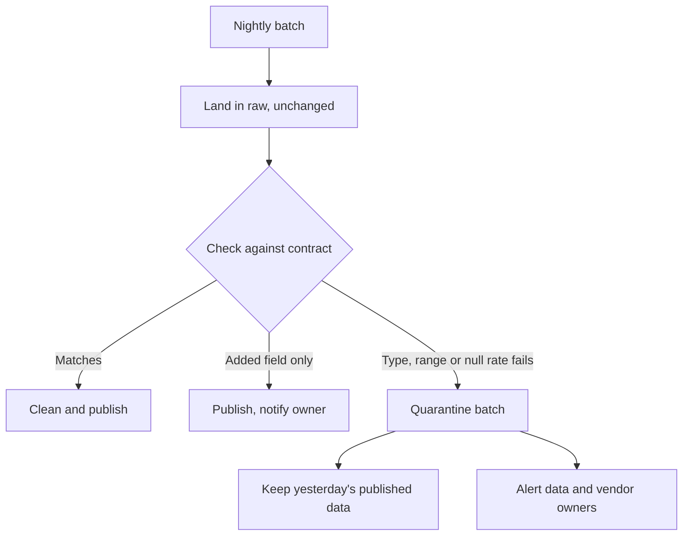

# Schema Drift and Late Data

## Start with the fares that shrank

Norland Rail, a train operator, loaded ticket sales from the machines at its 180 stations every night, and a revenue assistant answered managers' questions from the result. Femi, the forward deployed engineer, had built the pipeline against the vendor's file format. One Tuesday the vendor shipped an update. The `fare` field changed from whole pence, such as `1250`, to pounds as text, such as `"12.50"`, and the pipeline kept treating the number as pence: daily revenue fell from about £184,000 to about £1,840. The same update renamed `railcard_code` to `discount_card`, the old field arrived empty, and railcard use dropped to zero in every report. Every row loaded without error, so nobody was paged. Finance spotted it three days later, and the change had been in release notes nobody on the data team received. Call this **the quiet contract change**: a source that changes shape or meaning without telling the pipeline.

> **What you'll learn**
>
> - Name the kinds of schema drift and the default response to each.
> - Check every batch against a contract before it reaches users.
> - Separate event time from arrival time, and decide how long a day stays open.
> - Deduplicate late data and replays across the whole lateness window.

## Four kinds of drift

**Schema drift** is any change in the shape or meaning of incoming data that nobody agreed with you. It comes in four kinds.

| Kind | Example | How to detect | Default response |
| --- | --- | --- | --- |
| Added field | A new `platform` column | Field not in the contract | Land it in raw, pass the batch, tell the owner |
| Field stops arriving | `railcard_code` empty after a rename | Null rate jumps against its recent average | Hold the batch, alert |
| Type change | `fare` from integer to text | Type check fails | Hold the batch, alert |
| Meaning change | Pence to pounds, same type | Value range or totals shift sharply | Hold the batch, alert |

*Table 1: Kinds of schema drift. Additions are usually safe. Removals, type changes and meaning changes are not.*

The fourth kind is the most dangerous, because the type may not change at all. If the vendor had sent `1250` and later `12.5`, both are numbers. Only a range or total check catches it.

## A contract at the door

A **data contract** is the agreed shape and meaning of a feed: field names, types, units, which fields may be empty, and valid ranges. Write it down with the source owner, and check every batch against it before anything reaches users. Figure 1 shows Norland's check after the incident.

*Figure 1: Checking each batch at the door. A breaking change stops at quarantine, and users keep the last good data.*

Norland's contract now checks four things:

- **Fields and types.** Every expected field is present and parses as its type.
- **Ranges.** A single fare lies between £0.50 and £500. The pounds-as-text values fail this when read as pence.
- **Null rates.** `railcard_code` was filled on about 31% of rows for a year. A night at 0% fails.
- **Totals.** Daily revenue within 50% of the same weekday's four-week average.

Raw data always lands first, so a quarantined batch can be reprocessed once the contract or the code is fixed. Agree with the vendor that schema changes come with notice and a sample file, and add the data team to their release notes.

## Event time and arrival time

Every transaction has two times. **Event time** is when the sale happened. **Arrival time** is when the pipeline received it. Usually they are minutes apart. At Norland's rural stations, machines lose their network for hours, store sales and upload when they reconnect. About 0.6% of transactions arrive up to two days late.

Report by event time, because a sale belongs to the day it happened. That raises a question arrival time does not: when is a day complete?

Streaming systems answer with a **watermark** in a second sense: an estimate that all events up to some event time have arrived. Events behind it are **late data**, and an **allowed lateness** says how long the system still accepts them. In a batch pipeline the same choice appears as how long you keep a day open. This is a different watermark from the checkpoint in [incremental loads and watermarks](/learn/fde-building-in-the-estate/customer-data-pipelines/incremental-loads-and-watermarks), which tracks how far you have read.

## Closing a day that is still filling

Norland's revenue for a typical day is £184,000, and the late 0.6% is about £1,104. The switcher compares three ways to close the day.

A day's sales total £184,000. About £1,104 of it arrives up to two days late from offline machines.

<button type="button" data-mode="close" aria-pressed="false" aria-controls="close-result">Close at 02:00</button>
<button type="button" data-mode="hold" aria-pressed="false" aria-controls="hold-result">Hold for three days</button>
<button type="button" data-mode="restate" aria-pressed="false" aria-controls="restate-result">Provisional, then final</button>

<section id="close-result" class="mode-panel" data-announcement="Close at 02:00 selected. Fast, about 1,104 pounds short each day."><h4>Close at 02:00</h4><ul><li>Revenue is ready by 07:00 the next morning.</li><li>Every day is about £1,104 short, for good.</li><li>Late sales land in the wrong day, or nowhere.</li></ul>
Fast and simple, and wrong in a consistent direction.
</section>
<section id="hold-result" class="mode-panel" data-announcement="Hold for three days selected. Complete but slow."><h4>Hold for three days</h4><ul><li>Revenue appears three days late, complete.</li><li>Managers lose the morning figure they plan with.</li></ul>
Accurate, too slow for daily decisions.
</section>
<section id="restate-result" class="mode-panel" data-announcement="Provisional then final selected. Morning figure, corrected on day three."><h4>Provisional, then final</h4><ul><li>A provisional total of about £182,896 is published at 07:00.</li><li>Late sales update the day as they arrive. It becomes final on day three.</li><li>Reports show "provisional" or "final", and finance uses only final days.</li></ul>
Managers keep their morning figure, and finance gets the complete one.
</section>

Norland chose provisional, then final. The label matters as much as the number. A manager who sees "provisional" knows the figure will move a little. A sale that arrives after the final close goes into an adjustment for the current period, with a note, rather than reopening a closed month.

## Late data meets replays

Late uploads bring a second problem. A machine that loses its connection mid-upload sends the whole file again when it reconnects. If you deduplicate only within one night's arrivals, a transaction sent on Monday night and again on Wednesday night is counted twice.

The rule: **the deduplication window must cover the lateness window.** Norland deduplicates on machine ID plus the machine's transaction number, against every transaction with an event time in the last seven days. That covers the two-day lateness with room to spare. The [duplicates and entity resolution](/learn/fde-building-in-the-estate/customer-data-pipelines/duplicates-and-entity-resolution) lesson covers choosing the key.

Replays and checkpoint recovery are taught in [recoverable data syncs](/learn/engineering-foundations/distributed-systems-essentials/recoverable-data-syncs).

## Limits of this lesson

- **Contracts need owners on both sides.** A contract the vendor never agreed to catches drift but does not prevent it.
- **Thresholds need tuning.** A bank holiday can move totals by more than 50%. Expect some false alarms and adjust.
- **Composite engagement.** Norland Rail, its staff and its figures are illustrative, not a real customer.

## Interview angle

Each answer is an outline to say in about two minutes. Open each question and try it aloud before reading.

Interview question 1. What data quality problems do you plan for in a customer pipeline, and how do you handle each?

- **Answer:** Four. Exact duplicates from retries and overlapping exports: deduplicate on a stable key. The same entity under different records: entity resolution with weighed evidence and reversible merges. Schema change: a contract checked at the door, with breaking changes quarantined. Late and missing data: report by event time, keep the period open for the lateness window, and alert when a field's null rate jumps.
- **Trade-off:** Strict checks stop bad data but sometimes stop good data. Loose checks let errors reach users.
- **Follow-up to expect:** "Which do you build first?" Whichever the customer's decision is most sensitive to, usually duplicates in money.

Interview question 2. A source system changes its schema without telling you. What happens in a well-built pipeline, and what do you do next?

- **Answer:** Raw data lands unchanged. The contract check finds the new or missing field, the type change, or a shifted range or total. An added field passes with a notice. A breaking change quarantines the batch, users keep the last good data, and the data and source owners are alerted. Then I confirm the change with the source owner, update the contract and mapping, reprocess from raw, and agree that future changes come with notice and a sample.
- **Trade-off:** Quarantine makes data a day stale. Passing it can publish wrong figures.
- **Follow-up to expect:** "The type is the same but units changed." Range and total checks catch that.

## References

1. Confluent, [Schema evolution and compatibility](https://docs.confluent.io/platform/current/schema-registry/fundamentals/schema-evolution.html), accessed 17 November 2026. Backward and forward compatible changes to a schema.
2. Google Cloud, [Streaming pipelines](https://cloud.google.com/dataflow/docs/concepts/streaming-pipelines), accessed 17 November 2026. Event time, watermarks and late data.
3. Apache Avro, [Specification](https://avro.apache.org/docs/1.11.1/specification/), accessed 17 November 2026. Schema resolution when reader and writer schemas differ.
4. The author's own field experience, the basis for the provisional-then-final close.

## Key takeaways

- Added fields are usually safe. Missing fields, type changes and meaning changes are not.
- Check every batch against a written contract: fields, types, ranges, null rates and totals.
- Land raw first, so a quarantined batch can be reprocessed after the fix.
- Report by event time and decide how long a period stays open.
- Deduplicate across the whole lateness window, not one night's arrivals.

## Check yourself

1. Why did Norland's pipeline load the pounds-as-text fares without an error?

The text parsed as a number, and nothing checked its range or the daily total, so 12.50 was stored as 12.50 pence.

2. What is the difference between event time and arrival time?

Event time is when the sale happened. Arrival time is when the pipeline received it. Late data is where they differ by more than you allow.

3. Why must deduplication cover the lateness window?

A replayed transaction can arrive on a different night from its first copy. Checking one night's arrivals misses it.

