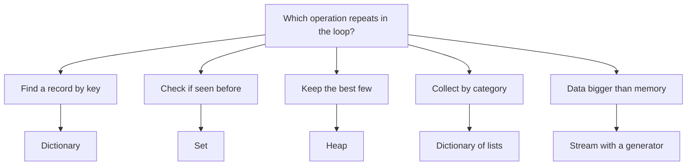

# Choosing the Language and Keeping Code Maintainable

## Start with the deadline shortcut

Jessop Engineering, a fictional manufacturer, asked for a nightly import that matched customer order lines against its parts catalogue. Marta, the forward deployed engineer, had one week. She wrote it in Python, tested it on a sample of 500 order lines, and it finished in about 6 seconds.

The first real night had 40,000 order lines. For each line, the code scanned a list of 250,000 parts to find a match. The sample needed about 62 million comparisons. The real file needed about 5 billion, eighty times more, and took about 8 minutes. The job had a 5-minute timeout, so it failed every night.

The same week, the order form's TypeScript check accepted part codes in lower case, while the Python import rejected them. Two copies of one rule had drifted apart. Call both problems **the deadline shortcut**: code that passes on small samples and one happy path, and breaks on the customer's real data.

> **What you'll learn**
>
> - Choose a language by who maintains the code and what the work needs.
> - Pick data structures by the operation that repeats, and estimate the cost.
> - Keep one validation contract consistent across Python and TypeScript.
> - Tell the shortcuts you can take under a deadline from the ones to refuse.

## When Python fits and when it does not

The first question is not which language you prefer. It is who will maintain the code after you leave. A tidy Go service is a liability for a team that only writes Python.

| Situation | Usual fit | Why |
| --- | --- | --- |
| Data transformation, imports, scripts, glue between APIs | Python | Fast to write, strong libraries for files, data and HTTP |
| AI and machine learning work | Python | Most model, evaluation and data libraries are Python first |
| Code that runs in the browser | TypeScript | Browsers run JavaScript, and types catch contract errors |
| A service in an existing Java or Go estate | The estate's language | Their build, deploy and on-call tooling already supports it |
| A CPU-bound hot loop at high volume | A compiled language, or Python calling vectorised libraries | Pure Python loops are slow for heavy arithmetic |

*Table 1: Language fit by situation. The customer's ability to maintain the code outranks the rest.*

Python's limits are specific. Pure Python loops run much slower than compiled code for heavy arithmetic. In the standard interpreter, the global interpreter lock (GIL) lets only one thread run Python code at a time, which limits CPU-bound threading. Neither matters for most field work, which waits on networks, databases and files. Both matter for a service that parses millions of records a minute.

When you choose a language the customer does not use, write down why, and agree it with whoever will own the code. Otherwise match their stack, even if you would write it faster in another.

## Data structures for parsing and transforming

Jessop's import was slow because of one data structure, not because of Python. Choose the structure by asking which operation repeats inside the loop.

- **Lookup by key.** Use a dictionary. Average lookup cost does not grow with the number of entries. A list scan grows with every entry.
- **Membership.** Use a set: "have I seen this order number?"
- **Order matters, access by position.** Use a list.
- **Top few by some score.** Use a heap, which keeps the best few without sorting everything.
- **Grouping.** Use a dictionary of lists, keyed by the group.
- **Data larger than memory.** Stream it record by record with a generator, covered in [data handling for real exports](/learn/fde-building-in-the-estate/working-in-customer-code/data-handling-for-real-exports).

Then estimate the cost before running on real data. Marta's list scan did about 125,000 comparisons per line on average, half the catalogue. Across 40,000 lines that is 5 billion. A dictionary built once from 250,000 parts, then 40,000 lookups, does about 290,000 operations. The fix was three lines, and the job dropped to under a second.

*Figure 1: Choose the structure by the repeated operation. A list is right only when position or order is the operation.*

Test with a production-sized input, or at least one ten times the sample, before calling a transform finished. A test at 500 rows cannot show the difference between linear and quadratic growth.

## One contract in two languages

Jessop's part code rule was "two upper-case letters, then six digits". The form needed it in TypeScript to give users fast feedback. The import needed it in Python because the form is not the only way data arrives. A rule that lives in two languages will drift unless something forces the copies to agree. The switcher compares three approaches.

The rule: a part code is two upper-case letters followed by six digits. The form checks it in TypeScript and the import checks it in Python.

<button type="button" data-mode="copied" aria-pressed="false" aria-controls="copied-result">Copied by hand</button>
<button type="button" data-mode="schema" aria-pressed="false" aria-controls="schema-result">One shared schema</button>
<button type="button" data-mode="fixtures" aria-pressed="false" aria-controls="fixtures-result">Shared test cases</button>

<section id="copied-result" class="mode-panel" data-announcement="Copied by hand selected. The copies drift and nothing notices."><h4>Copied by hand</h4><ul><li>Each side has its own pattern, written separately.</li><li>A developer relaxes the form to accept lower case. The import still rejects it.</li><li>Nothing fails until orders from the form are rejected at night.</li></ul>
Quick to write. Drift is found by customers.
</section>
<section id="schema-result" class="mode-panel" data-announcement="One shared schema selected. Both sides read the rule from one file."><h4>One shared schema</h4><ul><li>The rule lives once, in a JSON Schema file in the repository.</li><li>The Python model and the TypeScript type are generated from it, or checked against it in continuous integration (CI).</li><li>A change to the rule changes both sides in one pull request.</li></ul>
Strongest guarantee. Needs a generation step both teams accept.
</section>
<section id="fixtures-result" class="mode-panel" data-announcement="Shared test cases selected. Drift fails the build."><h4>Shared test cases</h4><ul><li>Each side keeps its own hand-written check.</li><li>One file lists 40 example codes, each marked valid or invalid, with the reason.</li><li>Both test suites run every example. If one side changes alone, its tests fail.</li></ul>
Lighter than generation. Covers only the cases in the file.
</section>

The shared schema suits a team that already generates types. Shared test cases suit an estate where the two codebases live in different repositories or teams. Either beats two copies with nothing joining them. The server-side check stays authoritative in every case, because a browser check can be skipped. The site's [typed schemas lesson](/learn/engineering-foundations/apis-and-backend/define-the-api-contract-with-typed-schemas) covers validating at the API boundary.

## Shortcuts to refuse under a deadline

Every engagement has a deadline, and some shortcuts are sensible. Martin Fowler describes technical debt that is deliberate and prudent: you know what you are skipping and plan to pay it back. The test is whether the shortcut is visible, bounded and cheap to undo.

Take these, and write each one down with a ticket:

- **Hard-coded configuration** for a single customer, with a note on where it should move.
- **A manual step** in deployment, documented in the runbook.
- **A narrower scope**, such as one file format instead of three.
- **Plain screens** without polish.

Refuse these, even on the last day:

- **Swallowing errors.** An empty exception handler turns a failure into wrong data nobody sees.
- **Skipping validation at a trust boundary.** Data from files, forms and partner APIs must be checked before it is stored.
- **Secrets in code.** Credentials in a repository leak, and rotating them later costs more than doing it right now.
- **Untested growth.** A transform never run at production size, like Jessop's list scan.
- **A second copy of a rule** with nothing to keep the copies in step.

The difference is who pays and when. The first list costs your team some tidying later. The second list costs the customer wrong data, an incident or a breach, often after you have left.

## Limits of this lesson

- **Complexity estimates are rough.** Constant factors, caching and the library underneath change real timings. Measure on realistic data.
- **Language choice is often made for you.** In an established estate, the decision is usually to match it, and that is fine.
- **Fictional data.** Jessop Engineering, its staff and its figures are illustrative.

## Interview angle

Each answer is an outline to say in about two minutes. Open each question and try it aloud before reading.

Interview question 1. A customer's team writes Java. You would build the integration faster in Python. Which do you choose?

- **Answer:** Usually Java, because they own the code after I leave and their build, deployment and on-call tooling already support it. I would pick Python only for a clear reason, such as a library that exists only in Python, and then agree it with the team that will maintain it, write the reason down and package it so their pipeline can deploy it.
- **Trade-off:** Matching their stack may slow me down for a week. A foreign language can cost them years of maintenance.
- **Follow-up to expect:** "It is a one-off migration script." Then Python is fine, because nobody maintains it after it runs.

Interview question 2. A transform matches 40,000 records against 250,000 reference rows and takes minutes. What do you look at first?

- **Answer:** The operation inside the loop. If each record scans a list of reference rows, that is about 5 billion comparisons. Build a dictionary keyed by the match field once, then look up each record, which is about 290,000 operations. Then check for other repeated work: parsing dates in the loop, or one database query per record instead of one batch.
- **Trade-off:** The dictionary holds all 250,000 rows in memory. If that does not fit, sort both sides and merge, or push the join into the database.
- **Follow-up to expect:** "Matches need fuzzy logic." Narrow candidates by an exact key first, then fuzzy-match within each group.

Interview question 3. You have two days left and the feature is not finished. Which shortcuts do you take, and which do you refuse?

- **Answer:** I take visible, bounded ones: hard-coded configuration with a ticket, a documented manual step, a narrower scope agreed with the customer, plain screens. I refuse ones that cause silent harm: swallowed exceptions, skipped validation on incoming data, secrets in code, untested performance on real volumes. I tell the customer which shortcuts I took and when they will be paid back.
- **Trade-off:** Refusing some shortcuts may mean shipping less. Taking them may mean shipping wrong data.
- **Follow-up to expect:** "The sponsor insists on the full scope." Show what each extra item costs in risk, and let them choose.

## References

1. Python Software Foundation, [Glossary: global interpreter lock](https://docs.python.org/3/glossary.html#term-global-interpreter-lock), accessed 17 November 2026. What the lock does to threaded Python code.
2. Python Wiki, [TimeComplexity](https://wiki.python.org/moin/TimeComplexity), accessed 17 November 2026. Average costs of list, set and dictionary operations.
3. JSON Schema, [JSON Schema](https://json-schema.org/), accessed 17 November 2026. A language-neutral way to describe one data contract.
4. Martin Fowler, [Technical Debt Quadrant](https://martinfowler.com/bliki/TechnicalDebtQuadrant.html), accessed 17 November 2026. Deliberate, prudent debt against reckless debt.

## Key takeaways

- Choose the language the customer can maintain, unless a clear reason says otherwise.
- Pick the data structure by the repeated operation, and estimate the count before running.
- Test transforms at production size, or ten times the sample at least.
- Join two copies of a rule with a shared schema or shared test cases.
- Take visible, bounded shortcuts. Refuse ones that cause silent harm.

## Check yourself

1. Jessop's sample took 6 seconds and the real file 8 minutes. Why did the sample not warn Marta?

The real file had 80 times more lines, and each line scanned the whole list. The sample was too small to show that the cost grew with both inputs.

2. With shared test cases, how is drift caught?

Both test suites run the same examples. When one side changes its check alone, an example it now treats differently fails that side's tests in CI.

3. Why keep the server-side check when the form already validates?

A browser check can be skipped, and data also arrives from files and partner APIs. The server is the last place every input passes through.

