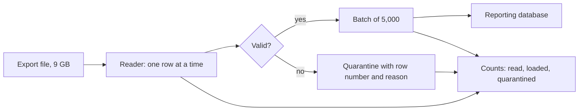

# Data Handling for Real Exports

## Start with the load-it-all import

Hythe Shipping, a fictional freight company, exports every shipment status event as one CSV file each night. During the pilot the file held one month of history and weighed 300 MB. Owen, the forward deployed engineer, wrote an import that read the whole file into memory, checked it, and loaded it into the reporting database. It ran in four minutes.

At go-live, Hythe switched the export to twelve months of history. The file grew to 9 GB and 38 million rows. The import ran in a container with a 4 GB memory limit, and the container was killed halfway through reading the file.

Owen raised the limit and tried again. Forty minutes in, at row 6.2 million, one row held the date "31/02/2026". The parser raised an error, the import stopped, and nothing was loaded. Call this **the load-it-all import**: code that assumes the whole file fits in memory and every row is clean.

> **What you'll learn**
>
> - Stream a large file record by record so memory stays flat.
> - Validate each row as it passes, with explicit checks.
> - Quarantine bad rows with reasons, and stop only past a threshold.
> - Work inside a container's memory limit.
> - Keep the latest record per key without holding every row.

## Stream instead of load

**Streaming** means reading one record, handling it, and moving on, so only a small window of the file is in memory at a time. In Python, iterating over an open file reads one line at a time, and the standard `csv` reader turns each line into a row the same way. Wrapping the steps in generator functions keeps the whole pipeline lazy: nothing is read until the next step asks for it.

Writes stream too. Inserting one row per database call is slow, and collecting all rows before writing defeats the point. Group valid rows into batches of a fixed size, such as 5,000, and write each batch in one call.

*Figure 1: A streaming import. Memory holds one batch and the counters, whatever the file's size.*

The design also makes a run restartable. Record the last row number in each committed batch. If the import dies at row 6.2 million, the next run skips to that point instead of starting again.

## Validate each row as it passes

A parser that throws on bad input is not a validator. Write the checks explicitly, so each failure has a name:

| Check | Hythe example | Failure reason recorded |
| --- | --- | --- |
| Required fields present | Shipment ID, status, event time | missing shipment_id |
| Type and format | Event time is a real date and time | invalid date: 31/02/2026 |
| Allowed values | Status is one of 9 known codes | unknown status: DLVRD |
| Range | Weight between 0 and 40,000 kg | weight out of range: -12 |
| Reference | Port code exists in the port list | unknown port: XXA |

*Table 1: Row checks for Hythe's export. Each failure produces a specific reason, not a stack trace.*

Parse dates strictly, with the exact format the export promises, and treat anything else as a failure. A lenient parser that guesses "03/04" as March or April turns a visible error into a silent wrong value. The reference check needs the port list in memory, which is small: load it once into a set before the stream starts.

## Quarantine bad rows instead of stopping

One bad row in 38 million should not throw away the other 37,999,999. It should not vanish either. The switcher compares three ways to handle Hythe's 1,900 bad rows.

Hythe's export has 38 million rows. 1,900 of them, about 0.005%, fail a check.

<button type="button" data-mode="stop" aria-pressed="false" aria-controls="stop-result">Stop at the first</button>
<button type="button" data-mode="skip" aria-pressed="false" aria-controls="skip-result">Skip silently</button>
<button type="button" data-mode="quarantine" aria-pressed="false" aria-controls="quarantine-result">Quarantine and count</button>

<section id="stop-result" class="mode-panel" data-announcement="Stop at the first selected. Nothing loads."><h4>Stop at the first</h4><ul><li>The import fails at row 6.2 million after forty minutes.</li><li>Nothing is loaded. Someone fixes one row and reruns.</li><li>The next bad row stops it again.</li></ul>
Safe for data quality. Useless for a nightly job.
</section>
<section id="skip-result" class="mode-panel" data-announcement="Skip silently selected. Totals are wrong and nobody knows why."><h4>Skip silently</h4><ul><li>37,998,100 rows load. 1,900 vanish.</li><li>Reports show fewer deliveries than Hythe's operations team counted.</li><li>Nobody can tell which shipments are missing or why.</li></ul>
Runs every night. Loses trust within a week.
</section>
<section id="quarantine-result" class="mode-panel" data-announcement="Quarantine and count selected. Good rows load and bad rows are listed with reasons."><h4>Quarantine and count</h4><ul><li>37,998,100 rows load. 1,900 go to a quarantine table with row number, raw text and reason.</li><li>The run report states read, loaded and quarantined counts, which add up.</li><li>Hythe's data team fixes the 1,900 at source and they load the next night.</li></ul>
Runs every night, and every row is accounted for.
</section>

Quarantine needs a stopping rule. If 1,900 rows fail, the export is mostly healthy. If 4 million fail, something upstream has changed, such as a renamed column, and loading the rest would mix good data with a broken feed. Agree a threshold with the customer, such as 0.1% of rows, and stop the run with a clear message above it. Then the counts must reconcile: rows read equals rows loaded plus rows quarantined. A gap means the code dropped rows somewhere.

## Memory limits

A container's memory limit is a hard ceiling. Exceed it and the operating system kills the process without a Python error, which is why Owen's first run ended with no message. Know the limit before you design, and measure the import's peak memory on a realistic file.

Things that quietly hold the whole file:

- **Building a list of all rows** before processing them.
- **Reading the file into one string** to split it later.
- **Loading into a data frame** without chunking. A data frame's in-memory form is often several times the file's size.
- **Sorting or grouping in Python** across all rows.

When work needs all rows at once, such as sorting or a large group-by, push it into the database or process the file in chunks and merge the results. Streaming lets Hythe's import run in the original 4 GB container with room to spare, because it holds one batch of 5,000 rows plus the port set and the counters.

## Keep the latest record per key

Hythe's file has many events per shipment: booked, loaded, departed, arrived, delivered. The reporting table needs one row per shipment, showing its latest status. This is **keeping the latest record per key**.

Streaming handles it with a dictionary keyed by shipment ID. For each valid row, compare its event time with the stored one and keep the newer. Memory grows with the number of distinct shipments, not the number of rows: 38 million events cover 2.1 million shipments. At a few hundred bytes per entry, that is roughly 1 GB, which fits in 4 GB.

Two details decide whether the result is right:

- **Ties.** Two events for one shipment can share a timestamp. Break ties with a sequence number from the source if it has one. If not, agree a rule with the customer, such as a status order where delivered beats arrived.
- **Late arrivals.** An event can appear in tomorrow's file with an older timestamp. Compare event times, never arrival order, so a late "departed" cannot overwrite "delivered".

When the distinct keys do not fit in memory, move the comparison into the database: upsert each batch with a condition that only replaces a row when the incoming event time is newer. PostgreSQL's `INSERT ... ON CONFLICT DO UPDATE` with a `WHERE` clause does this in one statement.

## Limits of this lesson

- **Some formats resist streaming.** A single huge JSON array or a spreadsheet may need a streaming parser for that format, or a conversion first.
- **Thresholds are judgement.** The right quarantine threshold depends on what the data feeds. Agree it with the people who use the reports.
- **Fictional data.** Hythe Shipping, its staff and its figures are illustrative.

## Interview angle

Each answer is an outline to say in about two minutes. Open each question and try it aloud before reading.

Interview question 1. An import worked in the pilot, and now the customer's export is 9 GB and the job is killed for running out of memory. What do you change?

- **Answer:** Stop loading the file. Read it row by row with a streaming reader, validate each row, and write valid rows in fixed batches of a few thousand. Record the last committed row so a crash resumes instead of restarting. Measure peak memory on a production-sized file. Anything that needs all rows at once, such as sorting or a large group-by, moves into the database.
- **Trade-off:** Streaming code is a little more complex than one load call. Raising the memory limit only delays the next failure.
- **Follow-up to expect:** "The file is one big JSON array." Use a streaming JSON parser, or ask for line-delimited JSON.

Interview question 2. Describe how you would parse and validate a large file of records so that a few bad rows do not stop the load.

- **Answer:** Stream the file and run explicit checks on each row: required fields, strict formats, allowed values, ranges and references. Valid rows go into batches for the database. Invalid rows go to a quarantine table with row number, raw text and reason. At the end, report read, loaded and quarantined counts and check they add up. Stop the run if failures pass an agreed threshold, such as 0.1%.
- **Trade-off:** Quarantine needs someone to own the bad rows. Failing fast is simpler but blocks the whole load for one row.
- **Follow-up to expect:** "Who fixes the quarantined rows?" The data owner at source, with the reasons as their worklist.

## References

1. Python Software Foundation, [csv: CSV file reading and writing](https://docs.python.org/3/library/csv.html), accessed 17 November 2026. Reading rows one at a time from a file.
2. Python Software Foundation, [Functional programming HOWTO: generators](https://docs.python.org/3/howto/functional.html#generators), accessed 17 November 2026. Lazy pipelines that produce one item at a time.
3. Docker, [Resource constraints](https://docs.docker.com/engine/containers/resource_constraints/), accessed 17 November 2026. Container memory limits and what happens when a process exceeds them.
4. PostgreSQL, [INSERT](https://www.postgresql.org/docs/current/sql-insert.html), accessed 17 November 2026. Upserts with `ON CONFLICT DO UPDATE` and a condition.

## Key takeaways

- Stream large files row by row, and write in fixed batches.
- Validate with explicit, named checks. A parser error is not a validation rule.
- Quarantine bad rows with reasons, reconcile the counts, and stop past an agreed threshold.
- Know the container's memory limit and measure peak memory on real-sized files.
- Keep the latest record per key with a dictionary or a conditional upsert, comparing event times.

## Check yourself

1. Why did Owen's first run end without a Python error?

The container passed its memory limit and the operating system killed the process. Python never got the chance to raise anything.

2. Hythe's run reports 38,000,000 read, 37,998,100 loaded and 1,800 quarantined. What does that tell you?

100 rows are unaccounted for. The code dropped them somewhere, so the run should be treated as failed until the gap is found.

3. Why does keeping the latest record per shipment need about 1 GB and not memory for 38 million rows?

The dictionary holds one entry per distinct shipment, 2.1 million of them, and replaces an entry when a newer event arrives.

