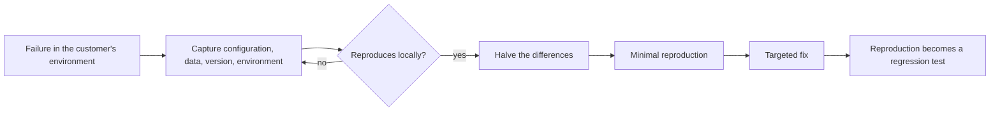

# Reproduce, Isolate, Fix

## Start with the default-config blind spot

Islay Bank, a fictional bank, runs a statement-export product that a software vendor installs at several banks. Each night the export writes a file of 210,000 account balances for the bank's reconciliation system. One October morning, reconciliation flagged 37 accounts with impossible balances. The next night it happened again, with a different 41.

The vendor's support team ran the export on their test environment, with the product's default settings, and every row came out right. They closed the ticket as "cannot reproduce". Islay reopened it. Support closed it again a week later.

Nadia, the vendor's forward deployed engineer for Islay, asked for the bank's configuration file. It differed from the default in 14 settings. Two of them, set years earlier for an old mainframe reader, turned off quoting and changed the separator from the default pipe to a comma. Every broken row had an account name containing a comma. Call this **the default-config blind spot**: testing the product as you ship it, when the customer runs it as they configured it.

> **What you'll learn**
>
> - Reproduce with the customer's exact configuration, data, version and environment.
> - Isolate a cause by halving configuration, data, code history or environment.
> - Shrink the failure to a minimal reproduction.
> - Make a targeted fix and turn the reproduction into a regression test.

## Reproduce before you reason

Theories are cheap and most of them are wrong. A reproduction is the first piece of evidence that you are looking at the same failure as the customer. Until you have one, every fix is a guess.

A failure depends on four inputs. Capture all four before trying anything:

| Input | What to capture | Islay example |
| --- | --- | --- |
| Configuration | The full settings file, and a diff against the default | 14 settings differ, including quoting off |
| Data | One record that fails, anonymised if it is sensitive | One account named with a comma |
| Version | Product version, patch level, dependency versions | Same version as the test environment |
| Environment | Operating system, time zone, locale, database version | No relevant difference |

*Table 1: The four inputs behind a failure. Support had matched the version and environment, and missed the other two.*

Sensitive data needs care. A bank cannot send real account records to a vendor. Ask the customer to run a small script in their environment that copies one failing record with names and numbers replaced, keeping the characters that matter, such as the comma. Check that the anonymised record still fails before you use it.

## Isolate by halving

Once the failure reproduces, find which difference causes it. Changing one thing at a time works but is slow when there are many differences. Halving is faster: change half the differences, see whether the failure stays, and keep the half that matters.

- **Configuration.** Reset half of the 14 custom settings to default. If the failure stays, the cause is in the other half. About four rounds narrow 14 settings to one or two.
- **Data.** Run the first half of the input file. With 210,000 rows and no idea which row fails, about 18 halvings find a single failing row, because 2 to the power 18 is more than 262,000.
- **Code history.** When the failure started after an upgrade, `git bisect` checks out the commit halfway between a known good and a known bad version, and you mark each one until it names the first bad commit.
- **Environment.** Swap one component at a time: time zone, locale, database version.

Halving assumes one cause. When two settings fail only together, as at Islay, resetting either one alone makes the failure disappear. That is a clue, not a dead end: test the pair.

*Figure 1: The loop from a customer failure to a fix. If the failure does not reproduce, an input is still missing, so capture more.*

## The minimal reproduction

A **minimal reproduction** is the smallest setup that still shows the failure: fewest settings, fewest records, fewest steps. It does three jobs. It proves the cause, it lets someone else confirm the bug in minutes, and it becomes the regression test. The walkthrough shows how Nadia shrank Islay's failure.

Shrink Islay's nightly export failure to something a developer can run in seconds. Each step shows what changed and what remained.

<button type="button" data-step="0" aria-pressed="false" aria-controls="repro-step-0">1. Capture</button><button type="button" data-step="1" aria-pressed="false" aria-controls="repro-step-1">2. Halve settings</button><button type="button" data-step="2" aria-pressed="false" aria-controls="repro-step-2">3. One record</button><button type="button" data-step="3" aria-pressed="false" aria-controls="repro-step-3">4. Test</button>

<section id="repro-step-0" class="step-panel" aria-labelledby="repro-heading-0"><h4 id="repro-heading-0">1. Capture the customer's setup</h4><dl><dt>Changed</dt><dd>Test environment loaded with Islay's settings file and one anonymised failing account.</dd><dt>Remains</dt><dd>14 custom settings, one record. The row comes out with its columns shifted.</dd><dt>Learned</dt><dd>The failure reproduces outside the bank. Support's default setup was the missing piece.</dd></dl></section><section id="repro-step-1" class="step-panel" aria-labelledby="repro-heading-1"><h4 id="repro-heading-1">2. Halve the settings</h4><dl><dt>Changed</dt><dd>Seven settings reset, then three or four more, over four runs.</dd><dt>Remains</dt><dd>Two settings: quoting turned off, and a comma in place of the default pipe separator.</dd><dt>Learned</dt><dd>Resetting either one alone fixes the row. The cause is the pair.</dd></dl></section><section id="repro-step-2" class="step-panel" aria-labelledby="repro-heading-2"><h4 id="repro-heading-2">3. Strip the record</h4><dl><dt>Changed</dt><dd>Every field emptied except the account name, then the name cut to two letters around a comma.</dd><dt>Remains</dt><dd>One record, one field, value "A,B".</dd><dt>Learned</dt><dd>Any name with a comma breaks the row. The 37 and 41 accounts were the ones active that night.</dd></dl></section><section id="repro-step-3" class="step-panel" aria-labelledby="repro-heading-3"><h4 id="repro-heading-3">4. Write it as a test</h4><dl><dt>Changed</dt><dd>The setup becomes an automated test: two settings, one record, check the row has the right number of columns.</dd><dt>Remains</dt><dd>A test that fails on the current code in under a second.</dd><dt>Learned</dt><dd>The fix is done when this test passes, and it guards every later release.</dd></dl></section>

<button type="button" data-walk="previous">Previous</button>

<button type="button" data-walk="next">Next step</button>

The walkthrough is a scripted illustration. Step 3 also explains why the count changed each night: the export only includes accounts with movements that day.

## Targeted fixes

With the cause proven, make the smallest change that removes it, at the place where it arises. At Islay, the exporter had a separate branch for "quoting off" that joined fields with commas by hand. Only a customer with that setting reached it.

- **Fix the root, not the symptom.** Stripping commas from names would hide the bug and change customer data. Nadia routed the "quoting off" branch through the same CSV writer as the default path, with an escape character agreed with Islay's mainframe team.
- **Guard the configuration.** The product now refuses to start an export where quoting is off and no escape character is set, with a message naming both settings.
- **Keep the reproduction as a test.** It runs on every build, so the bug cannot return quietly.
- **Look for other customers.** Search the deployed configurations for the same pair of settings. Two more banks had quoting off, and neither had commas in names yet.

Resist the rewrite. Finding the bug in an old exporter makes it tempting to replace the exporter. A rewrite changes behaviour that other customers depend on, and it needs its own testing. Propose it separately, with the evidence, if the code deserves it.

The site's [diagnosing production incidents](/learn/production-ai/observability-and-diagnosis/diagnosing-production-incidents) lesson covers the same discipline when the system is live and the clock is running.

## Limits of this lesson

- **Some failures resist reproduction.** Race conditions and load-dependent bugs may need logs, traces and many runs instead of one setup.
- **Customers cannot always share data.** Then you run scripts in their environment and reason from what they report.
- **Fictional data.** Islay Bank, the vendor, its staff and its figures are illustrative.

## Interview angle

Each answer is an outline to say in about two minutes. Open each question and try it aloud before reading.

Interview question 1. Walk me through how you debug a defect a customer reports in code you did not write.

- **Answer:** Reproduce first: capture the configuration, a failing input, the version and the environment, and confirm I see the same failure. Then isolate by halving the differences, the settings, the data or the commit range with git bisect, until a minimal reproduction remains. Fix at the root with the smallest change, and turn the reproduction into a regression test before closing.
- **Trade-off:** Building a reproduction takes hours. Fixing without one risks a change that does nothing, or breaks something else.
- **Follow-up to expect:** "You cannot reproduce it." Then an input is still missing. Compare their four inputs with mine again.

Interview question 2. A product works for every customer except one bank, and your support team cannot reproduce the failure. What do you do?

- **Answer:** Assume their configuration or data differs, not that they are wrong. Ask for the full settings file and diff it against the default. Ask them to anonymise one failing record in their environment. Reproduce with both, then halve the custom settings to find the cause. Fix it at the root, add a configuration check, and search other customers' settings for the same combination.
- **Trade-off:** Supporting custom configurations costs testing effort. Refusing them loses customers whose estates need them.
- **Follow-up to expect:** "Two settings only fail together." Halving hides that. Test the remaining settings in pairs.

## References

1. Git, [git-bisect documentation](https://git-scm.com/docs/git-bisect), accessed 17 November 2026. Binary search through history for the commit that introduced a bug.
2. Stack Overflow, [How to create a Minimal, Reproducible Example](https://stackoverflow.com/help/minimal-reproducible-example), accessed 17 November 2026. Minimal, complete and reproducible as the three properties.
3. Google, [Site Reliability Engineering: Effective Troubleshooting](https://sre.google/sre-book/effective-troubleshooting/), accessed 17 November 2026. Hypotheses, testing and dividing the problem space.
4. Python Software Foundation, [csv: CSV file reading and writing](https://docs.python.org/3/library/csv.html), accessed 17 November 2026. Quoting modes and the escape character.

## Key takeaways

- Reproduce before you reason, with the customer's configuration, data, version and environment.
- When support cannot reproduce, an input is missing. Diff the configuration first.
- Halve the differences to isolate a cause, and test pairs when halving makes it vanish.
- Shrink to a minimal reproduction and keep it as a regression test.
- Fix the root with the smallest change, and check other customers for the same setup.

## Check yourself

1. Why did support's test environment never show the bug?

It ran the default settings, which quote fields. Only Islay's quoting-off setting reached the branch that joined fields by hand.

2. Resetting either of Islay's two settings alone made the failure vanish. What does that tell you?

The cause needs both settings together. Halving finds single causes, so the next move is to test the remaining settings as a pair.

3. Why not strip commas from account names to fix the export?

It hides the bug and changes the customer's data. The exporter would still break on any other character that needs escaping.

