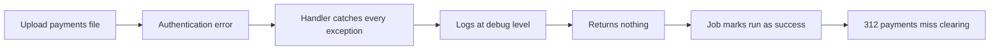

# Reviewing AI-generated Changes

## Start with the plausible patch

Islay Bank, a fictional bank, sends a payments file to its clearing provider every afternoon. The upload sometimes failed on network blips. Callum, the forward deployed engineer, asked an AI coding assistant to add retries. The patch looked tidy. It added a retry library, wrapped the upload in a retry loop, and passed every test.

Three things in it went unread. The upload was wrapped in a handler that caught every exception, logged it at debug level and returned nothing. The default timeout dropped from 30 seconds to 5. A field in the job's status output was renamed from `batchId` to `batch_id`.

Two weeks later the bank's client certificate expired. The upload failed with an authentication error, the handler swallowed it, and the job reported success. 312 supplier payments missed that day's clearing. The status dashboard, which read `batchId`, had shown blanks since the release, and nobody connected the two. Call this **the plausible patch**: a change that reads fluently, passes its tests and hides what it changed.

> **What you'll learn**
>
> - Review an AI-generated diff with the same scrutiny as a stranger's.
> - Find error handling that hides failures.
> - Question every new dependency before it enters the customer's estate.
> - Catch behaviour changes that break callers and data consumers.

## Review it as a stranger's code

An assistant writes code that looks like the code around it. That fluency makes review harder, because nothing looks out of place. Treat the patch as if an unknown contributor sent it, and remember that you, not the tool, are accountable for what you merge into a customer's system.

Habits that help:

- **Ask for small diffs.** One concern per change. A retry change should not also rename fields.
- **Read every line,** including tests and configuration. Assistants often edit more than you asked for.
- **Check the intent against the diff.** Write one sentence for what the change should do, then list everything the diff does beyond it.
- **Distrust passing tests.** Ask what the tests mock. Islay's tests replaced the upload with a fake that always succeeded. No test ever reached the failure path.

Google's engineering practices list what a reviewer looks for: design, behaviour, complexity, tests, naming and comments. All of it applies, with more weight on behaviour, because that is where fluent code hides surprises. The walkthrough reviews Callum's patch in four passes.

Review the retry patch for Islay's payment upload in four passes. Each pass shows what to look for and what it finds.

<button type="button" data-step="0" aria-pressed="false" aria-controls="review-step-0">1. Intent</button><button type="button" data-step="1" aria-pressed="false" aria-controls="review-step-1">2. Errors</button><button type="button" data-step="2" aria-pressed="false" aria-controls="review-step-2">3. Dependencies</button><button type="button" data-step="3" aria-pressed="false" aria-controls="review-step-3">4. Interfaces</button>

<section id="review-step-0" class="step-panel" aria-labelledby="review-heading-0"><h4 id="review-heading-0">1. Compare intent with the diff</h4><dl><dt>Look for</dt><dd>Everything the diff does beyond "retry the upload on network errors".</dd><dt>Finds</dt><dd>A new library, a changed timeout, a renamed status field and a broad error handler.</dd><dt>Action</dt><dd>Ask for the rename and the timeout change to come out, or be justified separately.</dd></dl></section><section id="review-step-1" class="step-panel" aria-labelledby="review-heading-1"><h4 id="review-heading-1">2. Follow every error path</h4><dl><dt>Look for</dt><dd>Handlers that catch everything, return defaults or log quietly.</dd><dt>Finds</dt><dd>All exceptions caught, logged at debug and turned into a normal return. Authentication errors are retried as if they were network blips.</dd><dt>Action</dt><dd>Retry only network errors and timeouts. Let every other error fail the job loudly.</dd></dl></section><section id="review-step-2" class="step-panel" aria-labelledby="review-heading-2"><h4 id="review-heading-2">3. Question the new dependency</h4><dl><dt>Look for</dt><dd>Need, maintenance, licence, advisories and the bank's approved list.</dd><dt>Finds</dt><dd>One maintainer, last release 19 months ago, not on the approved list. The bank's HTTP client already supports retries.</dd><dt>Action</dt><dd>Drop the library and configure retries in the existing client.</dd></dl></section><section id="review-step-3" class="step-panel" aria-labelledby="review-heading-3"><h4 id="review-heading-3">4. Check interfaces and defaults</h4><dl><dt>Look for</dt><dd>Changed defaults, field names, error types and output formats.</dd><dt>Finds</dt><dd>The timeout fell from 30 to 5 seconds, too short for a large file. The renamed field breaks the dashboard.</dd><dt>Action</dt><dd>Restore both. Search for every reader of the status output before any future rename.</dd></dl></section>

<button type="button" data-walk="previous">Previous</button>

<button type="button" data-walk="next">Next step</button>

The walkthrough is a scripted illustration. Each pass looks for one kind of problem, which is easier than hunting for all of them in one read.

## Swallowed exceptions

A **swallowed exception** is an error caught and then discarded, so the program carries on as if nothing failed. It is the most damaging pattern in generated code, because it turns a visible failure into wrong data or a false success.

*Figure 1: How Islay's swallowed exception became late payments. Each step looked reasonable on its own.*

Signs to look for in a diff:

- **Catching everything:** a bare `except`, or `except Exception`, with no re-raise.
- **Returning a default** such as `None`, an empty list or zero from a handler, so callers cannot tell failure from an empty result.
- **Quiet logging:** an error logged at debug or info level, below where alerts look.
- **Retrying the unretryable:** authentication failures, validation errors and "not found" retried as if they were transient.

What to ask for instead: catch the specific errors you can handle, such as connection errors and timeouts. Re-raise the rest, or let them propagate, so the job fails and alerts fire. When you log an error, include what was being done and for which record. Then add a test that makes the dependency fail, and assert that the job reports failure.

## New dependencies

Every new package becomes part of the customer's software supply chain, along with every package it pulls in. Assistants suggest packages freely, sometimes ones that are obscure or no longer maintained. Before accepting one, answer five questions:

| Question | Islay's retry library |
| --- | --- |
| Is it needed? Can the standard library or an existing dependency do it? | No. The existing HTTP client supports retries |
| Is it maintained? Releases, open issues, more than one maintainer | One maintainer, last release 19 months ago |
| Is its licence acceptable to the customer? | Permissive, but not checked against the bank's policy |
| Are there known vulnerabilities, in it or what it pulls in? | None found, though it pulls in two more packages |
| Is it on the customer's approved list, or does it need their review? | Not listed. The bank requires a security review |

*Table 1: Five questions for a new dependency. One "no" to the first question ends the discussion.*

If the dependency stays, pin its exact version in the lock file. A later release then cannot change behaviour without a reviewed change. NIST's Secure Software Development Framework and the OpenSSF Scorecard project both describe checks of this kind. The customer's own policy decides, and in a bank that often means a review you need to book in advance.

## Behaviour changes and backward compatibility

A change is **backward compatible** when every existing caller and consumer keeps working without changes. Generated code breaks compatibility casually, because the assistant sees one file, not the systems that read its output.

Changes that break callers you may not see:

- **Renamed or removed fields** in output, files, events or database columns.
- **Changed defaults,** such as timeouts, page sizes or sort orders.
- **New error types** where callers catch specific ones.
- **Changed formats** for dates, numbers and time zones.

Before merging, search for consumers: other repositories, scheduled reports, dashboards, partner integrations. Prefer additive changes: add `batch_id` alongside `batchId`, mark the old one as deprecated, and remove it only after every consumer has moved. Semantic versioning gives a shared language for this. A breaking change to a published interface needs a new major version and a migration note.

## Limits of this lesson

- **Review cannot catch everything.** Tests for failure paths, contract tests and monitoring catch what reviewers miss.
- **Policies differ.** Each customer has its own rules for dependencies and AI-generated code. Follow theirs.
- **Fictional data.** Islay Bank, its staff and its figures are illustrative.

## Interview angle

Each answer is an outline to say in about two minutes. Open each question and try it aloud before reading.

Interview question 1. How do you review a change for backward compatibility when part of it was written by an AI assistant?

- **Answer:** Same bar as any contributor, with extra attention on behaviour. Compare the stated intent with the whole diff and question everything beyond it. Check interfaces: field names, defaults, error types, formats. Search for every consumer of anything changed, including dashboards and partner feeds. Prefer additive changes with deprecation over renames. Check new dependencies, and follow every error path.
- **Trade-off:** A careful review slows the change by hours. A missed rename can break a consumer silently for weeks.
- **Follow-up to expect:** "How do you find consumers you do not know about?" Search code and logs, and ask the data owners.

Interview question 2. An assistant's patch fixes the bug but adds a small, unfamiliar package. What do you do before merging?

- **Answer:** First ask whether it is needed: often the standard library or an existing dependency does the job, as with retries in an HTTP client. If it stays, check maintenance, licence, known vulnerabilities and what it pulls in, and whether the customer's approved list or security review covers it. Pin the exact version. Otherwise rewrite the fix without it.
- **Trade-off:** Avoiding the package may mean writing twenty more lines. Accepting it adds a supply-chain risk the customer carries for years.
- **Follow-up to expect:** "The customer has no approved list." Then I apply the checks myself and record the decision.

## References

1. Google, [What to look for in a code review](https://google.github.io/eng-practices/review/reviewer/looking-for.html), accessed 17 November 2026. Design, functionality, complexity, tests and the reviewer's responsibility.
2. NIST CSRC, [SP 800-218, Secure Software Development Framework](https://csrc.nist.gov/pubs/sp/800/218/final), accessed 17 November 2026. Practices for third-party components and software supply chains.
3. OpenSSF, [Scorecard](https://scorecard.dev/), accessed 17 November 2026. Automated checks of an open-source project's maintenance and security practices.
4. Semantic Versioning, [Semantic Versioning 2.0.0](https://semver.org/), accessed 17 November 2026. Major versions for breaking changes to a public interface.

## Key takeaways

- Review AI-generated code as a stranger's: you are accountable for what you merge.
- Compare intent with the whole diff and ask what the tests mock.
- Hunt swallowed exceptions: broad handlers, default returns, quiet logs, retried permanent errors.
- Question every new dependency, and prefer what the estate already has.
- Search for consumers before changing an interface, and prefer additive changes.

## Check yourself

1. Why did Islay's tests pass with a swallowed exception in the code?

The tests replaced the upload with a fake that always succeeded. No test made the upload fail, and the handler never ran under test.

2. Why should authentication errors not be retried?

They do not go away by waiting. Retrying delays the failure and, with a swallowed exception, hides it entirely.

3. What makes adding batch_id alongside batchId safer than renaming?

Existing readers of batchId keep working while consumers move. The old field is removed only once nobody reads it.

