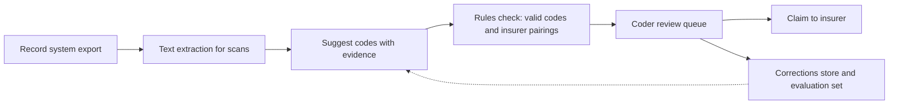
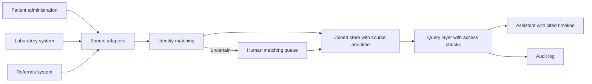
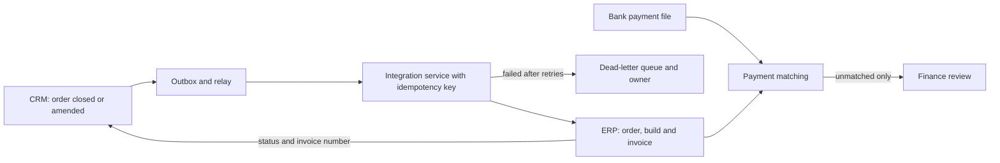
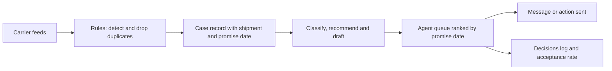
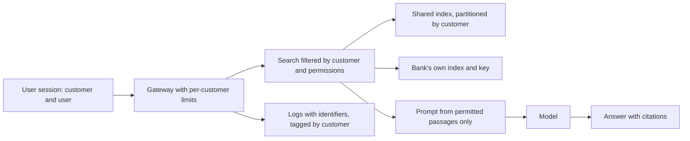
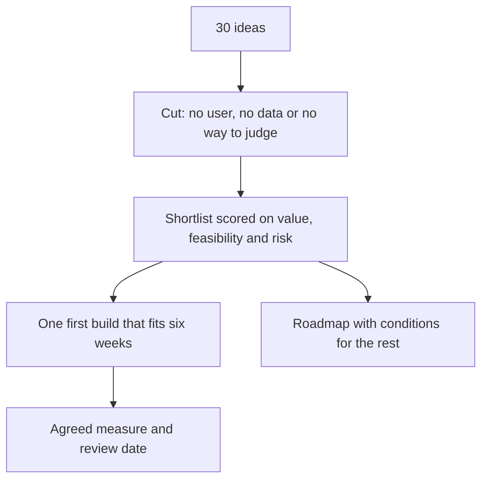

# Practise Case Drills

## How to use this practice

Each drill is a short case of the kind a decomposition or case-study round opens with. Give each one 20 minutes with a timer running:

1. Spend 2 minutes reading the brief and writing the questions you would ask.
2. Spend 6 minutes breaking the problem into parts, aloud.
3. Spend 8 minutes sketching the design or the decision and talking through it.
4. Spend 4 minutes on the follow-up questions, answering before you open each one.

The six drills come in three pairs, and one pair makes a 40-minute sitting: healthcare (drills 1 and 2), operations (drills 3 and 4), and platform and strategy (drills 5 and 6). Drill 6 has no system to draw at first. Its design stage is a decision method and a first build.

Open the outlines only after you have answered. They are one sound answer, not the only one. Every customer and figure below is a composite.

> **What you'll practise**
>
> - Turning a short brief into parts, owners and first questions within six minutes.
> - Drawing a design whose data flow you can explain box by box.
> - Finding the failure modes of an integration before choosing its tools.
> - Keeping one customer's data away from another at every layer, not only the database.
> - Cutting a long list of ideas to one first build, and holding a design steady when the interviewer changes a constraint.

## Drill 1. Billing codes from clinical notes

Full case for after the drill: the document review copilot casebook and the [document processing in a legacy estate](/learn/fde-case-drills/end-to-end-engagements/document-processing-in-a-legacy-estate) simulation.

Uffington Clinics runs 14 outpatient clinics paid by private insurers. Six clinical coders read each consultation note and assign diagnosis and procedure codes before a claim goes out. The clinics produce about 9,000 notes a week, the coding backlog stands at 11 days, and insurers reject 7% of claims for coding errors. The finance director asks you for "AI that does the coding".

Decompose: what are the parts, and what do you ask first?

- **The input.** Notes arrive as typed text in the record system, dictated letters and some scanned referral forms. Ask the share of each, because scans need text extraction and fail differently.
- **The rules.** Codes come from published code sets plus each insurer's pairing rules (which procedure codes are valid with which diagnoses). Ask who owns those rules today and how often they change.
- **The people.** Coders assign codes, a senior coder audits a sample, and finance submits claims. Ask who signs off a code and who carries the risk when a claim is wrong.
- **The measure.** Three numbers already exist: an 11-day backlog, a 7% rejection rate and coder throughput of about 300 notes per coder per day. Ask which one the director cares about most. Faster coding with more rejections is a loss.
- **The constraints.** Notes hold patient data. Ask where a model may run, whether data may leave the clinics' cloud tenancy, and what the data protection officer has approved.

The first three questions to ask, in order: which number defines success, who signs off a code, and where patient data may be processed.

Design: what do you build, and how does a note flow through it?

- **Ingest.** Pull finished notes from the record system's export, run text extraction on scanned forms, and keep the note identifier with every fragment.
- **Suggest with evidence.** A model inside the approved tenancy proposes candidate codes, each tied to the sentence in the note that supports it. A code with no supporting sentence is dropped.
- **Check rules.** A rules step (plain code, not a model) rejects invalid codes, retired codes and pairings the insurer forbids. Rules are cheaper and more predictable than a second model.
- **Coder review.** Coders see the note, the suggested codes and the highlighted evidence, then accept, change or add. Nothing is submitted without a coder's sign-off in the first release.
- **Learn from corrections.** Every accepted and changed code is stored as a labelled example. A weekly sample becomes the evaluation set that decides whether a new prompt or model ships.

Draw your own sketch first, then compare it with Figure 1.

*Figure 1: Uffington's coding assistant. The model suggests, a rules step filters, and a coder signs off every claim. Corrections feed the evaluation set.*

Practice question 1. The director says, "If the model is 98% confident, skip the coder." How do you respond?

- **Answer:** Not in the first release. Confidence scores from a model are not calibrated against Uffington's own rejection data yet. Run review-everything for six weeks, then measure how often coders change high-confidence suggestions. If coders change fewer than 1 in 200 of them for a given note type, propose auto-submission for that type only, with a weekly audit sample.
- **Trade-off:** Full review keeps coder time high early on. Auto-submission before measurement can raise the 7% rejection rate, which costs more than coder time.
- **Follow-up to expect:** "Who decides the threshold?" The director and the senior coder, using the measured change rate, not the model's score.

Practice question 2. The insurer updates its pairing rules every quarter and the code set changes once a year. How does the design cope?

- **Answer:** Keep both outside the model. Code sets and pairing rules live as versioned tables owned by the senior coder, and the rules check reads the version in force on the date of the consultation. On a change, rerun the evaluation set against the new tables before the effective date and brief the coders on codes that moved.
- **Trade-off:** Versioned tables need an owner and a release step. Putting rules in the prompt is quicker to start and impossible to audit.
- **Follow-up to expect:** "What about notes coded shortly before the change?" They follow the rules in force on the consultation date, which is why the date is stored with each note.

Practice question 3. Three months in, how do you show the director that the system works?

- **Answer:** Report the three baseline numbers side by side with the same measures before launch: backlog days, rejection rate and notes per coder per day. Add the coder change rate on suggestions as an early warning. Success means the backlog falls without the rejection rate rising. If notes per coder rise from about 300 to 450 a day, the six coders clear 13,500 notes a week against 9,000 arriving, and the backlog drains.
- **Trade-off:** Business measures move slowly and depend on other changes. Model accuracy moves fast but does not prove value on its own.
- **Follow-up to expect:** "Rejections went up." Pull the rejected claims, check whether the suggestion or the coder caused each one, and fix the rules table or prompt before scaling.

## Drill 2. A health-data hub across clinical systems

Full case for after the drill: the [three systems, one customer](/learn/fde-case-drills/end-to-end-engagements/three-systems-one-customer) simulation, and the natural language over governed data casebook for the question-answering layer.

Vale of Wye Health Board runs a patient administration system, a laboratory system and a referrals system from three different suppliers. A clinician who wants a patient's full pathway opens all three and joins them in their head. The board wants a hub that joins the records and an assistant that answers questions such as "What happened to this patient since the referral?" About 4% of laboratory records have no national patient number, only a name and date of birth.

Decompose: what are the parts, and what do you ask first?

- **Identity.** Before anything is joined, records must be matched to the same patient. The 4% without a national number need matching on name, date of birth and address, and a wrong match is a clinical safety risk. Ask who owns identity disputes today.
- **Sources.** Three suppliers, three interfaces. Ask what each one offers (a standard health-data interface, a database replica or nightly files), how fresh each is, and whether the supplier contract allows extraction.
- **Questions.** List the five questions clinicians ask most. Each question decides which fields and joins the hub needs. Ask a clinician, not the IT team.
- **Access.** A clinician may see a record only when they have a care relationship with the patient. Ask how the board records that relationship and whether an emergency override exists.
- **Safety and audit.** An answer that drops a lab result can harm a patient. Ask about the board's clinical safety officer and what evidence they need before go-live.

The first three questions to ask, in order: which questions clinicians need answered, how patient identity is matched today, and who approves access rules.

Design: what do you build, and how does a record flow through it?

- **Source adapters.** One adapter per system pulls changes on that system's terms and records the time of each pull. Freshness is shown to the user, never hidden.
- **Identity matching.** Records with a national number join directly. The rest go through deterministic matching on name, date of birth and postcode. Uncertain matches go to a human queue and are kept apart until resolved.
- **Joined store.** Records land in a common shape based on the Fast Healthcare Interoperability Resources (FHIR) standard, with the source and pull time kept on every item.
- **Query layer with access checks.** Every request carries the clinician's identity, and the layer returns only records for patients they have a care relationship with. Emergency overrides are allowed, logged and reviewed.
- **Assistant.** The assistant calls the query layer, never the stores, and answers with a timeline in which every line cites its source record. If a source is stale, the answer says so.

Draw your own sketch first, then compare it with Figure 2.

*Figure 2: Vale of Wye's hub. Identity is resolved before joining, and the assistant reaches records only through the access-checked query layer.*

Practice question 4. A clinician reports that a patient's timeline shows another person's blood test. What do you do?

- **Answer:** Treat it as a clinical safety incident. Hide the wrong link at once, tell the clinical safety officer and find which matching rule joined the two records. Search for other links made by the same rule in the same period, and move them to the human queue. Then tighten the rule, for example by requiring postcode agreement as well as name and date of birth.
- **Trade-off:** Tighter rules send more records to the human queue. A looser rule saves effort and puts patients at risk.
- **Follow-up to expect:** "How big would the queue get?" Estimate from the 4% without a number, then measure how many of those the tighter rule leaves unmatched.

Practice question 5. The laboratory supplier allows only a nightly file, so lab data is up to 24 hours old. How does the design handle it?

- **Answer:** Show freshness in every answer, for example "Lab results as of 02:00 today." Do not let the assistant say a test is missing when the file has not arrived. Ask clinicians whether 24 hours is acceptable for their questions. For urgent results, link to the lab system instead of copying it, and raise a faster feed with the supplier as a contract item.
- **Trade-off:** A visible freshness label adds noise to every answer. Hiding it lets clinicians act on data they think is current.
- **Follow-up to expect:** "Could you scrape the lab screen instead?" No. It breaks the supplier contract and fails silently when the screen changes.

Practice question 6. The board asks for the assistant to summarise a patient's history in one paragraph. What changes?

- **Answer:** A summary drops detail, so it carries more risk than a timeline. Keep the timeline as the source of truth and make the summary a view of it, with each sentence citing timeline entries. Test it on a set of real pathways reviewed by clinicians, checking for omitted abnormal results. Release it to one specialty first, with the clinical safety officer's sign-off.
- **Trade-off:** Summaries save clinicians time. Each one is a new place for a missing result to hide.
- **Follow-up to expect:** "What would stop you shipping it?" Any omitted abnormal result in the review set.

## Drill 3. An order-to-cash sync with the ERP

Full case for after the drill: the reliable workflow orchestration casebook, the [three systems, one customer](/learn/fde-case-drills/end-to-end-engagements/three-systems-one-customer) simulation and the worked [retailer and marketplace integration](/learn/enterprise-integration/a-worked-partner-integration/designing-a-retailer-marketplace-integration), which takes the same sync problem through a full design.

Brampton Engineering sells industrial pumps. Sales staff close orders in a customer relationship management (CRM) system, and a nightly spreadsheet export copies them into the enterprise resource planning (ERP) system, which schedules the build and raises the invoice. About 600 orders close each month. Some orders arrive twice, amended orders keep their old price, and finance spends two days at every month-end matching invoices to bank payments by hand.

Decompose: what are the parts, and what do you ask first?

- **The flow.** Write the stages: order closed, order created in the ERP, build scheduled, invoice raised, payment received, payment matched. Ask which system owns each stage, because the owner is the source of truth for it.
- **The failures.** Name the three seen today: duplicates, stale amendments and manual matching. Ask how many of the 600 orders hit each one last month. The biggest number decides where to start.
- **The interfaces.** Ask what the ERP offers for creating orders (an API, a staging table or file import only), its maintenance windows, and whether the CRM can send an event when an order closes.
- **The identifiers.** Ask whether one order number travels through every system. Without a shared key, duplicates and matching problems cannot be fixed.
- **The people.** Sales owns the order, operations owns the build and finance owns the invoice and payment. Ask who fixes an order that fails to sync, and how they hear about it.

The first three questions to ask, in order: which failure costs the most, which identifier is shared across systems, and what interface the ERP supports.

Design: what do you build, and how does an order flow through it?

- **Event on close.** When an order closes or is amended, the CRM writes an event to an outbox table in the same transaction, then a relay publishes it. No order is lost if the relay is down.
- **Integration service.** It reads events in order, maps fields to the ERP's format, and calls the ERP with an idempotency key made of the order number and version. A repeated event with the same key does nothing.
- **Amendments.** A new version of an order updates the ERP order if it is not yet built, or raises a change request for operations if it is.
- **Failures.** Calls that fail after retries go to a dead-letter queue with the reason. A named owner in operations works that queue each morning.
- **Status back and matching.** The ERP order number and invoice status are written back to the CRM. Payments from the bank file are matched on invoice number, and only unmatched payments reach finance.

Draw your own sketch first, then compare it with Figure 3.

*Figure 3: Brampton's order-to-cash sync. Events replace the nightly export, the idempotency key stops duplicates, and finance sees only unmatched payments.*

Practice question 7. The ERP goes down for a four-hour maintenance window every Sunday. What happens to orders closed during it?

- **Answer:** They wait. Events stay in the outbox and the integration service retries with backoff until the ERP returns, then processes them in order. Nothing goes to the dead-letter queue for a planned window. Pause the retries during the published window so the queue does not fill with noise. Alert only if the backlog is still there an hour after the window ends.
- **Trade-off:** Orders reach the ERP up to four hours late. Sending them through a second path during the window would add a source of duplicates.
- **Follow-up to expect:** "Sales wants confirmation straight away." Show "Waiting for ERP" in the CRM so sales knows the order is queued, not lost.

Practice question 8. A salesperson amends the price after the pump is already being built. What should the sync do?

- **Answer:** Not overwrite the ERP order. Once the build starts, the ERP owns the order and changes follow its change process. The sync sees the version is newer, finds the order already in build, and raises a change request for operations with both prices. The CRM shows the amendment as pending until operations accepts or rejects it.
- **Trade-off:** A person must handle each late amendment. Overwriting silently could invoice a price operations never agreed.
- **Follow-up to expect:** "How many amendments arrive late?" Measure it in the first month. If the count is high, the real fix is a sales process rule, not code.

Practice question 9. How do you prove the new sync is better than the nightly export?

- **Answer:** Use the numbers from discovery. Before launch, count duplicates, stale amendments and finance's month-end matching hours. After two month-ends, compare the same counts. Add a daily reconciliation report that compares order totals in the CRM and the ERP and lists any order in one system but not the other. A clean report each day is the evidence finance trusts.
- **Trade-off:** The reconciliation report is extra work to build. Without it, nobody notices a silent gap until month-end.
- **Follow-up to expect:** "What if the report finds a gap?" Each gap names an order and a stage, so the owner can trace it to a log entry or a dead-letter item.

## Drill 4. An assistant for shipment exceptions

Full case for after the drill: the logistics exception handling casebook.

Saltash Freight moves about 40,000 parcels a day across 30 carriers. About 3% of shipments stall each day (a missed scan, a customs hold, a damaged label), which makes about 1,200 exceptions. A team of 25 operations agents reads carrier messages, decides what to do and writes to the customer or carrier. Agents reach about 900 exceptions a day, and the rest roll over. Saltash wants an assistant to help clear the queue.

Decompose: what are the parts, and what do you ask first?

- **Detection.** What counts as an exception today, and who defined it? Ask for the rules, such as no scan for 24 hours. A loose rule floods the queue with parcels that are fine.
- **Types and actions.** List the main exception types and the action each one needs. Ask for last month's split. A few types usually take most of the volume, and those are where to start.
- **Context.** For each exception, the agent needs the shipment record, the carrier's message and the customer's promise date. Ask where each lives and how fresh the carrier feeds are.
- **Actions and risk.** Some actions are cheap to undo (a status note), others are not (rerouting a shipment, issuing a refund). Ask who may approve each one.
- **Measure.** Today 900 of 1,200 get handled each day and 300 roll over. Ask whether the target is queue size, time to first action or customer complaints.

The first three questions to ask, in order: which exception types make up most of the volume, which actions are hard to undo, and which measure the operations lead reports.

Design: what do you build, and how does an exception flow through it?

- **Detect with rules.** Carrier feeds land in one event stream. A rules step flags exceptions using the agreed thresholds and drops duplicates for the same parcel.
- **Gather context.** For each exception, fetch the shipment, recent carrier messages and the customer's promise date into one case record.
- **Recommend.** A model classifies the type and proposes an action and a draft message, citing the carrier message it relied on. Unknown types go to the queue with no recommendation.
- **Agent approves.** Agents see a queue ranked by promise date and accept, edit or reject each recommendation. Hard-to-undo actions always need an agent.
- **Measure.** Store each recommendation with the agent's decision. The acceptance rate per type shows where the assistant helps and where it does not.

Draw your own sketch first, then compare it with Figure 4.

*Figure 4: Saltash's exception assistant. Rules detect, the model recommends with a cited reason, and an agent approves each action.*

Practice question 10. A storm closes a hub and exceptions jump from 1,200 to 9,000 in a day. What does the design do?

- **Answer:** Group them. Most of the 9,000 share one cause. The rules step tags exceptions by route and cause, and agents act on a group with one message template instead of one parcel at a time. Rank groups by the customers with the nearest promise dates. Watch model costs and rate limits, and fall back to rules-only grouping if the model is throttled.
- **Trade-off:** Group actions are less tailored to each customer. Handling 9,000 one by one would take the team about ten days at today's rate.
- **Follow-up to expect:** "How do you spot a storm early?" A sudden rise in exceptions on one route triggers an alert to the operations lead.

Practice question 11. Agents accept 97% of drafts for missed-scan exceptions. The lead asks to send those automatically. Do you agree?

- **Answer:** For that type only, with limits. A missed-scan update to a customer is cheap to correct, so auto-sending is reasonable after the acceptance rate holds for several weeks. Keep a daily sample for review and a kill switch the lead controls. Do not extend it to customs holds or refunds without separate evidence.
- **Trade-off:** Auto-sending frees agent time for harder cases. An unreviewed message that is wrong reaches a customer before anyone sees it.
- **Follow-up to expect:** "What makes you switch it off?" A rise in complaints or in agent edits on the sample.

Practice question 12. One carrier's feed starts sending scans six hours late. How does the assistant behave?

- **Answer:** The rules would flag many of that carrier's parcels as stalled when they are moving. Monitor feed lag per carrier and pause exception detection for a carrier whose feed is late beyond a threshold, with a banner in the agent queue. Tell the carrier through the account manager.
- **Trade-off:** Pausing detection may hide a real stall for a few hours. Leaving it on sends false alarms to customers.
- **Follow-up to expect:** "How would you notice the lag?" Compare the scan time with the arrival time of each feed message.

## Drill 5. An assistant on a platform with many customers

Full case for after the drill: the secure multi-tenant AI platform casebook and the [one platform, many customers](/learn/fde-case-drills/end-to-end-engagements/one-platform-many-customers) simulation.

Kirkwall Software sells contract management software to 220 business customers from one shared platform. It wants to add an assistant that answers questions over each customer's own contracts. One customer, a bank with 4,000 users, says it will sign only if its data can never reach another customer's answers. The smallest customers have fewer than ten users each.

Decompose: what are the parts, and what do you ask first?

- **Tenancy today.** Ask how the platform separates customers now: a customer column on shared tables, a schema per customer or a database per customer. The assistant must not be weaker than the platform.
- **Where data can leak.** List every place customer text goes: the search index, any cache, the model prompt, logs, traces and evaluation sets. Each needs its own separation.
- **Access inside a customer.** Within the bank, not every user may see every contract. Ask whether the platform already has per-document permissions, because the assistant must respect them.
- **The bank's demands.** Ask what "never" means to the bank in writing: separate storage, separate encryption keys, no training on its data, or a dedicated deployment.
- **Cost and noise.** Ask how usage spreads across customers. One large customer can use most of the shared capacity and slow everyone else.

The first three questions to ask, in order: how the platform separates customers today, what the bank's contract requires, and whether per-document permissions exist.

Design: what do you build, and how does a question flow through it?

- **Customer identity on every request.** The customer and user come from the signed-in session, never from the question text. Every downstream call carries them.
- **Separated search.** Each customer gets its own index partition, and every search is filtered by customer and by the user's document permissions before ranking. The bank gets its own index and encryption key.
- **Prompt assembly.** Only passages returned for that customer and user enter the prompt. Caches are keyed by customer, so one customer's cached answer can never serve another.
- **Logs and evaluation.** Logs store document identifiers, not contract text, and are tagged by customer. Evaluation sets come only from customers who agreed in writing.
- **Fair use.** Rate limits and token budgets per customer stop one customer from slowing the rest.

Draw your own sketch first, then compare it with Figure 5.

*Figure 5: Kirkwall's assistant. Customer identity comes from the session and filters every layer: search, cache, prompt and logs.*

Practice question 13. How would you test that one customer can never see another's contracts?

- **Answer:** Build two test customers with planted contracts that contain unique marker phrases. Run questions as each customer that would match the other's markers, and fail the release if any marker appears in an answer, a citation, a cache entry or a log. Run the test on every release, and add a permission test inside one customer as well.
- **Trade-off:** The test suite needs upkeep as features grow. Without it, isolation rests on code review alone.
- **Follow-up to expect:** "What about the model provider?" Check its data-retention terms and confirm it does not train on prompts, in the contract.

Practice question 14. The bank now asks for a fully dedicated deployment. Do you agree?

- **Answer:** Price it, then decide with the account owner. A dedicated deployment removes shared-infrastructure risk but adds a second stack to patch, monitor and upgrade. Offer the separate index and key first, with the isolation test results. If the bank still requires dedication, charge for it and run it from the same release pipeline so it does not drift.
- **Trade-off:** One dedicated customer is manageable. Ten of them turn a platform into a services business.
- **Follow-up to expect:** "What would make you refuse?" A demand for custom code in their copy, which breaks the shared release process.

Practice question 15. A small customer complains that answers are slow every weekday morning. What do you check?

- **Answer:** Check whether a large customer's morning peak is using the shared capacity. Compare latency by customer and by hour against each customer's token use. If one customer dominates, tighten its per-customer limit or give it reserved capacity it pays for, so small customers keep their share.
- **Trade-off:** Stricter limits can slow the large customer at peak. Without them, every small customer pays for one customer's load.
- **Follow-up to expect:** "Which limit would you set first?" Tokens per minute per customer, because it tracks model cost and load more closely than request count.

## Drill 6. Thirty AI ideas, one first build

Full case for after the drill: the prioritise AI use cases casebook and the [vague AI for operations request](/learn/fde-case-drills/end-to-end-engagements/the-vague-ai-for-operations-request) simulation.

Tenby Insurance's chief operating officer hands you a list of 30 AI ideas gathered from every department and asks which to build first. The list includes claims triage, a chatbot for brokers, fraud scoring, call summaries and an AI that writes policy wording. The chief operating officer's favourite is the broker chatbot. You have six weeks and two engineers for the first build.

Decompose: what are the parts, and what do you ask first?

- **The goal behind the list.** Ask what the chief operating officer must show the board in six months: lower cost, faster claims, better broker retention. The goal decides the scoring.
- **Value.** For each idea, ask who does the work today, how often, and what it costs. Ideas without a named user and a number drop out early.
- **Feasibility.** Ask whether the data exists, is accessible and is good enough, and whether the work can be judged right or wrong. Fraud scoring needs labelled past fraud, which may not exist.
- **Risk.** Ask which ideas affect customers directly or touch regulated decisions. Policy wording and fraud decisions carry legal risk that call summaries do not.
- **Fit for six weeks.** Two engineers for six weeks can ship one narrow tool to real users. Ask which ideas can produce a measured result inside that window.

The first three questions to ask, in order: what result the board expects, which ideas have a named user and a measurable cost, and which have data you can reach this month.

Design: how do you decide, and what is the first build?

- **Cut to a shortlist.** Drop ideas with no named user, no data access or no way to judge correct output. A list of 30 often falls to six or eight this way.
- **Score the shortlist.** Rate each remaining idea on value, feasibility and risk with the department heads in the room, using their numbers. Show the scores on one page.
- **Pick one first build.** Choose the idea with high value, reachable data and low risk that fits six weeks. Call summaries for claims handlers often fit: the data exists, handlers can judge quality, and nothing reaches a customer unreviewed.
- **Name the favourite's path.** Place the broker chatbot on the roadmap with the conditions it needs, such as an approved answer source and broker testing, instead of rejecting it.
- **Define success up front.** Agree the measure for the first build, such as minutes of after-call work per claim, and the date it is reviewed.

Compare your method with Figure 6 after you have tried your own.

*Figure 6: Tenby's decision path. Most ideas leave at the cut, the shortlist is scored with department heads, and one build starts with an agreed measure.*

Practice question 16. The chief operating officer insists on the broker chatbot first. How do you respond?

- **Answer:** Take it seriously and show the scores. Explain what the chatbot needs before it is safe: an approved answer source, a way to measure wrong answers, and broker testing. Estimate whether six weeks covers that. If it does not, offer a narrower first step, such as an internal tool that drafts broker replies for staff to check, which tests the same content with less risk.
- **Trade-off:** Agreeing keeps the sponsor happy and risks a public failure. Refusing outright loses the sponsor.
- **Follow-up to expect:** "The board wants something visible." A measured internal win in six weeks is more visible than a chatbot pulled after a wrong answer.

Practice question 17. Two departments' ideas score the same. How do you break the tie?

- **Answer:** Prefer the one whose data you can reach this week and whose users will join a pilot. Then prefer the one that builds something reusable for later ideas, such as access to the claims document store. If both are still level, ask the chief operating officer to choose and record the reason.
- **Trade-off:** Reuse favours infrastructure over the most visible idea. It shortens every later build.
- **Follow-up to expect:** "Isn't scoring subjective?" Partly. Using each department's own numbers and showing the scores openly makes the judgement visible and open to challenge.

Practice question 18. Halfway through the six weeks, the call-summary data turns out to lack speaker labels. What now?

- **Answer:** Measure the damage before changing course. Test summaries on a sample without labels and have handlers rate them. If quality holds, continue. If not, see whether the call platform can add labels for new calls, and run the pilot on those. Tell the chief operating officer now, with the revised date, rather than at the review.
- **Trade-off:** Waiting for new calls delays the pilot by a few weeks. Switching to another idea throws away three weeks of work.
- **Follow-up to expect:** "Should discovery have caught this?" Yes. Add a data sample check to discovery for the next build.

## Limits of this practice

- **Outlines are not scripts.** Use your own words and examples in the round.
- **Composite engagements.** Uffington Clinics, Vale of Wye Health Board, Brampton Engineering, Saltash Freight, Kirkwall Software, Tenby Insurance and every figure here are illustrative, not real customers.
- **Not clinical or coding advice.** Real coding rules and clinical safety processes vary by country and insurer.
- **One design among several.** A message broker, an integration platform or a workflow engine could each carry the operations flows.
- **Scores are a tool, not an answer.** Real prioritisation also weighs politics and timing the scores do not capture.

## References

1. HL7 International, [FHIR overview](https://hl7.org/fhir/overview.html), accessed 17 November 2026. The FHIR standard for exchanging health records, used for the joined store's shape.
2. WHO, [International Classification of Diseases (ICD)](https://www.who.int/standards/classifications/classification-of-diseases), accessed 17 November 2026. The diagnosis code set and its revisions behind drill 1's versioned tables.
3. The site's document review copilot casebook, the full case for evidence-linked extraction with human review.
4. Chris Richardson, [Pattern: Transactional outbox](https://microservices.io/patterns/data/transactional-outbox.html), accessed 17 November 2026. Writing the event in the same transaction as the order change.
5. Gregor Hohpe and Bobby Woolf, [Idempotent Receiver](https://www.enterpriseintegrationpatterns.com/patterns/messaging/IdempotentReceiver.html), Enterprise Integration Patterns, accessed 17 November 2026. Ignoring repeated messages safely.
6. Gregor Hohpe and Bobby Woolf, [Dead Letter Channel](https://www.enterpriseintegrationpatterns.com/patterns/messaging/DeadLetterChannel.html), Enterprise Integration Patterns, accessed 17 November 2026. Where messages go when they cannot be delivered.
7. The site's logistics exception handling casebook, the full case behind drill 4.
8. AWS, [SaaS tenant isolation strategies](https://docs.aws.amazon.com/whitepapers/latest/saas-tenant-isolation-strategies/saas-tenant-isolation-strategies.html), accessed 17 November 2026. Silo, pool and bridge models for separating customers on a shared platform.
9. PostgreSQL Global Development Group, [Row security policies](https://www.postgresql.org/docs/current/ddl-rowsecurity.html), accessed 17 November 2026. Enforcing per-customer row access in the database itself.
10. The site's prioritise AI use cases casebook, the full case behind drill 6.
11. The author's own field experience, the basis for the drill timings, the order of first questions and the six-week first-build framing.

## Key takeaways

- Ask which number defines success before you design anything.
- Map each stage of a flow to the system that owns it before choosing tools.
- Keep rules that change on a calendar in versioned tables outside the model. Let rules detect and the model recommend.
- In healthcare, resolve identity before you join, and send uncertain matches to a person.
- A shared identifier and an idempotency key stop duplicates at the source. Give failed messages a queue and a named owner, not a log line.
- Show data freshness and source in every answer.
- Take customer identity from the session and filter every layer by it: search, cache, prompt and logs. Prove isolation with planted markers on every release.
- Automate one type at a time, after measuring how often people correct it, and keep people on actions that are hard to undo.
- Cut a long idea list on user, data and judgeable output before scoring, and put the sponsor's favourite on the roadmap with conditions.
- Agree the first build's measure and review date before the build starts.

## Check yourself

1. Why does the billing design use a rules step instead of a second model to check codes?

The insurer's pairing rules are exact and published. Plain code applies them the same way every time, can be audited, and changes when the table changes. A second model adds cost and its own errors.

2. In the health-data hub, why does the assistant call the query layer instead of the joined store?

The query layer enforces the care-relationship check and writes the audit log. An assistant reading the store directly would bypass both.

3. Why does Brampton's design write the event to an outbox in the same transaction as the order?

So the order change and the event either both happen or neither does. Publishing straight to a queue after saving the order can lose the event if the process stops between the two steps.

4. Why does Saltash detect exceptions with rules instead of asking the model to find them?

The thresholds are agreed business rules, and rules apply them the same way to all 40,000 parcels at low cost. The model's value is in classifying and drafting once a case exists.

5. Why must the customer identity come from the session and not from the question?

Anything in the question is user input and can be changed or faked. The session is set by the platform's sign-in, so filters built on it cannot be steered by what the user types.

6. Why cut the list of 30 before scoring it?

Scoring 30 ideas takes hours and gives weak ideas a seat at the table. Removing ideas with no user, no data or no way to judge output leaves a shortlist worth the department heads' time.

