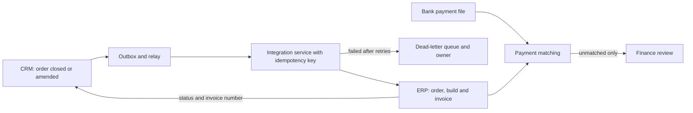
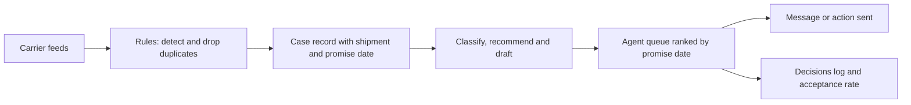

# Practise Case Drills 2

## How to use this practice

Run each drill in 20 minutes with a timer, as in [practise case drills 1](/learn/fde-case-drills/case-drills/practise-case-drills-1):

1. Spend 2 minutes reading the brief and writing the questions you would ask.
2. Spend 6 minutes breaking the problem into parts, aloud.
3. Spend 8 minutes sketching the design and talking through the data flow.
4. Spend 4 minutes on the follow-up questions, answering before you open each one.

Open the outlines only after you have answered. Every customer, name and figure below is fictional.

> **What you'll practise**
>
> - Finding the failure modes of an integration before choosing its tools.
> - Designing an assistant that recommends while people stay in charge of actions.
> - Holding a design steady when volume or a rule changes mid-round.

## Drill 3. An order-to-cash sync with the ERP

Full case for after the drill: the reliable workflow orchestration casebook and the [three systems, one customer](/learn/fde-case-drills/end-to-end-engagements/three-systems-one-customer) simulation.

Brampton Engineering sells industrial pumps. Sales staff close orders in a customer relationship management (CRM) system, and a nightly spreadsheet export copies them into the enterprise resource planning (ERP) system, which schedules the build and raises the invoice. About 600 orders close each month. Some orders arrive twice, amended orders keep their old price, and finance spends two days at every month-end matching invoices to bank payments by hand.

Decompose: what are the parts, and what do you ask first?

- **The flow.** Write the stages: order closed, order created in the ERP, build scheduled, invoice raised, payment received, payment matched. Ask which system owns each stage, because the owner is the source of truth for it.
- **The failures.** Name the three seen today: duplicates, stale amendments and manual matching. Ask how many of the 600 orders hit each one last month. The biggest number decides where to start.
- **The interfaces.** Ask what the ERP offers for creating orders (an API, a staging table or file import only), its maintenance windows, and whether the CRM can send an event when an order closes.
- **The identifiers.** Ask whether one order number travels through every system. Without a shared key, duplicates and matching problems cannot be fixed.
- **The people.** Sales owns the order, operations owns the build and finance owns the invoice and payment. Ask who fixes an order that fails to sync, and how they hear about it.

The first three questions to ask, in order: which failure costs the most, which identifier is shared across systems, and what interface the ERP supports.

Design: what do you build, and how does an order flow through it?

- **Event on close.** When an order closes or is amended, the CRM writes an event to an outbox table in the same transaction, then a relay publishes it. No order is lost if the relay is down.
- **Integration service.** It reads events in order, maps fields to the ERP's format, and calls the ERP with an idempotency key made of the order number and version. A repeated event with the same key does nothing.
- **Amendments.** A new version of an order updates the ERP order if it is not yet built, or raises a change request for operations if it is.
- **Failures.** Calls that fail after retries go to a dead-letter queue with the reason. A named owner in operations works that queue each morning.
- **Status back and matching.** The ERP order number and invoice status are written back to the CRM. Payments from the bank file are matched on invoice number, and only unmatched payments reach finance.

Draw your own sketch first, then compare it with Figure 1.

*Figure 1: Brampton's order-to-cash sync. Events replace the nightly export, the idempotency key stops duplicates, and finance sees only unmatched payments.*

Practice question 1. The ERP goes down for a four-hour maintenance window every Sunday. What happens to orders closed during it?

- **Answer:** They wait. Events stay in the outbox and the integration service retries with backoff until the ERP returns, then processes them in order. Nothing goes to the dead-letter queue for a planned window. Pause the retries during the published window so the queue does not fill with noise. Alert only if the backlog is still there an hour after the window ends.
- **Trade-off:** Orders reach the ERP up to four hours late. Sending them through a second path during the window would add a source of duplicates.
- **Follow-up to expect:** "Sales wants confirmation straight away." Show "Waiting for ERP" in the CRM so sales knows the order is queued, not lost.

Practice question 2. A salesperson amends the price after the pump is already being built. What should the sync do?

- **Answer:** Not overwrite the ERP order. Once the build starts, the ERP owns the order and changes follow its change process. The sync sees the version is newer, finds the order already in build, and raises a change request for operations with both prices. The CRM shows the amendment as pending until operations accepts or rejects it.
- **Trade-off:** A person must handle each late amendment. Overwriting silently could invoice a price operations never agreed.
- **Follow-up to expect:** "How many amendments arrive late?" Measure it in the first month. If the count is high, the real fix is a sales process rule, not code.

Practice question 3. How do you prove the new sync is better than the nightly export?

- **Answer:** Use the numbers from discovery. Before launch, count duplicates, stale amendments and finance's month-end matching hours. After two month-ends, compare the same counts. Add a daily reconciliation report that compares order totals in the CRM and the ERP and lists any order in one system but not the other. A clean report each day is the evidence finance trusts.
- **Trade-off:** The reconciliation report is extra work to build. Without it, nobody notices a silent gap until month-end.
- **Follow-up to expect:** "What if the report finds a gap?" Each gap names an order and a stage, so the owner can trace it to a log entry or a dead-letter item.

## Drill 4. An assistant for shipment exceptions

Full case for after the drill: the logistics exception handling casebook.

Saltash Freight moves about 40,000 parcels a day across 30 carriers. About 3% of shipments stall each day (a missed scan, a customs hold, a damaged label), which makes about 1,200 exceptions. A team of 25 operations agents reads carrier messages, decides what to do and writes to the customer or carrier. Agents reach about 900 exceptions a day, and the rest roll over. Saltash wants an assistant to help clear the queue.

Decompose: what are the parts, and what do you ask first?

- **Detection.** What counts as an exception today, and who defined it? Ask for the rules, such as no scan for 24 hours. A loose rule floods the queue with parcels that are fine.
- **Types and actions.** List the main exception types and the action each one needs. Ask for last month's split. A few types usually take most of the volume, and those are where to start.
- **Context.** For each exception, the agent needs the shipment record, the carrier's message and the customer's promise date. Ask where each lives and how fresh the carrier feeds are.
- **Actions and risk.** Some actions are cheap to undo (a status note), others are not (rerouting a shipment, issuing a refund). Ask who may approve each one.
- **Measure.** Today 900 of 1,200 get handled each day and 300 roll over. Ask whether the target is queue size, time to first action or customer complaints.

The first three questions to ask, in order: which exception types make up most of the volume, which actions are hard to undo, and which measure the operations lead reports.

Design: what do you build, and how does an exception flow through it?

- **Detect with rules.** Carrier feeds land in one event stream. A rules step flags exceptions using the agreed thresholds and drops duplicates for the same parcel.
- **Gather context.** For each exception, fetch the shipment, recent carrier messages and the customer's promise date into one case record.
- **Recommend.** A model classifies the type and proposes an action and a draft message, citing the carrier message it relied on. Unknown types go to the queue with no recommendation.
- **Agent approves.** Agents see a queue ranked by promise date and accept, edit or reject each recommendation. Hard-to-undo actions always need an agent.
- **Measure.** Store each recommendation with the agent's decision. The acceptance rate per type shows where the assistant helps and where it does not.

Draw your own sketch first, then compare it with Figure 2.

*Figure 2: Saltash's exception assistant. Rules detect, the model recommends with a cited reason, and an agent approves each action.*

Practice question 4. A storm closes a hub and exceptions jump from 1,200 to 9,000 in a day. What does the design do?

- **Answer:** Group them. Most of the 9,000 share one cause. The rules step tags exceptions by route and cause, and agents act on a group with one message template instead of one parcel at a time. Rank groups by the customers with the nearest promise dates. Watch model costs and rate limits, and fall back to rules-only grouping if the model is throttled.
- **Trade-off:** Group actions are less tailored to each customer. Handling 9,000 one by one would take the team about ten days at today's rate.
- **Follow-up to expect:** "How do you spot a storm early?" A sudden rise in exceptions on one route triggers an alert to the operations lead.

Practice question 5. Agents accept 97% of drafts for missed-scan exceptions. The lead asks to send those automatically. Do you agree?

- **Answer:** For that type only, with limits. A missed-scan update to a customer is cheap to correct, so auto-sending is reasonable after the acceptance rate holds for several weeks. Keep a daily sample for review and a kill switch the lead controls. Do not extend it to customs holds or refunds without separate evidence.
- **Trade-off:** Auto-sending frees agent time for harder cases. An unreviewed message that is wrong reaches a customer before anyone sees it.
- **Follow-up to expect:** "What makes you switch it off?" A rise in complaints or in agent edits on the sample.

Practice question 6. One carrier's feed starts sending scans six hours late. How does the assistant behave?

- **Answer:** The rules would flag many of that carrier's parcels as stalled when they are moving. Monitor feed lag per carrier and pause exception detection for a carrier whose feed is late beyond a threshold, with a banner in the agent queue. Tell the carrier through the account manager.
- **Trade-off:** Pausing detection may hide a real stall for a few hours. Leaving it on sends false alarms to customers.
- **Follow-up to expect:** "How would you notice the lag?" Compare the scan time with the arrival time of each feed message.

## Limits of this practice

- **Outlines are not scripts.** Use your own words and examples in the round.
- **Fictional customers.** Brampton Engineering, Saltash Freight and every figure here are illustrative.
- **One design among several.** A message broker, an integration platform or a workflow engine could each carry these flows.

## References

1. Chris Richardson, [Pattern: Transactional outbox](https://microservices.io/patterns/data/transactional-outbox.html), accessed 17 November 2026. Writing the event in the same transaction as the order change.
2. Gregor Hohpe and Bobby Woolf, [Idempotent Receiver](https://www.enterpriseintegrationpatterns.com/patterns/messaging/IdempotentReceiver.html), Enterprise Integration Patterns, accessed 17 November 2026. Ignoring repeated messages safely.
3. Gregor Hohpe and Bobby Woolf, [Dead Letter Channel](https://www.enterpriseintegrationpatterns.com/patterns/messaging/DeadLetterChannel.html), Enterprise Integration Patterns, accessed 17 November 2026. Where messages go when they cannot be delivered.
4. The site's logistics exception handling casebook, the full case behind drill 4.

## Key takeaways

- Map each stage of a flow to the system that owns it before choosing tools.
- A shared identifier and an idempotency key stop duplicates at the source.
- Give failed messages a queue and a named owner, not a log line.
- Let rules detect, let the model recommend, and keep people on actions that are hard to undo.
- Automate one exception type at a time, after its acceptance rate holds.

## Check yourself

1. Why does Brampton's design write the event to an outbox in the same transaction as the order?

So the order change and the event either both happen or neither does. Publishing straight to a queue after saving the order can lose the event if the process stops between the two steps.

2. Why does Saltash detect exceptions with rules instead of asking the model to find them?

The thresholds are agreed business rules, and rules apply them the same way to all 40,000 parcels at low cost. The model's value is in classifying and drafting once a case exists.

