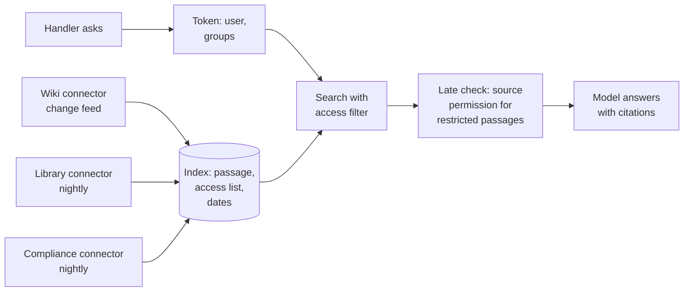

# A Permission-aware Knowledge Assistant

## Start with the index that forgot who was asking

Denby Insurance, a fictional general insurer, wants an assistant for its 400 claims handlers and underwriters. The head of claims asks: "Our people spend hours searching three places for the right policy. Give them one box that answers with sources."

An internal team had built a pilot in a fortnight. It indexed everything with one service account and answered well in the demo. In its second week, a claims handler asked how fraud referrals work and received a paragraph from a restricted investigation memo about a named customer. The pilot was switched off the same afternoon.

The index held every document, but it had no idea which person was allowed to read which one. Call this **the index that forgot who was asking**.

> **What you'll learn**
>
> - Design retrieval over sources with different permissions and update schedules.
> - Keep stale and superseded documents from answering questions.
> - Evaluate retrieval and answers separately, so you fix the right layer.
> - Close the gap when someone's access is revoked.
> - Answer correctly when two documents give contradictory rules with different effective dates.

## Discover: three sources, three rule sets

Discovery maps each source: who can read it, how often it changes, and how you can learn about changes.

| Source | Content | Who can read | Changes | Change signal |
| --- | --- | --- | --- | --- |
| Underwriting wiki | Policy wording, guidance | Groups per product line | Daily | Change feed, minutes behind |
| Claims document library | Procedures, templates, investigation memos | Per folder, some per document | Weekly | Nightly listing only |
| Compliance archive | Regulator circulars, internal rulings | Compliance team, plus named readers | Weekly | Nightly export |

*Table 1: The three sources. Permissions and freshness differ per source. One index-wide rule fits none of them.*

You also collect 120 real questions from handlers' search logs and team leads, with the passage that answers each one, marked by a senior handler. That set is your evaluation baseline before any design.

## Design: permissions on every passage

The assistant uses retrieval-augmented generation (RAG): it retrieves passages, then asks a model to answer only from them, with citations. Three design rules follow from discovery.

- **Store access with every passage.** Each indexed passage carries the groups or users allowed to read its source document, copied by the connector for that source.
- **Filter at query time.** The user's groups come from the identity provider's sign-in token. The search returns only passages whose access list includes one of them. The model never sees a passage the user could not open.
- **Keep freshness metadata.** Each passage records its source's last change time, its effective-from date if the document has one, and whether a newer version supersedes it. Superseded passages leave the index.

*Figure 1: The assistant. Access is filtered in the search and checked again at the source for restricted material.*

**Evaluation is split in two.** On the 120 questions, retrieval found the marked passage in the top five results for 94, which is 78 per cent. Answers were correct for 84. Of the 36 wrong answers, 26 had a retrieval miss and only 10 had the right passage and a wrong answer. Without the split, the team would have tuned the prompt. With it, they fixed retrieval first: they split long procedure pages into smaller passages and added the product line as a filter.

## The constraint changes: revoked access and contradictory dates

In week four, two problems arrive.

A handler moves from the fraud team to motor claims. Identity administrators remove her fraud group the same morning. The claims library's nightly listing will not show the change until the next night, and a cached answer from yesterday still quotes a fraud procedure. For up to a day, the assistant would show her material she can no longer open.

Then the underwriting lead reports a wrong answer. A handler asked for the excess on an escape-of-water claim. The wiki says £500 from 1 March 2026. A compliance ruling says £750 for policies renewed from 1 April 2026. An older claims procedure still says £400. The assistant answered £500 for a policy renewed in May.

## Recover: close the gaps, then show the conflict

**Revoked access.** Fix it in layers, from fastest to slowest:

1. **Token groups at query time.** The search filter uses the groups in the user's current token, refreshed every 15 minutes. Her fraud group drops out within that window, whatever the index holds.
2. **Late check for restricted sources.** For the claims library and the compliance archive, the assistant asks the source system whether this user can open each document before using it. This adds about 150 milliseconds for a few documents, accepted by the head of claims for restricted content only.
3. **Cache keyed by access.** Cached answers are keyed by question and the user's group set. A change of groups misses the old cache.
4. **Event-driven re-sync.** A group removal triggers a re-sync of that group's permissions in the index, rather than waiting for the nightly run.

**Contradictory dates.** The fix is in the data, then in the answer:

- Every policy passage gets an effective-from date and, where a later rule replaces it, an effective-to date. The compliance team owns those dates.
- The question's date matters. The assistant asks for, or reads from the claim, the policy renewal date, and retrieves only passages in force on it.
- When two passages in force still disagree, the assistant shows both with citations and says which team owns the rule. It does not choose or blend them.
- The stale £400 procedure is marked superseded by its owner and leaves the index.

Re-run on the 120 questions plus 15 new date questions, retrieval rises to 108 of 120 and correct answers to 101. All 15 date questions pass.

## Defend: the evidence the head of claims needs

The walkthrough replays the engagement as you would present it.

Step through the Denby engagement. Each phase shows what happened, your move and the evidence you kept.

<button type="button" data-step="0" aria-pressed="false" aria-controls="denby-step-0">1. Discover</button><button type="button" data-step="1" aria-pressed="false" aria-controls="denby-step-1">2. Design</button><button type="button" data-step="2" aria-pressed="false" aria-controls="denby-step-2">3. Change</button><button type="button" data-step="3" aria-pressed="false" aria-controls="denby-step-3">4. Recover</button><button type="button" data-step="4" aria-pressed="false" aria-controls="denby-step-4">5. Defend</button>

<section id="denby-step-0" class="step-panel" aria-labelledby="denby-heading-0"><h4 id="denby-heading-0">1. Discover the sources</h4><dl><dt>What happened</dt><dd>A pilot leaked a restricted memo through a single service account.</dd><dt>Your move</dt><dd>Map permissions, change schedules and change signals per source, and collect real questions.</dd><dt>Evidence</dt><dd>A source table and 120 questions with marked answers.</dd></dl></section><section id="denby-step-1" class="step-panel" aria-labelledby="denby-heading-1"><h4 id="denby-heading-1">2. Design for access</h4><dl><dt>What happened</dt><dd>Each source has its own access rules and freshness.</dd><dt>Your move</dt><dd>Access lists on every passage, query-time filtering, freshness metadata and split evaluation.</dd><dt>Evidence</dt><dd>Retrieval 94 of 120, answers 84 of 120, 26 of 36 errors from retrieval.</dd></dl></section><section id="denby-step-2" class="step-panel" aria-labelledby="denby-heading-2"><h4 id="denby-heading-2">3. The constraint changes</h4><dl><dt>What happened</dt><dd>A handler lost a group, and three documents gave three excess amounts.</dd><dt>Your move</dt><dd>Measure the exposure window and trace the wrong answer to its passages.</dd><dt>Evidence</dt><dd>Up to a day of stale access, and a May renewal answered with a March rule.</dd></dl></section><section id="denby-step-3" class="step-panel" aria-labelledby="denby-heading-3"><h4 id="denby-heading-3">4. Recover</h4><dl><dt>What happened</dt><dd>Both problems were design gaps, not model faults.</dd><dt>Your move</dt><dd>Token groups, late checks, access-keyed cache and event re-sync, plus owned effective dates.</dd><dt>Evidence</dt><dd>A 15-minute revocation window and 15 of 15 date questions correct.</dd></dl></section><section id="denby-step-4" class="step-panel" aria-labelledby="denby-heading-4"><h4 id="denby-heading-4">5. Defend the result</h4><dl><dt>What happened</dt><dd>The head of claims asks whether it is safe to roll out.</dd><dt>Your move</dt><dd>Show the access tests, the split evaluation and who owns rule dates.</dd><dt>Evidence</dt><dd>Retrieval 108 of 120, answers 101 of 120, no restricted passage in any test.</dd></dl></section>

<button type="button" data-walk="previous">Previous</button>

<button type="button" data-walk="next">Next step</button>

The walkthrough is a scripted illustration. The question you will be pressed on is the revocation window. State it as a number and say who accepted it.

## Limits of this lesson

- **Fictional data.** Denby Insurance, its sources and every figure are illustrative.
- **Access models vary.** Some sources expose per-document permissions through an API, and some do not. Where they do not, keep restricted content out of the index.
- **Deep topics live elsewhere.** Retrieval tuning and evaluation methods have their own lessons, linked below.

## Interview angle

Each answer is an outline to say in about two minutes. The last question is timed: set a clock and talk it through before opening it.

Interview question 1. Design an assistant over three internal sources that each have their own permissions and update schedules.

- **Answer:** Write one connector per source that copies each document's access list onto every passage and tracks changes in the way that source allows. Filter the search by the user's groups from their sign-in token. The model never sees what the user cannot open. Check restricted sources again at the source before use. Store change times and effective dates, and cite every answer.
- **Trade-off:** Per-source connectors take longer than one crawler. One crawler with a service account leaks.
- **Follow-up to expect:** "A source has no permission API." Keep its restricted content out of the index.
- **Go deeper:** [Permissions, deletions and citations](/learn/fde-building-in-the-estate/ai-delivery-in-customer-estates/permissions-deletions-and-citations).

Interview question 2. How do you stop stale documents answering, and why evaluate retrieval separately from answers?

- **Answer:** Keep change times, effective dates and a superseded flag, owned by the content owners, and remove superseded passages. Evaluate in two parts on real questions with marked answers: did retrieval find the right passage, and was the answer right given it. A wrong answer has two possible causes, and only the split tells you which layer to fix.
- **Trade-off:** Marking passages for each question takes expert time. Without it, teams tune prompts for retrieval misses.
- **Follow-up to expect:** "How many questions?" Start with about a hundred real ones and add each production failure.
- **Go deeper:** [Evaluating on the customer's work](/learn/fde-building-in-the-estate/ai-delivery-in-customer-estates/evaluating-on-the-customers-work).

Interview question 3. A user's access to a source is revoked, but the index syncs nightly. What do you do?

- **Answer:** Filter on the groups in the user's current token, refreshed every few minutes, rather than on what the index last saw. For restricted sources, check permission at the source before using a passage. Key the answer cache by the user's group set. Trigger a permission re-sync from the revocation event. State the remaining window as a number and get the owner to accept it.
- **Trade-off:** Late checks add latency on every restricted query. Without them, revocation waits for the next sync.
- **Follow-up to expect:** "The token lasts an hour." Shorten it for this app, or add the late check for all sources.

Interview question 4. Two policy documents give different values for the same rule, with different effective dates. How should the assistant answer?

- **Answer:** Give every rule passage an effective-from and effective-to date owned by the policy team. Use the date that matters for the question, such as the policy renewal date, and retrieve only passages in force on it. If two in-force passages still disagree, show both with citations and the owning team. Never pick or blend. Retire superseded documents at the source.
- **Trade-off:** Asking for a date adds a step for the user. Guessing the date gives confident wrong answers.
- **Follow-up to expect:** "Nobody owns the dates." That is the real finding. Raise it with the sponsor before launch.

Interview question 5. Timed drill (20 minutes): an insurer wants one assistant over three sources with different permissions. Run the engagement.

- **Answer:** Minutes 0 to 4: discovery on sources, permissions, change signals and real questions. Minutes 4 to 9: the design, with per-passage access, query-time filtering, late checks and freshness metadata. Minutes 9 to 12: split evaluation and what it tells you. Minutes 12 to 15: revoked access and the window you can promise. Minutes 15 to 18: contradictory effective dates. Minutes 18 to 20: the rollout evidence and the owners you need.
- **Trade-off:** Model choice is tempting to discuss. Access and freshness decide whether it can launch.
- **Follow-up to expect:** "What would block launch?" Any restricted passage reaching a user without access in tests.

## References

1. Elastic, [Document level security](https://www.elastic.co/guide/en/elasticsearch/reference/current/document-level-security.html), accessed 17 November 2026. Restricting which indexed documents a user's search can return.
2. Ragas, [Available metrics](https://docs.ragas.io/en/stable/concepts/metrics/available_metrics/), accessed 17 November 2026. Separate metrics for retrieval, such as context precision, and for answers, such as faithfulness.
3. The site's enterprise knowledge assistant case, for the full design.
4. The author's own field experience, the basis for the revocation layers and the effective-date rules.

## Key takeaways

- Store each source's access list on every passage and filter at query time with the user's current groups.
- Check restricted sources again at the source, and key caches by the user's access.
- Freshness needs owned effective dates and superseded flags, not only sync times.
- Evaluate retrieval and answers separately, so you fix the layer that failed.
- When in-force rules disagree, show both with citations and the owner. Do not choose.

## Check yourself

1. Why did the team fix retrieval before the prompt?

26 of the 36 wrong answers had a retrieval miss. Only 10 had the right passage and a wrong answer.

2. Why was the nightly sync not enough after the handler changed teams?

The claims library's nightly listing showed the change only the next night, and a cached answer still held the old content. She could see fraud material for up to a day.

3. Which date decides the escape-of-water excess, and why?

The policy renewal date, because each rule applies to policies renewed in its effective window. A May renewal falls under the £750 ruling from 1 April 2026.

