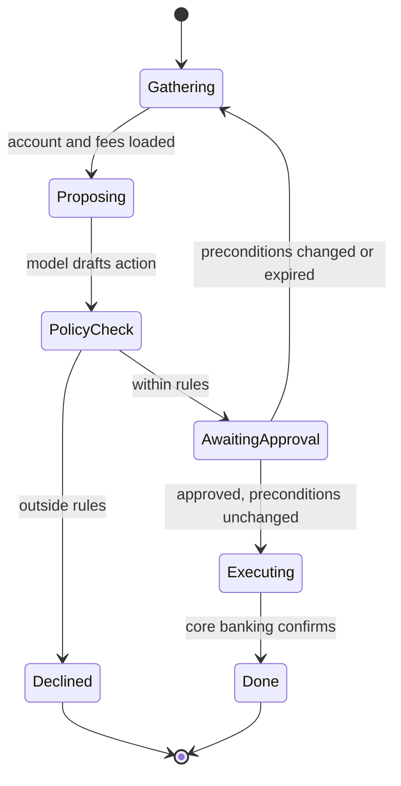

# An Agent That Changes Accounts

## Start with an agent that could do anything

Elstow Bank, a fictional business bank, handles about 1,800 fee disputes a month. A business customer writes in, an operations analyst reads the account history and the fee rules, and decides whether to refund. The head of operations asks: "Can an agent investigate these cases and fix the account, with an analyst signing off?"

A vendor's demonstration had shown an agent with one broad tool that could update any account field. It refunded a fee, then, asked a follow-up, changed the customer's correspondence address because the email mentioned a move. Nobody had approved the second action. The bank's risk team stopped the evaluation.

The agent was capable, and its tools let it do anything the model decided. Call this **the open hand**: an agent whose reach is set by its tools, not by what the business approved.

> **What you'll learn**
>
> - Decide which steps of a case are deterministic code and which need a model.
> - Give an agent narrow tools with scoped credentials.
> - Bind an analyst's approval to the exact action and the facts it was based on.
> - Persist the agent's state so a crash or restart resumes safely.
> - Recover when approvals go stale and when a restart follows a successful external update.

## Discover: what an analyst does with a case

You sit with three analysts for a day and follow 20 cases. Each case has the same shape: read the customer's message, pull the account and its fees, check the fee rules, decide, refund or decline, and write a note. Table 1 sorts the steps.

| Step | Who does it in the design | Why |
| --- | --- | --- |
| Read the message, find which fees are disputed | Model | Free text, varied wording |
| Pull the account, fee history and past refunds | Code | Fixed queries to core banking |
| Check eligibility: fee type, amount, refunds in the last 12 months | Code | Written rules, must be exact |
| Summarise the evidence and draft a reason | Model | Prose for the analyst and customer |
| Approve or decline | Analyst | Accountability stays with a person |
| Issue the refund and write the note | Code | An exact, logged change |

*Table 1: The case split into steps. The model reads and writes prose. Code fetches, checks rules and changes accounts.*

The fee rules allow analysts to refund up to £50 per fee without a manager. Larger refunds, and anything other than a fee refund, stay outside the agent's scope.

## Design: narrow tools, bound approvals, durable state

The agent is a workflow with model steps inside it, not a free loop. Figure 1 shows the states a case moves through.

*Figure 1: The case workflow. Each state is saved before the next step starts, and the path from approval back to gathering is what catches stale approvals.*

- **Tools.** Read tools fetch the account, fees and past refunds. One write tool refunds a single named fee, up to £50, and needs an idempotency key. A second adds a case note. There is no tool for addresses or limits. The agent's service account can call only these.
- **Approval binding.** The analyst sees the exact action: account, fee, amount and reason. The approval stores a hash of that action and a snapshot of its preconditions, such as the fee still being unrefunded and the account open.
- **State.** Every case's state, step results and the action awaiting approval live in a durable workflow store, not in the agent's memory.

Pilot results over two weeks: 410 cases, analysts approved 362 proposals unchanged, edited 31 and declined 17. Median time from approval to refund was 25 minutes.

## The constraint changes: stale approvals and a restart

Two incidents arrive in week three.

On Monday morning, a system outage pauses execution for four hours while approvals keep coming in. When it clears, 140 approved refunds run. Nine of them run against accounts that changed after approval. In four cases, branch staff had already refunded the same fee by phone. Those four double refunds total £118.

On Wednesday at 16:02, a deployment restarts the workers. Three refunds had reached core banking and succeeded, but the workers stopped before saving the result. On restart, the workflow saw three steps not done and sent them again. Core banking paid them a second time, £70 in all, and the daily reconciliation found them the next morning.

## Recover: check facts at execution, never guess after a crash

**Stale approvals.** An approval is a decision about facts at a moment. The fix makes the executor check those facts again:

1. Before executing, re-read the fee and account, and compare with the snapshot stored with the approval.
2. If any precondition changed, do not execute. Send the case back to gathering and ask for a new approval with the new facts shown.
3. Approvals expire after 60 minutes. An expired approval goes back to the analyst queue.
4. The executor refuses any call whose hash differs from the approved one.

**The restart.** The failure was that the workflow could not tell "not sent" from "sent, result unknown". The fix:

1. Each refund gets an idempotency key made from the case ID and step number, sent to core banking with the call.
2. The workflow saves the state "sending" with that key before the call.
3. On restart, a step found in "sending" queries core banking by key. If the refund exists, record it and move on. If not, send again with the same key, which core banking treats as the same request.

The seven double refunds are reversed through the bank's normal correction process, with a note to each customer. You write a short incident report: what happened, the £188 total, the fixes, and the test that now replays a crash between the call and the save.

## Defend: why the bank can trust it

The walkthrough replays the engagement as you would present it to the risk team.

Step through the Elstow engagement. Each phase shows what happened, your move and the evidence you kept.

<button type="button" data-step="0" aria-pressed="false" aria-controls="elstow-step-0">1. Discover</button><button type="button" data-step="1" aria-pressed="false" aria-controls="elstow-step-1">2. Design</button><button type="button" data-step="2" aria-pressed="false" aria-controls="elstow-step-2">3. Change</button><button type="button" data-step="3" aria-pressed="false" aria-controls="elstow-step-3">4. Recover</button><button type="button" data-step="4" aria-pressed="false" aria-controls="elstow-step-4">5. Defend</button>

<section id="elstow-step-0" class="step-panel" aria-labelledby="elstow-heading-0"><h4 id="elstow-heading-0">1. Discover the case steps</h4><dl><dt>What happened</dt><dd>A vendor agent with one broad tool changed an address nobody approved.</dd><dt>Your move</dt><dd>Follow 20 real cases and sort each step into model, code or analyst.</dd><dt>Evidence</dt><dd>A step table and a £50 refund limit from the fee rules.</dd></dl></section><section id="elstow-step-1" class="step-panel" aria-labelledby="elstow-heading-1"><h4 id="elstow-heading-1">2. Design the workflow</h4><dl><dt>What happened</dt><dd>The bank wanted analyst sign-off on every change.</dd><dt>Your move</dt><dd>Narrow tools, approvals bound to an action hash and preconditions, state in a durable store.</dd><dt>Evidence</dt><dd>410 pilot cases: 362 approved unchanged, 31 edited, 17 declined.</dd></dl></section><section id="elstow-step-2" class="step-panel" aria-labelledby="elstow-heading-2"><h4 id="elstow-heading-2">3. The constraint changes</h4><dl><dt>What happened</dt><dd>A four-hour pause left approvals stale, and a restart re-sent three completed refunds.</dd><dt>Your move</dt><dd>Treat both as design gaps and size the harm.</dd><dt>Evidence</dt><dd>Four double refunds of £118 and three of £70.</dd></dl></section><section id="elstow-step-3" class="step-panel" aria-labelledby="elstow-heading-3"><h4 id="elstow-heading-3">4. Recover</h4><dl><dt>What happened</dt><dd>The executor trusted old facts and could not tell sent from unsent.</dd><dt>Your move</dt><dd>Re-check preconditions, expire approvals, add idempotency keys and a "sending" state.</dd><dt>Evidence</dt><dd>Seven refunds reversed and a crash test that now passes.</dd></dl></section><section id="elstow-step-4" class="step-panel" aria-labelledby="elstow-heading-4"><h4 id="elstow-heading-4">5. Defend the design</h4><dl><dt>What happened</dt><dd>The risk team asks what the agent can and cannot do.</dd><dt>Your move</dt><dd>Show the tool list, the approval binding, the state diagram and the incident report.</dd><dt>Evidence</dt><dd>No write tool beyond a £50 fee refund, and every change traceable to an approval.</dd></dl></section>

<button type="button" data-walk="previous">Previous</button>

<button type="button" data-walk="next">Next step</button>

The walkthrough is a scripted illustration. A risk team trusts an agent by its limits. Lead with what it cannot do.

## Limits of this lesson

- **Composite engagement.** Elstow Bank, its cases and every figure are illustrative, not a real customer.
- **Core systems differ.** Not every core banking system accepts idempotency keys. Without them, look up by a client reference before any retry, or keep the step manual.
- **Regulation applies.** Customer redress, complaint handling and record keeping follow the bank's own regulatory duties.

## Interview angle

Each answer is an outline to say in about two minutes. The last question is timed: set a clock and talk it through before opening it.

Interview question 1. An agent investigates customer cases and proposes fixes. Which steps should be deterministic code, and which a model?

- **Answer:** Follow real cases and sort the steps. Use a model where the input is free text or the output is prose: reading the complaint and drafting the reason. Use code for fetching data, checking written rules and changing accounts, because those must be exact and repeatable. Keep the approve or decline decision with a person while trust is built.
- **Trade-off:** More code means more to build up front. More model steps means outcomes you cannot repeat or audit.
- **Follow-up to expect:** "Why not let the model check eligibility?" The rules are written and exact. A model adds variance for no gain.
- **Go deeper:** [Workflow or agent](/learn/fde-building-in-the-estate/choosing-the-ai-approach/workflow-or-agent).

Interview question 2. How do you design the agent's tools, approvals and state?

- **Answer:** Give it narrow tools that each do one approved action with limits, such as refunding one fee up to a cap, under a service account that can call only those. Bind each approval to a hash of the exact action and a snapshot of its preconditions. Run it as a workflow whose state is saved in a durable store before each step, so it survives restarts.
- **Trade-off:** Narrow tools mean new tools for new actions. Broad tools let the model act beyond what anyone approved.
- **Follow-up to expect:** "The analyst edits the action." An edit creates a new action, a new hash and a new approval.
- **Go deeper:** [Agents that touch business systems](/learn/fde-building-in-the-estate/ai-delivery-in-customer-estates/agents-that-touch-business-systems).

Interview question 3. Approved actions sat in a queue for hours, and some ran against accounts that had changed. How do you fix it?

- **Answer:** Treat an approval as a decision about facts at a moment. Store the preconditions with it, and have the executor re-read them before acting. If anything changed, stop, send the case back and ask for a new approval with the new facts. Expire approvals after a set time. Reverse the harm through the normal correction process and report it.
- **Trade-off:** Re-checks and expiry cause more re-approvals after a backlog. Running stale approvals pays twice.
- **Follow-up to expect:** "Analysts complain about re-approvals." Show them what changed, so a second look takes seconds.

Interview question 4. The agent's worker restarted after an external system had applied an update but before the agent recorded it. What should happen?

- **Answer:** The workflow must tell "not sent" from "sent, result unknown". Save a "sending" state with an idempotency key before each external call. On restart, query the external system by that key. If the update exists, record it and continue. If not, resend with the same key. Add a test that crashes between the call and the save.
- **Trade-off:** The extra state write and lookup add a little latency. Guessing after a crash means duplicates or lost work.
- **Follow-up to expect:** "The system has no keys or lookup." Keep that step manual, or reconcile before any retry.
- **Go deeper:** [The confirmation gate and memoization](/learn/production-ai/robust-agents/the-confirmation-gate-and-memoization).

Interview question 5. Timed drill (20 minutes): a bank wants an agent to investigate fee disputes and fix accounts with analyst sign-off. Run the engagement.

- **Answer:** Minutes 0 to 3: discovery on case volume, steps, rules and limits. Minutes 3 to 6: the step split between model, code and analyst. Minutes 6 to 10: tools, scoped credentials, approval binding and the state diagram. Minutes 10 to 13: pilot measures, such as approval rates and edits. Minutes 13 to 17: stale approvals and the restart, with the fixes. Minutes 17 to 20: what the agent cannot do, and the evidence for the risk team.
- **Trade-off:** Agent planning loops are tempting to discuss. Limits, state and approvals decide whether a bank allows it.
- **Follow-up to expect:** "When would you remove the analyst?" For a narrow case type, after a long record with few edits, agreed with risk.

## References

1. OWASP, [LLM06: Excessive Agency](https://genai.owasp.org/llmrisk/llm062025-excessive-agency/), accessed 17 November 2026. Limiting an agent's tools, permissions and autonomy.
2. Stripe, [Idempotent requests](https://docs.stripe.com/api/idempotent_requests), accessed 17 November 2026. Keys that make a retried write safe.
3. Temporal, [Workflows](https://docs.temporal.io/workflows), accessed 17 November 2026. Durable workflow state that survives process restarts.
4. The site's tool-using agent with safety controls case, and the author's own field experience, the basis for the approval binding and the incident steps.

## Key takeaways

- Use a model for free text and prose, and code for data, rules and account changes.
- Give the agent narrow, capped tools under a service account that can call nothing else.
- Bind approvals to the exact action and its preconditions, re-check them at execution, and expire them.
- Save a "sending" state with an idempotency key before every external call, and look up by key after a crash.
- Defend an agent by what it cannot do.

## Check yourself

1. Why did the Monday backlog cause double refunds?

Approvals were executed four hours later without re-checking the facts, and branch staff had refunded four of the same fees by phone in the meantime.

2. What did the workflow lack on Wednesday?

A way to tell a refund that was sent with an unknown result from one never sent. It had no "sending" state and no idempotency key to look up.

3. Why is there no tool for changing addresses?

Address changes are outside the approved scope. An agent's reach should match what the business approved, and the tools set that reach.

