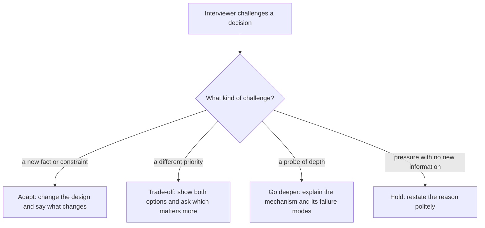

# Defending Your Engagement in the Interview

## Start with the answer that folded

A candidate finishes a strong 40 minutes on a case like [document processing in a legacy estate](/learn/fde-case-drills/end-to-end-engagements/document-processing-in-a-legacy-estate). The design for Selsey Water runs extraction inside the customer's network, imports through the ERP's batch file and sends payment amounts that fail a check to a clerk.

The interviewer leans back. "A hosted model would be more accurate. Why not use one?"

The candidate says, "Good point, I would switch to a hosted model." The interviewer writes a note. The design had no outbound internet as its first constraint, stated by the candidate 30 minutes earlier. The candidate dropped it at the first push.

A second candidate, given the same challenge, argues for five minutes that self-hosting is always better. Neither listened to what the question tested. Call this **the fold-or-fortress reflex**: answering a challenge by giving up the design or by defending all of it, instead of sorting what the challenge is about.

> **What you'll learn**
>
> - Know what an interviewer tests when they challenge your final design.
> - Present a final solution in about three minutes with its key decisions visible.
> - Sort a challenge into new fact, different priority, depth probe or pressure test.
> - Hold, concede or adapt, and say which you are doing.
> - Close with your final position, what changed and the risks that remain.

## What the challenge tests

At the end of a case, the interviewer has seen your design. The challenge tests something else: whether your decisions rest on reasons you can name, and whether you change them for good reasons only.

They listen for three things:

- **You know why you chose.** Each key decision traces to a constraint, a measure or evidence from the engagement.
- **You know what you gave up.** You can name the cost of each decision without being asked.
- **You know what would change your mind.** A fact, a number or a priority that would make you choose differently.

A candidate who can say all three for each decision does not need to win every exchange. The challenge is a conversation about judgement, not a contest.

## Present the final solution in three minutes

Before the challenges begin, give a short, structured summary. Use the same five parts for any engagement.

| Part | Time | Selsey Water example |
| --- | --- | --- |
| Problem and measure | 30 seconds | 9,000 scanned invoices a month typed by hand. Measure: correct amounts paid, clerk hours saved. |
| Constraints | 30 seconds | No outbound internet, an ERP with no API, finance relies on its import checks. |
| Design | 45 seconds | Self-hosted extraction, field checks, a review queue, the existing batch file. |
| Key decisions and their costs | 45 seconds | Self-hosting costs some accuracy. Review on amounts costs clerk time. |
| Evidence and next step | 30 seconds | Per-field accuracy, 57 of 60 amount errors caught before import. Next: raise the review limit when accuracy holds. |

*Table 1: A three-minute summary. Naming the costs of your own decisions answers half the challenges before they come.*

The fourth row matters most. Stating what you gave up shows you weighed it, and it gives the interviewer less to catch you on.

## Sort the challenge before you answer

Every challenge falls into one of four kinds. Take two seconds to decide which before you reply. Figure 1 shows the route from each kind to a response.

*Figure 1: Four kinds of challenge and the response each calls for. The sorting step is what the fold-or-fortress reflex skips.*

- **A new fact.** "The customer has now approved a private connection to a hosted provider." That changes a constraint. Adapt, and say what else changes, such as the data processing agreement.
- **A different priority.** "Accuracy matters more than data location here." Lay out both options with costs and ask which the customer would choose. Do not pick for them.
- **A depth probe.** "How would you know the self-hosted model is accurate enough?" Explain the per-field evaluation and the threshold.
- **A pressure test.** "A hosted model would be better." No new fact, no new priority. Hold: "Hosted would likely be more accurate. The customer's network blocks outbound calls, so I chose to stay inside and add checks for the fields where errors cost most."

If you cannot tell which kind it is, ask. "Is that a new constraint, or are you testing the trade-off?" is a fair question and shows you are sorting.

## Hold, concede or adapt, and say which

Name your move out loud, so the interviewer hears the decision as well as the content.

- **Hold.** "I would keep this, because..." Give the reason once, with its evidence, and state what would change your mind. Do not repeat yourself louder.
- **Concede.** "You are right, I missed that." Say what the gap costs and how you would fix it. A clean concession on a real gap scores better than a defence of it.
- **Adapt.** "With that constraint, I would change..." Trace the change through the design. A new fact rarely moves only one box.

The walkthrough runs the full defence for the Selsey design.

Run the defence of the Selsey Water design. Each stage shows what you do, a line you might say and the mistake to avoid.

<button type="button" data-step="0" aria-pressed="false" aria-controls="defence-step-0">1. Present</button><button type="button" data-step="1" aria-pressed="false" aria-controls="defence-step-1">2. Sort</button><button type="button" data-step="2" aria-pressed="false" aria-controls="defence-step-2">3. Respond</button><button type="button" data-step="3" aria-pressed="false" aria-controls="defence-step-3">4. Trace</button><button type="button" data-step="4" aria-pressed="false" aria-controls="defence-step-4">5. Close</button>

<section id="defence-step-0" class="step-panel" aria-labelledby="defence-heading-0"><h4 id="defence-heading-0">1. Present in three minutes</h4><dl><dt>You do</dt><dd>Give problem, constraints, design, decisions with costs, evidence and next step.</dd><dt>You might say</dt><dd>"Self-hosting costs some accuracy, so amounts get extra checks."</dd><dt>Avoid</dt><dd>Re-telling the whole engagement in order.</dd></dl></section><section id="defence-step-1" class="step-panel" aria-labelledby="defence-heading-1"><h4 id="defence-heading-1">2. Sort the challenge</h4><dl><dt>You do</dt><dd>Decide whether it is a new fact, a priority, a depth probe or pressure.</dd><dt>You might say</dt><dd>"Is that a new constraint, or are you testing the trade-off?"</dd><dt>Avoid</dt><dd>Answering before you know what is being asked.</dd></dl></section><section id="defence-step-2" class="step-panel" aria-labelledby="defence-heading-2"><h4 id="defence-heading-2">3. Hold, concede or adapt</h4><dl><dt>You do</dt><dd>Name your move and give the reason once.</dd><dt>You might say</dt><dd>"I would hold this. The network blocks outbound calls."</dd><dt>Avoid</dt><dd>Folding at the first push, or defending a real gap.</dd></dl></section><section id="defence-step-3" class="step-panel" aria-labelledby="defence-heading-3"><h4 id="defence-heading-3">4. Trace any change</h4><dl><dt>You do</dt><dd>When you adapt, follow the change through the rest of the design.</dd><dt>You might say</dt><dd>"A hosted model also needs a data processing agreement and a new security review."</dd><dt>Avoid</dt><dd>Changing one box and leaving the rest inconsistent.</dd></dl></section><section id="defence-step-4" class="step-panel" aria-labelledby="defence-heading-4"><h4 id="defence-heading-4">5. Close</h4><dl><dt>You do</dt><dd>State the final position, what changed and the risks that remain.</dd><dt>You might say</dt><dd>"Final design as before, with one change. The open risk is handwritten amounts."</dd><dt>Avoid</dt><dd>Ending on the last challenge with no summary.</dd></dl></section>

<button type="button" data-walk="previous">Previous</button>

<button type="button" data-walk="next">Next step</button>

The walkthrough is a scripted illustration. The lines are examples, not a script to memorise.

## Close with your final position

When the challenges end, take 30 seconds to close. Say the final design in one sentence, list what changed during the discussion and why, and name the risks you would watch first. For the [six-week support assistant](/learn/fde-case-drills/end-to-end-engagements/a-six-week-support-assistant), that might be: "Three intents live, visibility labels enforced at indexing. I changed the pilot size after your point on agent rotas. The open risk is stale articles."

A close turns a series of exchanges into a decision the interviewer can score. Without one, their last memory is whichever challenge went worst.

## Practise the defence

Practise with a partner using any lesson in this module.

1. Present the final solution in three minutes, using Table 1.
2. The partner asks five challenges, at least one of each kind, without saying which kind.
3. Name the kind and your move before each answer.
4. Close in 30 seconds.
5. Swap roles and score each other on whether the moves matched the kinds.

## Limits of this lesson

- **Scope.** Telling the build story and running the whiteboard round are taught in their own lessons, linked below.
- **Interviewers differ.** Some challenge to probe, some to see how you handle disagreement. The sorting step works for both.
- **Fictional data.** The candidates and the customers named here are illustrative.

## Interview angle

Each answer is an outline to say in about two minutes. Open each question and try it aloud before reading.

Interview question 1. You have presented your final design, and the interviewer says, "I think this is the wrong approach." How do you defend it?

- **Answer:** Ask, or work out, what kind of challenge it is: a new fact, a different priority, a probe of depth or pressure with no new information. Then name your move. Hold with the reason and what would change your mind, concede a real gap and say how you would close it, or adapt and trace the change through the design. Finish with your final position, what changed and the remaining risks.
- **Trade-off:** Asking what the challenge is about takes a few seconds and can feel defensive. Guessing wrong leads to folding or digging in.
- **Follow-up to expect:** "You still have not convinced me." Restate the trade-off once and ask which factor they weigh more.
- **Go deeper:** [The timed deep dive](/learn/communication-and-behavioural/telling-the-build-story/the-timed-deep-dive).

## References

1. Michael Nygard, [Documenting architecture decisions](https://cognitect.com/blog/2011/11/15/documenting-architecture-decisions), accessed 17 November 2026. Recording each decision with its context and consequences, the basis for naming what you gave up.
2. Malte Ubl, [Design docs at Google](https://www.industrialempathy.com/posts/design-docs-at-google/), accessed 17 November 2026. The alternatives-considered section that prepares you for "why not X?".
3. Barbara Minto, [The Pyramid Principle](https://www.barbaraminto.com/), accessed 17 November 2026. Leading with the conclusion in the presentation and the close.
4. The site's [decision records and design reviews](/learn/forward-deployed/requirements-and-solution-design/decision-records-and-design-reviews) and [deep dive, failure modes and the close](/learn/ai-systems-design/sixty-minute-whiteboard/deep-dive-failure-modes-and-the-close) lessons.
5. The author's own interviewing experience on both sides of the table, the basis for the four kinds of challenge.

## Key takeaways

- A challenge tests whether you know why you chose, what you gave up and what would change your mind.
- Present in three minutes and name the cost of each key decision yourself.
- Sort every challenge first: new fact, different priority, depth probe or pressure test.
- Say whether you hold, concede or adapt, and trace any change through the design.
- Close with the final position, what changed and the risks you would watch.

## Check yourself

1. Why was switching to a hosted model the wrong answer for the first candidate?

The challenge brought no new fact. The no-outbound-internet constraint still held, so dropping it showed the decision had no firm reason behind it.

2. What should change your design during a challenge?

A new fact or constraint, or a priority the customer would weigh differently. Pressure alone should not.

3. Why name the costs of your decisions before anyone asks?

It shows you weighed them, answers many challenges in advance and leaves the interviewer less to catch.

