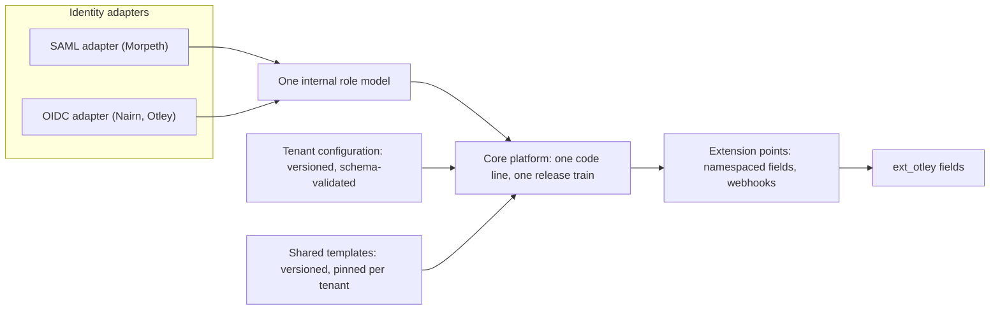

# One Platform, Many Customers

## Start with the fork that could not take a fix

Ludlow Software, a fictional vendor, sells a case-management platform with an AI triage assistant. Two years ago a field engineer onboarded a large customer by copying the codebase into a customer branch and changing what it asked for. The customer went live in five weeks.

Last spring Ludlow shipped a security fix to its core. The fix reached every customer on the main line in two days. It reached the branch customer after eleven weeks, because the fix touched files the branch had changed and somebody had to merge them by hand. For those eleven weeks the customer ran a version Ludlow knew was unsafe.

Ludlow now asks you to onboard three new customers, each with its own identity provider, policies and requests. Call the old shortcut **the friendly fork**: a copy made to help one customer that quietly removes them from every later fix.

> **What you'll learn**
>
> - Sort each customer request into configure, extend, contribute to core or decline.
> - Design one core with tenant configuration, identity adapters and declared extension points.
> - Contain a defect in a template that eight customers share.
> - Resolve an extension that collides with a new core field, and an upgrade that new validation blocks.
> - Defend the no-fork rule to a product lead under deadline pressure.

## Discover: what each customer needs to be different

The three customers are Morpeth Health, a hospital trust, Nairn Council, a local authority, and Otley Bank. All three use Ludlow's shared intake triage template, as do five other Ludlow customers.

Spend the first week listing every difference each customer asks for, then ask why. A request often names a solution when the need is smaller.

| Customer | Request as stated | Need underneath | Class |
| --- | --- | --- | --- |
| Morpeth Health | Sign in with our identity provider over SAML, and map clinician groups to roles | Federated sign-in and group mapping | Configure |
| Nairn Council | Keep case records for seven years, then delete | A retention period per tenant | Configure |
| Otley Bank | Add a risk tier field to every case | A typed customer field that reports can read | Extend |
| Otley Bank | Two people must approve any bulk export | Dual approval on one action | Contribute to core |
| Nairn Council | Disable audit logging to save storage | Lower storage cost | Decline, offer a shorter log tier |

*Table 1: Requests sorted by class. The dual-approval request goes to core because other regulated customers will ask for it.*

Four classes cover every request:

- **Configure.** The setting exists. Set a value for this tenant.
- **Extend.** A declared extension point fits, such as typed custom fields or a webhook. The customer's schema lives in its own namespace.
- **Contribute to core.** The need is general. Build it once, behind a tenant flag.
- **Decline.** The request weakens a control or costs other customers. Offer an alternative.

There is no fifth class called "change the code for this customer". That is the friendly fork.

## Design: one core, many tenant configurations

Figure 1 shows the shape you agree with Ludlow's architects.

*Figure 1: Ludlow's platform. Differences live in configuration, adapters, pinned template versions and namespaced extensions. The core has one code line.*

Four design rules carry the weight:

- **Identity through adapters, roles in one model.** Each identity provider speaks SAML or OpenID Connect (OIDC). An adapter per protocol maps the provider's group claims onto Ludlow's internal roles. Morpeth's "Ward Sister" and Otley's "Ops Analyst" groups both become the reviewer role.
- **Tenant configuration is data with a schema.** Retention periods, session limits, approval thresholds and feature flags sit in a versioned configuration document per tenant. The platform validates it on save and on every upgrade.
- **Templates are versioned and pinned.** Each tenant runs a named template version, such as intake triage 3.1. A new version rolls out tenant by tenant, not to everyone at once.
- **Extensions live in a namespace.** Otley's risk tier becomes a field in `ext_otley`, declared with a type, not a new column in the core case table.

## A constraint changes: three problems in one week

In week four, three things go wrong.

**A shared template defect.** Ludlow releases intake triage 3.2 to all eight customers at once, skipping its own staged rollout. A new routing rule drops any case whose priority field is empty into an unmonitored queue. Over three days, 212 cases sit unseen: 140 at Morpeth, 26 at Otley and 46 across four other customers. Nairn and one other customer require priority, so they lost none.

**An extension that collides with the data model.** Ludlow's next release adds a core field called `risk_tier` with five values. Otley's earlier pilot had added its own `risk_tier` column directly to the case table, with three values, before the namespace rule existed. The upgrade migration fails on Otley's tenant.

**An upgrade blocked by validation.** The same release tightens configuration validation: retention must be a positive number of days. Nairn's configuration stores retention as 0, which an old version read as "keep forever" for a set of legal-hold cases. The upgrade refuses to apply.

## Recover: fix the core, never the copy

Work in order of harm. Unseen cases come first, because a patient or applicant may be waiting.

**The template defect.** Stop the rollout, then pin all eight tenants back to 3.1. Query each tenant for cases in the unmonitored queue and move them back to triage with their original arrival time, so they sort as overdue. Tell each customer their own count. Fix the rule in core as version 3.3, add the empty-priority case to the template's regression tests, and roll it out to one tenant, then two, then the rest.

**The extension collision.** Do not rename the core field or skip Otley's migration. Use an expand and contract change. Create `ext_otley.risk_tier`, copy Otley's values into it, and point Otley's reports at the new field. Remove the old column once nothing reads it, then apply the upgrade.

**The blocked upgrade.** Do not loosen validation for one tenant. The rule is right: 0 is ambiguous. Ship a configuration migration that converts a retention of 0 into an explicit legal-hold flag plus a seven-year period, and apply it after Nairn's records officer signs off. Then add a dry run that validates every tenant's configuration against the next release a week before it ships.

Follow the Ludlow engagement through its five phases. Each step shows the goal, what you do and the evidence you leave behind.

<button type="button" data-step="0" aria-pressed="false" aria-controls="platform-step-0">1. Discover</button><button type="button" data-step="1" aria-pressed="false" aria-controls="platform-step-1">2. Design</button><button type="button" data-step="2" aria-pressed="false" aria-controls="platform-step-2">3. Constraint</button><button type="button" data-step="3" aria-pressed="false" aria-controls="platform-step-3">4. Recover</button><button type="button" data-step="4" aria-pressed="false" aria-controls="platform-step-4">5. Defend</button>

<section id="platform-step-0" class="step-panel" aria-labelledby="platform-heading-0"><h4 id="platform-heading-0">1. Discover the differences</h4><dl><dt>Goal</dt><dd>Know every way the three customers differ, and why.</dd><dt>You do</dt><dd>Find the need under each request and sort it into one of four classes.</dd><dt>Evidence</dt><dd>A request table each customer has seen and agreed.</dd></dl></section><section id="platform-step-1" class="step-panel" aria-labelledby="platform-heading-1"><h4 id="platform-heading-1">2. Design one core</h4><dl><dt>Goal</dt><dd>Serve all three without a customer branch.</dd><dt>You do</dt><dd>Add adapters, validated tenant configuration, pinned templates and namespaced extensions.</dd><dt>Evidence</dt><dd>A design record and each tenant's configuration under version control.</dd></dl></section><section id="platform-step-2" class="step-panel" aria-labelledby="platform-heading-2"><h4 id="platform-heading-2">3. The constraint changes</h4><dl><dt>Goal</dt><dd>See the three problems clearly before acting.</dd><dt>You do</dt><dd>Count the defect's damage per tenant and read both failed upgrades.</dd><dt>Evidence</dt><dd>212 unseen cases counted by tenant, two failed upgrade logs.</dd></dl></section><section id="platform-step-3" class="step-panel" aria-labelledby="platform-heading-3"><h4 id="platform-heading-3">4. Recover in the core</h4><dl><dt>Goal</dt><dd>Fix each problem once, for everyone.</dd><dt>You do</dt><dd>Pin back, re-queue, ship 3.3 in stages, move Otley's field, migrate Nairn's value.</dd><dt>Evidence</dt><dd>A regression test, a staged rollout log, signed-off configuration changes.</dd></dl></section><section id="platform-step-4" class="step-panel" aria-labelledby="platform-heading-4"><h4 id="platform-heading-4">5. Defend the approach</h4><dl><dt>Goal</dt><dd>Keep the no-fork rule when the next deadline arrives.</dd><dt>You do</dt><dd>Compare the fork's cost with what pinning saved.</dd><dt>Evidence</dt><dd>Eleven weeks for one fix on the fork, minutes to roll back eight tenants on the platform.</dd></dl></section>

<button type="button" data-walk="previous">Previous</button>

<button type="button" data-walk="next">Next step</button>

The walkthrough is a scripted illustration.

## Defend: the rule that keeps customers on the main line

Ludlow's head of product asks whether a fork for the next large customer would be faster. Answer with this engagement's evidence.

- **The fork's cost arrives later.** Five weeks saved at onboarding became eleven weeks of exposure on one security fix, and a hand merge on every release since.
- **Pinning paid for itself this week.** Eight tenants went back to a working template in minutes. A forked customer would have needed its own fix.
- **Dry runs move surprises earlier.** Nairn's failure would now appear a week before release.

Concede that the platform approach costs design time up front. Offer a fast path for urgent needs: a flagged core change, released to one tenant first.

## Limits of this lesson

- **Scope.** Tenant isolation and single sign-on are taught in their own lessons, linked below.
- **Product politics.** Moving a request into core needs the product owner's agreement.
- **Composite engagement.** Ludlow Software, Morpeth Health, Nairn Council, Otley Bank and every figure here are illustrative, not real customers.
- **Shorter drill.** For a 20-minute version on a different customer, run [drill 5, an assistant on a platform with many customers](/learn/fde-case-drills/case-drills/practise-case-drills-1#drill-5-an-assistant-on-a-platform-with-many-customers).

## Interview angle

Each answer is an outline to say in about two minutes. Open each question and try it aloud before reading.

Interview question 1. A platform vendor has customers who each want something different. How do you meet those needs without a branch per customer?

- **Answer:** Keep one code line and move every difference into a place built for it: tenant configuration with a schema, identity adapters that map each provider's groups to one role model, versioned templates pinned per tenant, and extension points with namespaced fields and webhooks. General needs go into core behind a tenant flag. Nothing customer-specific lives in core code.
- **Trade-off:** Those places cost design time up front. A branch is faster once and slower forever.
- **Follow-up to expect:** "The customer's need fits none of those." Then it is a core change or a decline.
- **Go deeper:** [Tenancy and isolation](/learn/fde-deploying-in-the-estate/deployment-models-and-environments/tenancy-and-isolation).

Interview question 2. How do you decide whether a customer request becomes configuration, an extension, a core feature or a no?

- **Answer:** Find the need under the request first. If an existing setting covers it, configure. If it is specific to the customer and fits a declared extension point, extend in their namespace. If other customers will need it, build it in core once, behind a flag. If it weakens a control or costs other customers, decline and offer an alternative.
- **Trade-off:** Contributing to core is slower for the requesting customer. It avoids paying for the same feature many times.
- **Follow-up to expect:** "Who decides?" The product owner, with your evidence on how many customers asked.

Interview question 3. A new core field has the same name as a column one customer added earlier. The upgrade fails for them. What do you do?

- **Answer:** Keep the core field as designed and the upgrade path the same for everyone. Move the customer's data with an expand and contract change: create the field in their extension namespace, copy the values, repoint their reports and integrations, then drop the old column and upgrade. Agree with them how their values map to the core field if they want it.
- **Trade-off:** The move costs the customer time. Renaming core for one customer breaks everyone else.
- **Follow-up to expect:** "How do you stop it happening again?" Extensions may only write to their namespace, enforced by the platform.

Interview question 4. A customer's upgrade is blocked because their configuration fails a validation rule the new release added. How do you handle it?

- **Answer:** Read why the value fails. If the rule is right, migrate the value, not the rule: convert it to an explicit, valid form that keeps its meaning, show the customer's owner and apply it after sign-off. Then run every tenant's configuration through the next release's validation in a dry run before shipping.
- **Trade-off:** A migration needs the customer's review and delays their upgrade by days. A per-tenant exemption leaves a silent difference in every later release.
- **Follow-up to expect:** "The rule itself is wrong." Then fix it in core for all tenants, with a test.

Interview question 5. A defect in a template shared by eight customers has sent cases to the wrong place for three days. Run the response.

- **Answer:** Stop the rollout and pin every tenant back to the last good version. Count affected cases per tenant, move them back with their original time so they sort as overdue, and tell each customer their own figure. Fix the template in core, add the failing case to its tests, and roll out tenant by tenant.
- **Trade-off:** Rolling back loses any good change in the new version for a while. Fixing forward under pressure risks a second defect for all eight.
- **Follow-up to expect:** "One customer refuses the rollback." Patch forward for them first, with their agreement.

Interview question 6. Timed drill (20 minutes): onboard three customers with different identity providers and policies onto one platform, then handle a shared template defect.

- **Answer:** Minutes 0 to 4: ask about each customer's identity provider, policies, deadlines and who owns the platform. Minutes 4 to 8: sort requests into configure, extend, contribute or decline. Minutes 8 to 13: draw the core, adapters, tenant configuration, pinned templates and extensions. Minutes 13 to 17: run the defect response: pin back, count, re-queue, fix in core, staged rollout. Minutes 17 to 20: state the no-fork rule, its cost and the fast path.
- **Trade-off:** Eight minutes before drawing feels slow. Drawing first designs for the wrong differences.
- **Follow-up to expect:** "Make it go live in two weeks." Cut scope, not the code line.

## References

1. Amazon Web Services, [SaaS tenant isolation strategies](https://docs.aws.amazon.com/whitepapers/latest/saas-tenant-isolation-strategies/saas-tenant-isolation-strategies.html), accessed 17 November 2026. Tenant isolation models for a shared platform.
2. OpenID Foundation, [OpenID Connect Core 1.0](https://openid.net/specs/openid-connect-core-1_0.html), accessed 17 November 2026. The identity protocol behind two of the adapters.
3. Martin Fowler, [Parallel change](https://martinfowler.com/bliki/ParallelChange.html), accessed 17 November 2026. The expand and contract pattern used to move Otley's field.
4. Semantic Versioning, [Semantic Versioning 2.0.0](https://semver.org/), accessed 17 November 2026. Version numbers for shared templates.
5. The site's [SSO, OIDC and tokens](/learn/fde-deploying-in-the-estate/networks-and-identity/sso-oidc-and-tokens) lesson and the casebooks configurable platform for customer workflows and secure multi-tenant AI platform.
6. The author's own field experience, the basis for the four request classes and the recovery order.

## Key takeaways

- A customer branch saves weeks at onboarding and costs every later fix.
- Sort each request into configure, extend, contribute to core or decline. There is no fifth class.
- Put identity behind adapters, policy in validated tenant configuration, templates in pinned versions and customer data in namespaced extensions.
- Roll out shared templates tenant by tenant, so a defect can be pinned back in minutes.
- When validation blocks an upgrade, migrate the value and keep the rule.

## Check yourself

1. Why did Nairn Council have no cases stuck by the template defect?

Nairn's forms make priority mandatory, so no case arrived with the empty priority the faulty rule mishandled.

2. Why move Otley's column into its namespace instead of renaming the new core field?

Renaming a core field for one customer creates a difference every upgrade must carry, a fork by another name.

3. What made the rollback of eight tenants take minutes?

Each tenant ran a pinned template version, so moving back to 3.1 was a configuration change, not a rebuild.

