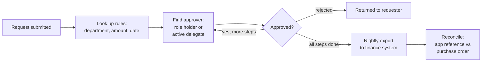

# Spreadsheets to an Approvals App

## Start with a spreadsheet that is the process

Carrick Council, a fictional local authority, approves about 90 spending requests a month across six departments. Each request is a row in a shared spreadsheet with 14 tabs. Approvers are told by email, and a column of formulas works out who should approve next. The head of procurement asks: "Replace the spreadsheet with a proper app. Approvals take nine working days and we lose track of them."

Last summer, a £18,000 request for road repairs sat for three weeks. The approver was on leave, the formula still pointed at her, and nobody else could see the request was stuck. The contractor's price expired and the job cost more.

The spreadsheet held the rules, the data, the history and the routing, and no one could see any of them clearly. Call this **the spreadsheet that is the process**: a tool whose hidden logic nobody owns.

> **What you'll learn**
>
> - Pull the real approval rules out of a spreadsheet and model them as data.
> - Design an approvals app with a request, its steps, its rules and an audit trail.
> - Move people off the spreadsheet without losing open requests.
> - Absorb department rules and temporary approvers that arrive mid-build.
> - Remove duplicate entry with a legacy finance system that has no API.

## Discover: the rules hiding in the formulas

Before designing screens, list the rules. You read the formulas with the procurement lead, then check them against the council's financial regulations, because the spreadsheet may have drifted from the written policy.

| Amount | Approver | Notes |
| --- | --- | --- |
| Up to £5,000 | Budget holder's manager | One approval |
| £5,000 to £25,000 | Head of service | One approval |
| Over £25,000 | Director, then finance | Two approvals, in that order |

*Table 1: The approval rules in the financial regulations. The spreadsheet had a fourth band that the regulations did not, added by someone who had left.*

Discovery also finds the work around the spreadsheet. After approval, a finance officer re-types each request into the legacy finance system to raise a purchase order. About one in 30 has a typing error in the amount or supplier. That re-typing becomes a requirement of its own.

## Design: rules as data, history as a log

The app has four parts. Figure 1 shows how a request moves through them.

- **Request.** Department, amount, supplier, reason, requester and a reference number.
- **Rules table.** Rows of department, amount band, approver role and order, each with an effective-from date. Rules are data the procurement lead can change through an admin screen, not code.
- **Approval steps.** Created when a request is submitted, from the rules in force that day. Each step records who approved, when and under which rule version.
- **Audit log.** Every change to a request or a rule, with who and when.

*Figure 1: The approvals flow. Rules are looked up once, at submission, and the approver lookup checks delegations on every step.*

A request waiting more than three working days on one step is shown to the procurement lead on a daily list, so a stuck request is visible.

For the move off the spreadsheet, plan three steps. Load the 60 open requests into the app with their approvals so far. Run both for two weeks, with new requests only in the app. Then make the spreadsheet read only and keep it as the record of older requests.

## The constraint changes: new rules and temporary approvers

In week three of a six-week build, two departments bring rules of their own. Highways wants a head of service limit of £10,000 rather than £5,000, because its contractor spend is frequent and small. Housing needs every request over £5,000 checked by its compliance officer as well. Finance agrees both, effective from 1 June.

At the same meeting, managers raise leave. Over the summer they expect about a dozen temporary approver arrangements a month, and today they handle them by email.

## Recover: absorb the change without rebuilding

Because rules are data, the department rules are new rows, not new code:

- Highways gets its own bands, effective from 1 June.
- Housing gets an extra step for its compliance officer above £5,000, effective from 1 June.
- A request submitted on 31 May keeps the old rules, because its steps were built from the rules in force that day. The steps record the rule version, so an auditor can see why.

Temporary approvers become **delegations**: a record of who delegates to whom, for which role, from and to which date. The approver lookup uses an active delegate in place of the role holder. Three guard rails come from the financial regulations:

1. A delegate must hold the same or a higher grade.
2. Nobody can approve their own request, even as a delegate.
3. Each delegation is itself recorded in the audit log, and ends on its date without anyone remembering to remove it.

The duplicate entry needs a decision. The finance system has no API, only a nightly import of comma-separated files. Three options:

| Option | Effort | Risk |
| --- | --- | --- |
| Keep re-typing | None | One error in 30 continues |
| Nightly file export from the app | Two weeks | A failed import is noticed late |
| Robotic screen entry | Three weeks | Breaks when a screen changes |

*Table 2: Options for the purchase order step. The nightly export wins, with a reconciliation report.*

The app writes approved requests to the import file with the app reference in the purchase order's external reference field. The import skips a reference it has already loaded. A re-run creates no duplicates. Each morning a reconciliation report lists any approved request with no purchase order, and any purchase order with no approved request, for the finance officer to clear. The two extra weeks move go-live from week six to week eight. You agree it with the head of procurement in writing.

## Defend: the result to procurement

You defend the app with three numbers against the spreadsheet baseline: approval time, stuck requests and purchase order errors. The walkthrough replays the engagement.

Step through the Carrick engagement. Each phase shows what happened, your move and the evidence you kept.

<button type="button" data-step="0" aria-pressed="false" aria-controls="carrick-step-0">1. Discover</button><button type="button" data-step="1" aria-pressed="false" aria-controls="carrick-step-1">2. Design</button><button type="button" data-step="2" aria-pressed="false" aria-controls="carrick-step-2">3. Change</button><button type="button" data-step="3" aria-pressed="false" aria-controls="carrick-step-3">4. Recover</button><button type="button" data-step="4" aria-pressed="false" aria-controls="carrick-step-4">5. Defend</button>

<section id="carrick-step-0" class="step-panel" aria-labelledby="carrick-heading-0"><h4 id="carrick-heading-0">1. Discover the rules</h4><dl><dt>What happened</dt><dd>A 14-tab spreadsheet with routing hidden in formulas.</dd><dt>Your move</dt><dd>Read the formulas, check them against the financial regulations and watch the work after approval.</dd><dt>Evidence</dt><dd>Three bands, one stray band to remove, one in 30 purchase orders mistyped.</dd></dl></section><section id="carrick-step-1" class="step-panel" aria-labelledby="carrick-heading-1"><h4 id="carrick-heading-1">2. Design rules as data</h4><dl><dt>What happened</dt><dd>Procurement wanted an app, not a new spreadsheet.</dd><dt>Your move</dt><dd>Requests, a dated rules table, approval steps with rule versions and an audit log.</dd><dt>Evidence</dt><dd>A migration plan for 60 open requests and a two-week parallel run.</dd></dl></section><section id="carrick-step-2" class="step-panel" aria-labelledby="carrick-heading-2"><h4 id="carrick-heading-2">3. The constraint changes</h4><dl><dt>What happened</dt><dd>Highways and Housing brought their own rules, and managers needed temporary approvers.</dd><dt>Your move</dt><dd>Ask finance to confirm each rule and its start date.</dd><dt>Evidence</dt><dd>Signed rules effective from 1 June and about 12 delegations a month expected.</dd></dl></section><section id="carrick-step-3" class="step-panel" aria-labelledby="carrick-heading-3"><h4 id="carrick-heading-3">4. Recover</h4><dl><dt>What happened</dt><dd>New rules, delegations and the re-typing problem landed together.</dd><dt>Your move</dt><dd>New rule rows, delegations with guard rails, a nightly export with reconciliation.</dd><dt>Evidence</dt><dd>Go-live moved from week six to week eight, agreed in writing.</dd></dl></section><section id="carrick-step-4" class="step-panel" aria-labelledby="carrick-heading-4"><h4 id="carrick-heading-4">5. Defend the result</h4><dl><dt>What happened</dt><dd>Procurement asks whether the app is better than the spreadsheet.</dd><dt>Your move</dt><dd>Compare approval time, stuck requests and purchase order errors with the baseline.</dd><dt>Evidence</dt><dd>Measured numbers from the first month, and the audit log for any disputed approval.</dd></dl></section>

<button type="button" data-walk="previous">Previous</button>

<button type="button" data-walk="next">Next step</button>

The walkthrough is a scripted illustration. Expect challenge on the delay. Your answer is that two departments changed the rules, and the design absorbed them as data rather than a rebuild.

## Limits of this lesson

- **Fictional data.** Carrick Council, its rules and every figure are illustrative.
- **Buy before build.** Many councils already own a finance or workflow product with approvals. Check that first, as the lesson on building, buying or configuring explains.
- **Regulations differ.** Approval limits and delegation rules come from each organisation's own financial regulations.

## Interview angle

Each answer is an outline to say in about two minutes. The last question is timed: set a clock and talk it through before opening it.

Interview question 1. A team runs approvals in a shared spreadsheet. How do you design the app that replaces it?

- **Answer:** Pull the rules out of the formulas and check them against the written policy. Model a request, a rules table with department, amount band, approver role, order and an effective date, approval steps built at submission with the rule version, and an audit log. Make rules editable data, show stuck requests daily, and keep approvers out of their own requests.
- **Trade-off:** A rules table takes longer to build than hard-coded bands. Hard-coded bands turn every policy change into a release.
- **Follow-up to expect:** "Why build the steps at submission?" So a rule change never alters a request already in flight.
- **Go deeper:** [Human review and approval](/learn/fde-building-in-the-estate/building-for-operators/human-review-and-approval).

Interview question 2. How do you move people off the spreadsheet without losing work?

- **Answer:** Load the open requests into the app with their approvals so far, checked by the process owner. Run both for a short period with new requests only in the app. Then make the spreadsheet read only and keep it as the record of older requests. Train approvers on the few screens they use and give them one place to report problems.
- **Trade-off:** A parallel run costs effort from both teams. A hard switch risks losing requests in flight.
- **Follow-up to expect:** "People keep using the spreadsheet." Make it read only on a date agreed with the sponsor.
- **Go deeper:** [Rolling out with a way back](/learn/forward-deployed/adoption-and-impact/rolling-out-with-a-way-back).

Interview question 3. Mid-build, two departments bring their own approval rules and managers ask for temporary approvers. What changes?

- **Answer:** Confirm each rule with finance and its start date. Add the rules as dated rows. Requests already submitted keep the old rules. Add delegations with a from and to date, a grade check, a ban on approving your own request and an audit entry. Re-estimate and agree any date change in writing.
- **Trade-off:** Dated rules add complexity to queries. Undated rules quietly change the rules for requests in flight.
- **Follow-up to expect:** "A delegate is on leave too." The lookup falls back to the role holder's manager and flags it.
- **Go deeper:** [Managing change and scope creep](/learn/forward-deployed/requirements-and-solution-design/managing-change-and-scope-creep).

Interview question 4. After approval, staff re-type every request into a legacy finance system with no API. How do you stop the duplicate entry?

- **Answer:** Compare options: keep re-typing, a file export to the system's import, or screen automation. Prefer the import file with the app's reference in an external reference field, so a re-run skips loaded rows. Add a daily reconciliation listing approvals without purchase orders and the reverse, owned by a finance officer.
- **Trade-off:** A nightly file is a day behind. Screen automation is faster and breaks when a screen changes.
- **Follow-up to expect:** "The import has no external reference field." Use a notes field the import keeps, and reconcile on it.

Interview question 5. Timed drill (20 minutes): a council wants its spreadsheet approvals replaced by an app. Run the engagement.

- **Answer:** Minutes 0 to 4: discovery on volumes, rules, approvers and the work after approval. Minutes 4 to 9: the data model, with requests, dated rules, steps, delegations and an audit log. Minutes 9 to 12: migration and parallel run. Minutes 12 to 15: absorb new rules and temporary approvers. Minutes 15 to 18: the legacy finance integration and reconciliation. Minutes 18 to 20: the metrics you would report and the decision you need.
- **Trade-off:** Screens are tempting to draw first. The data model is what absorbs change.
- **Follow-up to expect:** "Why not buy a workflow product?" Check what the council owns, and build only if nothing fits.

## References

1. Martin Fowler, [Strangler fig application](https://martinfowler.com/bliki/StranglerFigApplication.html), accessed 17 November 2026. Replacing a legacy system piece by piece while both run.
2. Microsoft, [Strangler Fig pattern](https://learn.microsoft.com/en-us/azure/architecture/patterns/strangler-fig), accessed 17 November 2026. Routing new work to the new system while the old one stays available.
3. The site's [build, buy, configure or no AI](/learn/forward-deployed/scoping-an-fde-project/build-buy-configure-or-no-ai) lesson and the configurable platform for customer workflows case.
4. The author's own field experience, the basis for the delegation guard rails and the reconciliation report.

## Key takeaways

- Read the spreadsheet's formulas, then check them against the written policy before modelling anything.
- Model rules as dated data and build each request's steps at submission, with the rule version.
- Delegations need dates, a grade check, no self-approval and an audit entry.
- Remove duplicate entry with an idempotent import keyed on your reference, plus a daily reconciliation.
- Move people across with loaded open work, a short parallel run and a read-only date.

## Check yourself

1. Why did a request submitted on 31 May keep the old rules?

Its approval steps were built from the rules in force on the day it was submitted, and the new rules start on 1 June.

2. What stops a nightly import from creating duplicate purchase orders on a re-run?

The app reference sits in the purchase order's external reference field, and the import skips a reference it has already loaded.

3. Why was the road repair request stuck for three weeks?

The routing formula pointed at an approver on leave, there was no delegation, and nobody could see how long a request had waited.

