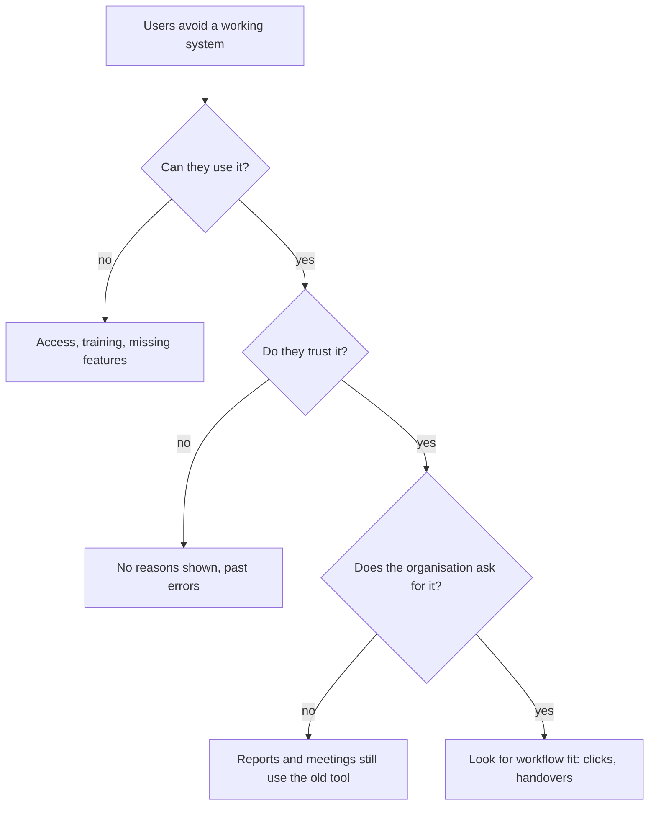

# The Deployment Users Avoid

## Start with the request from Kirkby Freight

Kirkby Freight, a fictional haulage firm, runs a control room of 45 shipment controllers over three shifts. Six weeks ago your team deployed an exception assistant. When a shipment is late, damaged or stuck, it suggests the next action: rebook with another carrier, warn the customer or escalate. On 600 past exceptions its suggestions matched senior controllers' choices 91% of the time. It has been up 99.7% of the time since launch.

Kirkby's head of operations writes:

> "The dashboard says it works. My team leads say nobody uses it. Which is true?"

Both were. Nine of the 45 controllers used the assistant daily. The rest worked from a shared spreadsheet, the exceptions tracker, edited about 220 times a day. Every technical measure was green, and the room had gone round the system. Call this **the silent bypass**: a working system that users quietly replace with the tool they had before.

> **What you'll learn**
>
> - Find out why users avoid a working system by watching the work, not asking for opinions.
> - Plan a four-week intervention with measures that show whether it worked.
> - Treat a spreadsheet workaround as a requirements document.
> - Handle blind acceptance and avoidance as two sides of the same trust problem.

## Discover: watch a shift, then read the numbers

Surveys tell you what people think they do. You asked to sit with one controller on each shift for a full shift. Four findings came out of those three days:

- **The spreadsheet held what the tool did not.** Controllers wrote carrier promises ("truck by 16:00") and handover notes for the next shift. The assistant had no place for either.
- **Recording an action took six clicks.** The spreadsheet took one cell.
- **Suggestions came without reasons.** Experienced controllers would not act on "rebook" without knowing why.
- **The daily meeting counted rows in the spreadsheet.** Team leads reported from it each morning, so using the tool made a controller's work invisible.

The usage data added a second pattern. Of the nine daily users, four accepted 98% of suggestions, with a median of four seconds from display to acceptance. Four seconds is too short to read the shipment.

Figure 1 shows the frame you used to sort the causes.

*Figure 1: Sorting avoidance into can, trust and asked. Kirkby had a cause on every branch.*

## Design: a four-week plan with measures

You proposed four weeks, each targeting one cause, with the same measures read every Friday: daily active controllers, spreadsheet edits per day, override rate, time to accept, and the share of exceptions resolved within their service level.

- **Week 1, fit.** Add carrier promises and handover notes to the assistant. Cut recording the three most common actions to one click.
- **Week 2, trust.** Show the reason and evidence with each suggestion, such as "carrier's arrival slipped six hours, 40 similar cases rebooked".
- **Week 3, asked.** One champion per shift. The head of operations moves the morning report to the assistant's dashboard. Spreadsheet columns the assistant now covers become read-only, not deleted.
- **Week 4, measure.** Compare against week 0 and agree a date to retire the spreadsheet, or a reason not to.

The head of operations owned the plan. Your team owned the product changes. Changing the morning meeting was the step only Kirkby could take.

## A constraint changes: a costly accepted suggestion

In week 2 a controller accepted a suggestion to rebook a refrigerated load with a carrier that had no refrigerated trailer free. The load waited, and the customer's claim cost Kirkby £6,200. The controller had accepted it in three seconds.

The head of operations asked you to switch suggestions off. Meanwhile, the spreadsheet had gained a new tab, where team leads tracked which suggestions they did not trust.

Avoidance and blind acceptance looked like opposite problems. They came from the same cause: controllers could not tell when to trust a suggestion. Some trusted none, and some trusted all.

## Recover: tier by risk, check the accepts, keep the sheet's good parts

Switching suggestions off would have sent the room back to the spreadsheet. Instead you set tiers by cost:

- **High-cost actions,** rebooks over £2,000 or any refrigerated load, show the evidence and require the controller to pick a reason before confirming.
- **Low-cost actions** stay one click.
- **A weekly sample** of 5% of accepted suggestions is reviewed by a senior controller, and errors feed back into the assistant's rules and tests.

You read the override rate as a signal. On high-cost actions, an override rate near zero meant controllers were not checking.

The team leads' new tab was useful evidence. Its entries named three suggestion types that were often wrong, all involving refrigerated loads. Those became the first fixes. You thanked the team leads for it, and asked them to log distrust in the assistant from then on, with a one-click "I disagree" and a reason.

## Defend: report what changed, and what may not last

At the end of week 4 you reported to the head of operations with Table 1.

| Measure | Week 0 | Week 4 |
| --- | --- | --- |
| Daily active controllers | 9 of 45 | 31 of 45 |
| Spreadsheet edits per day | 220 | 35 |
| Median time to accept a high-cost action | 4 s | 38 s |
| Override rate on high-cost actions | 2% | 13% |
| Exceptions resolved within service level | 78% | 86% |

*Table 1: Kirkby's measures before and after the intervention. Slower acceptance and more overrides on costly actions are the intended result.*

You named two limits. Some of the gain may come from the attention of the four weeks, so the measures continue monthly. The remaining 35 edits a day were mostly customer-specific notes, which went on the backlog. The head of operations set a date six weeks out to make the spreadsheet read-only.

The walkthrough replays the engagement as you would tell it in an interview, one phase per step.

Step through the Kirkby engagement. Each step shows what you knew, what you decided and what you can show for it.

<button type="button" data-step="0" aria-pressed="false" aria-controls="kirkby-step-0">1. Discover</button><button type="button" data-step="1" aria-pressed="false" aria-controls="kirkby-step-1">2. Design</button><button type="button" data-step="2" aria-pressed="false" aria-controls="kirkby-step-2">3. Constraint</button><button type="button" data-step="3" aria-pressed="false" aria-controls="kirkby-step-3">4. Recover</button><button type="button" data-step="4" aria-pressed="false" aria-controls="kirkby-step-4">5. Defend</button>

<section id="kirkby-step-0" class="step-panel" aria-labelledby="kirkby-heading-0"><h4 id="kirkby-heading-0">1. Watch a shift</h4><dl><dt>You know</dt><dd>9 of 45 daily users, 220 spreadsheet edits a day.</dd><dt>You decide</dt><dd>Observe one controller per shift before proposing anything.</dd><dt>Evidence</dt><dd>Four causes, across can, trust and asked.</dd></dl></section><section id="kirkby-step-1" class="step-panel" aria-labelledby="kirkby-heading-1"><h4 id="kirkby-heading-1">2. Plan four weeks</h4><dl><dt>You know</dt><dd>Each cause needs a different fix and owner.</dd><dt>You decide</dt><dd>Fit, trust, asked, measure, one per week.</dd><dt>Evidence</dt><dd>Five measures read every Friday.</dd></dl></section><section id="kirkby-step-2" class="step-panel" aria-labelledby="kirkby-heading-2"><h4 id="kirkby-heading-2">3. A £6,200 accepted error</h4><dl><dt>You know</dt><dd>Some controllers accept everything, others nothing.</dd><dt>You decide</dt><dd>Treat both as one trust problem.</dd><dt>Evidence</dt><dd>A three-second acceptance on a costly action.</dd></dl></section><section id="kirkby-step-3" class="step-panel" aria-labelledby="kirkby-heading-3"><h4 id="kirkby-heading-3">4. Tier by risk</h4><dl><dt>You know</dt><dd>Switching off sends the room back to the sheet.</dd><dt>You decide</dt><dd>Evidence and a reason on costly actions, a 5% weekly review.</dd><dt>Evidence</dt><dd>The team leads' tab names three weak suggestion types.</dd></dl></section><section id="kirkby-step-4" class="step-panel" aria-labelledby="kirkby-heading-4"><h4 id="kirkby-heading-4">5. Report with caveats</h4><dl><dt>You know</dt><dd>Gains may partly come from attention.</dd><dt>You decide</dt><dd>Keep measuring monthly, set a date for the sheet.</dd><dt>Evidence</dt><dd>31 daily users, 13% overrides on costly actions.</dd></dl></section>

<button type="button" data-walk="previous">Previous</button>

<button type="button" data-walk="next">Next step</button>

## Limits of this lesson

- **A willing head of operations.** Changing the morning report needed her authority. Without a sponsor for the "asked" branch, product fixes alone rarely move usage.
- **Short measurement.** Four weeks shows direction, not a lasting habit.
- **Fictional data.** Kirkby Freight, its controllers and its figures are illustrative. The logistics exception handling case covers the system design.

## Interview angle

Each answer is an outline to say in about two minutes. Open each question and try it aloud before reading.

Interview question 1. Your system meets every technical target, but most users avoid it. How do you find out why?

- **Answer:** Watch the work: sit with users from each team or shift for a full session, and see what they do instead. Read usage by person, not in total. Sort causes into whether they can use it, whether they trust it, and whether the organisation asks for it. Look at what the old tool does that yours does not.
- **Trade-off:** Observation takes days. A survey is faster and tells you what people think they do.
- **Follow-up to expect:** "Users say it is fine in interviews." Believe what they do, and ask about the gap.
- **Go deeper:** [Diagnosing low adoption](/learn/forward-deployed/adoption-and-impact/diagnosing-low-adoption).

Interview question 2. You have a month to bring users onto a working system they avoid. What is your plan?

- **Answer:** Target one cause at a time, with an owner for each. Close the workflow gaps first, then show reasons with each output, then change what the organisation asks for: reports, meetings, champions. Read the same measures weekly: active users, use of the workaround, override rate, time to accept and the business outcome. End with a decision on retiring the old tool.
- **Trade-off:** A month shows direction, not a lasting habit. Keep measuring after it.
- **Follow-up to expect:** "Which step matters most?" Usually changing what managers ask for, because only the customer can do it.
- **Go deeper:** [Training and champions](/learn/forward-deployed/adoption-and-impact/training-and-champions).

Interview question 3. Users keep a spreadsheet beside your system and update both. What do you do about it?

- **Answer:** Treat the spreadsheet as a requirements document. List each column and why people use it, then bring the useful parts into the system. Make duplicated columns read-only once the system covers them, rather than deleting the sheet. Agree a retirement date with the process owner, and keep an export for what remains.
- **Trade-off:** Banning the sheet is quick and drives the workaround somewhere less visible. Absorbing it takes product work.
- **Follow-up to expect:** "The sheet holds data the system must not." Then the sheet is a data handling risk, and the owner must decide quickly.

Interview question 4. Some users accept every AI suggestion in seconds, and others ignore it entirely. How do you handle both?

- **Answer:** Treat both as one problem: users cannot tell when to trust a suggestion. Show the reason and evidence with each one. Tier by risk, so costly actions need a chosen reason before confirming and cheap ones stay fast. Review a sample of acceptances, and treat an override rate near zero on costly actions as a warning.
- **Trade-off:** Friction on costly actions slows the work. Without it, a three-second accept can cost thousands.
- **Follow-up to expect:** "What override rate is right?" There is no fixed number. Compare it with the error rate found in the reviews.
- **Go deeper:** [Measuring trust and overrides](/learn/forward-deployed/adoption-and-impact/measuring-trust-and-overrides).

Interview question 5. Timed drill (20 minutes): a working AI system is avoided by most users, some users accept everything, and a spreadsheet runs alongside it.

- **Answer:** Minutes 0 to 4: usage by person, and how you would observe the work. Minutes 4 to 8: causes sorted into can, trust and asked. Minutes 8 to 12: the four-week plan, an owner per step and weekly measures. Minutes 12 to 16: blind acceptance, risk tiers and sampled reviews. Minutes 16 to 20: the spreadsheet's retirement and how you report results with their caveats.
- **Trade-off:** Interviewers may push for a technical fix. Name it, then show why the organisational step matters too.
- **Follow-up to expect:** "How do you know it lasted?" Monthly measures after the four weeks end.

## References

1. Nielsen Norman Group, [Field Studies](https://www.nngroup.com/articles/field-studies/), accessed 17 November 2026. Observing users in their own setting rather than asking.
2. Google PAIR, [People + AI Guidebook: Explainability + Trust](https://pair.withgoogle.com/chapter/explainability-trust/), accessed 17 November 2026. Showing reasons so users can calibrate trust in AI output.
3. The site's [observing the work](/learn/forward-deployed/customer-discovery/observing-the-work) and [human review and approval](/learn/fde-building-in-the-estate/building-for-operators/human-review-and-approval) lessons.
4. The author's own field experience, the basis for the four-week plan and the risk tiers.

## Key takeaways

- A green dashboard and an empty room can both be true. Read usage by person.
- Watch a full shift. The workaround shows what the system lacks.
- Sort causes into can, trust and asked, and give each a fix and an owner.
- Blind acceptance and avoidance share one cause: users cannot tell when to trust the output.
- Tier friction by risk, sample acceptances, and read near-zero overrides as a warning.

## Check yourself

1. Why did using the assistant make a Kirkby controller's work invisible?

Team leads reported from the spreadsheet in the morning meeting. Work recorded only in the assistant did not appear in those counts.

2. Why was a rise in the override rate on high-cost actions a good sign?

It showed controllers were reading the evidence before acting. A rate near zero, with four-second accepts, meant they were not checking.

3. Why did you not delete the spreadsheet at the start?

It held carrier promises and handover notes the assistant could not store. Deleting it would have pushed those somewhere less visible.

