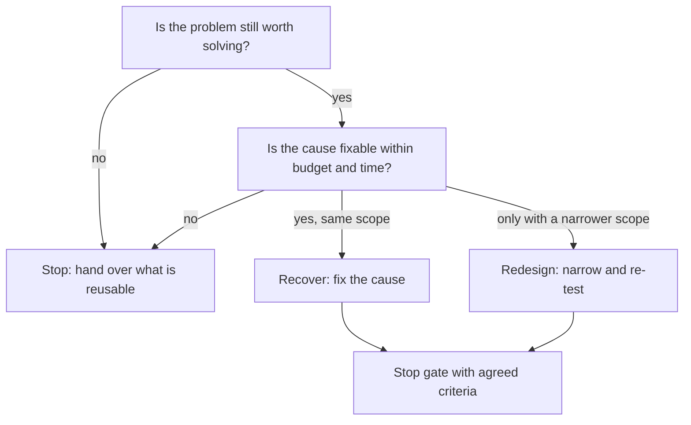

# The Engagement That Is Failing

## Start with the sunk-cost sprint

Pateley Energy, a fictional energy retailer, hired your team to build an assistant that drafts replies to billing complaints. The budget was £600,000 over 16 weeks. The goal was to cut handling time by 30% and have 60% of drafts sent with light edits or none.

You join in week 10, after the previous lead has moved on. £480,000 is spent. Handling time is down 4%. Agents send 18% of drafts with light edits and rewrite the rest. The delivery plan for the last six weeks adds two more complaint types and a dashboard, to "show the full picture" before the budget runs out.

That plan spends the remaining £120,000 faster in the hope that more features will justify the first £480,000. Call it **the sunk-cost sprint**: speeding up a failing engagement because stopping would admit the spend did not work.

> **What you'll learn**
>
> - Diagnose why an engagement is not producing value before choosing a fix.
> - Lay out recover, redesign and stop with cost, time and evidence for each.
> - Brief a new sponsor who did not choose the engagement.
> - Compare running costs with realised benefits per unit of work.
> - Give a five-minute recommendation an executive can decide on.

## Discover: find out why value is missing

Before proposing anything, find which link in the chain broke. An engagement produces value only when four things hold: the right problem, usable data, a design that fits the work, and people using it.

Spend the first week on evidence, not opinions:

- **Read 50 rewritten drafts** next to what the agent sent. At Pateley, 41 of the 50 rewrites added facts the assistant did not have: the customer's last meter read, recent bills and payment plan. The assistant saw only the complaint email.
- **Sort the complaint volume.** 40% of complaints dispute an estimated meter read. They follow one policy: ask for a reading, re-bill, explain. A rule and a template would draft most of them.
- **Sit with three agents for a morning.** They trust the assistant on tone and distrust it on numbers, which matches the rewrites.
- **Check the plan against the goal.** Two more complaint types widen the problem the assistant already fails on.

The diagnosis: the problem is real and the agents would use a good tool. The design failed on data. The assistant drafts billing replies without billing data.

## Design: three options with the same evidence

Put the options side by side so the decision rests on the same facts. Figure 1 shows the decision flow.

*Figure 1: The recover, redesign or stop decision. Every route that continues passes a stop gate with criteria agreed in advance.*

| Option | What it means at Pateley | Cost and time | Evidence that it works |
| --- | --- | --- | --- |
| Recover | Integrate the billing system so every draft has account data, all complaint types | £250,000, 12 weeks, so £130,000 above budget | Not yet: the billing integration is untested |
| Redesign | Rules and templates for meter-read disputes. The assistant, with read-only account data, for one other complaint type | £90,000, 6 weeks, inside the remaining budget | Rewrites show missing data, not tone, as the cause |
| Stop | Hand over the email triage and the complaint taxonomy, close the engagement | £20,000, 2 weeks | Not needed |

*Table 1: Options for Pateley. Each has a cost, a time and the evidence it rests on.*

Recovering keeps the original scope but needs money nobody has approved and an integration nobody has tested. Redesigning narrows scope to where the evidence points.

## A constraint changes: a new sponsor arrives

In week 11, Pateley's chief operating officer, who sponsored the engagement, leaves. The new sponsor is the director of customer operations. She did not choose this engagement and her first question is, "Why are we paying for this?"

Treat a new sponsor as a new discovery. Meet her within the week and ask three things before presenting anything:

1. What does she measure her team on? At Pateley: cost per complaint and complaints escalated to the energy ombudsman.
2. What has she heard about the engagement, and from whom?
3. What would make her stop it today?

Then restate the engagement in her measures. "Cut handling time by 30%" becomes cost per complaint and ombudsman escalations. Do not defend the old sponsor's framing.

## Recover: make the numbers add up per complaint

Her finance partner runs the numbers and finds the assistant costs more to run than it saves. Check that claim per month, with the same complaint volume.

| Per month | Today | After redesign (projected) |
| --- | --- | --- |
| Model and hosting | £11,000 | £4,000 |
| Agent time reviewing and rewriting drafts | £11,000 | £3,000 |
| Total running cost | £22,000 | £7,000 |
| Agent time saved | £9,000 | £15,000 |
| Net | −£13,000 | +£8,000 |

*Table 2: Running cost against benefit. Today's review time is high because most drafts are rewritten.*

The redesign changes both sides. Rules handle 40% of the volume at almost no model cost. Drafts with account data need less rewriting, so review time falls and time saved rises. At £8,000 a month net, the £90,000 redesign pays back in about 11 months. Say that number plainly. It is a real cost, not a footnote.

Agree a stop gate before starting. After four of the six weeks, continue only if meter-read drafts are sent with light edits at least 70% of the time and net running cost is positive on actual figures. If not, stop and take the £20,000 hand-over route with what remains.

Follow the Pateley engagement through its five phases. Each step shows the goal, what you do and the evidence you leave behind.

<button type="button" data-step="0" aria-pressed="false" aria-controls="failing-step-0">1. Discover</button><button type="button" data-step="1" aria-pressed="false" aria-controls="failing-step-1">2. Design</button><button type="button" data-step="2" aria-pressed="false" aria-controls="failing-step-2">3. Constraint</button><button type="button" data-step="3" aria-pressed="false" aria-controls="failing-step-3">4. Recover</button><button type="button" data-step="4" aria-pressed="false" aria-controls="failing-step-4">5. Defend</button>

<section id="failing-step-0" class="step-panel" aria-labelledby="failing-heading-0"><h4 id="failing-heading-0">1. Diagnose</h4><dl><dt>Goal</dt><dd>Find which link broke: problem, data, design or use.</dd><dt>You do</dt><dd>Read 50 rewrites, sort the volume, sit with agents.</dd><dt>Evidence</dt><dd>41 of 50 rewrites added billing facts the assistant lacked.</dd></dl></section><section id="failing-step-1" class="step-panel" aria-labelledby="failing-heading-1"><h4 id="failing-heading-1">2. Lay out options</h4><dl><dt>Goal</dt><dd>Decide on the same facts.</dd><dt>You do</dt><dd>Cost recover, redesign and stop, with the evidence behind each.</dd><dt>Evidence</dt><dd>An options table: £250,000, £90,000 and £20,000.</dd></dl></section><section id="failing-step-2" class="step-panel" aria-labelledby="failing-heading-2"><h4 id="failing-heading-2">3. The sponsor changes</h4><dl><dt>Goal</dt><dd>Earn the new sponsor's view, not inherit the old one's.</dd><dt>You do</dt><dd>Ask what she is measured on and what would make her stop.</dd><dt>Evidence</dt><dd>The goal restated as cost per complaint and ombudsman escalations.</dd></dl></section><section id="failing-step-3" class="step-panel" aria-labelledby="failing-heading-3"><h4 id="failing-heading-3">4. Fix the unit economics</h4><dl><dt>Goal</dt><dd>Make running cost lower than benefit.</dd><dt>You do</dt><dd>Move meter reads to rules, add account data, set a stop gate.</dd><dt>Evidence</dt><dd>Net −£13,000 a month today, +£8,000 projected, gate at week four.</dd></dl></section><section id="failing-step-4" class="step-panel" aria-labelledby="failing-heading-4"><h4 id="failing-heading-4">5. Recommend in five minutes</h4><dl><dt>Goal</dt><dd>Get a decision in one meeting.</dd><dt>You do</dt><dd>Answer first, then evidence, options, risks and the ask.</dd><dt>Evidence</dt><dd>A signed decision with the stop criteria written in.</dd></dl></section>

<button type="button" data-walk="previous">Previous</button>

<button type="button" data-walk="next">Next step</button>

The walkthrough is a scripted illustration.

## Defend: the five-minute executive recommendation

The new sponsor gives you five minutes at her leadership meeting. Lead with the answer. An executive who hears the history first decides before you reach the point.

1. **The answer, in one sentence (30 seconds).** "Narrow the engagement to meter-read disputes and one other type, within the remaining £120,000, with a stop gate in four weeks."
2. **Why it failed so far (60 seconds).** The assistant drafted billing replies without billing data. Agents rewrote 82% of drafts.
3. **The options (90 seconds).** Recover needs £130,000 more and an untested integration. Stop costs £20,000 and ends the value. Redesign costs £90,000 and fixes the cause.
4. **What she gets (60 seconds).** Net running benefit of about £8,000 a month, payback in about 11 months, fewer ombudsman escalations from slow meter-read replies.
5. **Risks and the ask (60 seconds).** The gate criteria, the date, and her decision today.

Keep a one-page note behind it with the tables. If she chooses stop, deliver the hand-over well. A clean stop is a result you can defend.

## Limits of this lesson

- **Scope.** Escalation, value measurement and baselines are taught in their own lessons, linked below.
- **Contract terms.** Fixed-price and time-and-materials contracts change who carries the overrun. Agree any change with your commercial lead.
- **Fictional data.** Pateley Energy and every figure here are illustrative.

## Interview angle

Each answer is an outline to say in about two minutes. Open each question and try it aloud before reading.

Interview question 1. You take over an engagement that has spent 80% of its budget and shows little value. How do you decide what to do?

- **Answer:** Pause new scope and spend a week on evidence. Check four links: is the problem real, is the data usable, does the design fit the work, are people using it. Read real outputs against what users did with them. Then decide whether the cause is fixable within budget and time, and only then choose recover, redesign or stop.
- **Trade-off:** A week of diagnosis spends budget with nothing new to show. Building more on a broken link spends it faster.
- **Follow-up to expect:** "The previous lead says it only needs more time." Ask what evidence would show that.
- **Go deeper:** [Escalate, pause or stop](/learn/fde-in-the-field/fde-role-and-boundaries/escalate-pause-or-stop).

Interview question 2. How do you present recover, redesign and stop to a sponsor?

- **Answer:** Put the three in one table with what each means, its cost, its time and the evidence it rests on. Recommend one and say why. Give every continuing option a stop gate with measurable criteria and a date, agreed before work starts. Treat stop as a real option with its own cost and hand-over.
- **Trade-off:** Showing stop as an option can alarm a sponsor. Hiding it makes your recommendation look like self-interest.
- **Follow-up to expect:** "Which would you pick?" Name it, with the evidence.

Interview question 3. The sponsor who hired you leaves mid-engagement. Their replacement is sceptical. What do you do?

- **Answer:** Treat it as new discovery. Meet them within the week and ask what they are measured on, what they have heard and what would make them stop. Restate the engagement's goal in their measures, show current evidence as it stands, and ask for an explicit decision to continue, change or stop.
- **Trade-off:** Re-opening the goal risks losing scope. Defending the old sponsor's framing risks losing the engagement.
- **Follow-up to expect:** "They want to cancel at once." Offer the stop route cleanly, with a short hand-over.

Interview question 4. Finance says the AI system costs more to run each month than it saves. How do you respond?

- **Answer:** Check the claim per month and per unit of work, splitting running cost into model, hosting and human review. Review time is often the largest cost when outputs are poor. Then find changes that move both sides: rules for simple cases, better input data, routing only hard cases to the model. Project net value and payback, and set a gate to confirm them on actual figures.
- **Trade-off:** Cutting model cost alone can lower quality and raise review time.
- **Follow-up to expect:** "Payback is 11 months." Say so plainly and let the sponsor decide.
- **Go deeper:** [Realised versus estimated value](/learn/forward-deployed/adoption-and-impact/realised-versus-estimated-value).

Interview question 5. Timed drill (20 minutes): an engagement is over budget, the sponsor has changed and costs outrun benefits. End with a five-minute recommendation.

- **Answer:** Minutes 0 to 3: ask the goal, spend, results, sponsor and contract. Minutes 3 to 7: diagnose the broken link from evidence. Minutes 7 to 11: cost recover, redesign and stop in a table. Minutes 11 to 15: run the unit economics and set a stop gate. Minutes 15 to 20: deliver the recommendation, answer first, then cause, options, benefit, risks and the ask.
- **Trade-off:** Leaving five minutes for the recommendation cuts analysis. Without it you have no decision.
- **Follow-up to expect:** "She chooses stop." Deliver the hand-over well.

## References

1. GOV.UK Service Manual, [How the alpha phase works](https://www.gov.uk/service-manual/agile-delivery/how-the-alpha-phase-works), accessed 17 November 2026. Stopping altogether as a legitimate outcome of a phase.
2. Hal Arkes and Catherine Blumer, [The psychology of sunk cost](https://doi.org/10.1016/0749-5978(85)90049-4), journal article, 1985, accessed 17 November 2026. Why prior spend pushes people to continue.
3. Barbara Minto, [The Pyramid Principle](https://www.barbaraminto.com/), accessed 17 November 2026. Leading with the answer in executive communication.
4. The site's [baselines, value and ROI](/learn/forward-deployed/scoping-an-fde-project/baselines-value-and-roi) lesson and the prioritise AI use cases casebook.
5. The author's own field experience, the basis for the diagnosis order and the five-minute structure.

## Key takeaways

- Do not speed up a failing engagement. Pause new scope and diagnose first.
- Check four links: problem, data, design and use. Fix the one that broke.
- Cost recover, redesign and stop on the same evidence, and give every continuing route a stop gate.
- A new sponsor means new discovery. Restate the goal in their measures.
- Measure running cost against benefit per month, including human review time.
- Lead an executive recommendation with the answer.

## Check yourself

1. Why did redesign beat recover at Pateley?

Redesign fixed the diagnosed cause, missing billing data, within the remaining budget. Recover needed £130,000 more and an untested integration.

2. Why did running cost fall by more than the model bill in the redesign?

Better drafts need less rewriting, so agent review time fell from £11,000 to £3,000 a month as well as the model and hosting cost.

3. Why ask a new sponsor what would make them stop today?

It tells you the condition the engagement must meet to survive, so you can test it openly instead of finding out at cancellation.

