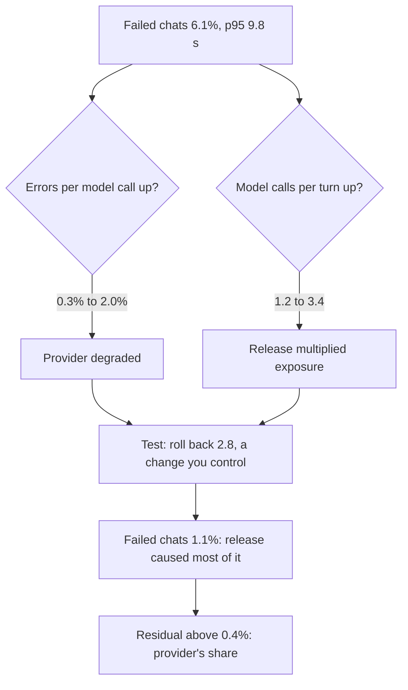

# The Incident with Two Suspects

## Start with the message from Hesketh Retail

Hesketh Retail, a fictional homeware chain, runs your order-support assistant. It answers customer chats about orders and can issue goodwill credits under £20. At 14:31 on a Tuesday, Hesketh's head of customer service writes:

> "Chats are timing out and customers are complaining on social media. Your team shipped something this afternoon. Is this you?"

Your team had released version 2.8 at 14:05. By 14:25 the share of failed chats had risen from 0.4% to 6.1%, and the 95th percentile (p95) response time from 3.1 to 9.8 seconds. At 14:22 the model provider's status page had posted "elevated error rates".

For twenty minutes the call went round in circles. Half the team blamed the provider and waited for its fix. The other half blamed the release but did not want to roll back something the provider might explain. Nobody had taken charge, so nobody chose. Call this **the two-suspect stall**: an incident where a plausible second cause becomes a reason not to act on the first.

> **What you'll learn**
>
> - Settle who owns an incident that spans your service, the customer's platform and a provider.
> - Isolate the failing layer with per-hop measurements, not opinion.
> - Test two suspects with a reversible action you control.
> - Recover requests a restart left accepted but unfinished, without doing them twice.

## Discover: who owns this, and what is known

Three parties had a stake. Hesketh's platform team ran the cluster and gateway. Your team owned the assistant service and its release. The provider owned the model API. Hesketh's incident process names an incident commander from their on-call rota. That was the first call. You took the role of technical lead for the assistant, and one engineer wrote the timeline.

The incident commander set three things in the first ten minutes: severity two, an update to the customer-service lead every 30 minutes, and one channel for decisions. You owned the next question: which layer is failing?

The first update said what you knew and what you did not. Chats were failing at about 6%, two causes were under test, and the next update would come at 15:00. Promising a cause before you have one costs trust you need later.

## Design the diagnosis: measure each hop

A chat crosses the gateway, the assistant, the order system and the model API. Each hop records its own latency and errors in the traces. Read them by hop before you form a theory. Table 1 shows the numbers from 14:30, set against the same hour a week earlier.

| Measure | Last week | 14:30 today |
| --- | --- | --- |
| Failed chats | 0.4% | 6.1% |
| Errors per model call | 0.3% | 2.0% |
| Model call p95 latency | 1.9 s | 2.6 s |
| Model calls per chat turn | 1.2 | 3.4 |
| Order system p95 latency | 0.2 s | 0.2 s |

*Table 1: Per-hop measurements at Hesketh. The order system is clean. The model calls are worse, and there are almost three times as many of them.*

The table holds both suspects. The provider was degraded: errors per call rose almost sevenfold. The release had changed the shape of the work: version 2.8 added an order-history tool, and the assistant now made 3.4 model calls per turn. Each failed call was retried three times at once, with no backoff. More calls per chat meant more chances to fail, and the retries added load to a provider already struggling.

Figure 1 shows how the evidence pointed to a test rather than a verdict.

*Figure 1: Isolating the layer at Hesketh. Two contributing causes, one reversible test.*

## A constraint changes: a restart that forgot

At 14:40, before the rollback decision, a Hesketh engineer restarted the assistant's workers to "clear the backlog". The workers held their queue in memory. The gateway had already accepted 312 chats and told each customer, "We'll reply within five minutes." Those requests disappeared. No error was logged, because from the workers' view the work had never existed.

The restart also emptied the caches. For ten minutes latency got worse, not better. The incident now had a third problem: accepted work with no owner and no record of how far it had gone.

## Recover: roll back, then account for every accepted request

The incident commander asked for one decision. You recommended rolling back to 2.7 at once. The rollback was reversible, in your control and took eight minutes. Waiting for the provider was neither. At 14:58 version 2.7 was live. By 15:10 failed chats were 1.1%, and p95 was 4.0 seconds. The release had caused most of the impact. The rest matched the provider's degradation, which cleared at 16:05.

You also cut retries to one with exponential backoff and jitter, so a struggling provider did not get extra load.

The 312 lost chats needed care, because some might have issued a credit before the restart. Every request carried an ID from the gateway. You listed the 312 IDs that had no completion record. You then checked the order system for credits tagged with those IDs. Nineteen had been issued. Those chats got only their reply. The other 293 were replayed, each with its request ID as the idempotency key on the credit call. A replay could not credit twice. Customers received a reply with an apology for the delay.

The lasting fixes went on the action list: a durable queue that acknowledges a message only after the work completes, and a shutdown that drains in-flight work before a worker stops.

## Defend: one timeline, two causes, no blame

The provider's account manager argued that the incident was your release. Hesketh's head of customer service asked whether the provider could be trusted. Your postmortem answered both with the timeline and Table 1.

It said the release raised model calls per chat almost threefold and retried without backoff. That turned a moderate provider fault into a visible outage. It said the provider's degradation was real and explained the residual 1.1%. It named the restart as a process gap, not a person's mistake: nothing told the engineer that a restart lost queued work.

Each action had an owner and a date: the durable queue, a canary for releases that change call patterns, an alert on model calls per chat, and a runbook line on restarts.

The walkthrough replays the engagement as you would tell it in an interview, one phase per step.

Step through the Hesketh incident. Each step shows what you knew, what you decided and what you can show for it.

<button type="button" data-step="0" aria-pressed="false" aria-controls="hesketh-step-0">1. Discover</button><button type="button" data-step="1" aria-pressed="false" aria-controls="hesketh-step-1">2. Design</button><button type="button" data-step="2" aria-pressed="false" aria-controls="hesketh-step-2">3. Constraint</button><button type="button" data-step="3" aria-pressed="false" aria-controls="hesketh-step-3">4. Recover</button><button type="button" data-step="4" aria-pressed="false" aria-controls="hesketh-step-4">5. Defend</button>

<section id="hesketh-step-0" class="step-panel" aria-labelledby="hesketh-heading-0"><h4 id="hesketh-heading-0">1. Settle ownership</h4><dl><dt>You know</dt><dd>Failures at 6.1%, a release at 14:05, a provider warning at 14:22.</dd><dt>You decide</dt><dd>Their incident commander, you as technical lead, updates every 30 minutes.</dd><dt>Evidence</dt><dd>A timeline started at minute one.</dd></dl></section><section id="hesketh-step-1" class="step-panel" aria-labelledby="hesketh-heading-1"><h4 id="hesketh-heading-1">2. Measure each hop</h4><dl><dt>You know</dt><dd>Errors per call up sevenfold, calls per turn up from 1.2 to 3.4.</dd><dt>You decide</dt><dd>Both suspects contribute. Test with the change you control.</dd><dt>Evidence</dt><dd>Per-hop traces against last week.</dd></dl></section><section id="hesketh-step-2" class="step-panel" aria-labelledby="hesketh-heading-2"><h4 id="hesketh-heading-2">3. The restart loses work</h4><dl><dt>You know</dt><dd>312 accepted chats vanished from an in-memory queue.</dd><dt>You decide</dt><dd>Treat lost work as its own problem, with a list of IDs.</dd><dt>Evidence</dt><dd>Gateway acceptances with no completion record.</dd></dl></section><section id="hesketh-step-3" class="step-panel" aria-labelledby="hesketh-heading-3"><h4 id="hesketh-heading-3">4. Roll back and replay safely</h4><dl><dt>You know</dt><dd>Some lost chats may already have issued credits.</dd><dt>You decide</dt><dd>Roll back, back off retries, replay 293 with idempotency keys.</dd><dt>Evidence</dt><dd>Failures fell to 1.1%, no double credits.</dd></dl></section><section id="hesketh-step-4" class="step-panel" aria-labelledby="hesketh-heading-4"><h4 id="hesketh-heading-4">5. Explain both causes</h4><dl><dt>You know</dt><dd>The provider and the customer each want a single culprit.</dd><dt>You decide</dt><dd>Show how the release amplified a real provider fault.</dd><dt>Evidence</dt><dd>A blameless postmortem with owned actions.</dd></dl></section>

<button type="button" data-walk="previous">Previous</button>

<button type="button" data-walk="next">Next step</button>

## Limits of this lesson

- **Clean traces.** Hesketh had per-hop traces with request IDs. Without them the diagnosis takes far longer, and adding them is the first action.
- **A clean rollback.** Version 2.8 changed no data. A release that migrates data may not roll back this easily.
- **Composite engagement.** Hesketh Retail, its numbers and its timeline are illustrative, not a real customer.

## Interview angle

Each answer is an outline to say in about two minutes. Open each question and try it aloud before reading.

Interview question 1. Latency and failures are rising in a system that spans your service, the customer's platform and a model provider. Who owns the incident, and what do you do first?

- **Answer:** One person runs the incident, usually from the customer's on-call process because it is their service. Everyone else takes a named role: technical lead per component, a scribe, a communications owner. In the first minutes, set severity, open one channel, start a timeline and give the first update with what is known and when the next update comes.
- **Trade-off:** Formal roles feel slow for a small team. Without them, two people make conflicting changes.
- **Follow-up to expect:** "The customer has no incident process." Propose one for this incident and agree it afterwards.
- **Go deeper:** [Diagnosing production incidents](/learn/production-ai/observability-and-diagnosis/diagnosing-production-incidents).

Interview question 2. How do you work out which layer is causing rising latency and errors?

- **Answer:** Read latency and errors per hop from traces, against a normal baseline: gateway, service, each dependency, the model API. Look for a hop that changed and for a change in how often each hop is called. Split by version, customer and error type. A dependency that is slower per call and a service that calls it more often look the same from outside.
- **Trade-off:** Per-hop telemetry costs effort before any incident. Without it you diagnose by argument.
- **Follow-up to expect:** "Averages look fine." Use percentiles, because the tail carries the complaints.

Interview question 3. You released fifteen minutes before failures rose, and the model provider reports degradation at the same time. How do you decide which caused it?

- **Answer:** Do not choose by argument. Measure both: errors per provider call, and whether the release changed call volume, retries or prompts. Then run the reversible test you control, usually a rollback. If failures fall to baseline, it was the release. If a residual remains that matches the provider's window, both contributed.
- **Trade-off:** Rolling back loses the release's features for a while. Waiting for the provider can cost hours.
- **Follow-up to expect:** "Rollback is not possible." Turn off the new behaviour with a flag, or route a share of traffic to the old path.

Interview question 4. A worker restart left accepted requests unfinished, and some may have changed data. How do you recover them?

- **Answer:** List every request accepted with no completion record, using IDs from the entry point. For each, check the systems it writes to for side effects tagged with its ID. Complete only the missing steps, and replay with the request ID as the idempotency key, so nothing happens twice. Tell affected users. Then fix the cause: a durable queue and a draining shutdown.
- **Trade-off:** Checking each request is slow. Replaying blindly can pay or credit twice.
- **Follow-up to expect:** "There are no request IDs." Reconstruct from logs, and add IDs first in the follow-up.
- **Go deeper:** [Idempotent writes and long-running jobs](/learn/engineering-foundations/apis-and-backend/idempotent-writes-and-long-running-jobs).

Interview question 5. Timed drill (20 minutes): after your release, failures and latency rise while the model provider reports degradation, and a restart loses queued work.

- **Answer:** Minutes 0 to 3: roles, severity, first update. Minutes 3 to 8: per-hop numbers against a baseline, including calls per request. Minutes 8 to 12: both suspects, and the rollback as the test you control. Minutes 12 to 16: lost work, by request ID, side-effect checks and idempotent replay. Minutes 16 to 20: postmortem with both causes and owned actions.
- **Trade-off:** Fixed timings leave little room for a detour. Say where you are so the interviewer can steer.
- **Follow-up to expect:** "What would you alert on?" Failed chats and model calls per chat, not CPU.

## References

1. Google, [Site Reliability Engineering: Managing Incidents](https://sre.google/sre-book/managing-incidents/), accessed 17 November 2026. Incident command, roles and a single channel for decisions.
2. Amazon Web Services, [Timeouts, retries and backoff with jitter](https://aws.amazon.com/builders-library/timeouts-retries-and-backoff-with-jitter/), accessed 17 November 2026. How retries amplify load on a struggling dependency.
3. Google, [Site Reliability Engineering Workbook: Postmortem Culture](https://sre.google/workbook/postmortem-culture/), accessed 17 November 2026. Blameless postmortems with owned actions.
4. The site's observability and production diagnosis case and [retries, circuit breakers and bulkheads](/learn/production-ai/scaling-and-reliability/retries-circuit-breakers-and-bulkheads) lesson.
5. The site's [incidents with a customer watching](/learn/fde-deploying-in-the-estate/operating-after-go-live/incidents-with-a-customer-watching) and [isolate the failing boundary](/learn/forward-deployed/debugging-customer-environment/isolate-the-failing-boundary) lessons, for running the incident and separating the suspects.

## Key takeaways

- Settle one incident lead and named roles before anyone changes anything.
- Read latency and errors per hop, and check whether call volume changed as well as speed.
- With two suspects, run the reversible test you control. A residual can belong to the other.
- Accepted work lost in a restart needs a list of IDs, a side-effect check and idempotent replay.
- A postmortem can name two causes. It names process gaps, not people.

## Check yourself

1. Why did a moderate provider fault become a visible outage at Hesketh?

Version 2.8 nearly tripled model calls per chat and retried each failure three times at once. More calls meant more chances to fail, and the retries added load to the degraded provider.

2. How did the rollback tell you how much each suspect contributed?

Failed chats fell from 6.1% to 1.1%. Most of the impact went with the release. The residual above the 0.4% baseline matched the provider's window and cleared when the provider recovered.

3. Why were only 293 of the 312 lost chats replayed?

Nineteen had already issued their credit before the restart. Those needed only the reply. Replaying them without a check could have credited the customer twice.

