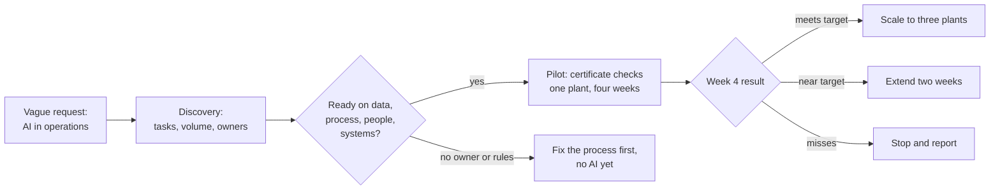

# The Vague AI for Operations Request

## Start with a request for AI in operations

Alderley Foods, a fictional food manufacturer with three plants, sends a one-line brief: "We want AI in operations. Can you show something in six weeks?" The chief operating officer (COO) signs it. There is no named task, no data list and no owner below the COO.

A year earlier, another vendor answered a brief like this with a chatbot over Alderley's standard operating procedures. It demonstrated well. Six months later it had eleven users, none of them on the production floor, because the people with the real pain never asked it anything.

That vendor built for the words in the request, not for the work behind them. Call this **the answer looking for an operation**: a capable system aimed at no task anyone owns.

> **What you'll learn**
>
> - Turn a vague AI request into a short list of owned tasks with numbers.
> - Judge readiness across data, process, people and systems before you commit.
> - Size a pilot with a baseline, a success measure and an exit decision.
> - Handle a sponsor who switches to a rarely performed task mid-engagement.
> - Build evaluation data when the history you expected does not exist.

## Discover: find the work behind the request

Your first meeting is with the COO. The goal is not to propose anything. It is to find which decisions or tasks hurt, who does them and how often. Table 1 is a short role-play of the first ten minutes.

| You ask | The COO says | What you learn |
| --- | --- | --- |
| "Which part of operations costs you most time or risk today?" | "Planning, quality paperwork, and recall drills." | Three areas, not one |
| "Who does the quality paperwork, and how often?" | "Two QA leads check supplier certificates, about 40 a week." | A named task with volume |
| "What happens when a check is wrong?" | "A non-conforming ingredient reaches a line. We had two last year." | The cost of an error |
| "What have you tried already?" | "The procedures chatbot. Nobody uses it." | What not to repeat |
| "Who could stop a change here?" | "The head of quality, and IT for anything touching the ERP." | Control and system owners |

*Table 1: The opening role-play. Each question asks about work, volume, consequence or ownership, never about technology.*

After the meeting you watch the work. You sit with a QA lead for half a day and time 12 certificate checks: about 15 minutes each, mostly re-typing values from a PDF into a spreadsheet and comparing them with the ingredient specification. That gives 40 × 15 = 600 minutes, or 10 hours a week, on one task with clear inputs and a human check already in place.

You end discovery with three candidates and a readiness view of each.

| Candidate | Volume | Data today | Owner | Risk if wrong |
| --- | --- | --- | --- | --- |
| Supplier certificate checks | 40 a week | Three months of PDFs, specifications in the ERP | Head of quality | Medium: a QA lead still signs |
| Production schedule suggestions | Daily, per line | Line rates in spreadsheets, often out of date | Plant managers (three, who disagree) | High: lost output |
| Procedures chatbot rebuild | Unclear | Procedures, 30 per cent out of date | Nobody | Low, and low value |

*Table 2: Candidates after discovery. Readiness covers data, process, people and systems, not only data.*

## Design: a pilot sized to the evidence

Certificate checks win. The task is frequent, the inputs are documents, a person already signs every result and one owner can say yes. Scheduling has more value on paper, but three plant managers disagree on the rules, so a model would learn an argument.

*Figure 1: From a vague request to a pilot with a decision at the end. The "no" branch is a valid outcome, not a failure.*

The pilot design fits on one page:

- **Scope.** One plant, four weeks, every incoming certificate, about 160 in total.
- **Mechanism.** Extract the values from each certificate, compare them with the specification in the ERP, and show the QA lead a pre-filled check with mismatches highlighted. The lead still signs.
- **Baseline.** 15 minutes per check, timed in week 0.
- **Success.** Five minutes per check, and no mismatch missed when a second lead re-checks a sample of 40.
- **Exit.** Scale, extend or stop, decided by the head of quality against those two numbers.

At five minutes, the saving is 10 minutes × 40 = 400 minutes a week, about 6.7 hours. Over 48 working weeks that is about 320 hours a year at one plant. The numbers are small on purpose: they are ones the head of quality can check.

## The constraint changes: a rare task and missing history

In week two, two things happen.

First, the COO returns from a board meeting and says the real pain is the mock recall. Twice a year, three people spend four days tracing a test lot through suppliers, lines and customers. The board was unhappy with the last one. "Can AI do that instead?"

The mock recall uses 3 × 4 × 8 = 96 hours per drill, 192 hours a year. That is fewer hours than the certificate pilot saves, but hours are the wrong measure. A real recall is rare and high-consequence, and its value is speed and completeness on the day it happens. A rare task also has few examples to learn from or test against, and the people doing it forget the steps between drills.

Second, the QA team admits that certificates older than three months sat in a supplier portal that was switched off in the spring. There is no labelled history of past mismatches to test the extraction against.

## Recover: re-plan without losing the pilot

Do not swap the pilot for the rare task, and do not wave the COO away. Separate the two problems.

For the recall, ask what slowed the last drill. The answer is lot records spread across the ERP, a warehouse spreadsheet and paper intake sheets. That is a data and process gap, not an AI problem. Offer a small, separate deliverable: a traceability query over the ERP and warehouse data, plus a one-page runbook, tested at the next drill against a target the COO sets, such as tracing one lot in four hours. Put it in writing as a change to scope, with its own owner and date.

For the missing history, build the test set going forward:

1. Run the pilot in shadow mode for weeks one and two. The tool extracts and compares, the QA leads check as before, and their result becomes the label. That gives about 80 labelled certificates.
2. Add 30 hand-made edge cases agreed with the head of quality: wrong units, a missing allergen line, a certificate for the wrong batch.
3. Report extraction and mismatch detection against those 110 cases before the tool pre-fills anything a lead relies on.

The cost is one extra week: the pilot now ends in week five. Tell the COO this in the same message as the recall plan, with the reason.

## Defend: the recommendation to the COO

You finish with a ten-minute read-out. Lead with the decision you want, then the evidence, then the risks. The walkthrough replays the engagement as you would tell it.

Step through the Alderley engagement. Each phase shows what happened, your move and the evidence you kept.

<button type="button" data-step="0" aria-pressed="false" aria-controls="alderley-step-0">1. Discover</button><button type="button" data-step="1" aria-pressed="false" aria-controls="alderley-step-1">2. Design</button><button type="button" data-step="2" aria-pressed="false" aria-controls="alderley-step-2">3. Change</button><button type="button" data-step="3" aria-pressed="false" aria-controls="alderley-step-3">4. Recover</button><button type="button" data-step="4" aria-pressed="false" aria-controls="alderley-step-4">5. Defend</button>

<section id="alderley-step-0" class="step-panel" aria-labelledby="alderley-heading-0"><h4 id="alderley-heading-0">1. Discover the work</h4><dl><dt>What happened</dt><dd>A one-line request with no task or owner.</dd><dt>Your move</dt><dd>Ask about work, volume, consequence and owners, then time real certificate checks.</dd><dt>Evidence</dt><dd>40 checks a week at 15 minutes, three candidates with readiness notes.</dd></dl></section><section id="alderley-step-1" class="step-panel" aria-labelledby="alderley-heading-1"><h4 id="alderley-heading-1">2. Design a small pilot</h4><dl><dt>What happened</dt><dd>Certificate checks had volume, documents, one owner and a human sign-off.</dd><dt>Your move</dt><dd>One plant, four weeks, a five-minute target and a scale, extend or stop decision.</dd><dt>Evidence</dt><dd>A one-page pilot plan signed by the head of quality.</dd></dl></section><section id="alderley-step-2" class="step-panel" aria-labelledby="alderley-heading-2"><h4 id="alderley-heading-2">3. The constraint changes</h4><dl><dt>What happened</dt><dd>The COO asked for the twice-yearly mock recall, and the certificate history turned out to be gone.</dd><dt>Your move</dt><dd>Treat them as two problems and ask what slowed the last drill.</dd><dt>Evidence</dt><dd>192 hours a year on recalls, value driven by risk, not hours.</dd></dl></section><section id="alderley-step-3" class="step-panel" aria-labelledby="alderley-heading-3"><h4 id="alderley-heading-3">4. Recover the plan</h4><dl><dt>What happened</dt><dd>The pilot had no test set and a new request competed with it.</dd><dt>Your move</dt><dd>Shadow-mode labelling plus 30 edge cases, and a separate traceability query for the recall.</dd><dt>Evidence</dt><dd>110 labelled cases and a written scope change, pilot end moved to week five.</dd></dl></section><section id="alderley-step-4" class="step-panel" aria-labelledby="alderley-heading-4"><h4 id="alderley-heading-4">5. Defend the result</h4><dl><dt>What happened</dt><dd>The COO wants to know whether to scale.</dd><dt>Your move</dt><dd>Lead with the decision, show minutes per check and missed mismatches, name the risks.</dd><dt>Evidence</dt><dd>Measured numbers against the week-0 baseline.</dd></dl></section>

<button type="button" data-walk="previous">Previous</button>

<button type="button" data-walk="next">Next step</button>

The walkthrough is a scripted illustration. In an interview, the defence stage is where you show judgement: why certificate checks, why not the recall, and what would make you stop.

## Limits of this lesson

- **Fictional data.** Alderley Foods, its plants and every figure are illustrative.
- **One path.** A different customer could have a scheduling problem with one clear owner, and then scheduling would win.
- **Regulation varies.** Food safety and recall duties differ by country. Confirm them with the customer's quality and legal owners.

## Interview angle

Each answer is an outline to say in about two minutes. The last question is timed: set a clock and talk it through before opening it.

Interview question 1. A COO asks for "AI in operations" and names no task. What are your first questions?

- **Answer:** Ask which tasks or decisions cost the most time or risk, who does them, how often, how long each takes, what an error costs, what has been tried and who can block a change. Then watch the work and time a few real cases, because what people say and what they do differ.
- **Trade-off:** Discovery delays any demo by a week or two. Skipping it builds for the words in the request.
- **Follow-up to expect:** "The COO wants a demo next week." Offer a read-out of candidates with numbers instead of a demo of a guess.
- **Go deeper:** [The discovery conversation](/learn/forward-deployed/customer-discovery/the-discovery-conversation).

Interview question 2. How do you judge whether the customer is ready, and what pilot do you propose?

- **Answer:** Check four kinds of readiness per candidate: data that exists and can be reached, a stable process, an owner who can decide, and systems you can connect to. Pick the candidate that passes all four with real volume. Propose a pilot with a fixed scope, a measured baseline, one success number, a quality guard and an exit decision of scale, extend or stop.
- **Trade-off:** The ready task may not be the most valuable one. A valuable task with no owner or stable rules stalls.
- **Follow-up to expect:** "What if nothing is ready?" Recommend fixing the process or data first, without AI.
- **Go deeper:** [Pilots that predict production](/learn/forward-deployed/delivery-stages-and-gates/pilots-that-predict-production).

Interview question 3. In week two, the sponsor says the real pain is a task the team does twice a year. What do you do?

- **Answer:** Keep the pilot and treat the new request separately. Ask what slowed the last run. Rare tasks have few examples to test against and people forget the steps, so the fix is often data access, a checklist or a query rather than a model. Value them by consequence, not hours. Offer a small deliverable tested at the next run, written up as a scope change with its own owner.
- **Trade-off:** Saying "not now" to a sponsor carries risk. Abandoning a measured pilot for an untestable task carries more.
- **Follow-up to expect:** "The sponsor insists." Show both plans with their evidence and let the sponsor choose in writing.

Interview question 4. The historical data you planned to evaluate against does not exist. How do you go on?

- **Answer:** Build the evaluation set going forward. Run in shadow mode so the current human result becomes the label, add edge cases the domain owner agrees, and report quality on that set before anyone relies on the output. Move the timeline and say why, in the same message.
- **Trade-off:** Shadow mode costs a week or two. Launching without labels means nobody can say whether the tool is right.
- **Follow-up to expect:** "Can you use synthetic data?" For edge cases, yes, if the owner agrees they are realistic, but not as the whole test set.
- **Go deeper:** [Success metrics and evaluation data](/learn/forward-deployed/customer-discovery/success-metrics-and-evaluation-data).

Interview question 5. Timed drill (20 minutes): a manufacturer says "we want AI in operations, show us something in six weeks". Run the engagement.

- **Answer:** Minutes 0 to 4: discovery questions on work, volume, consequence and owners. Minutes 4 to 7: list three candidates with readiness on data, process, people and systems. Minutes 7 to 11: pick one and design the pilot with scope, baseline, success number and quality guard. Minutes 11 to 14: handle a change, such as a rare task or missing history. Minutes 14 to 17: risks, exit decision and what you would not build. Minutes 17 to 20: the recommendation and the decision you need.
- **Trade-off:** Time spent on discovery leaves less for design. Interviewers mark the choice, not the diagram.
- **Follow-up to expect:** "Why not the most valuable task?" Because it fails a readiness check, and say which one.

## References

1. UK Government Digital Service, [How the discovery phase works](https://www.gov.uk/service-manual/agile-delivery/how-the-discovery-phase-works), accessed 17 November 2026. Understanding the problem and the users before committing to a solution.
2. NIST, [AI Risk Management Framework](https://www.nist.gov/itl/ai-risk-management-framework), accessed 17 November 2026. Mapping context and impact before measuring and managing an AI system.
3. The site's [build, buy, configure or no AI](/learn/forward-deployed/scoping-an-fde-project/build-buy-configure-or-no-ai) lesson and the prioritise AI use cases case.
4. The author's own field experience, the basis for the role-play and the shadow-mode labelling plan.

## Key takeaways

- A vague request hides tasks. Ask about work, volume, consequence and owners before any technology.
- Judge readiness on data, process, people and systems, and pick the task that passes all four.
- A pilot needs a scope, a measured baseline, one success number, a quality guard and an exit decision.
- Value a rare task by its consequence, and expect its fix to be data or process before a model.
- When history is missing, label going forward in shadow mode and move the date openly.

## Check yourself

1. Why did production scheduling lose to certificate checks despite more value on paper?

Three plant managers disagreed on the scheduling rules and no single owner could decide, so it failed the process and people readiness checks.

2. Why are hours saved the wrong measure for the mock recall?

A real recall is rare and high-consequence. Its value is the speed and completeness of a trace on the day it happens, not the drill hours.

3. Where did the labels for the certificate test set come from?

From the QA leads' own checks during two weeks of shadow mode, plus 30 edge cases agreed with the head of quality.

