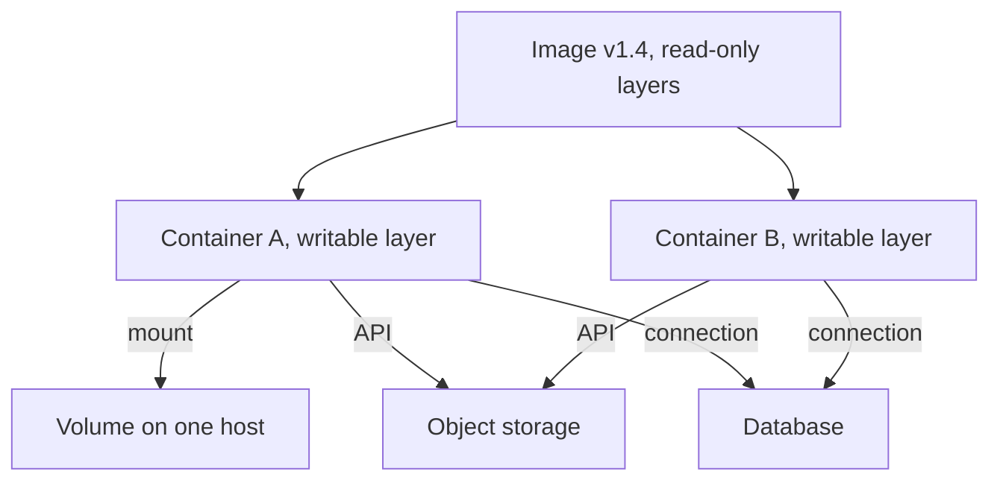

# Containers and Persistent Data

## Start with the disposable disk

Yarrow Health, a fictional group of outpatient clinics, ran a referral-letter service as a container on a host in its own data centre. Clinic staff uploaded scanned letters, and the service converted them to text for a summary. The service saved each upload to `/app/uploads`, a folder inside the container.

On Thursday the vendor shipped a fix. The operator pulled the new image, stopped the old container and started a new one. The service came up cleanly. On Friday a clinician asked for a letter uploaded on Monday, and the service returned "file not found". So did every one of the 412 letters uploaded since the previous deploy. They had lived in the old container's writable layer, and that layer was deleted with the container.

Nothing had failed. The container did what containers do. Call this **the disposable disk**.

> **What you'll learn**
>
> - Tell an image from a container, and know what each keeps.
> - Run as a non-root user with pinned dependencies, and avoid ownership surprises on volumes.
> - Diagnose restarts under a memory limit and size the limit from measurements.
> - Choose where persistent data lives: volume, database or object storage.

## Image against container

An **image** is a read-only template: a stack of file-system layers plus metadata such as the command to run and the user to run it as. It is built once and does not change. A **container** is a running instance of an image. The runtime adds a thin writable layer on top of the image's layers, and every file the process writes lands there.

That writable layer belongs to that one container. Replace the container, for an upgrade, a restart on another host or a crash, and the layer is gone. Run three containers from the same image and each has its own layer, invisible to the other two.

Figure 1 shows where data can live.

*Figure 1: One image, two containers. Each writable layer dies with its container. Volumes, object storage and databases live outside it.*

The rule that follows is short: the container's own file system is scratch space. Anything that must survive a deploy goes outside it.

## Non-root users and pinned dependencies

Two image choices decide how the container behaves in a customer's estate. The site's [package the service and keep secrets out](/learn/engineering-foundations/cloud-containers-deployment/package-the-service-and-keep-secrets-out) lesson teaches the build itself: two-stage builds, settings and secrets. Here are the field consequences.

| Choice | What to do | Why it matters on site |
| --- | --- | --- |
| Run as non-root | Create a user with a fixed numeric ID, such as 10001, and switch to it in the image | Many customer platforms reject root containers. A breakout from root is worse |
| Own your files | Give that user the directories it writes, at build time | Avoids "Permission denied" on first start |
| Pin the base image | Refer to the base by its digest, not a moving tag such as `latest` | The same build gives the same image next month |
| Lock dependencies | Install from a lockfile with exact versions and hashes | No surprise upgrades between your test and their install |
| Install at build, not start | No package installs when the container starts | The container starts without internet, the same way every time |

*Table 1: Image choices and why each matters in the customer's estate.*

Non-root users meet a common trap with volumes. A volume created by the host is often owned by root. The container's user 10001 then cannot write to it, and the service fails with the same "Permission denied" taught in the [Linux processes, permissions and limits](/learn/fde-deploying-in-the-estate/deployment-models-and-environments/linux-processes-permissions-and-limits) lesson. Agree the user ID with the customer's platform team, and have the volume prepared with that owner, or let the platform set group ownership when it mounts the volume.

Docker's own build guidance recommends both habits, a non-root user and base images pinned by digest. Customer security scanners check for them.

## Restarts under memory limits

Customer platforms set a memory limit on each container. The kernel enforces it through the control group the container runs in. When the process inside exceeds the limit, the kernel's out-of-memory (OOM) killer ends it, the runtime records exit code 137 (128 plus signal 9), and the platform restarts the container. In Kubernetes, `kubectl describe pod` shows the last state as "OOMKilled". The application's own log shows nothing, because it was killed mid-sentence.

Yarrow's converter hit this the week after the upload fix. The numbers, measured afterwards:

- **Limit:** 512 MiB per container.
- **Baseline:** the service uses about 180 MiB when idle.
- **Per conversion:** a 60 MB scanned letter is decoded into page images that peak at about 300 MiB.
- **Two at once:** 180 + 300 + 300 = 780 MiB, above the limit. Single conversions fit, which is why tests passed.

There are two fixes, and the second matters more:

1. **Bound the work.** Convert one letter at a time per container, or stream pages one by one, which brought the per-conversion peak to about 40 MiB.
2. **Size from measurement.** Run a realistic load, record the peak memory per container, and set the limit at the peak plus headroom. Yarrow measured a 380 MiB peak with streaming under load, and kept the 512 MiB limit, about 35% above it.

Raising the limit without bounding the work only moves the failure to the next large file. The Kubernetes documentation on resource management describes requests, limits and what happens when a container exceeds them.

## Where persistent data belongs

Data that must outlive the container goes into one of three places, each suited to a kind of data:

- **A database** for records: users, metadata, the status of each letter.
- **Object storage** for files: uploads, generated documents, exports. Every container reaches the same store over an API. Versioning and lifecycle rules handle retention.
- **A volume** for data a single process needs on a file system, such as a self-managed database's data directory. A volume survives the container but is usually tied to one host or one attachment at a time.

The switcher replays Yarrow's uploads under each storage choice, through a deploy and then a scale-out to three containers.

Clinic staff upload 412 letters. Then the container is replaced by a new version, and later the service scales to three containers. Choose where uploads are saved.

<button type="button" data-mode="layer" aria-pressed="false" aria-controls="layer-result">Container file system</button>
<button type="button" data-mode="volume" aria-pressed="false" aria-controls="volume-result">Volume on the host</button>
<button type="button" data-mode="object" aria-pressed="false" aria-controls="object-result">Object storage</button>

<section id="layer-result" class="mode-panel" data-announcement="Container file system selected. All 412 letters are lost on replace."><h4>Container file system</h4><ul><li>The deploy deletes the old container and its writable layer. All 412 letters are gone.</li><li>With three containers, each sees only the uploads it received, so about two downloads in three fail.</li><li>There is nothing to back up, because the data has no stable home.</li></ul>
Fine for temporary files during one request. Wrong for anything a user expects to see again.
</section>
<section id="volume-result" class="mode-panel" data-announcement="Volume selected. Letters survive the deploy but scale-out is limited."><h4>Volume on the host</h4><ul><li>The new container mounts the same volume. All 412 letters survive the deploy.</li><li>Three containers on different hosts cannot all mount a single-host volume, so scale-out stalls.</li><li>Backups, disk growth and host failure are now the operator's job.</li></ul>
Works for one container on one host. It ties the service to that host.
</section>
<section id="object-result" class="mode-panel" data-announcement="Object storage selected. Letters survive and all containers see them."><h4>Object storage</h4><ul><li>Uploads go to a bucket, and the database stores each letter's key and status.</li><li>The deploy and the scale-out change nothing for users. Every container reads the same bucket.</li><li>Versioning and retention rules are set once, on the bucket.</li></ul>
The container keeps no data of value. It can be replaced at any time.
</section>

In a disconnected or on-premises estate, object storage means an S3-compatible store the customer runs, or a shared file system they provide. Ask which one exists before the design assumes either.

## Limits of this lesson

- **The build is taught elsewhere.** Multi-stage builds, image size and secrets are in the T1.3 packaging lesson.
- **Memory figures depend on the language runtime.** Garbage-collected runtimes may hold memory they no longer need. Measure the real process under load.
- **Fictional data.** Yarrow Health, its letters and its memory figures are illustrative.

## Interview angle

Each answer is an outline to say in about two minutes. Open each question and try it aloud before reading.

Interview question 1. What is the difference between an image and a container, and what happens to data written inside a container?

- **Answer:** An image is a read-only template of layers plus metadata, built once. A container is a running instance with its own writable layer on top. Files written inside land in that layer, which is deleted when the container is replaced, and is not shared with other containers from the same image. Anything that must survive a deploy goes to a database, object storage or a volume.
- **Trade-off:** Disposable containers make deploys and scaling simple. They push every piece of state to an external service you must run and back up.
- **Follow-up to expect:** "Is a volume enough?" For one container on one host. Not for several containers across hosts.

Interview question 2. A container keeps restarting under load, and the application logs show no error. What do you check?

- **Answer:** Check the exit code and last state: 137 or "OOMKilled" means the kernel killed it at the memory limit, which is why the application logged nothing. Compare the limit with measured peak usage per container under realistic load. Find what drives the peak, often concurrent large inputs. Bound the work, for example one large job at a time or streaming, then set the limit at the measured peak plus headroom.
- **Trade-off:** A higher limit is quick and costs memory on every container. Bounding work takes code changes and keeps cost flat.
- **Follow-up to expect:** "It only fails in production." Production has larger inputs or more concurrency. Test with those.

Interview question 3. Users report that files they uploaded last week have vanished after a release. What happened, and how do you fix it?

- **Answer:** The service almost certainly stored uploads in the container's file system, and the release replaced the container. First stop further loss: check whether the old container still exists and copy its files out. Then move uploads to object storage, with the database holding each file's key and status, and test by replacing a container and scaling to two. Tell the customer exactly which uploads are lost, with dates.
- **Trade-off:** Object storage adds a dependency. Keeping files in containers loses data on every deploy.
- **Follow-up to expect:** "No object store on-premises." Use their S3-compatible store or shared file system.

## References

1. Docker, [Building best practices](https://docs.docker.com/build/building/best-practices/), accessed 17 November 2026. Pinning base images and running as a non-root user.
2. Docker, [Volumes](https://docs.docker.com/engine/storage/volumes/), accessed 17 November 2026. Data that outlives a container.
3. Kubernetes, [Resource management for pods and containers](https://kubernetes.io/docs/concepts/configuration/manage-resources-containers/), accessed 17 November 2026. Memory requests, limits and OOM kills.
4. The site's [package the service and keep secrets out](/learn/engineering-foundations/cloud-containers-deployment/package-the-service-and-keep-secrets-out) lesson, the deep dive on building images.

## Key takeaways

- An image is a read-only template. A container adds a writable layer that dies with it.
- Run as a fixed non-root user, own your directories and agree volume ownership.
- Pin the base image by digest and install from a lockfile at build time.
- Exit code 137 or OOMKilled means the memory limit. Bound the work, then size from measurements.
- Store files in object storage and records in a database, so containers hold nothing of value.

## Check yourself

1. Why did Yarrow's service start cleanly after the deploy yet lose 412 letters?

The letters lived in the old container's writable layer. Starting a new container from the new image gave it an empty layer, and the old one was deleted.

2. Why did single conversions pass testing while production containers restarted?

One conversion peaked at about 480 MiB with the baseline, under the 512 MiB limit. Two at once reached about 780 MiB, which the tests never ran.

3. Why can a non-root container fail to write to a new volume?

The volume is often created owned by root. The container's user, such as 10001, has no write permission on it until ownership is agreed and set.

