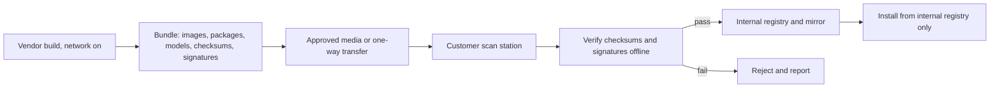

# Disconnected and Hybrid Installs

## Start with the phone-home install

Zennor Energy, a fictional electricity distributor, wanted a fault-report assistant inside its operations network. That network has no route to the internet, by design. The vendor's engineer, Callum, was given a two-hour access window on a Saturday morning, escorted, on a workstation inside the network.

The installer started by pulling container images from a public registry. It failed. Callum copied the images from a USB drive he had brought, which the security officer had not scanned, so it was taken away. The images he could load started, then the application tried to install Python packages at startup and to check its licence with the vendor's server. Both calls hung until they timed out. At the end of the two hours nothing was running, and the next window was three weeks away.

Every step assumed a network that the customer had said, in writing, did not exist. Call this **the phone-home install**.

> **What you'll learn**
>
> - Tell fully disconnected, restricted and hybrid sites apart.
> - Build an install bundle that needs nothing from outside.
> - Verify artefacts inside the customer's network before they run.
> - Plan updates, support and a short access window without internet.
> - Design for a data-centre-to-cloud link that is slow or down.

## Three kinds of limited network

"No internet" covers several situations. Ask which one you face, because each changes the design.

| Site type | What it allows | Typical example | What changes for you |
| --- | --- | --- | --- |
| Fully disconnected (air-gapped) | Nothing in or out by network. Files cross on approved media after scanning | Control systems, defence, some labs | Everything ships in a bundle. Support works from exported files |
| Restricted outbound | Outbound only through a proxy, to an allow-list | Banks, hospitals | You can reach named hosts. Every host must be requested and approved |
| Hybrid | Some parts in the data centre, some in the cloud, joined by a VPN or private link | A plant floor with a cloud dashboard | The link is a component that fails. Each side must cope alone |

*Table 1: Three kinds of limited network. Ask which one before writing the install plan.*

Zennor's operations network is the first kind. Its corporate network is the second kind, and its plan to send summaries to a cloud dashboard would make the whole system the third kind. One customer can present all three.

## Package everything the install needs

A disconnected install works only if the bundle contains everything. List every place the system reaches outside itself, then remove each one or bring it inside:

- **Container images.** Export them, including base images, and load them into a registry inside the customer's network.
- **Language packages.** Install them at build time, never at startup. A container that runs a package install when it starts has a network dependency.
- **Models and data.** Model weights, tokenisers and reference data go into the bundle or a separate data package.
- **Licences and telemetry.** Offline licence files, and telemetry that is off or written locally.
- **Time and certificates.** An internal time server and the customer's certificate authority, because public ones are unreachable.

Test the bundle where it will run: a build environment with the network cable pulled, or a cloud network with no outbound route. Every hidden call fails there instead of on the customer's Saturday.

**Verify before you run.** Files that crossed an air gap need proof that they are what you built. Ship a checksum list signed with your key, and image signatures that can be checked offline. Tools such as Sigstore's cosign can verify a signature against a public key with no network access. Supply-chain frameworks such as Supply-chain Levels for Software Artifacts (SLSA) describe provenance: a signed record of how and from what source each artefact was built. The customer's security team checks the signatures before anything enters the internal registry.

Figure 1 shows the whole path.

*Figure 1: The path of a disconnected install. Nothing is installed until the signatures are verified inside the customer's network.*

## Updates and support without internet

The first install is the easy part. Each later release has to make the same journey, so design for it from the start.

- **Versioned bundles.** Each release is one bundle with a version, a changelog and a list of supported upgrade paths, such as 2.3 to 2.4 only.
- **Mirrors.** The customer runs an internal registry and package mirror. Releases load into the mirror, and every machine installs from it.
- **Rehearsal inside.** Upgrade a staging copy inside the customer's network first. A rehearsal outside does not test their mirror, certificates or proxies.
- **Support by export.** You cannot log in. Give operators a command that collects logs, configuration with secrets removed and version details into one file. Their security team reviews it before it leaves.
- **Security patches.** Agree how fast a critical patch can cross the gap. If the answer is three weeks, the customer's risk team should know.

## Using a short access window

Many disconnected sites grant short, escorted access windows. A two-hour window is enough for an upgrade only if every minute is planned and nothing is discovered inside it. The walkthrough lays out a two-hour window for Zennor's next attempt.

Callum has a two-hour window, 09:00 to 11:00, with a verified bundle already scanned and approved. Each step shows the time, the work and the stop rule.

<button type="button" data-step="0" aria-pressed="false" aria-controls="win-step-0">1. Pre-flight</button><button type="button" data-step="1" aria-pressed="false" aria-controls="win-step-1">2. Load</button><button type="button" data-step="2" aria-pressed="false" aria-controls="win-step-2">3. Upgrade</button><button type="button" data-step="3" aria-pressed="false" aria-controls="win-step-3">4. Test</button><button type="button" data-step="4" aria-pressed="false" aria-controls="win-step-4">5. Decide</button>

<section id="win-step-0" class="step-panel" aria-labelledby="win-heading-0"><h4 id="win-heading-0">1. Pre-flight check, 09:00 to 09:10</h4><dl><dt>Work</dt><dd>Run a checker script that confirms disk space, registry access, certificates, time sync and a fresh backup.</dd><dt>Stop rule</dt><dd>Any failure ends the window. Nothing has changed yet.</dd></dl></section><section id="win-step-1" class="step-panel" aria-labelledby="win-heading-1"><h4 id="win-heading-1">2. Load and verify, 09:10 to 09:40</h4><dl><dt>Work</dt><dd>Load images into the internal registry and verify every signature and checksum against the vendor's public key.</dd><dt>Stop rule</dt><dd>One failed signature ends the window and the bundle is rejected.</dd></dl></section><section id="win-step-2" class="step-panel" aria-labelledby="win-heading-2"><h4 id="win-heading-2">3. Upgrade, 09:40 to 10:15</h4><dl><dt>Work</dt><dd>Run the rehearsed upgrade: database migration first, then the application.</dd><dt>Stop rule</dt><dd>If the migration is not finished by 10:15, roll back from the backup taken at pre-flight.</dd></dl></section><section id="win-step-3" class="step-panel" aria-labelledby="win-heading-3"><h4 id="win-heading-3">4. Smoke test, 10:15 to 10:35</h4><dl><dt>Work</dt><dd>Run five scripted checks with an operator: log in, submit a fault report, see a summary, search, export.</dd><dt>Stop rule</dt><dd>Any failed check means rollback.</dd></dl></section><section id="win-step-4" class="step-panel" aria-labelledby="win-heading-4"><h4 id="win-heading-4">5. Decide, 10:35 to 11:00</h4><dl><dt>Work</dt><dd>The operations lead signs off, or Callum rolls back. 25 minutes are held for the rollback.</dd><dt>Stop rule</dt><dd>The system leaves the window either upgraded and tested or back on the old version. Never half-done.</dd></dl></section>

<button type="button" data-walk="previous">Previous</button>

<button type="button" data-walk="next">Next step</button>

The plan is a scripted illustration. Its shape carries over: 10 + 30 + 35 + 20 + 25 minutes fill the 120, and the last 25 are reserved for going back. The bundle was scanned and approved before the window opened, so no minute is spent on paperwork.

## Hybrid links between the data centre and the cloud

A hybrid system splits across a link: a site-to-site VPN over the internet, or a dedicated private connection. Treat the link as a component with its own capacity and failures.

**Size it with arithmetic.** Zennor wants 20 GB of sensor summaries copied to the cloud each night over a 50 Mbps VPN. That is 160,000 megabits, which takes 3,200 seconds, about 53 minutes, at full speed. Daytime traffic shares the same link. Run the copy overnight and limit its rate.

**Decide what happens when it drops.** Ask, for every function, whether it must keep working with the link down:

- **Keep working locally.** Fault reports are written and summarised inside the data centre. They must not stop because the cloud is unreachable.
- **Queue and replay.** Records for the cloud dashboard wait in a local queue with enough disk for the longest outage you plan for. When the link returns, they replay in order, and each carries an ID so the cloud side ignores duplicates.
- **Degrade visibly.** The cloud dashboard shows the time of its latest data, so nobody mistakes a stale view for a quiet night.

Watch for a direction trap. Cloud services that call back into the data centre need inbound access through the customer's firewall, which security teams resist. Design so the data-centre side opens every connection outbound.

## Limits of this lesson

- **Transfer procedures vary.** Some sites use one-way data diodes, some approved removable media, some only vendor-supplied hardware. Follow the customer's procedure.
- **Network design lives elsewhere.** DNS, proxies and certificates inside the customer's network are covered in the networks and identity module.
- **Fictional data.** Zennor Energy, its windows and its figures are illustrative.

## Interview angle

Each answer is an outline to say in about two minutes. Open each question and try it aloud before reading.

Interview question 1. What do "disconnected" and "hybrid" mean for a deployment, and what changes in your design?

- **Answer:** Disconnected means no network route out. Every image, package, model and licence ships in a bundle that crosses on approved media, and support works from exported files. Restricted means outbound only through an allow-listed proxy. Hybrid means part runs in the data centre and part in the cloud, joined by a link that can drop. The design changes are the same in spirit: list every outside call, then remove it, bring it inside or make the system cope without it.
- **Trade-off:** Self-contained bundles are larger and slower to release. Assuming any network fails on site.
- **Follow-up to expect:** "How do you test that?" Install in an environment with no outbound route.

Interview question 2. The customer's network has no internet access. How do you install and keep the system updated?

- **Answer:** Build a versioned bundle with every image, package, model and an offline licence, signed with our key and with a checksum list. The customer scans it, verifies signatures offline, and loads it into an internal registry and mirror. Install only from there. Each release is a new bundle with stated upgrade paths, rehearsed on a staging copy inside their network. Support comes from a diagnostics export their security team reviews before it leaves.
- **Trade-off:** Releases reach the site slowly. Agree how fast a critical security patch can cross.
- **Follow-up to expect:** "You get two hours on site." Pre-flight checks, a timed plan and a reserved rollback slot.

Interview question 3. The link between the customer's data centre and your cloud components drops for six hours. What should happen?

- **Answer:** Work that serves people on site keeps running locally. Data bound for the cloud waits in a local queue with disk sized for the longest planned outage, then replays in order with IDs that let the cloud side drop duplicates. Cloud views show the time of their latest data so nobody trusts a stale picture. Alerts fire on the link and on queue depth, and the data-centre side opens every connection outbound so recovery needs no firewall change.
- **Trade-off:** A local queue and local processing add parts to operate. Without them, one link outage stops the site.
- **Follow-up to expect:** "How big a queue?" Records per hour times the longest outage, plus a margin.

## References

1. Sigstore, [Verifying signatures with cosign](https://docs.sigstore.dev/cosign/verifying/verify/), accessed 17 November 2026. Signature verification, including offline use.
2. SLSA, [Supply-chain Levels for Software Artifacts, version 1.0](https://slsa.dev/spec/v1.0/), accessed 17 November 2026. Build provenance and artefact integrity.
3. Docker, [Mirror the Docker Hub library](https://docs.docker.com/docker-hub/image-library/mirror/), accessed 17 November 2026. Running a registry mirror.
4. Amazon Web Services, [What is AWS Site-to-Site VPN?](https://docs.aws.amazon.com/vpn/latest/s2svpn/VPC_VPN.html), accessed 17 November 2026. Joining a data centre to a cloud network.

## Key takeaways

- Ask whether the site is disconnected, restricted or hybrid before planning the install.
- Ship one bundle with everything inside, and test it with no outbound route.
- Verify signatures and checksums inside the customer's network before anything runs.
- Plan an access window minute by minute, with a reserved rollback slot.
- Treat a hybrid link as a component: size it, and decide what each function does when it drops.

## Check yourself

1. Name three outside calls that broke Zennor's first install.

Pulling images from a public registry, installing Python packages at startup and checking the licence with the vendor's server.

2. How long does 20 GB take over a 50 Mbps link at full speed?

20 GB is 160,000 megabits. At 50 megabits a second that is 3,200 seconds, about 53 minutes.

3. Why should the data-centre side open every connection to the cloud?

Outbound connections pass most customer firewalls by policy. Cloud services calling inward need firewall openings that security teams resist and that can block recovery after an outage.

