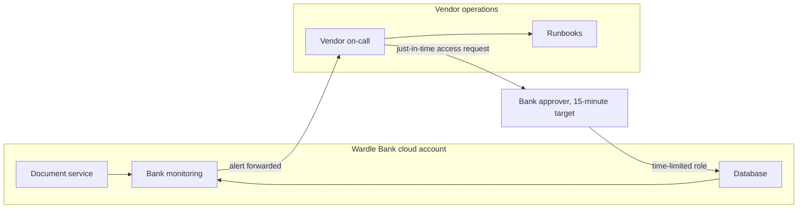

# SaaS, Customer Cloud or On-premises

## Start with the disk at two in the morning

Wardle Bank, a fictional retail bank, had a vendor's document-review service installed in the bank's own cloud account, because the data could not leave it. The contract said the vendor would "operate the service", and the bank's cloud team owned the account. Five weeks after go-live the database disk filled at 02:10 and the service stopped accepting documents. The alert went to the bank's monitoring tool, and the bank's on-call engineer found that the database belonged to the vendor's application. Nobody paged Elin, the vendor's forward deployed engineer, until 08:30, and she had no access to the account until the bank approved a request at 11:00. A ten-minute fix took nine hours, because nobody had written down who watches the disk, who gets paged and who may log in. Call this **the ownerless gap**.

> **What you'll learn**
>
> - Tell SaaS, customer-cloud and on-premises deployments apart by who runs what.
> - Write a responsibility matrix that names an owner for every operating task.
> - Choose between managed and self-managed services in each model.
> - Set up access and paging when the system runs in the customer's cloud but you operate it.

## Three places the system can run

A **deployment model** answers two questions: whose infrastructure runs the system, and whose people operate it. The three common answers are below.

| Model | Runs in | Operated by | Customer gets | Fits when |
| --- | --- | --- | --- | --- |
| SaaS | Vendor's cloud account | Vendor | A service and an API | Data may leave the customer, and the customer wants no operating work |
| Customer cloud | Customer's cloud account | Vendor, customer or both | Data stays in their account, under their controls | Data must stay in the customer's account, but the cloud is acceptable |
| On-premises | Customer's data centre | Customer, with vendor support | Full physical control | Regulation, latency or policy rules out the public cloud |

*Table 1: Three deployment models, told apart by where the system runs and who operates it.*

SaaS is the easiest to operate well, because one team runs one estate with one set of tools. Each step away from it moves infrastructure into the customer's estate and adds a boundary between the people who know the software and the people who own the machines.

Customer cloud splits into two common forms. In one, the vendor operates the system inside the customer's account, with access the customer grants. In the other, the customer's platform team operates it from the vendor's runbooks. The bank above had the first form on paper and the second form in practice, which is how the gap opened.

NIST's definition of cloud computing describes the same split in its own terms: who controls the infrastructure, the platform and the application. That framing helps when a security reviewer asks which model you are proposing.

## Who operates what: the responsibility matrix

A **responsibility matrix** lists every operating task and names one owner for each. Cloud providers publish a version for their own services, the shared responsibility model, which separates security *of* the cloud from security *in* the cloud. You need the same thing one level up, between you and the customer.

The rows come from the work of running a system, not from the architecture diagram:

| Task | SaaS | Customer cloud, vendor-operated | On-premises |
| --- | --- | --- | --- |
| Hardware, network, cloud account | Vendor | Customer | Customer |
| Operating system and patching | Vendor | Vendor | Customer |
| Database backups and restore tests | Vendor | Vendor | Customer, vendor runbook |
| Application upgrades | Vendor | Vendor, in customer's change window | Customer, vendor support |
| Monitoring and first page | Vendor | Vendor, alerts routed from customer tooling | Customer |
| Access approvals | Vendor | Customer | Customer |
| Secrets and certificate renewal | Vendor | Agreed per secret | Customer |
| Incident updates to users | Vendor | Customer, from vendor facts | Customer |

*Table 2: An example responsibility matrix. Each cell names one owner. "Both" is not an owner.*

Three rules make the matrix useful:

1. **One owner per cell.** "Shared" means nobody. If two teams act, name who decides and who helps.
2. **Every alert has a row.** For each alert, name who is paged and what access they have at 02:00.
3. **Test it.** Walk a fault through the matrix with both teams before go-live, then fix the rows that fail.

Figure 1 shows how Wardle Bank redrew its arrangement after the outage.

*Figure 1: Wardle Bank's revised arrangement. Alerts reach the vendor's on-call engineer, who requests time-limited access that a bank approver grants within an agreed target.*

## Managed against self-managed services

Inside any model you choose, for each component, whether to rent it as a **managed service** or run it yourself as a **self-managed** one. A managed PostgreSQL database from the cloud provider patches itself, takes backups and fails over. A self-managed PostgreSQL on a virtual machine does none of that until someone builds and runs it.

| Question | Managed service | Self-managed |
| --- | --- | --- |
| Who patches and backs it up? | The provider, within limits you configure | Your team or the customer's |
| How fast to start? | Minutes | Days, with backup and failover designed |
| How much control? | The settings the provider exposes | Every setting and version |
| Where does it run? | Only where the provider offers it | Anywhere, including disconnected sites |
| Cost pattern | Higher unit price, low staff time | Lower unit price, steady staff time |

*Table 3: Managed against self-managed, per component.*

The choice is per component and per model. In SaaS, managed services are usually the default because you choose the provider. In customer cloud, the customer's approved-services list decides: a bank may allow a managed database but forbid a managed queue its security team has not reviewed. On-premises has no managed option unless the customer runs an internal platform. Every database, queue and object store becomes yours or theirs to operate.

The trap is counting only the price. A self-managed database costs little to start and then needs backups, restore tests, upgrades and someone who understands failover. Write those tasks into the matrix before you choose, and the comparison becomes honest. The model itself is one more component: [hosted or open weight](/learn/fde-building-in-the-estate/choosing-the-ai-approach/hosted-or-open-weight) makes the same choice for it.

## Their cloud, our operations

The bank's arrangement is common in regulated work: the system runs in the customer's account, and the vendor operates it. It works when four things are settled before go-live.

- **Access.** No standing administrator access. The vendor's engineer requests a time-limited role, a named approver grants it, and every session is logged. [Service accounts and least privilege](/learn/fde-deploying-in-the-estate/networks-and-identity/service-accounts-and-least-privilege) covers time-boxed elevation and break-glass accounts in depth. Agree an approval target, such as 15 minutes, and a break-glass route for a severe incident.
- **Alerts.** Telemetry stays in the customer's account, but alerts are forwarded to the vendor's paging tool. Test the route by firing a fake alert.
- **Change.** Upgrades follow the customer's change process and windows. Agree a fast route for security patches.
- **Evidence.** The customer's auditors need logs of what the vendor did. Keep them in the customer's account, where the vendor cannot alter them.

The switcher replays Wardle Bank's full disk under each deployment model. The facts are fictional and the same in each mode: the disk fills at 02:10.

The database disk fills at 02:10 and the service stops accepting documents. Choose a model to see who acts and how long recovery takes.

<button type="button" data-mode="saas" aria-pressed="false" aria-controls="saas-result">SaaS</button>
<button type="button" data-mode="custcloud" aria-pressed="false" aria-controls="custcloud-result">Customer cloud, matrix agreed</button>
<button type="button" data-mode="onprem" aria-pressed="false" aria-controls="onprem-result">On-premises</button>

<section id="saas-result" class="mode-panel" data-announcement="SaaS selected. The vendor fixes it in about 20 minutes."><h4>SaaS</h4><ul><li>The vendor's own monitoring pages the vendor's on-call engineer at 02:10.</li><li>The engineer already has access and grows the disk by 02:30.</li><li>The bank learns of it from the vendor's status page.</li></ul>
Fast, because one team owns the alert, the access and the fix. The bank accepted its data leaving its account to get this.
</section>
<section id="custcloud-result" class="mode-panel" data-announcement="Customer cloud with an agreed matrix selected. Recovered in about 45 minutes."><h4>Customer cloud, matrix agreed</h4><ul><li>The bank's monitoring forwards the alert, and the vendor is paged at 02:11.</li><li>The vendor requests access, and the bank's approver grants a two-hour role by 02:30.</li><li>The disk is grown by 02:55, and the session log stays in the bank's account.</li></ul>
Slower than SaaS by the approval step, and far faster than nine hours.
</section>
<section id="onprem-result" class="mode-panel" data-announcement="On-premises selected. The bank's team fixes it in about an hour."><h4>On-premises</h4><ul><li>The bank's infrastructure team is paged and owns the disk.</li><li>They follow the vendor's runbook to extend the volume.</li><li>They call vendor support only if the runbook fails.</li></ul>
Recovery depends on the runbook's quality and the team's familiarity with the software.
</section>

The times are illustrative. The point is the structure: recovery time follows who is paged and who already has access.

## Choosing the model

Customers often arrive with the model already chosen by policy. When the choice is open, work through four questions in order:

1. **Where may the data go?** Residency, regulation or contract may rule out SaaS at once.
2. **Is there internet?** No outbound route rules out SaaS and makes vendor operations hard. [Disconnected and hybrid installs](/learn/fde-deploying-in-the-estate/deployment-models-and-environments/disconnected-and-hybrid-installs) covers that case.
3. **Who will operate it?** If the customer has no team that can run your database at 02:00, on-premises needs a support contract with real response times, or a different model.
4. **How often must it change?** Weekly releases suit SaaS. A customer with quarterly change windows will run older versions, and you must support them.

Write the answer and the reason into a decision record. Interviewers listen for the questions, and customers remember the reasons when the model is challenged a year later.

## Limits of this lesson

- **The matrix is an example.** Real contracts add rows for data deletion, audit support and end of contract. [Residency, retention and deletion](/learn/fde-deploying-in-the-estate/security-reviews-and-compliance/residency-retention-and-deletion) covers them.
- **Provider offers change.** Which managed services exist in which region and on which private platforms changes often. Check the customer's approved list.
- **Composite engagement.** Wardle Bank, Elin, the outage and every time above are illustrative, not a real customer.

## Interview angle

Each answer is an outline to say in about two minutes. Open each question and try it aloud before reading.

Interview question 1. Explain the difference between SaaS, deploying into the customer's cloud and on-premises.

- **Answer:** The difference is whose infrastructure runs the system and whose people operate it. SaaS runs in the vendor's account and the vendor operates everything. Customer cloud runs in the customer's account, so data stays under their controls, and operation is the vendor's, the customer's or split. On-premises runs in the customer's data centre and the customer operates it with vendor support. Each step away from SaaS adds a boundary between who knows the software and who owns the machines.
- **Trade-off:** SaaS is easiest to run well. The other models give the customer control at the cost of slower operations.
- **Follow-up to expect:** "Which would you propose for a bank?" Ask where the data may go first.

Interview question 2. When would you use a managed database instead of running your own?

- **Answer:** Use managed when the model allows it and the customer has approved it, because patching, backups and failover come with it and nobody has to be expert at 02:00. Run your own when the service is not offered where you deploy, such as on-premises or a disconnected site, when you need a version or setting the provider does not expose, or when policy forbids it. Decide per component, and price the operating tasks, not only the instance.
- **Trade-off:** Managed costs more per unit and limits control. Self-managed costs staff time every week.
- **Follow-up to expect:** "Self-managed is cheaper on paper." List backups, restore tests and upgrades with an owner, then compare.

Interview question 3. A customer insists the system runs in their cloud account but wants you to operate it. How do you set that up?

- **Answer:** Write a responsibility matrix with one owner per task, then settle four things. Access: no standing admin rights, time-limited roles approved by a named person within an agreed time, plus break-glass for severe incidents. Alerts: telemetry stays in their account and alerts forward to our paging. Change: upgrades in their windows, with a fast route for security patches. Evidence: session logs kept in their account. Rehearse one fault end to end before go-live.
- **Trade-off:** Approval steps slow every fix. Standing access is faster but rarely passes a bank's security review.
- **Follow-up to expect:** "Their approver is asleep." That is what the break-glass route and a named deputy are for.

## References

1. NIST CSRC, [SP 800-145: The NIST definition of cloud computing](https://csrc.nist.gov/pubs/sp/800/145/final), accessed 17 November 2026. Service and deployment models, and who controls each layer.
2. Amazon Web Services, [Shared responsibility model](https://aws.amazon.com/compliance/shared-responsibility-model/), accessed 17 November 2026. Security of the cloud against security in the cloud.
3. The site's [package the service and keep secrets out](/learn/engineering-foundations/cloud-containers-deployment/package-the-service-and-keep-secrets-out) lesson, for building the deployable unit itself.
4. The author's own field experience, the basis for the responsibility matrix rows and the access arrangement.

## Key takeaways

- A deployment model is where the system runs and who operates it.
- Write a responsibility matrix with one owner per task, and test it with a real fault.
- Choose managed or self-managed per component, counting the operating work.
- In the customer's cloud, settle access, alerts, change and evidence before go-live.
- Ask about data, internet, operators and change cadence before proposing a model.

## Check yourself

1. Why did Wardle Bank's outage last nine hours when the fix took ten minutes?

The alert reached the bank, not the vendor, and the vendor had no access until a request was approved. Nobody had written down who gets paged or who may log in.

2. Why is "shared" a poor entry in a responsibility matrix?

When two teams share a task, each can assume the other is acting. One owner per cell, with named helpers, removes that doubt.

3. Why does on-premises usually rule out managed services?

Managed services run on a provider's platform. In the customer's own data centre there is no provider. Every component must be operated by the vendor's or the customer's people.

