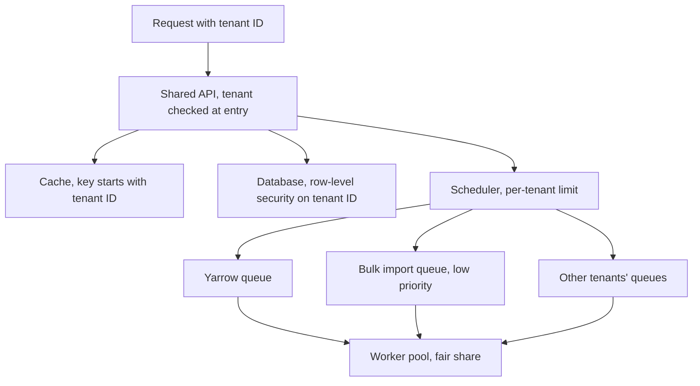

# Tenancy and Isolation

## Start with the shared lane

Yarrow Health, a fictional group of outpatient clinics, used a multi-tenant service to summarise clinic letters. Forty customers shared one deployment: the same web servers, one database with a tenant column, one cache and one job queue.

One Tuesday evening another customer imported two million archived letters. The import put two million summary jobs on the shared queue. Yarrow's clinics, which send about 3,000 letters each evening, found their jobs behind the import. The workers cleared the queue in order, and Yarrow's summaries arrived the next afternoon instead of within the hour. No data leaked. Yarrow's clinicians still started Wednesday's clinics without them.

Yarrow's chief information officer, Imogen, asked for a dedicated environment the next morning. The problem was one shared queue with no per-tenant limit. Call this **the shared lane**.

> **What you'll learn**
>
> - Compare single-tenant and multi-tenant deployments and the steps between them.
> - Isolate compute, stores, caches, queues, logs and admin tools one by one.
> - Handle a request for a dedicated environment by finding the reason first.
> - Price a dedicated environment, including the work of keeping many of them current.

## Single-tenant, multi-tenant and the steps between

A **tenant** is one customer organisation and its users and data. A **multi-tenant** deployment serves many tenants from shared infrastructure. A **single-tenant** deployment gives one tenant its own copy of the whole stack.

These are two ends of a range, not a binary. The useful question is what each tenant shares.

| Pattern | What tenants share | Isolation | Cost per tenant | Upgrade effort |
| --- | --- | --- | --- | --- |
| Shared everything, tenant column | All infrastructure and tables | Code must filter every query | Lowest | One upgrade for all |
| Schema per tenant | Database server, application | Separate tables, shared server | Low | One upgrade, many migrations |
| Database per tenant | Application, compute | Separate databases | Medium | One deploy, many databases |
| Stack per tenant | Nothing | Separate everything, often separate accounts | Highest | One upgrade per tenant |

*Table 1: Tenancy patterns from fully shared to fully separate.*

Multi-tenancy wins on cost and on operations. One fleet is cheaper per customer, and one upgrade reaches everybody. Its risks are the two in Yarrow's story and its opposite: one tenant's load hurting others (the **noisy neighbour**), and one tenant's data reaching another through a missed filter.

Single-tenancy wins on blast radius and on customer control. A bug or a heavy import affects one tenant. The tenant can hold its own encryption keys, pick its upgrade date and pass its auditors with a simpler diagram. It costs more, and it multiplies operating work.

The site's [tenant isolation levels](/learn/production-ai/security-tenancy-prompt-injection/tenant-isolation-levels) lesson covers the security design of each level in depth. This lesson takes the field view: what to isolate in a real deployment, and how to answer the customer who asks.

## Isolation is a property of each component

A deployment is only as isolated as its least isolated component. Teams often isolate the database carefully and leave the cache, the queue or the admin console shared. Go through every component that holds or moves tenant data.

| Component | How to isolate | What goes wrong if you do not |
| --- | --- | --- |
| Compute | Per-tenant concurrency limits, or separate worker pools for large tenants | One tenant's load slows everyone |
| Database and object store | Tenant filter enforced below the application (row-level security, separate schema or bucket) | A missed filter returns another tenant's records |
| Cache | Tenant ID in every cache key | A cached answer reaches the wrong tenant |
| Queue | Per-tenant queues or fair scheduling, with per-tenant limits | A bulk job blocks everyone, as at Yarrow |
| Logs and traces | Tenant tag on every record, access filtered by tenant | Support staff see one tenant's data while helping another |
| Admin tools | Tenant scope on every admin action, logged | An operator changes the wrong tenant's settings |
| Encryption keys | Key per tenant where the risk justifies it | One key compromise exposes every tenant |

*Table 2: Isolation component by component. The weakest row sets the real level.*

Figure 1 shows Yarrow's shared service after the fix. The tenant boundary now runs through the queue and the cache as well as the database.

*Figure 1: Yarrow's shared service after the fix. The scheduler caps any one tenant's share of the workers, and bulk imports run at low priority.*

AWS's guidance on tenant isolation makes the same point in its own words: isolation must be enforced, not assumed, at every layer that touches tenant data. Fair scheduling of shared workers is covered in the site's tenancy lessons. Here it is enough to know it is the fix for Yarrow's problem.

## Answering a request for a dedicated environment

Imogen's request is reasonable, and agreeing at once can be wrong. A dedicated environment fixes Yarrow's delay. So would a per-tenant queue limit, for every customer, at a fraction of the cost. The walkthrough shows how to handle the request.

Yarrow asks for its own environment after the delayed summaries. Each step shows what you do, what you learn and what it decides.

<button type="button" data-step="0" aria-pressed="false" aria-controls="ded-step-0">1. Reason</button><button type="button" data-step="1" aria-pressed="false" aria-controls="ded-step-1">2. Fix the cause</button><button type="button" data-step="2" aria-pressed="false" aria-controls="ded-step-2">3. Options</button><button type="button" data-step="3" aria-pressed="false" aria-controls="ded-step-3">4. Price</button><button type="button" data-step="4" aria-pressed="false" aria-controls="ded-step-4">5. Decide</button>

<section id="ded-step-0" class="step-panel" aria-labelledby="ded-heading-0"><h4 id="ded-heading-0">1. Find the reason</h4><dl><dt>Do</dt><dd>Ask Imogen what the dedicated environment must achieve: speed, data separation, key control, audit or contract terms.</dd><dt>Learn</dt><dd>Speed after the incident, and a new rule from her auditors that clinical data must sit in a separately encrypted store.</dd><dt>Decides</dt><dd>Two needs to meet, not one product to sell.</dd></dl></section><section id="ded-step-1" class="step-panel" aria-labelledby="ded-heading-1"><h4 id="ded-heading-1">2. Fix the cause for everyone</h4><dl><dt>Do</dt><dd>Add per-tenant queue limits and a low-priority lane for bulk imports.</dd><dt>Learn</dt><dd>A replay of Tuesday's load shows Yarrow's 3,000 jobs finishing within 40 minutes.</dd><dt>Decides</dt><dd>The speed need is met without a new environment, and other tenants benefit too.</dd></dl></section><section id="ded-step-2" class="step-panel" aria-labelledby="ded-heading-2"><h4 id="ded-heading-2">3. List the options for the audit need</h4><dl><dt>Do</dt><dd>Compare a per-tenant encryption key, a separate database for Yarrow, and a full dedicated stack.</dd><dt>Learn</dt><dd>The auditors accept a separate database with its own key held in Yarrow's key vault.</dd><dt>Decides</dt><dd>A database per tenant for Yarrow meets the rule. A full stack is not required.</dd></dl></section><section id="ded-step-3" class="step-panel" aria-labelledby="ded-heading-3"><h4 id="ded-heading-3">4. Price each option</h4><dl><dt>Do</dt><dd>Cost infrastructure and the recurring work: upgrades, monitoring, on-call, backups.</dd><dt>Learn</dt><dd>Separate database: about £900 a month. Full stack: about £3,200 a month plus a separate upgrade each release.</dd><dt>Decides</dt><dd>The price difference goes into the proposal so Imogen chooses with the numbers.</dd></dl></section><section id="ded-step-4" class="step-panel" aria-labelledby="ded-heading-4"><h4 id="ded-heading-4">5. Decide and record</h4><dl><dt>Do</dt><dd>Present both needs, the fix already shipped and the priced options. Record the choice and its review date.</dd><dt>Learn</dt><dd>Yarrow takes the separate database and keeps the shared application.</dd><dt>Decides</dt><dd>A dedicated stack stays available if a future rule requires it, at a known price.</dd></dl></section>

<button type="button" data-walk="previous">Previous</button>

<button type="button" data-walk="next">Next step</button>

The walkthrough is a scripted illustration. Its pattern holds: separate the stated request from the needs behind it, and fix the shared cause before selling a private copy.

## The cost of many dedicated environments

Sometimes a dedicated environment is the right answer: a regulator requires it, the tenant holds its own keys for everything, or its load dwarfs everyone else's. Price all of it, because the infrastructure is the smaller part.

Take a shared stack that costs £8,000 a month for 40 tenants, £200 each. A minimal dedicated stack, with its own small database, compute and monitoring, might cost £3,200 a month, sixteen times the shared share. The larger cost is the operating work that grows with each stack:

- **Upgrades.** Each release becomes 40 deployments if every tenant is separate. Version drift follows, and support must know which tenant runs which version.
- **Monitoring and on-call.** Forty sets of alerts, dashboards and capacity limits.
- **Incidents.** A fix must be rolled out to every stack, and the slowest one sets the exposure time.

Teams that offer dedicated environments well automate them heavily: one template, one pipeline that upgrades every stack, and a short list of allowed differences. Teams that agree to one dedicated environment by hand often find themselves running five slightly different ones a year later.

## Limits of this lesson

- **Security depth lives elsewhere.** Row-level security, per-tenant keys and cross-tenant threat models are taught in the tenancy and security review lessons.
- **Prices are illustrative.** Real costs depend on the provider, region and component sizes.
- **Fictional data.** Yarrow Health, its letters and every figure above are illustrative.

## Interview angle

Each answer is an outline to say in about two minutes. Open each question and try it aloud before reading.

Interview question 1. What are the trade-offs between a single-tenant and a multi-tenant deployment?

- **Answer:** Multi-tenant shares infrastructure across customers, which is cheaper per tenant and needs one upgrade for all. Its risks are noisy neighbours and data crossing tenants through a missed filter, so isolation must be enforced in every component. Single-tenant gives each customer its own stack, which shrinks the blast radius and gives the customer control over keys and upgrade timing. It costs more, and operating work grows with every stack. Most systems sit between, such as a database per tenant behind a shared application.
- **Trade-off:** Cost and operating simplicity against blast radius and customer control.
- **Follow-up to expect:** "Which components are hardest to isolate?" Caches, queues and admin tools, because teams forget them.
- **Go deeper:** [Tenant isolation levels](/learn/production-ai/security-tenancy-prompt-injection/tenant-isolation-levels).

Interview question 2. A large customer demands a dedicated environment after a slowdown caused by another tenant. What do you do?

- **Answer:** First find what the environment must achieve: speed, data separation, key control or a contract term. Fix the shared cause for everyone, such as per-tenant queue limits, and show the result with a replay of the bad night. For any remaining need, list options from a per-tenant key to a separate database to a full stack, price each including upgrades and on-call, and let the customer choose with the numbers. Record the decision.
- **Trade-off:** Agreeing at once wins goodwill and adds a stack you must run for years. Refusing outright loses trust.
- **Follow-up to expect:** "They still want the full stack." Then it is a priced product with an automated upgrade path, not a one-off favour.

## References

1. Amazon Web Services, [SaaS tenant isolation strategies](https://docs.aws.amazon.com/whitepapers/latest/saas-tenant-isolation-strategies/saas-tenant-isolation-strategies.html), accessed 17 November 2026. Silo, pool and bridge models and enforcing isolation at each layer.
2. The site's [tenant isolation levels](/learn/production-ai/security-tenancy-prompt-injection/tenant-isolation-levels) lesson, the deep dive on isolation design.
3. The site's [SaaS, customer cloud or on-premises](/learn/fde-deploying-in-the-estate/deployment-models-and-environments/saas-customer-cloud-or-on-prem) lesson, for who operates each environment.
4. The author's own field experience, the basis for the dedicated-environment walkthrough and the cost of many stacks.

## Key takeaways

- Tenancy is a range: ask what each tenant shares.
- Isolation is per component. Caches, queues, logs and admin tools are where it often fails.
- Answer a dedicated-environment request by finding the needs behind it.
- Fix the shared cause for every tenant before selling a private copy.
- Price dedicated stacks with their upgrade and on-call work, not only the infrastructure.

## Check yourself

1. Yarrow's database was isolated by a tenant column. Why were its summaries still late?

The queue was shared with no per-tenant limit. Another tenant's two million jobs sat ahead of Yarrow's, and workers took them in order.

2. Why does a cache need the tenant ID in every key?

Without it, two tenants asking the same question share one cache entry, and one tenant can receive an answer built from the other's data.

3. Why is the infrastructure price the smaller cost of a dedicated stack?

Each stack needs its own upgrades, monitoring, on-call and incident fixes. That work repeats for every stack and grows with their number.

