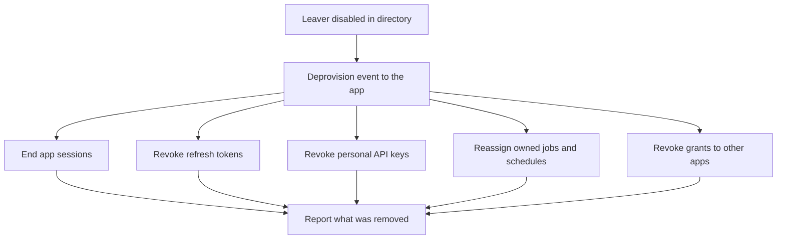

# Service Accounts and Least Privilege

## Start with the key that outlived its owner

Cromer Insurance, a fictional insurer, ran a nightly job that sent suspicious claims to its fraud team. Hannah, an analyst, had set it up. The claims system needed an API key, so she created one under her own user, with administrator rights, because that was the quickest way to make it work.

Hannah left in March. IT disabled her single sign-on account the same day. The API key lived in the claims system's own user store, not in the directory, so it kept working. In August a security review found an administrator key belonging to someone who had left five months earlier. The reviewer revoked it at once, and that night the fraud export stopped. Nobody had known it depended on Hannah.

The credential was too powerful, tied to a person and invisible to the leaver process. Call this **the ghost credential**: access that belongs to nobody and so is removed by nobody, until removing it breaks something.

> **What you'll learn**
>
> - Choose delegated or service access for each call.
> - Design roles, then add attribute rules where roles are too coarse.
> - Provision and deprovision across sessions, keys and queued jobs.
> - Answer a request for administrator rights with something narrower.

## Delegated or service access

Every call your system makes runs as some identity. There are two kinds:

- **Delegated access.** The system acts on behalf of a signed-in user, with that user's permissions. An assistant reading claims for a handler sees only the claims that handler may see.
- **Service access.** The system acts as itself, through a **service account** or workload identity, with permissions granted to the service. A nightly job with no user present needs this.

| Use | Fits | Risk if misused |
| --- | --- | --- |
| Delegated | A user asks for something and should see only what they may see | Long-running work fails when the user's token expires |
| Service | Scheduled, background or system-wide work with no user present | A user asks the service and receives data they could not see themselves |

*Table 1: Delegated and service access. Most systems need both, for different calls.*

The second risk has a name, the **confused deputy**: a powerful service tricked or careless enough to act for a user beyond that user's rights. AI assistants are prone to it, because they take requests in plain language and call tools on the user's behalf. Default to delegated access for anything a user asks for. Keep service access for work no user starts, and give each job its own account, owned by a team. The site's [delegated authority](/learn/production-ai/security-tenancy-prompt-injection/delegated-authority-and-zero-ambient-authority) lesson covers the agent case in depth, and [agents that touch business systems](/learn/fde-building-in-the-estate/ai-delivery-in-customer-estates/agents-that-touch-business-systems) applies it to an MCP server.

## Roles first, then attributes

**Least privilege** means each identity holds only the permissions its task needs, for only as long as it needs them. Two models put it into practice.

**Role-based access control** (RBAC) bundles permissions into roles and gives users roles. It is easy to review: "who are the senior handlers?" has one answer. Cromer's roles:

| Role | Can do | Held by |
| --- | --- | --- |
| Claims handler | Read and update claims, approve up to their limit | About 300 staff |
| Senior handler | Everything a handler can, approve above the limit, reassign | Team leads |
| Fraud analyst | Read all claims, flag claims, read fraud scores | Fraud team |
| Support engineer | Read logs and configuration, no claim content | FDE and support staff |
| Fraud export job | Read flagged claims, write to the fraud queue | One service account |

*Table 2: Cromer's roles. Each role names a task, not a person or a team.*

Roles alone get coarse. If handlers may approve only claims in their own region and under their own limit, you would need a role for every region and limit. **Attribute-based access control** (ABAC) adds rules over attributes of the user, the resource and the request. Cromer's rule: a handler may approve a claim when the claim's region is one of the handler's regions, the amount is within the handler's limit and the handler is not the claimant.

The switcher shows one request under three access models.

Ola, a handler in the North region with a £10,000 limit, asks the assistant to approve claim 4471: South region, £18,000.

<button type="button" data-mode="admin" aria-pressed="false" aria-controls="admin-result">Admin service account</button>
<button type="button" data-mode="rbac" aria-pressed="false" aria-controls="rbac-result">Roles only</button>
<button type="button" data-mode="abac" aria-pressed="false" aria-controls="abac-result">Roles and attributes</button>

<section id="admin-result" class="mode-panel" data-announcement="Admin service account selected. The claim is approved."><h4>Admin service account</h4><ul><li>The assistant calls the claims system as an administrator.</li><li>The claim is approved. The audit log names the service, not Ola.</li><li>Ola has approved a claim outside her region at almost twice her limit.</li></ul>
A confused deputy, with no trace of who asked.
</section>
<section id="rbac-result" class="mode-panel" data-announcement="Roles only selected. The claim is approved."><h4>Roles only</h4><ul><li>The assistant calls with Ola's delegated token.</li><li>Her role, claims handler, includes approval. The claim is approved.</li><li>The log names Ola, but the approval still breaks Cromer's rules.</li></ul>
Traceable, and still too broad.
</section>
<section id="abac-result" class="mode-panel" data-announcement="Roles and attributes selected. The claim is refused."><h4>Roles and attributes</h4><ul><li>Her role allows approval. The rule then checks region and limit.</li><li>South is not her region, and £18,000 is above £10,000. Refused, with both reasons.</li><li>The assistant offers to route the claim to a South senior handler.</li></ul>
The decision matches the business rule, and the reason is logged.
</section>

Start with roles, because people can review them. Add attribute rules only where a role would need many variants. Keep the rules in one policy layer, not scattered through the code, so they can be tested and audited.

## Provisioning and deprovisioning

Access follows a person through three events: **joiner**, **mover** and **leaver**. Joiners and movers are visible, because someone asks for access. Leavers are where ghost credentials come from, because nobody asks for access to be removed.

Drive all three from the customer's directory. The SCIM protocol (System for Cross-domain Identity Management) lets the IdP create, update and deactivate users in your application automatically. A disabled account in the directory must reach everything the person holds:

*Figure 1: What a leaver event must reach. Disabling the sign-in account only starts the process. Every credential below it needs its own step.*

Movers need the same care. When a handler moves from claims to fraud, remove the old role as well as adding the new one. Otherwise access only ever grows.

## API keys and queued jobs

Two places hide credentials from the leaver process. **API keys** created in an application's own user store never pass through the directory. **Queued and scheduled jobs** may run under the identity of the person who created them, days after they left.

Rules that close both gaps:

- **No personal credentials for shared work.** A job the business depends on runs as a service account owned by a team, with a named owner and a backup.
- **Every credential has a record:** owner, purpose, scope, creation date and expiry. Keys without an expiry do not exist.
- **Check permission when a job runs,** not only when it was queued. If the requester has left, fail the job closed and alert its team.
- **Transfer, then revoke.** For a leaver, move each job to a service identity, confirm it runs, and then revoke the personal key.

Cromer's fix took two days. The fraud export got its own service account with the fraud export job role, the fraud team became its owner and every remaining personal key got a 90-day expiry.

## When someone asks for admin rights

You will be asked for administrator rights, and you will ask for them. An FDE installing software often hears "it needs admin" from a vendor guide. A customer's user may ask for admin "to get unblocked". Answer in the same way each time:

1. **Name the task.** Admin is never the task. "Create a database, register an app, read the logs" are tasks.
2. **List the permissions the task needs,** from the documentation or a trial in a test environment.
3. **Grant a role with those permissions,** scoped to the resources involved.
4. **Time-box anything broader.** Use just-in-time elevation that expires after hours, with approval and a logged reason.
5. **Let the customer run the privileged step** when they would rather not grant it. Give them a runbook and watch.

Keep a **break-glass** account for emergencies, held by the customer, alerting on every use. That covers the case "admin" was supposed to cover, without anyone holding it day to day.

## Limits of this lesson

- **Policy tools vary.** How roles and rules are written depends on the customer's IdP and the application. The design questions stay the same.
- **SCIM support varies.** Some applications support only creation, not deactivation. Test the leaver path before go-live.
- **Fictional data.** Cromer Insurance, its people, roles and figures are illustrative.

## Interview angle

Each answer is an outline to say in about two minutes. Open each question and try it aloud before reading.

Interview question 1. When should a system act on behalf of a user, and when as its own service account?

- **Answer:** Act on behalf of the user when a user asks for something and should see only what they may see, such as an assistant searching claims. Use a service account for work no user starts, such as a nightly export. Give each job its own account owned by a team, scoped to its task. Never let a powerful service answer users' requests without checking the user's own rights.
- **Trade-off:** Delegated access limits exposure but breaks long-running work when tokens expire. Service access is reliable and must be kept narrow.
- **Follow-up to expect:** "A job must act for a user overnight." Store the user's consent and re-check their rights when the job runs.

Interview question 2. Explain RBAC, ABAC and least privilege. When do you need attributes as well as roles?

- **Answer:** Least privilege gives each identity only what its task needs, for as long as needed. RBAC bundles permissions into roles, which are easy to review. ABAC adds rules on attributes of the user, resource and request, such as region or amount. Add attributes when roles would multiply, one per region or limit. Keep rules in one policy layer you can test.
- **Trade-off:** Attribute rules are precise and harder to review. Roles are reviewable and get coarse.
- **Follow-up to expect:** "How do you stop role sprawl?" Review roles quarterly with their owners and merge or remove unused ones.

Interview question 3. Design the roles and one attribute rule for an assistant that lets claims staff approve payouts.

- **Answer:** Roles: claims handler (read, update, approve to a limit), senior handler (approve above the limit, reassign), fraud analyst (read all, flag), support engineer (logs and configuration, no claim content), and one service role per background job. Rule: a handler may approve when the claim's region is one of theirs, the amount is within their limit and they are not the claimant. The assistant calls with the user's token and logs refusals with reasons.
- **Trade-off:** Five roles and one rule are reviewable. More precision means more rules to test.
- **Follow-up to expect:** "A senior handler is on leave." Route by region to another senior handler, not a wider role.

## References

1. NIST CSRC, [Role Based Access Control](https://csrc.nist.gov/projects/role-based-access-control), accessed 17 November 2026. The RBAC model and its standard.
2. NIST, [SP 800-162: Guide to Attribute Based Access Control Definition and Considerations](https://csrc.nist.gov/pubs/sp/800/162/upd2/final), accessed 17 November 2026. ABAC rules over subject, object and environment attributes.
3. IETF, [RFC 7644: System for Cross-domain Identity Management Protocol](https://www.rfc-editor.org/rfc/rfc7644), accessed 17 November 2026. Automated provisioning and deactivation of users.
4. OWASP, [OWASP Authorization Cheat Sheet](https://cheatsheetseries.owasp.org/cheatsheets/Authorization_Cheat_Sheet.html), accessed 17 November 2026. Least privilege, deny by default and checking permission on every request.

## Key takeaways

- Use delegated access for what users ask for, and service accounts for work no user starts.
- Start with reviewable roles. Add attribute rules where roles would multiply.
- Drive joiners, movers and leavers from the directory, and make leavers reach every credential.
- No personal credentials for shared work. Every key has an owner and an expiry.
- Answer "admin" with a named task, a scoped role and time-boxed elevation.

## Check yourself

1. Why did disabling Hannah's sign-in account not remove her API key?

The key lived in the claims system's own user store, outside the directory, so the leaver process never saw it.

2. In the switcher, why does the roles-only model still approve claim 4471?

Ola's role includes approval in general. Only an attribute rule can check that the region and amount fall within her own region and limit.

3. Why check permission when a queued job runs, not only when it was queued?

The requester may have left or changed role in between. Checking at run time stops a job acting with access its owner no longer has.

