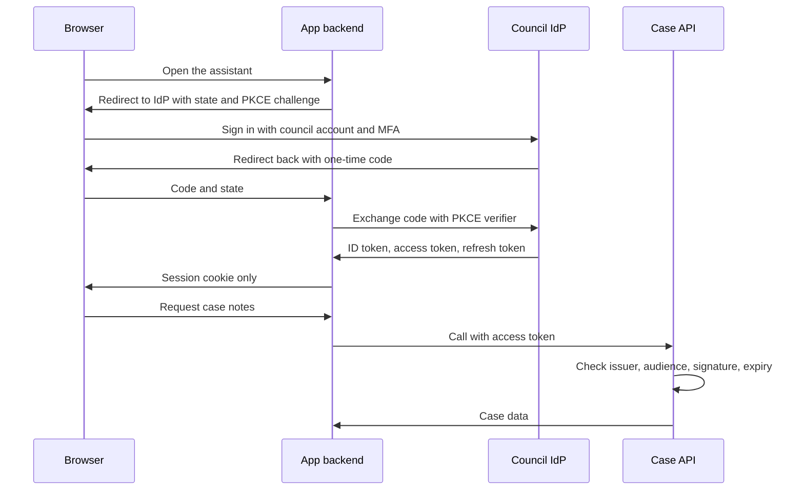

# SSO, OIDC and Tokens

## Start with the session that never asked again

Bexley Council, a local authority, gave its housing officers an assistant that drafts case notes from case files, with sign-in through the council's single sign-on (SSO). Femi, a contractor, finished on a Friday, and IT disabled his account at 17:00. On Monday an audit report showed him opening three case files from his own laptop. Rohan, the forward deployed engineer who had wired up the sign-in, traced it within the hour: the assistant had checked Femi's identity once, at sign-in two weeks earlier, then issued its own session cookie valid for 30 days and never asked the identity provider again. SSO had worked as designed. The application had not. Call this **the session that never asked again**: an application session that outlives the identity it was built on.

> **What you'll learn**
>
> - Explain federation and what the customer's identity provider vouches for.
> - Trace an OpenID Connect login for a browser app and its API.
> - Give ID, access and refresh tokens one job each.
> - Diagnose a user mapped to the wrong role, and end sessions when an account is disabled.

## Federation: who vouches for whom

**Federation** means your application trusts another system to say who a user is. The customer's **identity provider** (IdP) holds the accounts, passwords and multi-factor rules. Your application is the **relying party**: it accepts a signed statement from the IdP and never sees the password.

Trust is set up once, by exchanging configuration: the IdP's issuer address, its signing keys and the addresses it may send users back to. Two protocols carry the statement:

- **SAML** sends a signed XML assertion through the browser. It is common in older enterprise applications.
- **OpenID Connect** (OIDC) adds a sign-in layer to OAuth 2.0 and sends signed JSON tokens. It suits browser apps, mobile apps and APIs.

For an FDE, federation moves the hard parts to the customer. They own password policy, multi-factor rules and leavers. You own three things: validating what the IdP sends, mapping it to your roles and keeping your own sessions honest.

## OIDC login for a browser app and its API

OAuth 2.0 is about **authorisation**: letting an application call an API with limited rights. OIDC adds **authentication**: telling the application who signed in. A browser app with its own API uses the authorisation code flow with PKCE (Proof Key for Code Exchange), which stops a stolen code from being exchanged by anyone else.

*Figure 1: Bexley's corrected login. The backend holds the tokens and the browser holds only a session cookie. The API checks every access token before it answers.*

Keeping tokens on the backend, a pattern often called **backend for frontend**, means script injected into the page cannot read them. A single-page app with no backend can run the same flow in the browser, with short-lived tokens and stricter limits on refresh tokens. The OAuth security best current practice describes both.

The API must validate every access token before using it: the signature against the IdP's published keys, the issuer, the **audience** (the token was meant for this API) and the expiry. The site's [identity verification with SSO and OIDC](/learn/production-ai/security-tenancy-prompt-injection/identity-verification-with-sso-and-oidc) lesson covers validation in depth.

## Three tokens, three jobs

OIDC returns up to three tokens. Give each one job, and never use one in place of another.

| Token | Its job | Who reads it | Typical life | Common misuse |
| --- | --- | --- | --- | --- |
| ID token | Tells the app who signed in, when and how | The app that asked for sign-in | Minutes to an hour | Sent to an API as if it granted access |
| Access token | Lets the holder call one API with limited scopes | The API named in its audience | 5 to 60 minutes | Accepted by an API it was not issued for |
| Refresh token | Gets new access tokens without a new sign-in | The IdP only | Hours to weeks | Stored in the browser, or never rotated |

*Table 1: The three OIDC tokens. Lifetimes vary by IdP and customer policy.*

Short access tokens limit the damage of a stolen token and force regular trips back to the IdP. Each refresh is a chance for the IdP to say no: the account is disabled, the password changed or the session revoked. Rotate refresh tokens on each use, so a stolen one stops working once the real client uses it. When several workers share one connection's refresh token, [authenticating as whom](/learn/enterprise-integration/connecting-enterprise-systems/authenticating-as-whom) covers the refresh race between them.

## A user mapped to the wrong role

The IdP says who the user is and, usually, which groups they belong to. Your application turns groups into its own roles. When a user gets the wrong role, look at that mapping first:

- **Mapping by group name.** Someone renames "Housing Officers" or creates a second group with a similar name. Map by the group's immutable ID.
- **Roles set once, at first sign-in.** Just-in-time provisioning created the user with a role and never updated it. An officer who moved to planning keeps housing access. Re-evaluate roles at every sign-in.
- **Too many groups.** Some IdPs drop the group list from the token when a user belongs to many groups, and send a pointer instead. The app sees no groups and falls back to a default.
- **A generous default.** Any unmatched user gets a working role. Default to no access and show a clear message.
- **Several matches.** The user is in two mapped groups and the code takes the first it finds. Decide the rule, such as the least privileged, and log it.

Log every mapping decision with the user, groups received and role given. When someone reports the wrong role, that log answers the question in one lookup. The [service accounts and least privilege](/learn/fde-deploying-in-the-estate/networks-and-identity/service-accounts-and-least-privilege) lesson covers designing the roles themselves.

## Sessions that outlive a disabled account

Disabling an account at the IdP stops new sign-ins. It does not reach into sessions your application already granted. How fast access ends depends on how often your application checks back. The switcher compares three designs for Femi's last Friday.

IT disables Femi's account at 17:00 on Friday. Compare when each session design stops him reading case files.

<button type="button" data-mode="long" aria-pressed="false" aria-controls="long-result">30-day app session</button>
<button type="button" data-mode="refresh" aria-pressed="false" aria-controls="refresh-result">Short tokens and refresh</button>
<button type="button" data-mode="event" aria-pressed="false" aria-controls="event-result">Deprovisioning event</button>

<section id="long-result" class="mode-panel" data-announcement="30-day app session selected. Access continues until the cookie expires."><h4>30-day app session</h4><ul><li>The app checked the IdP once, at sign-in.</li><li>Femi's cookie stays valid until it expires, up to 30 days.</li><li>Nobody learns of it until an audit report.</li></ul>
The IdP is out of the loop after sign-in.
</section>
<section id="refresh-result" class="mode-panel" data-announcement="Short tokens and refresh selected. Access ends within 10 minutes."><h4>Short tokens and refresh</h4><ul><li>Access tokens last 10 minutes. The app session lasts at most 8 hours.</li><li>At the next refresh the IdP refuses, because the account is disabled.</li><li>Access ends by about 17:10.</li></ul>
The gap is the access-token lifetime, traded against more calls to the IdP.
</section>
<section id="event-result" class="mode-panel" data-announcement="Deprovisioning event selected. Access ends when the event arrives."><h4>Deprovisioning event</h4><ul><li>The IdP pushes a deprovisioning or logout event to the app.</li><li>The app ends Femi's sessions and revokes his tokens on receipt.</li><li>Access ends when the event arrives, within the push interval the IdP is set to.</li></ul>
Fastest, and it needs the IdP to support the push and the app to handle it.
</section>

Combine the last two. Short tokens give a ceiling on exposure even if an event is lost. Events close the gap for leavers and urgent cases. Add a **maximum session lifetime** after which the user signs in again, whatever their activity. Ask the customer how fast access must end for a leaver. That number, not a default, sets the token lifetime.

## Limits of this lesson

- **IdP behaviour varies.** Whether a refresh fails after a disable, and how events are pushed, depends on the product and its settings. Test it with the customer's IdP.
- **Not a protocol course.** The flows have more options, such as the device flow and token exchange, than one lesson covers. [Identity verification with SSO and OIDC](/learn/production-ai/security-tenancy-prompt-injection/identity-verification-with-sso-and-oidc) goes further into token validation.
- **Composite engagement.** Bexley Council, Rohan, Femi and the timings are illustrative, not a real customer.

## Interview angle

Each answer is an outline to say in about two minutes. Open each question and try it aloud before reading.

Interview question 1. A customer wants staff to use their existing company sign-in for your application. What is federation, and what do you need from them?

- **Answer:** Federation means the application trusts the customer's IdP to say who the user is, through a signed statement, so it never handles passwords. From them you need the protocol (OIDC or SAML), the issuer and signing keys, registered redirect addresses, the claims they will send, including group IDs, and who owns the configuration on their side. Then agree the group-to-role mapping and how leavers are handled.
- **Trade-off:** Federation reuses their policy and multi-factor rules. Your application now fails whenever their IdP does.
- **Follow-up to expect:** "Some users are outside their directory." Ask for guest accounts in their IdP rather than local passwords.

Interview question 2. What is the difference between OAuth and OIDC, and what is each token for?

- **Answer:** OAuth 2.0 grants an application limited access to an API. OIDC adds sign-in on top, telling the application who the user is. The ID token is for the app and describes the sign-in. The access token is for one API, named in its audience, and is short-lived. The refresh token goes only to the IdP to get new access tokens, and should be rotated.
- **Trade-off:** Short access tokens limit damage from theft. They mean more refresh calls and more dependence on the IdP being up.
- **Follow-up to expect:** "Can the API accept the ID token?" No. It was not issued for the API.

Interview question 3. Design the sign-in flow for a browser app with its own API, using the customer's OIDC provider.

- **Answer:** Use the authorisation code flow with PKCE. The backend redirects to the IdP with state and a PKCE challenge, receives a one-time code, exchanges it with the verifier and keeps the tokens server-side. The browser holds only a secure, HTTP-only session cookie. The backend calls the API with the access token, and the API checks signature, issuer, audience and expiry on every call. Refresh on expiry and end the session on refusal.
- **Trade-off:** A backend that holds tokens is safer and adds a component. A browser-only flow is simpler and exposes tokens to script.
- **Follow-up to expect:** "How do you log out?" End the app session, revoke the refresh token and call the IdP's logout.
- **Go deeper:** [Identity verification with SSO and OIDC](/learn/production-ai/security-tenancy-prompt-injection/identity-verification-with-sso-and-oidc).

## References

1. OpenID Foundation, [OpenID Connect Core 1.0](https://openid.net/specs/openid-connect-core-1_0.html), accessed 17 November 2026. The ID token and the authorisation code flow.
2. IETF, [RFC 9700: Best Current Practice for OAuth 2.0 Security](https://www.rfc-editor.org/rfc/rfc9700), accessed 17 November 2026. PKCE, refresh token rotation and browser-based clients.
3. OpenID Foundation, [OpenID Connect Back-Channel Logout 1.0](https://openid.net/specs/openid-connect-backchannel-1_0.html), accessed 17 November 2026. Logout events sent from the IdP to the application.
4. OWASP, [Session Management Cheat Sheet](https://cheatsheetseries.owasp.org/cheatsheets/Session_Management_Cheat_Sheet.html), accessed 17 November 2026. Session lifetimes, cookies and expiry.

## Key takeaways

- Federation moves passwords and leavers to the customer's IdP. You still own validation, role mapping and sessions.
- Use the authorisation code flow with PKCE, and keep tokens on the backend where you can.
- ID tokens are for the app, access tokens for one API, refresh tokens for the IdP.
- Map roles by group ID, re-evaluate at each sign-in and default to no access.
- Access ends only when your app checks back: short tokens, a session ceiling and deprovisioning events.

## Check yourself

1. Why did disabling Femi's account not stop him on Monday?

The assistant checked his identity once at sign-in, then trusted its own 30-day cookie. It never went back to the IdP, so the disable never reached it.

2. Why should an API reject a valid ID token sent in place of an access token?

The ID token was issued to the app to describe a sign-in. Its audience is the app, not the API, and it grants no access to call anything.

3. An officer moved to the planning team still has housing access. Which mapping fault is most likely?

Roles set once at first sign-in by just-in-time provisioning and never re-evaluated, so the old group's role stayed.

