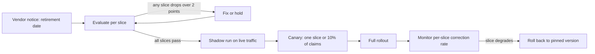

# Maintenance and Drift

## Start with the average that hid a format

Ravensworth Insurance triages about 3,000 claims a day with a hosted model that suggests a category for each claim; handlers fix wrong categories by hand. When the vendor announced the retirement of the model version in 60 days, Yusuf, the forward deployed engineer, ran the evaluation set against the new version. Correct categories rose from 91% to 93%, and the team switched the following week. Nine days later the largest broker complained. Its claims arrive as scanned schedules with several columns, about 8% of daily volume, and on those correct categories had fallen from 90% to 61% because the new model read the columns in a different order. About 630 claims had gone to the wrong team. The other formats had improved from about 91% to 96%, which lifted the average and hid the loss. Call this **the average that hid a format**: an upgrade judged on one overall number, while one group of users pays for everyone else's gain.

> **What you'll learn**
>
> - What changes underneath a running system, and how you hear about it.
> - How to upgrade a model or dependency with per-slice checks.
> - How to detect stale sources, missing records and schema drift.
> - What a runbook needs so someone else can follow it.
> - How to turn customer feedback into a maintained backlog.

## What changes underneath you

A system that nobody touches still changes, because the things it depends on change. Plan for each kind.

| Change | How you hear about it | How you test it |
| --- | --- | --- |
| Library or base image update | Dependency scanner, security advisory | Automated tests, then staging |
| Vendor API version | Vendor changelog, deprecation header, email | Contract tests against the new version |
| Hosted model version | Deprecation notice with a retirement date | Per-slice evaluation, then a shadow run |
| Upstream data source | Usually nobody tells you | Freshness, volume and schema checks |
| Customer process | Their change board, if you are on it | Review of SLIs and dashboards |

*Table 1: Sources of change. The last two rarely announce themselves, so monitoring must catch them.*

Some habits make this routine instead of a scramble:

- **Pin versions.** Libraries through lockfiles, base images by digest, models by their full version name, never an alias that moves.
- **Keep a register.** One list of every dependency, vendor API and model version, its owner and its end-of-support date. Subscribe the team's shared inbox to each vendor's notices.
- **Upgrade on a schedule.** A monthly patch window for libraries and images, with security fixes applied sooner. Small regular upgrades are easier to test and roll back than a large one forced by a deadline.

## Upgrading a model without losing a format

A model upgrade is a change to behaviour, not only to code. The overall score can rise while one slice falls. A **slice** is a group of inputs that matters to the customer on its own: a broker, a document format, a claim type, a language.

The fix is to evaluate and release by slice. The switcher shows Ravensworth's upgrade results both ways.

The same evaluation of the new model version, reported two ways.

<button type="button" data-mode="average" aria-pressed="false" aria-controls="average-result">Overall score</button>
<button type="button" data-mode="slices" aria-pressed="false" aria-controls="slices-result">Score per format</button>

<section id="average-result" class="mode-panel" data-announcement="Overall score selected. 91% to 93%, upgrade approved."><h4>Overall score</h4><ul><li>Correct category: 91% before, 93% after.</li><li>Every check passes.</li></ul>
Decision: upgrade. The broker's loss is invisible.
</section>
<section id="slices-result" class="mode-panel" data-announcement="Score per format selected. Scanned schedules fall from 90% to 61%, upgrade blocked."><h4>Score per format</h4><ul><li>Typed claim forms and emails, 92% of volume: about 91% before, 96% after.</li><li>Scanned multi-column schedules, 8% of volume: 90% before, 61% after.</li><li>Rule: no slice may fall by more than 2 points.</li></ul>
Decision: blocked. Fix the schedules first, for example by extracting the table before the model reads it.
</section>

Figure 1 shows the release path that would have caught it.

*Figure 1: A model upgrade judged slice by slice, with the old version kept until the new one proves itself.*

Each stage has a purpose:

- **Evaluate per slice** with a labelled set that includes every slice, sized so each one has enough examples to show a real change, such as 100 or more.
- **Shadow run** the new version beside the old on live traffic, without acting on its output. Compare where they disagree.
- **Canary** to a small share, judged on the per-slice correction rate: how often handlers fix the category.
- **Keep the old version** callable until the retirement date, as the rollback.

Start early. A 60-day retirement notice is time for this path, but not if work begins on day 50.

## Stale sources, missing records and schema drift

AI systems in the field read the customer's data: policy records, broker lists, document stores. When that data changes quietly, the system degrades quietly. Watch three things at every source.

- **Freshness.** The age of the newest record. If the policy table is loaded every hour and its newest record is five hours old, the load has stopped. Alert on age, not on whether the job reported success.
- **Completeness.** The count of records against what the source holds or what normal looks like. Reconcile by ID where you can: a daily count of policies in the source system against your copy, with a list of the missing IDs.
- **Schema.** The fields, types and allowed values you depend on. A renamed column, a date that becomes text or a new claim type nobody mapped are all **schema drift**.

When a check fails, decide what the system does. For freshness and completeness, show the data's age to users and alert the owner. For schema drift, follow Martin Fowler's tolerant reader idea: read only the fields you need and ignore additions. Quarantine records that fail a required field, and alert, instead of guessing at them. Never let a failed check pass silently. For a pipeline you built yourself, [schema drift and late data](/learn/fde-building-in-the-estate/customer-data-pipelines/schema-drift-and-late-data) covers the contract at the door and records that arrive late.

## Runbooks someone else can follow

A **runbook** is a written procedure for a known situation: an alert, a routine task or a recovery. It must work for someone who did not build the system, at 03:00.

Each runbook holds:

- **Trigger.** The alert or request that starts it, linked from the alert itself.
- **Checks.** What to look at first, with the exact dashboard or query.
- **Actions.** Numbered steps, each with its expected result.
- **Rollback.** How to undo each action.
- **Escalation.** Who to call when the steps do not work, with contacts that are tested.

Test each runbook in a tabletop exercise or a planned drill, and update it after every incident that used it. A runbook nobody has run is a guess. The site's [handover and ownership](/learn/forward-deployed/delivery-stages-and-gates/handover-and-ownership) lesson covers handing runbooks and on-call duty to the customer's team.

## Turning feedback into a backlog

After go-live, the customer's staff become the best source of defects. Make their feedback cheap to give and visible once given.

1. **Collect it where they work.** Ravensworth's handlers have a "wrong category" button, and every correction is logged with the claim, the old and the new category.
2. **Tag it by slice.** Broker, format and claim type. A rise in one slice is a signal, as the schedule failure showed.
3. **Triage weekly with the customer.** Group items by cause, rank by impact and frequency, and agree what enters the next release.
4. **Close the loop.** Each fixed failure becomes a case in the evaluation set, so it cannot return unseen. Tell the people who reported it.

## Limits of this lesson

- **Vendor terms differ.** Retirement notice periods and version pinning vary by provider and contract.
- **Evaluation design.** Building a labelled evaluation set, and sizing each slice, is covered in [golden sets and sample size](/learn/production-ai/evaluation-and-release-gates/golden-sets-and-sample-size).
- **Composite engagement.** Ravensworth Insurance, Yusuf, its broker and figures are illustrative, not a real customer.

## Interview angle

Each answer is an outline to say in about two minutes. Open each question and try it aloud before reading.

Interview question 1. How do you keep up with dependency and vendor API changes in a system you have handed to a customer?

- **Answer:** Keep a register of every library, base image, vendor API and model version, with an owner and end-of-support date. Pin versions with lockfiles, digests and full model names. Subscribe a shared inbox to each vendor's changelog and deprecation notices. Patch libraries monthly and security fixes sooner. Test vendor API changes with contract tests before the old version is retired. Agree who does each part after handover.
- **Trade-off:** Pinning prevents surprises and means you must upgrade on purpose. Floating versions upgrade themselves, untested.
- **Follow-up to expect:** "The vendor changes the API without notice." Contract tests in production catch it. Alert on response shape errors.

Interview question 2. How do you detect model regressions, stale data and schema drift after go-live?

- **Answer:** For models, track a live quality signal per slice, such as how often users correct the output, and rerun the evaluation set on every version change. For data, check three things at each source: the age of the newest record, record counts against the source, and the fields and allowed values you depend on. Alert on each. Quarantine records with broken required fields instead of guessing.
- **Trade-off:** Per-slice checks need enough volume per slice. Too fine a split gives noisy alerts.
- **Follow-up to expect:** "There are no labels in production." Use correction rates and disagreement with a reference model as proxies.

Interview question 3. What do you leave behind so the customer can keep the system running, and how does their feedback reach the backlog?

- **Answer:** Runbooks for each alert and routine task: trigger, checks, numbered actions, rollback and tested contacts. Test them in a drill with the customer's team before handover. For feedback, a correction button or channel where users work, tagged by slice, triaged weekly with the customer, ranked by impact. Each fixed failure becomes an evaluation case. Reporters hear back when it ships.
- **Trade-off:** Detailed runbooks go stale. Review them after every incident that used them.
- **Follow-up to expect:** "Nobody owns it after you leave." Make the named owner a handover gate.
- **Go deeper:** [Handover and ownership](/learn/forward-deployed/delivery-stages-and-gates/handover-and-ownership).

Interview question 4. A model upgrade raised overall accuracy, but one customer's document format got much worse. What do you do now, and what do you change?

- **Answer:** Now: roll that format back to the old version if it is still available, or route it to manual review, and tell the affected customer what happened and how many items to recheck. Then find why: compare outputs on that format between versions. Change the release process: evaluate per slice with a rule that no slice falls by more than a set margin, shadow run, canary by slice and monitor per-slice correction rates.
- **Trade-off:** Per-slice gates slow upgrades. One format may hold everyone back, so fix it in its own path.
- **Follow-up to expect:** "The old version retires next week." Pre-process that format or keep it on manual review.

Interview question 5. Design a routine maintenance process for an AI system running in a customer's estate.

- **Answer:** A dependency register with owners and end dates. A monthly patch window for libraries and images, with security fixes faster. A model upgrade path: per-slice evaluation, shadow run, canary and pinned rollback. Daily data checks on freshness, completeness and schema. Runbooks tested each quarter. A weekly feedback triage with the customer. A monthly review of SLOs, alerts and open postmortem actions. Write down who does each part after handover.
- **Trade-off:** A full process costs regular time. Skipping it turns each change into an incident.
- **Follow-up to expect:** "The customer has two engineers." Automate checks and cut the review to the highest-risk items.

## References

1. Google, [Data processing pipelines](https://sre.google/workbook/data-processing/), The Site Reliability Workbook, accessed 17 November 2026. Freshness and correctness objectives for data pipelines.
2. Martin Fowler, [Tolerant Reader](https://martinfowler.com/bliki/TolerantReader.html), accessed 17 November 2026. Reading only the fields you need so additions do not break consumers.
3. Anthropic, [Model deprecations](https://docs.anthropic.com/en/docs/about-claude/model-deprecations), accessed 17 November 2026. An example of a vendor's model retirement notices and dates.
4. Semantic Versioning, [Semantic Versioning 2.0.0](https://semver.org/), accessed 17 November 2026. What major, minor and patch numbers promise about change.

## Key takeaways

- Pin every version, keep a register with end dates, and upgrade on a schedule.
- Judge model upgrades per slice, then shadow, canary and keep the old version for rollback.
- Check every source for freshness, completeness and schema, and never pass a failed check silently.
- Runbooks need a trigger, checks, actions, rollback and tested contacts, and they must be rehearsed.
- Collect feedback where users work, triage it with the customer and turn each fix into a test.

## Check yourself

1. How did Ravensworth's overall score rise while the broker's claims got worse?

The other formats, 92% of volume, improved from about 91% to 96%. That outweighed the fall from 90% to 61% on the 8% that were scanned schedules.

2. Why alert on the age of the newest record rather than on the load job's status?

A job can report success while loading nothing, or stop running altogether and report nothing. The age of the data shows the outcome whatever the job says.

3. Why quarantine records with a broken required field instead of filling in a default?

A guessed value flows into decisions as if it were real. Quarantine keeps bad data out and makes the drift visible to the owner.

