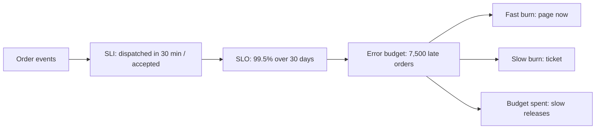

# SLOs and Alerts that Match Impact

## Start with the busy pager and the silent night

Pennick Logistics handles about 1.5 million orders a month: around 2,500 an hour in the day and 300 an hour at night. After go-live its on-call engineer was paged whenever any worker's CPU passed 80% for five minutes, 41 times in the first month, and no page matched a delayed order. Then, from 01:10 to 04:10 one night, the carrier's label service rejected every request, and no order could be dispatched without a label. The workers failed fast, CPU sat at 12% and nobody was paged. At 06:00 the day shift lead rang Gwen, the forward deployed engineer, with 900 stuck orders, and the first lorries left half empty. Call this **the busy pager and the silent night**: alerts tuned to how hard the machines work, not to whether the customer's work gets done.

> **What you'll learn**
>
> - What SLIs, SLOs and SLAs are, in terms the customer agrees.
> - How to define an indicator as good events over valid events.
> - How to work out an error budget and how fast an incident spends it.
> - How to page on budget burn and send causes to tickets and dashboards.

## SLI, SLO and SLA in the customer's words

Three terms do the work, and they are easy to mix up.

- A **service level indicator (SLI)** is a measurement of how the service behaves for its users, written as a ratio: good events divided by valid events. For Pennick: orders confirmed by a warehouse within 30 minutes, divided by orders accepted.
- A **service level objective (SLO)** is the target for that ratio over a window. For example, 99.5% of orders confirmed within 30 minutes, over a rolling 30 days.
- A **service level agreement (SLA)** is a contract with consequences, such as service credits. It is usually looser than the SLO. The team then acts before the contract is at risk.

Write the SLO with the customer's operations lead, not for them. They know what a late order costs and which delays their staff can absorb. The site's [define working with SLIs and SLOs](/learn/production-ai/observability-and-diagnosis/define-working-with-slis-and-slos) lesson covers the layers of an AI system's indicators. This lesson takes the field view: turning one customer's journey into targets and alerts.

## Choosing indicators from the journey

Start from what the customer's users do, then find where to measure it. Each SLI needs a precise good event, a precise valid event and a named data source.

| SLI | Good event | Valid event | Measured at |
| --- | --- | --- | --- |
| Order dispatch | Warehouse confirms pick list within 30 minutes of acceptance | Order accepted by the API | Order store and warehouse acknowledgements |
| Order API availability | Response that is not a server error | Well-formed request from an authenticated client | Load balancer logs |
| Order API latency | Response in under 500 ms | Same as availability | Load balancer logs |
| Label success | Carrier returns a valid label | Label request for a dispatched order | Adapter logs |

*Table 1: Pennick's indicators. Each is a ratio the team can compute from data it already has.*

The details decide whether the number means anything.

- **Exclude what is not the service's fault, explicitly.** A malformed request that gets a 400 is not valid. Write that rule down, or the ratio becomes an argument.
- **Measure as close to the user as you can.** The load balancer sees requests the application never logs, such as those that time out on the way in.
- **Prefer the outcome over the call.** Order dispatch catches the silent failures that API availability misses. Keep a few indicators, three or four, not twenty.

## Error-budget arithmetic

An SLO below 100% leaves room for failure. That room is the **error budget**: one minus the SLO, times the valid events in the window.

For Pennick's dispatch SLO, 99.5% over 30 days with 1.5 million orders:

- Budget: 0.5% of 1,500,000 = **7,500 late orders a month**.
- The label failure: 3 hours at 300 an hour = 900 late orders, or **12% of the month's budget** in one night.
- A two-hour stall in daytime: 2 × 2,500 = 5,000 late orders, or **two thirds of the budget**.

The **burn rate** is how fast you spend the budget, relative to spending it evenly. A burn rate of 1 uses the whole budget in exactly 30 days. The allowed error rate here is 0.5%. During the label failure every order failed, a 100% error rate, which is a burn rate of 200.

The budget turns reliability into a shared decision. While budget remains, the team ships changes. When an incident spends most of it, the team and customer agree to slow releases and fix reliability first.

*Figure 1: From indicator to action. The budget drives the alerts and the release decision.*

## Paging on failed work, not busy machines

A page should mean the customer is being hurt now and a person must act. The Google site reliability workbook recommends alerting on burn rate over two windows: page when the last hour spent 2% of the 30-day budget, which is a burn rate of 14.4, and when the last six hours spent 5%, a burn rate of 6. Raise a ticket when three days spent 10%. A short window, such as five minutes, confirms the burn is still happening. The page then stops once it is fixed.

Compare three alert designs on Pennick's silent night.

From 01:10 the carrier's label service rejects every request. Night volume is 300 orders an hour. Which alert wakes someone, and when?

<button type="button" data-mode="cpu" aria-pressed="false" aria-controls="cpu-result">CPU above 80%</button>
<button type="button" data-mode="count" aria-pressed="false" aria-controls="count-result">50 failures in 5 minutes</button>
<button type="button" data-mode="burn" aria-pressed="false" aria-controls="burn-result">Burn rate above 14.4</button>

<section id="cpu-result" class="mode-panel" data-announcement="CPU alert selected. No page all night."><h4>CPU above 80%</h4><ul><li>Workers fail fast, so CPU stays near 12%.</li><li>No page. 900 orders are late by morning.</li><li>Last month the same alert paged 41 times with no customer impact.</li></ul>
It watches effort, not outcome.
</section>
<section id="count-result" class="mode-panel" data-announcement="Failure count selected. No page at night volume."><h4>50 failures in 5 minutes</h4><ul><li>At 300 orders an hour, only 25 orders arrive in 5 minutes.</li><li>Even with every one failing, the count never reaches 50. No page.</li><li>In the day, at 2,500 an hour, a 25% failure rate would page.</li></ul>
A fixed count means different things at different volumes.
</section>
<section id="burn-result" class="mode-panel" data-announcement="Burn rate selected. Page after about 4 minutes."><h4>Burn rate above 14.4</h4><ul><li>The threshold is 14.4 × 0.5% = a 7.2% error rate over the last hour.</li><li>With every order failing, the hour's rate passes 7.2% after about 4.3 minutes.</li><li>The engineer is paged at about 01:15, with the carrier's errors on the dashboard.</li></ul>
It fires because customers are hurt, at any volume.
</section>

Ratios need a floor at low volume. At 300 orders an hour, 22 failures in an hour already exceed 7.2%. Add a minimum count, such as at least 10 failed orders in the window. Two odd failures at 03:00 then do not page.

## Where causes belong

CPU, memory, disk and queue depth still matter. They explain why a symptom happens and warn of trouble before it arrives. They belong in three places, none of them the pager:

- **Dashboards** that the on-call engineer opens after a symptom page, to find the cause.
- **Tickets** for slow trends, such as disk filling in four days or memory creeping up after each release.
- **Capacity reviews**, where sustained high CPU means a sizing change, not a night call.

Keep a short list of cause-based pages only where waiting would cause harm before any symptom shows, such as a certificate expiring within 24 hours or a disk 95% full on the order database. Review every page monthly. A page nobody acted on is a candidate to delete or demote. When a dashboard points at a slow query or a full connection pool, [finding the real bottleneck](/learn/fde-deploying-in-the-estate/reliability-performance-and-cost/finding-the-real-bottleneck) shows how to choose the fix.

## Limits of this lesson

- **Targets are local.** 99.5% suits Pennick's dispatch work. The right figure depends on the cost of failure and what the customer's staff can absorb.
- **Thresholds are a starting point.** The burn-rate values come from the Google workbook's starting numbers. Tune them with the customer's traffic.
- **Composite engagement.** Pennick Logistics, Gwen, its systems and figures are illustrative, not a real customer.

## Interview angle

Each answer is an outline to say in about two minutes. Open each question and try it aloud before reading.

Interview question 1. Explain SLIs, SLOs and alerts that match customer impact, for a system you are handing to a customer.

- **Answer:** An SLI is a ratio of good events to valid events that users would recognise, such as orders confirmed within 30 minutes over orders accepted. An SLO is the target for it over a window, such as 99.5% over 30 days. The gap is the error budget. Alerts fire on how fast that budget burns, so a page means customers are hurt now. Agree the SLIs and targets with the customer's operations lead.
- **Trade-off:** Outcome SLIs need data from several systems. Simple uptime checks are easy and miss silent failures.
- **Follow-up to expect:** "Who owns the SLO after handover?" The customer's operations lead, written into the runbook.
- **Go deeper:** [Define working with SLIs and SLOs](/learn/production-ai/observability-and-diagnosis/define-working-with-slis-and-slos).

Interview question 2. Your team is paged nightly on CPU spikes that never hurt anyone, and missed a night when every transaction failed. What do you change?

- **Answer:** Move the pager to symptoms. Define an SLI on completed transactions, set an SLO, and page on error-budget burn over a long and a short window. Add a minimum failure count for quiet hours. Demote CPU to dashboards for diagnosis and tickets for trends. Then review a month of past pages against the new rules to check that real incidents would have fired and the noise would not.
- **Trade-off:** Symptom pages come later than some cause alerts. In return, every page means harm.
- **Follow-up to expect:** "What if CPU at 100% will crash the service?" Keep that one, as a capacity alert with a long threshold.

Interview question 3. Define SLIs for an order-fulfilment service. Be precise about what counts.

- **Answer:** Dispatch: good is the warehouse confirming the pick list within 30 minutes of acceptance, valid is every accepted order. Availability: good is any non-server-error response, valid is a well-formed authenticated request. Latency: good is a response under 500 ms, same valid set. Measure availability at the load balancer and dispatch from the order store and the warehouse's acknowledgements. Write down the exclusions, such as malformed requests.
- **Trade-off:** Measuring at the load balancer catches more failures, but loses business context.
- **Follow-up to expect:** "Why not average latency?" Averages hide the slow tail. A threshold ratio does not.

Interview question 4. An SLO is 99.9% of requests successful over 30 days, with 4 million requests a month. Work out the budget and what a 40-minute outage at 6,000 requests an hour costs.

- **Answer:** The budget is 0.1% of 4,000,000, which is 4,000 failed requests. Forty minutes at 6,000 an hour is 4,000 requests. If they all fail, the outage spends the whole month's budget. The burn rate during it is 1 divided by 0.001, which is 1,000. A one-hour page at a burn rate of 14.4 needs a 1.44% error rate over the hour, which total failure reaches in about 52 seconds.
- **Trade-off:** A tight SLO catches more harm and leaves almost no room for risky releases.
- **Follow-up to expect:** "Budget is gone with ten days left." Freeze risky releases and spend the time on reliability.

## References

1. Google, [Service level objectives](https://sre.google/sre-book/service-level-objectives/), Site Reliability Engineering, accessed 17 November 2026. Definitions of SLIs, SLOs and SLAs.
2. Google, [Alerting on SLOs](https://sre.google/workbook/alerting-on-slos/), The Site Reliability Workbook, accessed 17 November 2026. Burn rates, the 2% in one hour and 5% in six hours starting thresholds and multiwindow alerts.
3. Google, [Monitoring distributed systems](https://sre.google/sre-book/monitoring-distributed-systems/), Site Reliability Engineering, accessed 17 November 2026. Paging on symptoms rather than causes.

## Key takeaways

- An SLI is good events over valid events, measured where users feel it.
- Agree the SLO with the customer, and keep the SLA looser than it.
- Error budget is one minus the SLO, times valid events. Burn rate is how fast you spend it.
- Page on fast burn over a long and short window, with a floor for quiet hours.
- Send CPU and other causes to dashboards and tickets, and review every page monthly.

## Check yourself

1. Why did the failure-count alert stay silent on Pennick's bad night?

Only 25 orders arrived in any five minutes at night, so the count could never reach 50 even with every order failing. A fixed count ignores volume.

2. What fraction of the month's budget did the three-hour label failure spend, and how?

900 late orders against a budget of 7,500, which is 12%. Three hours at 300 orders an hour, all failing.

3. Why keep the SLA looser than the SLO?

The SLO is where the team starts acting. A gap before the contractual line gives time to fix problems before credits or penalties apply.

