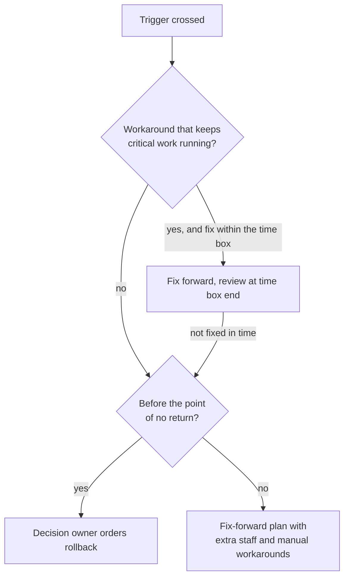

# Cutover and Rollback Decisions

## Start with the rollback nobody could call

Thornbury Freight switched from its old booking system to the new one at 22:00 on a Saturday, after the migration had reconciled cleanly. By 07:00 on Sunday, two of its nine depots could not print collection labels. A call began at 07:15 with eleven people. The operations director wanted to roll back, Bisi, the forward deployed engineer, wanted two hours to fix the label template, and the IT manager said the change board had approved going forward, not back. Nobody had written down what would trigger a rollback or who could order one, and at 10:30 the operations director decided alone. The rollback restored the old system without the 1,140 bookings customers had made on the new one since 22:00. Staff re-keyed them from exports on Sunday afternoon and missed 63, whose collections did not happen on Monday. Call this **the rollback nobody could call**: a cutover planned in detail for going forward, with nothing decided about going back.

> **What you'll learn**
>
> - Write a cutover checklist with owners, timings and checks.
> - Set rollback triggers before go-live, as measurable thresholds.
> - Name one decision owner, and time-box the decision.
> - Carry orders taken on the new system back to the old one in a rollback.

## The cutover checklist

A **cutover** is the moment work moves from the old system to the new one. A **checklist** turns it into steps a tired team can follow at 02:00. Each step has an owner, an expected duration, a check that proves it worked, and what to do if the check fails.

| Phase | When | Items |
| --- | --- | --- |
| Readiness | Two weeks before | Reconciliation thresholds signed off. Rollback rehearsed end to end. Support rota and contact list. Customer and partner notices sent. Change freeze dates agreed |
| Go or no-go | The day before | Each owner confirms their items. Open defects reviewed against the triggers. The decision owner says go, and it is recorded |
| Cutover | The window | Freeze writes on the old system. Wait for change-capture lag to reach zero. Final reconciliation. Switch routing. Smoke tests of each critical workflow |
| Verification | First hours | Business checks by real users: a booking at each depot, a label printed, a haulier request received |
| Hypercare | First one to two weeks | Daily review of triggers and defects. Reverse sync running. Rollback still possible until the agreed end |

*Table 1: A cutover checklist by phase. Thornbury's plan had the cutover row only.*

Rehearse the cutover at least once, against a full-size copy, with a stopwatch. The rehearsal finds the step that takes three hours instead of thirty minutes, and it is the only honest test of the rollback.

## Rollback triggers decided in advance

A **rollback trigger** is a measurable condition, agreed before go-live, that means "go back". Under pressure, people argue for the outcome they own. A trigger set on a calm Tuesday replaces that argument with a check. Good triggers name a measure, a threshold and a duration:

- Completed bookings fall below 85 in every 100 attempts for 30 minutes.
- Any depot cannot print labels for 60 minutes with no workaround.
- Open collections in the new system differ from the reconciled figure at all.
- Any haulier receives a duplicate or missing collection request.

Each trigger has a **point of no return**: the time after which rolling back costs more than fixing forward, for example once hauliers have planned Monday's routes from the new system. After that point, the triggers change from "roll back" to "invoke the fix-forward plan". Figure 1 shows the decision.

*Figure 1: The rollback decision, agreed in advance. A time box stops a fix attempt from running into the point of no return.*

## One decision owner

One named person orders a rollback, with a named deputy. Usually that is the customer's business owner for the system, because the decision trades business risks against each other. The FDE recommends, with evidence. The engineers run the steps.

Write down three things for the decision owner:

- **What they decide on:** the triggers, the time box for any fix attempt, such as 45 minutes, and the point of no return.
- **How to reach them:** phone numbers for the window and hypercare, and the deputy's.
- **What they need to hear:** a one-minute brief in a fixed shape: which trigger, current impact, the fix option and its time, the rollback option and its time, your recommendation.

With that in place, Thornbury's Sunday would have been one call at 07:15: the label trigger was 60 minutes, so a 45-minute fix attempt was allowed, and at 08:00 the owner decides.

## Keeping orders taken before a rollback

Every minute the new system runs, it takes real work. Rolling back must carry that work to the old system, or the business loses it. Plan the carry-back during the build, not on the morning it is needed.

The options, from strongest to weakest:

- **Reverse change capture.** During hypercare, stream changes from the new database back to the old one, mapped into the old format. The old system stays current and rollback is a routing switch plus a final check. It is the forward migration's mechanism from [migrating live data](/learn/fde-deploying-in-the-estate/releases-cutover-and-recovery/migrating-live-data), run in reverse.
- **Export and replay.** Record each accepted command, such as "create booking" with its inputs, and replay them through the old system's API on rollback.
- **Manual re-keying.** Export a list and have staff enter it. Only for small volumes, with a count to reconcile against.

The walkthrough shows Thornbury's rehearsed rollback, using export and replay.

The new system has taken 1,140 bookings since cutover. Roll back to the old system without losing one. Each step shows the action, the state afterwards and the check.

<button type="button" data-step="0" aria-pressed="false" aria-controls="cb-step-0">1. Freeze</button><button type="button" data-step="1" aria-pressed="false" aria-controls="cb-step-1">2. Carry back</button><button type="button" data-step="2" aria-pressed="false" aria-controls="cb-step-2">3. Reconcile</button><button type="button" data-step="3" aria-pressed="false" aria-controls="cb-step-3">4. Reopen</button>

<section id="cb-step-0" class="step-panel" aria-labelledby="cb-heading-0"><h4 id="cb-heading-0">1. Freeze the new system</h4><dl><dt>Action</dt><dd>Put the new system into read-only mode with a holding message. Bookings in progress finish or fail clearly.</dd><dt>State</dt><dd>No new bookings anywhere for a few minutes. The list of bookings since cutover is now fixed.</dd><dt>Check</dt><dd>No writes in the new database for two minutes.</dd></dl></section><section id="cb-step-1" class="step-panel" aria-labelledby="cb-heading-1"><h4 id="cb-heading-1">2. Carry the bookings back</h4><dl><dt>Action</dt><dd>Replay the 1,140 recorded booking commands through the old system's API, each with its new-system ID as an idempotency key. Replay changes and cancellations in their original order.</dd><dt>State</dt><dd>The old system holds every booking. Repeated replays create nothing new.</dd><dt>Check</dt><dd>Replay reports 1,140 accepted, or a named list of rejections for staff.</dd></dl></section><section id="cb-step-2" class="step-panel" aria-labelledby="cb-heading-2"><h4 id="cb-heading-2">3. Reconcile</h4><dl><dt>Action</dt><dd>Compare open collections per depot for the next seven days between the two systems. Check haulier requests already sent so none is sent again.</dd><dt>State</dt><dd>Both systems agree on the work ahead.</dd><dt>Check</dt><dd>Difference of zero, or each difference explained and assigned.</dd></dl></section><section id="cb-step-3" class="step-panel" aria-labelledby="cb-heading-3"><h4 id="cb-heading-3">4. Reopen on the old system</h4><dl><dt>Action</dt><dd>Switch routing back. Tell customers who booked since cutover that their references still work, and give hauliers a single contact.</dd><dt>State</dt><dd>The old system is live with nothing lost.</dd><dt>Check</dt><dd>A booking at each depot and a printed label.</dd></dl></section>

<button type="button" data-walk="previous">Previous</button>

<button type="button" data-walk="next">Next step</button>

Two details make this work. Customers keep the reference the new system gave them, so the old system must store it or map it. And a booking that triggered a real action, such as a haulier request, carries a flag so the old system does not send it again.

## Limits of this lesson

- **Some cutovers cannot go back.** Where the old system is decommissioned or a partner switches at the same time, plan fix-forward and say so plainly.
- **Contracts and regulators.** Banks and others may need to notify a regulator of a failed change. Check the customer's rules during readiness.
- **Composite engagement.** Thornbury Freight, Bisi, the cutover and its figures are illustrative, not a real customer.
- **After hypercare.** Once rollback closes, a failure is an incident, run as [incidents with a customer watching](/learn/fde-deploying-in-the-estate/operating-after-go-live/incidents-with-a-customer-watching) describes.

## Interview angle

Each answer is an outline to say in about two minutes. Open each question and try it aloud before reading.

Interview question 1. What goes into a go-live checklist, and how do you decide in advance when to roll back?

- **Answer:** Readiness items two weeks out: signed reconciliation thresholds, a rehearsed rollback, a support rota and customer notices. A go or no-go meeting where the decision owner records the call. Cutover steps with owners, timings and checks. Verification by real users, then hypercare. Rollback triggers are measurable: a measure, a threshold and a duration, such as completed bookings under 85 in 100 for 30 minutes. Add a point of no return and one named decision owner.
- **Trade-off:** Strict triggers may roll back for a fixable fault. A time box for fix attempts balances that.
- **Follow-up to expect:** "Who owns the decision?" The customer's business owner, advised by you.

Interview question 2. You roll back a cutover six hours in. Customers placed orders on the new system during those hours. How do you keep them?

- **Answer:** Plan it before go-live. Best is reverse change capture, keeping the old system current throughout hypercare. Otherwise record every accepted command and replay it into the old system on rollback, with the new ID as an idempotency key, in original order including changes and cancellations. Freeze the new system first to fix the list. Reconcile open orders between systems, avoid repeating external actions already taken, and let customers keep their references.
- **Trade-off:** Reverse sync costs build time for a path you hope not to use. Re-keying is cheap and loses orders.
- **Follow-up to expect:** "The old system has no field for the new reference." Store a mapping table.

## References

1. Google, [Reliable Product Launches at Scale](https://sre.google/sre-book/reliable-product-launches/), Site Reliability Engineering, accessed 17 November 2026. Launch checklists and launch coordination.
2. Google, [Release Engineering](https://sre.google/sre-book/release-engineering/), Site Reliability Engineering, accessed 17 November 2026. Repeatable, rehearsed release processes.
3. Martin Fowler, [Blue Green Deployment](https://martinfowler.com/bliki/BlueGreenDeployment.html), accessed 17 November 2026. Switching routing between two environments, and keeping data in step for a fast rollback.
4. The author's own field experience, the basis for the decision-owner brief and the carry-back steps.

## Key takeaways

- Every checklist step has an owner, a duration, a check and a failure action. Rehearse it with a stopwatch.
- Triggers name a measure, a threshold and a duration, set before go-live.
- One named decision owner, a deputy and a time box for fix attempts.
- Know the point of no return, and what replaces rollback after it.
- Carry orders back with reverse sync or replay, and never repeat an external action.

## Check yourself

1. Why did Thornbury's Sunday call take more than three hours?

Nobody had agreed triggers or a decision owner, so eleven people argued for the outcomes they each owned until one person decided alone.

2. Why freeze the new system before carrying bookings back?

Freezing fixes the list. Without it, bookings keep arriving while you replay, and some miss the carry-back.

3. What changes after the point of no return?

Rolling back now costs more than fixing forward, so a crossed trigger invokes the fix-forward plan instead of a rollback.

