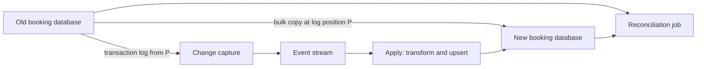

# Migrating Live Data

## Start with the parallel run that did the work twice

Thornbury Freight, a fictional freight operator, is replacing its 15-year-old booking system with a new one your team built. To gain confidence, the plan was a one-week parallel run. Every booking went into both systems, and each night a script compared their records.

Both systems were fully live. Each sent collection requests to Thornbury's subcontracted hauliers and a confirmation email to the customer. By noon on the first day, 340 collections had been requested twice. Two hauliers sent lorries to the same warehouse for the same pallets, and customers received two confirmations with different reference numbers. The run was stopped and the hauliers were paid for the wasted trips.

The data comparison had been designed with care. The side effects had not been designed at all.

Call this **the parallel run that did the work twice**: a test that runs the new system for real, in a world where only one system is allowed to act.

> **What you'll learn**
>
> - Copy a live database with a bulk load and change data capture.
> - Reconcile with checksums and business totals, not only row counts.
> - Use shadow traffic to compare behaviour without effects.
> - Run two systems in parallel with one allowed to act.

## Copying data that keeps changing

A database that takes bookings all day cannot be frozen for the hours a full copy takes. The usual pattern has two parts:

1. **A bulk copy** of every row as of a known point in the source's transaction log.
2. **Change data capture** (CDC) from that same point onwards. CDC reads the source database's log of committed changes, such as PostgreSQL's write-ahead log, and turns each insert, update and delete into an event. Tools such as Debezium do this. A consumer applies the events to the target.

Figure 1 shows the flow.

*Figure 1: The bulk copy and the change stream start at the same log position, so no change falls between them. Reconciliation reads both sides.*

The details that decide whether it works:

- **Start position.** The bulk copy and the change stream must share one log position. A gap loses changes. An overlap is fine only if applying is idempotent.
- **Idempotent apply.** Applying the same event twice must give the same result. Upsert by primary key and carry the source's log position. An older event must never overwrite a newer row.
- **Deletes.** CDC emits deletes as their own events. A consumer that only handles inserts and updates leaves deleted bookings alive in the target.
- **Lag.** Measure the time between a commit on the source and its arrival on the target. At cutover you wait for lag to reach zero. Its size decides the length of the write freeze.
- **Schema changes.** A column added to the source mid-migration must reach the transform, or the stream fails or drops the field.

## Reconciliation beyond row counts

**Reconciliation** proves the target matches the source. Row counts are the first check and the weakest. Thornbury's migration of 1,204,310 bookings is used below to show what each level catches. The switcher shows three checks run against the same copy.

The same migrated copy of 1,204,310 bookings, checked three ways. Each check reads both databases.

<button type="button" data-mode="counts" aria-pressed="false" aria-controls="counts-result">Row counts</button>
<button type="button" data-mode="checksums" aria-pressed="false" aria-controls="checksums-result">Field checksums</button>
<button type="button" data-mode="totals" aria-pressed="false" aria-controls="totals-result">Business totals</button>

<section id="counts-result" class="mode-panel" data-announcement="Row counts selected. Counts match, nothing found."><h4>Row counts</h4><ul><li>Old: 1,204,310 bookings. New: 1,204,310 bookings.</li><li>Counts per depot and per month also match.</li><li>Finds lost or duplicated rows. Says nothing about their contents.</li></ul>
Result: pass. Both faults below are invisible.
</section>
<section id="checksums-result" class="mode-panel" data-announcement="Field checksums selected. 2,180 rows with shifted dates found."><h4>Field checksums</h4><ul><li>Hash the compared fields of each row, with source values passed through the mapping rules, and compare hashes per day of collection.</li><li>Three days mismatch. Drilling into them finds 2,180 bookings whose collection date moved by one day.</li><li>Cause: the transform converted local times near midnight to UTC and kept only the date.</li></ul>
Result: a field-level fault in rows that counted correctly.
</section>
<section id="totals-result" class="mode-panel" data-announcement="Business totals selected. 57 open bookings missing from the new system's workload."><h4>Business totals</h4><ul><li>Compare what the business runs on: open collections per depot for the next seven days, and chargeable weight per customer per month.</li><li>Old: 8,412 open collections. New: 8,355.</li><li>The 57 missing are bookings on hold, which the mapping turned into cancelled. Their fields matched the transform's rule exactly.</li></ul>
Result: a mapping fault that checksums cannot see, because both sides agreed with a wrong rule.
</section>

Run all three, at increasing cost. Counts run every few minutes during the copy. Checksums run per partition, such as per day. A mismatch then narrows quickly to a few rows. Business totals need someone from the business to name the figures they would notice first, and they catch errors where the migration did exactly what it was told. Agree in advance what difference is acceptable, such as zero for open bookings and a listed set of known legacy errors, so reconciliation ends in a decision.

## Shadow traffic

**Shadow traffic** copies real requests to the new system, compares its responses with the old system's, and throws the new responses away. Users see only the old system. Martin Fowler calls the related practice of running new code on real traffic without exposing it a dark launch.

Shadowing is safe for reads by default. Writes need care:

- **Point the shadow at its own data,** a copy kept current by change capture, so shadow writes never touch the system of record.
- **Disable or record every outbound effect.** The shadow's email, haulier and payment adapters write to a log of intended actions, which you compare with the old system's actual ones.
- **Compare meaning, not bytes.** Responses differ in timestamps, generated IDs and field order. Normalise those, then diff.
- **Watch load.** Shadow traffic doubles the requests some dependencies receive. Sample, for example one request in ten, if a shared dependency cannot take the extra load.

## Parallel runs with one system allowed to act

A **parallel run** puts both systems through the same real workload over days, often including month-end or other periodic jobs, and compares outcomes. It is the strongest test before cutover and the one that caused Thornbury's double collections. The rule that would have prevented them: exactly one system is the **system of record** and the only one allowed to act on the outside world. The other runs in compare mode.

| Side effect | In the system of record | In the system under test |
| --- | --- | --- |
| Haulier collection requests | Sent | Written to an intended-actions log |
| Customer emails | Sent | Rendered and stored, not sent |
| Payments and invoices | Taken and issued | Calculated and compared |
| Calls to partner APIs that change state | Made | Pointed at a sandbox or a recorder |
| Data written to shared stores | Written | Written to its own copy |

*Table 1: Who may act during a parallel run. The system under test proves what it would have done, without doing it.*

Compare the intended-actions log with what the old system did each day: same collections, same amounts, same recipients. Also give every action an **idempotency key** derived from the booking, such as the booking ID plus the action type, and have the haulier integration reject a repeat. That second layer turns any slip in the first rule into a rejected duplicate instead of a lorry.

Thornbury restarted its parallel run a fortnight later with the new system in compare mode. Over seven days the intended-actions log matched the old system's actions for all but 14 collections, each traced to a known rounding rule.

## Limits of this lesson

- **Change capture needs access.** Reading the transaction log needs database settings and grants the customer's database team must approve.
- **Some systems cannot be shadowed.** Mainframe batch jobs and vendor products may offer no way to copy traffic. Parallel runs on batch outputs may be the only option.
- **Fictional data.** Thornbury Freight, its people and figures are illustrative.

## Interview angle

Each answer is an outline to say in about two minutes. Open each question and try it aloud before reading.

Interview question 1. Explain how you would move a customer's live database to a new system, and how you would prove the move was correct before switching users over.

- **Answer:** Bulk-copy the data as of a log position and stream changes from that same position with change capture, applying them idempotently, including deletes. Reconcile in layers: row counts, per-partition checksums of the fields, then business totals the customer's staff choose. Shadow real requests to compare responses without effects. If risk justifies it, run both systems in parallel over a full business cycle, with only the old one allowed to act and the new one logging intended actions for comparison.
- **Trade-off:** Each layer adds days. Skipping layers moves the discovery to after cutover.
- **Follow-up to expect:** "How do you know when to stop?" Agreed thresholds for each check, signed by the business owner.

## References

1. Debezium, [Debezium documentation](https://debezium.io/documentation/reference/stable/index.html), accessed 17 November 2026. Change data capture from database transaction logs, including snapshots and delete events.
2. PostgreSQL, [Logical replication](https://www.postgresql.org/docs/current/logical-replication.html), accessed 17 November 2026. Initial data copy followed by streamed changes from the write-ahead log.
3. Martin Fowler, [Dark Launching](https://martinfowler.com/bliki/DarkLaunching.html), accessed 17 November 2026. Running new behaviour on real traffic without exposing it to users.
4. Martin Fowler, [Strangler Fig Application](https://martinfowler.com/bliki/StranglerFigApplication.html), accessed 17 November 2026. Replacing a legacy system gradually instead of in one switch.

## Key takeaways

- Start the bulk copy and change capture at one log position, and apply changes idempotently, deletes included.
- Row counts catch lost rows. Checksums catch wrong fields. Business totals catch wrong rules.
- Shadow traffic compares behaviour with no effects, if outbound adapters are disabled.
- In a parallel run, one system acts and the other logs what it would have done.
- Idempotency keys turn a slip into a rejected duplicate.

## Check yourself

1. Why did the business totals catch the 57 bookings when checksums did not?

The transform mapped "on hold" to "cancelled" every time. Checksums passed source values through the same mapping rules, so both sides agreed. Only a business figure showed the rule was wrong.

2. What decides the length of the write freeze at cutover in a change-capture migration?

The change-capture lag. Writes stop on the old system, and you wait until every committed change has reached the target and reconciliation passes.

3. Why is an idempotency key worth adding even when the system under test has its outbound adapters disabled?

Configuration mistakes happen. If one adapter is left live, the receiving system rejects the repeated action instead of carrying it out twice.

