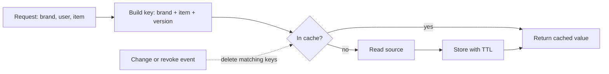

# Finding the Real Bottleneck

## Start with the bigger pool that sank the database

Mossgiel Retail's customer service portal shows an order history page for each caller. At the Monday peak, about 60 pages a second, the page took 3 seconds, and logs showed requests waiting for a database connection. Before Ceri, the forward deployed engineer, had read a trace, the team raised the connection pool on each of the 8 application instances from 20 to 50. The database allowed 300 connections, and the instances now asked for 400. New connections were refused, the admitted ones fought over 8 CPU cores, and the page went from slow to failing. Call this **the bigger pool that sank the database**: a fix aimed at the symptom you can see, the wait for a connection, that adds load to the resource that was already full.

> **What you'll learn**
>
> - Measure where a slow request spends its time before choosing a fix.
> - Find and fix repeated per-row queries.
> - Size connection pools from the database's capacity, not the queue in front of it.
> - Design caches with tenant-aware keys, and never let them serve stale permissions.

## Measure where the time goes

Every slow request spends its time somewhere: in your code, waiting for a pool, in the database, or in another service. A trace shows each part. Read it before you change anything. Start from the symptom the customer feels, then open the dashboards and traces that explain it, as [SLOs and alerts that match impact](/learn/fde-deploying-in-the-estate/operating-after-go-live/slos-and-alerts-that-match-impact#where-causes-belong) describes. [Telemetry the customer can use](/learn/fde-deploying-in-the-estate/operating-after-go-live/telemetry-the-customer-can-use) covers adding the spans a trace needs.

| What the trace shows | Likely fix |
| --- | --- |
| Many small, similar queries per request | Batch them into one query |
| One slow query with a full table scan | Add an index or rewrite the query |
| The same expensive result built again and again | Cache it, with a clear invalidation rule |
| Waiting for a pool while the database is busy | Reduce database work. Do not enlarge the pool |
| Every resource busy after the work is efficient | Add capacity |

*Table 1: Symptoms and the fix they point to. Capacity comes last, once the work itself is efficient.*

Mossgiel's trace showed each order history page making 51 queries: one for the caller's 50 recent orders, then one per order for its items.

## Repeated per-row queries

This pattern is often called **N+1 queries**: one query for a list, then one more for each row. Each is fast alone. Together they multiply round trips and database work.

- **Find them.** Count queries per request in traces or the database's statement statistics. Group by query shape with the values removed. A shape that runs 50 times per request is the suspect.
- **Measure them.** Mossgiel's 51 queries took about 4 ms each, 204 ms of database time per page. At 60 pages a second, that is 3,060 queries and about 12.2 seconds of database time every second. The database has 8 cores, so the work cannot keep up and queues.
- **Fix them.** Fetch all 50 orders' items in one query with a join or an `IN` list. Mossgiel's single query took 12 ms. Then check its plan, and add an index on the items table's order ID if it scans.

The T1.4 lesson on [indexes and query plans](/learn/engineering-foundations/sql-and-data-modelling/indexes-and-query-plans) covers reading plans in depth. The switcher compares the three fixes Mossgiel considered.

60 order history pages a second, 51 queries each, on a database with 8 cores and a limit of 300 connections. Choose a fix. Simplified figures that treat query time as CPU time.

<button type="button" data-mode="pool" aria-pressed="false" aria-controls="pool-result">Bigger pool</button>
<button type="button" data-mode="capacity" aria-pressed="false" aria-controls="capacity-result">Bigger database</button>
<button type="button" data-mode="query" aria-pressed="false" aria-controls="query-result">Fix the query</button>

<section id="pool-result" class="mode-panel" data-announcement="Bigger pool selected. 400 connections against a limit of 300, and errors."><h4>Bigger pool</h4><ul><li>8 instances × 50 = 400 connections against a limit of 300.</li><li>Refused connections become errors. Admitted queries contend for the same 8 cores.</li></ul>
The work is unchanged. The database stays overloaded.
</section>
<section id="capacity-result" class="mode-panel" data-announcement="Bigger database selected. About 77 per cent busy at twice the cost."><h4>Bigger database</h4><ul><li>16 cores. About 12.2 of 16 busy, 77 per cent.</li><li>The page recovers. The database bill roughly doubles.</li></ul>
Queries per page still grow with each caller's order count.
</section>
<section id="query-result" class="mode-panel" data-announcement="Fix the query selected. Under one core busy."><h4>Fix the query</h4><ul><li>One 12 ms query per page instead of 51.</li><li>60 × 0.012 s ≈ 0.7 seconds of database time a second.</li></ul>
Database time per page falls from 204 ms to 12 ms, on the same hardware.
</section>

## When a bigger pool makes it worse

A connection pool limits how many queries one instance sends at once. The database can only run as many as its cores and disks allow. Extra connections beyond that do not add throughput. They add contention for locks, memory and CPU. PostgreSQL runs a separate process per connection, which raises the cost further.

Size pools from the database outwards:

1. **Work out the busy connections you need.** Little's law: queries a second × time per query. 2,000 queries a second at 5 ms needs about 10 busy connections.
2. **Compare with what the database can run.** A common starting point is about twice the core count, then test around it.
3. **Divide across instances.** The total is instances × pool size. Autoscaling multiplies it, so cap it against the database's limit.
4. **Use a pooler** in front of the database when many instances need few real connections.

A queue for the pool is a symptom. It says demand beats the database, and the fix is less work per request or more database, in that order.

## Caching without serving the wrong answer

A cache stores a result to avoid rebuilding it. Every cache needs three decisions: the key, how long an entry lives, and what removes it when the source changes.

*Figure 1: Cache-aside with tenant-aware keys. A change event removes entries before their time-to-live (TTL) ends.*

- **Put the tenant in the key.** Mossgiel's portal serves three store brands. A key of item alone could return one brand's price to another brand's staff. Use brand, item and a data version.
- **Cache per user only what is per user.** Shared data, such as a product, can be shared across users within a brand. Anything that depends on who asks needs the user or role in the key.
- **Never cache permissions longer than you can tolerate a revoked user keeping access.** Mossgiel cached each staff member's "can refund" check for an hour. A team leader removed from the refunds role kept refunding for 40 minutes. Cache permission checks for seconds, and delete them on a revoke event from the identity system.

For caching model answers, see [caching in GenAI systems](/learn/production-ai/cost-and-latency/caching-in-genai-systems) in T16.10 and [cache answers without serving wrong ones](/learn/engineering-foundations/apis-and-backend/cache-answers-without-serving-wrong-ones).

## Limits of this lesson

- **Databases differ.** Connection costs, limits and poolers vary by engine and host. Read the customer's database documentation and current settings.
- **Simplified arithmetic.** Real query time mixes CPU, disk and lock waits. Use the numbers for direction, then measure.
- **Composite engagement.** Mossgiel Retail, Ceri, its pages and figures are illustrative, not a real customer.

## Interview angle

Each answer is an outline to say in about two minutes. Open each question and try it aloud before reading.

Interview question 1. A page is slow. How do you choose between caching, batching, a database fix or more capacity?

- **Answer:** Measure first. Trace slow requests and split the time into code, pool waits, database and other services. Many similar queries per request point to batching. One slow query points to an index or rewrite. The same costly result built repeatedly points to a cache with a clear invalidation rule. Add capacity only when the work is efficient and every resource is still busy. Re-measure after each change.
- **Trade-off:** Capacity is quick to buy and costs every month. Code fixes take longer and last.
- **Follow-up to expect:** "The deadline is tomorrow." Add capacity now, and schedule the fix with a date.

Interview question 2. The team raised the connection pool to fix waits, and the database became unstable. Why, and what do you do?

- **Answer:** The waits meant the database was already busy. A bigger pool sent more queries at once to the same cores, adding lock, memory and CPU contention, and instances × pool size passed the connection limit. Roll the pool back. Then reduce work per request, such as batching repeated queries. Size the pool from the database: busy connections needed by Little's law, and a total across instances under its limit. Add a pooler if many instances need few connections.
- **Trade-off:** Small pools cause visible waits. Large pools hide them inside the database, where they hurt everyone.
- **Follow-up to expect:** "Autoscaling adds instances." Cap total connections, or the database limit breaks again.

Interview question 3. A user removed from a role can still use it for an hour. The cause is a cache. How do you fix it?

- **Answer:** The permission check was cached for an hour, keyed by user. Shorten that cache to seconds, or stop caching the decision and cache only stable inputs. Subscribe to revoke and role-change events from the identity system and delete matching entries at once. Put the tenant and a policy version in the key. A policy change then invalidates everything. Agree with security how long a revoked user may keep access, and set the TTL below it.
- **Trade-off:** Shorter caches add load on the permission service. Long ones break the customer's access rules.
- **Follow-up to expect:** "The events can be lost." Keep the short TTL as a backstop.

Interview question 4. How do you find and fix repeated per-row queries in a service you did not write?

- **Answer:** Turn on query tracing or the database's statement statistics, and count queries per request grouped by shape. A shape that runs once per row is the suspect. Confirm with a trace: a list query followed by many near-identical lookups. Replace them with one query using a join or an `IN` list, or the object-relational mapper's eager loading. Check the new query's plan and add an index if it scans. Measure database time per request before and after.
- **Trade-off:** One large query can fetch more than needed. Many small ones multiply round trips.
- **Follow-up to expect:** "You cannot change the code." Cache the per-row lookups, or ask for a database view.
- **Go deeper:** [Indexes and query plans](/learn/engineering-foundations/sql-and-data-modelling/indexes-and-query-plans).

Interview question 5. Design a cache for a platform that serves several customers' brands.

- **Answer:** Use cache-aside: read the cache, and on a miss read the source and store it. Build every key from tenant, entity, ID and a data version, so one tenant never reads another's entry. Add the user or role only for data that differs by who asks. Set a TTL per data type, short for prices and permissions, longer for product text. Delete entries on change events. Record hit rate per tenant and cap each tenant's memory so one cannot evict the rest.
- **Trade-off:** Per-tenant keys lower hit rates. Shared keys risk leaking data across tenants.
- **Follow-up to expect:** "How do you clear one tenant?" Bump its version, and old keys age out.

## References

1. PostgreSQL Global Development Group, [Connections and authentication](https://www.postgresql.org/docs/current/runtime-config-connection.html), accessed 17 November 2026. The `max_connections` setting and its default.
2. HikariCP, [About pool sizing](https://github.com/brettwooldridge/HikariCP/wiki/About-Pool-Sizing), accessed 17 November 2026. Why small pools often give more throughput, and a starting formula from core count.
3. Microsoft, [Cache-Aside pattern](https://learn.microsoft.com/en-us/azure/architecture/patterns/cache-aside), accessed 17 November 2026. Loading on a miss, expiry and invalidation.
4. OWASP, [Authorization Cheat Sheet](https://cheatsheetseries.owasp.org/cheatsheets/Authorization_Cheat_Sheet.html), accessed 17 November 2026. Checking permissions on every request.

## Key takeaways

- Trace before you fix. The visible wait is often not the bottleneck.
- Repeated per-row queries multiply database work. Batch them into one.
- Size pools from the database's capacity, and cap the total across instances.
- Cache keys carry the tenant, and permission caches live seconds, with revoke events.
- Add capacity last, once the work is efficient.

## Check yourself

1. Why did raising the pool to 50 per instance fail at Mossgiel?

8 × 50 = 400 connections passed the database's limit of 300, and the admitted queries contended for the same 8 cores. The work per page was unchanged.

2. How many busy connections does 2,000 queries a second at 5 ms each need?

About 10, by Little's law: 2,000 × 0.005.

3. Why put the brand in every cache key on Mossgiel's portal?

Without it, one brand's staff could read a price or record cached for another brand.

