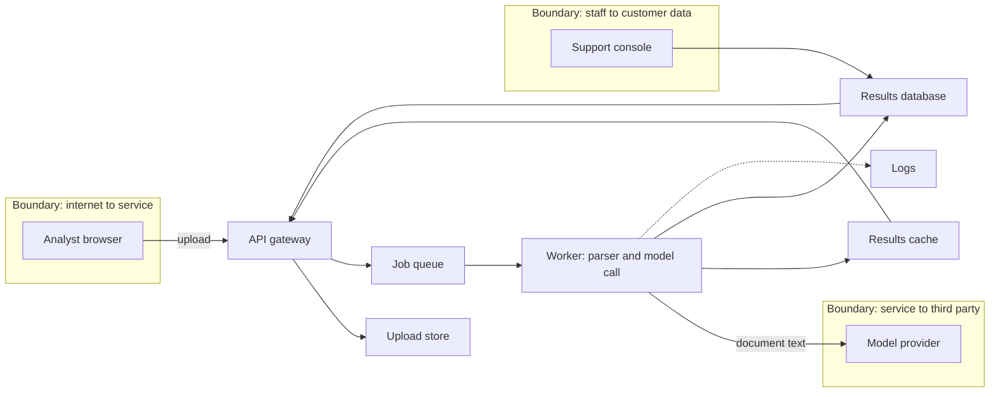

# Threat Modelling a Deployment

## Start with the questionnaire without a map

Sandling Pay, a payments firm, piloted a shared document service that extracted dispute fields from receipts for fourteen customers on one deployment. Its security reviewer sent a 120-row questionnaire, and the team answered every row within a week. The reviewer replied with one line asking for the data flow diagram and the threat model. There was no diagram. While drawing one, Ama, the forward deployed engineer on the pilot, reached the results cache. Results were keyed by document number and page, and document numbers were counters per customer, so Sandling's document 4812 and another customer's document 4812 shared a key. The pilot logs showed a Sandling analyst opening another customer's extracted invoice for a few seconds. Every answer was true, and none covered the cache. Call this **the questionnaire without a map**: a list of controls that nobody checked against the path the data takes.

> **What you'll learn**
>
> - Answer the four questions of a threat model for a real deployment.
> - Draw a data flow with its trust boundaries, including caches, queues and support tools.
> - Find upload threats and tenant-crossing threats element by element.
> - Turn each threat into a control, an owner and evidence a reviewer can check.

## What a threat model gives a security review

A **threat model** is a structured answer to four questions. What are we working on? What can go wrong? What are we going to do about it? Did we do a good enough job? The threat modelling manifesto (linked in References) frames the work around these four questions.

A questionnaire asks whether controls exist. A threat model shows where they apply and what is left. Reviewers ask for it because it is the only document that ties your controls to their data. In a review, it does three jobs:

- **It shows you know the system.** A diagram with every store and boundary tells the reviewer your team has looked.
- **It focuses the review.** The reviewer can test the riskiest boundaries instead of every row.
- **It records decisions.** Each accepted risk has an owner and a reason, which is what an auditor asks for later.

Keep it short. Sandling's final threat model was a diagram, a table of 18 threats and a page of accepted risks. It was more useful to the reviewer than the 120 rows.

## Draw the data flow and its trust boundaries

Start from the path one document takes, not from a list of attacks. Name every element that receives, stores or moves the data. Then mark the **trust boundaries**: the lines where data or control passes between parties that trust each other differently.

*Figure 1: The document service's data flow. Each subgraph marks a trust boundary. The tenant boundary runs through every store, including the cache.*

Four boundaries matter in this service:

- **Internet to service.** Anything the browser sends, including the file, its name and its declared type, is untrusted.
- **Tenant to tenant.** Fourteen customers share every store. The boundary is invisible on the diagram unless you write the tenant into each key.
- **Service to third party.** Document text leaves for the model provider.
- **Staff to customer data.** Support engineers can read results through the console.

Elements people forget are the ones that cause incidents: caches, queues, logs, search indexes, admin consoles and exports. If your diagram has none of them, it is incomplete.

## Walk each element for what can go wrong

With the diagram drawn, walk each element and boundary with a checklist. **STRIDE** is a common one: spoofing, tampering, repudiation, information disclosure, denial of service and elevation of privilege. Use it as a prompt, not a form to fill in.

An upload service has its own threats, because the input is a whole file chosen by someone else.

| Element | What can go wrong | Control |
| --- | --- | --- |
| Gateway | A file named `../../config` writes outside its folder | Ignore the client's filename. Store under a random identifier |
| Gateway | A file declared as PDF is an executable or script | Check the file's signature against an allow-list of types. Never trust the declared type |
| Gateway and worker | A small compressed file expands to many gigabytes | Limit size before and after decompression, and the page count |
| Worker | A crafted file exploits a bug in the parser | Run the parser in a sandbox with no network, low privileges and a time limit |
| Worker | Text in the document instructs the model to change its output | Treat document text as data. Validate the output against a schema |
| Upload store | One customer reads another's files by guessing a path | Prefix every object with the tenant, sign short-lived links per tenant |
| Results cache | One customer receives another's result | Put the tenant in every cache key |
| Support console | An engineer browses any customer's data | Access by ticket, time-limited, every read logged |

*Table 1: Threats along the document service, element by element, with the control for each.*

The support console row is an access design question as much as a threat. Time-limited, approved access is set out in [service accounts and least privilege](/learn/fde-deploying-in-the-estate/networks-and-identity/service-accounts-and-least-privilege#when-someone-asks-for-admin-rights).

Prompt injection through documents is canonical in [threat model each request path](/learn/production-ai/security-tenancy-prompt-injection/threat-model-each-request-path). This lesson takes the deployment's view of it: a boundary on the diagram with a control outside the model.

## The cache that crosses tenants

Caches cross tenants more easily than databases, because a cache key is written once in code and rarely reviewed. The database had a tenant column and a row-level policy. The cache had neither. Isolation across components is covered in [tenancy and isolation](/learn/fde-deploying-in-the-estate/deployment-models-and-environments/tenancy-and-isolation). Here the question is what each key design leaks.

Two customers both have a document numbered 4812. Sandling uploaded a receipt. The other customer uploaded an invoice. Sandling's analyst asks for document 4812, page 1. Choose a cache key to see what the analyst receives.

<button type="button" data-mode="docid" aria-pressed="false" aria-controls="docid-result">Document number and page</button>
<button type="button" data-mode="hash" aria-pressed="false" aria-controls="hash-result">Hash of the file</button>
<button type="button" data-mode="tenant" aria-pressed="false" aria-controls="tenant-result">Tenant, document and version</button>

<section id="docid-result" class="mode-panel" data-announcement="Document number and page selected. The analyst can receive the other customer's invoice."><h4>Document number and page</h4><ul><li>Key: 4812, page 1. Both customers produce the same key.</li><li>Whichever result was cached first is served to both for the cache lifetime of 10 minutes.</li><li>The analyst can receive the other customer's invoice fields.</li></ul>
A direct breach between tenants. This was Sandling's finding.
</section>
<section id="hash-result" class="mode-panel" data-announcement="Hash of the file selected. Different files do not collide, but identical files share results and reveal each other."><h4>Hash of the file</h4><ul><li>Different files give different keys, so the receipt and invoice never collide.</li><li>If two customers upload the same file, they share one entry. A result that includes customer-specific fields, such as their merchant codes, leaks.</li><li>A fast answer tells the second customer someone else uploaded that file.</li></ul>
Safer, but it still shares state and leaks a signal across tenants.
</section>
<section id="tenant-result" class="mode-panel" data-announcement="Tenant, document and version selected. Each customer has its own entries."><h4>Tenant, document and version</h4><ul><li>Key: Sandling, 4812, version 3, page 1. Only Sandling's requests produce it.</li><li>An edited document gets a new version and a fresh result.</li><li>The cache library builds the key from the request's authenticated tenant, never from a field the caller sends.</li></ul>
No sharing across tenants. Hit rate falls a little, because identical files are processed twice.
</section>

The fix has three parts. Build every key from the authenticated tenant in one shared function. Add a test that writes the same document number for two tenants and asserts each reads its own result. Then flush the cache, because entries written under the old scheme stay valid until they expire.

The incident response follows the same order as any exposure. Contain it by disabling the cache or flushing it. Use logs to find every cross-tenant read during the exposure window. Tell the affected customers what was exposed and when. Fix the key and add the test. Running the incident itself, with a customer watching, is covered in [incidents with a customer watching](/learn/fde-deploying-in-the-estate/operating-after-go-live/incidents-with-a-customer-watching).

Telling customers is a legal duty as well as good practice. When the data is personal data, your contract and data protection law usually set who tells whom and how fast. Under the GDPR, for example, a processor must tell the controller (here, each affected customer) without undue delay, and the controller must tell its regulator within 72 hours of becoming aware, unless the breach is unlikely to put people at risk. The customer decides on that notification. Your job is to give its security team the facts early: what was exposed, for which tenants, over which window, and what you have contained.

## Turn threats into controls, owners and evidence

A threat list helps a reviewer only when each row ends in a decision. For each threat, record four things:

1. **Rating.** Impact and likelihood, on a scale the customer recognises. Reading another tenant's data is high impact even when it is unlikely.
2. **Response.** Fix it, reduce it, transfer it (for example to a provider's contract) or accept it with a reason.
3. **Owner.** A named person or team, with a date for anything not yet fixed.
4. **Evidence.** The test, configuration export or log query that shows the control works.

Sandling's reviewer accepted the model with two open items, each with an owner and a date. One was the parser sandbox, then in progress. The other was a quarterly review of support console access.

Answer the fourth question, "did we do a good enough job", by re-running the model whenever the data flow changes. A new store, a new third party or a new export path means a new row. The cache existed for months because nobody revisited the diagram when it was added.

## Limits of this lesson

- **Method choice.** STRIDE is one prompt list among several. Customers with their own method, such as attack trees or a regulator's template, expect you to use theirs.
- **Depth.** This lesson covers a deployment-level model. Code review, penetration tests and AI-specific threats need their own work.
- **Composite engagement.** Sandling Pay, Ama, the pilot, its figures and documents are illustrative, not a real customer.

## Interview angle

Each answer is an outline to say in about two minutes. Open each question and try it aloud before reading.

Interview question 1. A customer's security team asks for a threat model of the service you are deploying, which several customers share. How do you build it, and how do you show tenants are isolated?

- **Answer:** Draw the data flow for one request: entry point, stores, queues, caches, logs, third parties and admin tools. Mark the trust boundaries, including the boundary between tenants in every shared store. Walk each element with STRIDE as a prompt, rate each threat, and record a response, owner and evidence. For isolation, show where the tenant comes from, the authenticated session, and how each store enforces it: row policies, key prefixes, per-tenant encryption keys. Back it with a test that tries to cross tenants.
- **Trade-off:** A deep model takes days. A diagram and a ranked table of the top risks usually satisfies a first review.
- **Follow-up to expect:** "Which component is hardest to isolate?" Caches and admin tools.
- **Go deeper:** [Tenant isolation levels](/learn/production-ai/security-tenancy-prompt-injection/tenant-isolation-levels).

Interview question 2. A customer reports that a cached answer showed them another customer's data. What do you do in the first hour, and what is the lasting fix?

- **Answer:** Treat it as a confirmed exposure. Disable or flush the cache at once, accepting slower responses. Pull the cache key code and logs to find the cause and every cross-tenant read during the window. Tell the customer's security contacts what you know, and escalate under your incident process, since the other customer is affected too. The lasting fix is to build every key from the authenticated tenant in one function, add a cross-tenant test, and add the cache to the threat model.
- **Trade-off:** Disabling the cache raises latency and model cost. Leaving it on risks more exposures.
- **Follow-up to expect:** "How do you know the full scope?" Only from logs that record tenant and key. Check you have them.

## References

1. Manifesto authors, [Threat Modeling Manifesto](https://www.threatmodelingmanifesto.org/), accessed 17 November 2026. The four questions and the values behind threat modelling.
2. OWASP, [Threat Modeling Cheat Sheet](https://cheatsheetseries.owasp.org/cheatsheets/Threat_Modeling_Cheat_Sheet.html), accessed 17 November 2026. Data flow diagrams, trust boundaries and STRIDE.
3. OWASP, [File Upload Cheat Sheet](https://cheatsheetseries.owasp.org/cheatsheets/File_Upload_Cheat_Sheet.html), accessed 17 November 2026. Generated filenames, untrusted content types, signature checks, size limits and decompression attacks.
4. Microsoft, [Threat Modeling Tool threats](https://learn.microsoft.com/en-us/azure/security/develop/threat-modeling-tool-threats), accessed 17 November 2026. The STRIDE categories with examples.
5. European Union, [Regulation (EU) 2016/679 (GDPR)](https://eur-lex.europa.eu/eli/reg/2016/679/oj), Article 33, accessed 20 November 2026. Breach notification by the controller to the supervisory authority, and by the processor to the controller.

## Key takeaways

- A questionnaire lists controls. A threat model shows where they apply. Reviewers ask for both.
- Draw the path of one request first, with every store, queue, cache, log and admin tool.
- Mark trust boundaries, including the one between tenants in each shared store.
- Uploads bring their own threats: names, types, sizes, parser bugs and instructions inside documents.
- End every threat with a response, an owner and evidence, and re-run the model when the flow changes.

## Check yourself

1. Why did Sandling's 120 true answers miss the cache leak?

The questionnaire asked whether controls existed, not where data went. Only a data flow diagram puts the cache on the page, where someone asks how it keeps tenants apart.

2. Why is a hash of the file a weaker cache key than tenant, document and version?

Two customers with the same file share one entry. Any customer-specific field in the result leaks, and a fast response reveals that another customer uploaded the file.

3. Why must the cache key take the tenant from the authenticated session?

A tenant value sent by the caller can be changed by the caller. Only the session's tenant is something the service has verified.

