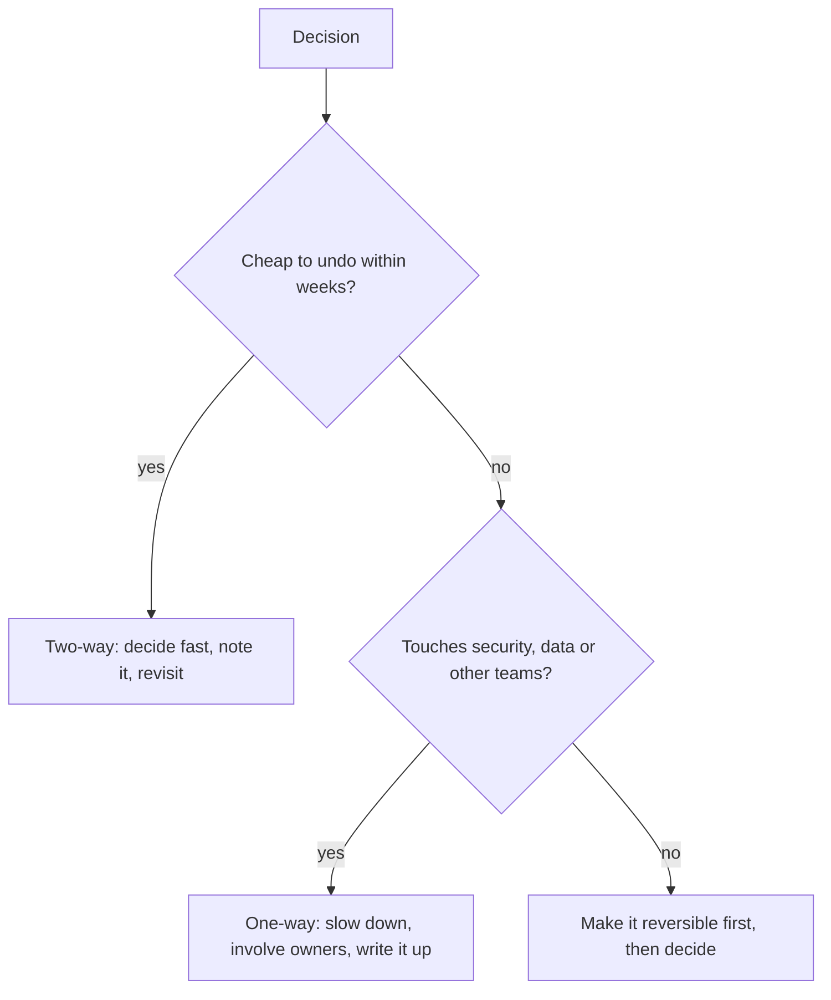

# Judgement Under Uncertainty

## Start with a shortcut that outlived its week

Ana, a forward deployed engineer at Ashby Logistics, a warehouse operator, had nine days to put a stock-reconciliation tool live before a quarterly audit. Single sign-on with Ashby's identity provider would take two weeks to approve, so the team created one shared admin account and gave its password to six supervisors, agreeing it was temporary. Eight months later the account still existed, two of the six supervisors had left, and the audit log showed every change as "admin", so Ashby's auditors could not tell who had adjusted a stock count by 400 units. The shortcut itself was reasonable for nine days. The failure was treating a decision that is hard to undo as if it were easy to undo, and never writing down when it would be reversed. Call it **the permanent temporary fix**.

> **What you'll learn**
>
> - Sort decisions by how hard they are to reverse, and spend your care accordingly.
> - Trade speed, quality and scope openly with the customer.
> - Count the long-term cost of work built for one customer.
> - Tell an acceptable shortcut from debt that endangers operations.
> - Break an unfamiliar problem into questions you can answer this week.

## One-way and two-way decisions

Amazon's 2015 shareholder letter described two types of decision. Some are consequential and nearly irreversible, one-way doors, and deserve slow, careful thought. Most are two-way doors: if you are wrong, you walk back through. The letter warned that large organisations tend to treat every decision like a one-way door and become slow.

In the field the split works as a sorting rule. Figure 1 shows it.

*Figure 1: Sorting a decision by reversibility. Many apparent one-way doors can be turned into two-way doors with a flag, an adapter or a backup.*

Typical two-way doors in an engagement: a library choice behind your own interface, a dashboard layout, a batch schedule. Typical one-way doors: a data model other systems will read, an identity design, deleting source data, a contract term.

The third branch matters most. Before you make a hard decision, ask whether you can make it cheaper to undo: write to a new table instead of altering the old one, put the vendor behind an adapter, keep the old path running for a month.

## Speed, quality and scope

Every deadline forces a trade among three things: how fast you ship, how good it is and how much it does. Fixing all three is a wish, not a plan.

The FDE's job is to make the trade visible and let the customer choose, because they own the consequences. Table 1 shows how the Ashby deadline could have been traded.

| Option | Speed | Quality | Scope | Risk the customer accepts |
| --- | --- | --- | --- | --- |
| Full tool with single sign-on | Misses the audit | High | Full | Audit without the tool |
| Full tool, shared admin account | Meets the audit | Low on access control | Full | Untraceable changes until fixed |
| Reconciliation only, named accounts in the tool | Meets the audit | Good | Reduced: no adjustments screen | Supervisors adjust stock in the old system for a month |

*Table 1: Three ways to meet one deadline. Each option makes a different promise, and the customer should pick knowing which.*

The third row was available and nobody offered it. Cutting scope is usually the safest lever, because missing features are visible and quality problems hide until they hurt.

> **Pitfall:** Cutting tests to hit a date trades quality silently. The customer never agreed to it, and the cost arrives later as a production incident.

## The cost of building it for one customer

A request that fits only one customer is tempting: they are paying, and it is quick. Each customer-specific change carries costs that arrive later:

- **Maintenance.** Someone must keep it working through every product upgrade.
- **Upgrade friction.** A fork or patch can block the customer from taking new product versions.
- **Knowledge.** Only the people who built it understand it, and they move on.
- **Support.** Your support desk sees behaviour that no other customer has.

Before agreeing, ask three questions. Can it be configuration instead of code? Would two other customers want it? Who maintains it in a year? If the answers are no, no and nobody, push back or price the maintenance into the engagement.

## When a shortcut becomes debt

Ward Cunningham's debt metaphor treats a shortcut as a loan: you ship sooner and pay interest until you repay it. Martin Fowler's technical debt quadrant splits debt by whether it was **deliberate** or **inadvertent**, and whether it was **prudent** or **reckless**. "We must ship now and will deal with the consequences" is deliberate and prudent, if you repay it.

For an FDE, one more question decides whether a shortcut is acceptable: **does it endanger operations or the customer's controls?** A slow report is debt you can carry. A shared admin account, unencrypted data or a skipped backup puts the customer at risk while you carry it.

The switcher replays the Ashby decision with the shortcut handled two ways.

The shared admin account goes live nine days before the audit. Compare what happens when the shortcut is recorded and when it is not.

<button type="button" data-mode="unrecorded" aria-pressed="false" aria-controls="unrecorded-result">Agreed verbally</button>
<button type="button" data-mode="recorded" aria-pressed="false" aria-controls="recorded-result">Recorded with an expiry</button>

<section id="unrecorded-result" class="mode-panel" data-announcement="Agreed verbally selected. The account stays for eight months."><h4>Agreed verbally</h4><ul><li>The team says "temporary" in a meeting. Nothing is written down.</li><li>Single sign-on approval arrives in week three. Nobody remembers to switch.</li><li>Eight months later, auditors find untraceable stock adjustments.</li></ul>
A nine-day shortcut became eight months of risk.
</section>
<section id="recorded-result" class="mode-panel" data-announcement="Recorded with an expiry selected. The account is removed in week four."><h4>Recorded with an expiry</h4><ul><li>The decision log names the risk, the owner and a removal date: four weeks after go-live.</li><li>Supervisors write their name in a change note field until then, so adjustments stay traceable.</li><li>The account is disabled in week four, when single sign-on goes live.</li></ul>
The shortcut cost four weeks of a known, contained risk.
</section>

Every shortcut that stays needs four things written down: what was skipped, the risk it creates, who owns removing it, and the date or event that triggers removal.

## Breaking down an unfamiliar problem

Sometimes the uncertainty is the whole problem: a customer in an industry you have never worked in wants a prototype in five days. The way through is to turn the unknown into questions you can answer this week:

1. **Who decides, and what do they decide?** Find the person whose daily decision the prototype supports.
2. **What does a good outcome look like to them?** A number or an example, in their words.
3. **What data and rules exist?** Ask for a sample and the policy documents, not a data model.
4. **What is the smallest thing that would change their decision?** Build that, and fake the rest.

Spend the first day on questions and the remaining days building. [Practise breaking down the unknown](/learn/fde-in-the-field/fde-role-and-boundaries/practise-fde-role-and-boundaries-decomposition) drills this with timed cases. The full discovery method lives in the discovery module: [the discovery conversation](/learn/forward-deployed/customer-discovery/the-discovery-conversation) and [decomposing a solution into workstreams](/learn/forward-deployed/customer-discovery/decomposing-a-solution-into-workstreams).

## Limits of this lesson

- **Reversibility is a judgement.** Teams disagree about which doors are one-way. Write the reasoning down so it can be challenged.
- **Debt is not always bad.** Prudent, deliberate debt that gets repaid can be the right call. The danger is debt that hides or endangers operations.
- **Composite engagement.** Ashby Logistics, Ana and the figures are illustrative, not a real customer.

## Interview angle

Each answer is an outline to say in about two minutes. Open each question and try it aloud before reading.

Interview question 1. How do you decide how much care a decision needs when you have incomplete information?

- **Answer:** Sort it by how hard it is to undo. Decide two-way doors quickly, write them down and revisit. Slow down on one-way doors such as data models, identity and deletions, and involve their owners. First, try to make a hard decision cheaper to undo.
- **Trade-off:** Treating everything as one-way makes you slow. Treating everything as two-way eventually burns you on a decision you cannot reverse.
- **Follow-up to expect:** "Give an example of turning a one-way door into a two-way one." Writing to a new table and keeping the old path running for a month.

Interview question 2. A deadline cannot move. How do you trade speed, quality and scope?

- **Answer:** Lay out two or three options, each with what the customer gives up, and let them choose. Prefer cutting scope, because a missing feature is visible. Avoid silently cutting quality, such as tests, because its cost arrives later as an incident.
- **Trade-off:** Reduced scope disappoints someone now. Reduced quality disappoints everyone later.
- **Follow-up to expect:** "The sponsor wants everything." Show the options in a table with the risk of each and ask them to pick.

Interview question 3. A customer asks for a feature only they need. How do you think about its cost?

- **Answer:** Count maintenance, upgrade friction, knowledge concentration and support load. Ask whether it can be configuration, whether other customers would want it, and who maintains it in a year. If nobody does, push back or price the maintenance in.
- **Trade-off:** Saying yes wins goodwill now. Saying no, or proposing configuration, keeps the customer upgradable later.
- **Follow-up to expect:** "They are your biggest customer." Then make the cost explicit to your product leadership, so the company decides knowingly.

Interview question 4. When is a shortcut acceptable, and when does it become dangerous debt?

- **Answer:** It is acceptable when it is deliberate, written down with an owner and a removal date, and does not endanger operations or the customer's controls. It becomes dangerous when nobody records it, or when it weakens security, data protection or recovery.
- **Trade-off:** A recorded shortcut still carries risk until removed. The record makes the risk visible and bounded.
- **Follow-up to expect:** "Give an example." A shared admin account before an audit: accept it for four weeks with traceable change notes, then remove it.

## References

1. Jeff Bezos, [2015 letter to shareholders](https://s2.q4cdn.com/299287126/files/doc_financials/annual/2015-Letter-to-Shareholders.PDF), Amazon, accessed 17 November 2026. Type 1 and Type 2 decisions.
2. Martin Fowler, [Technical debt](https://martinfowler.com/bliki/TechnicalDebt.html), accessed 17 November 2026. The debt metaphor and its origin with Ward Cunningham.
3. Martin Fowler, [Technical debt quadrant](https://martinfowler.com/bliki/TechnicalDebtQuadrant.html), accessed 17 November 2026. Deliberate or inadvertent, prudent or reckless.
4. The author's own field experience, the basis for the shortcut record and the customisation questions.

## Key takeaways

- Sort decisions by reversibility. Move fast on two-way doors and slow down on one-way doors.
- Before a hard decision, look for a way to make it cheaper to undo.
- Put speed, quality and scope options in front of the customer. Prefer cutting scope over silently cutting quality.
- Count maintenance, upgrades, knowledge and support before building for one customer.
- Record every shortcut with its risk, owner and removal date, and never accept one that endangers operations unbounded.

## Check yourself

1. Is choosing a charting library a one-way or a two-way door? What about the identity design?

The charting library is usually two-way, especially behind your own interface. The identity design is one-way: other systems and audits depend on it and changing it later is costly.

2. Which row in Table 1 was available at Ashby but not offered, and why was it the safer choice?

Reconciliation only, with named accounts. It cut scope, which is visible and agreed, instead of cutting access control, which hid a risk that lasted eight months.

3. What four things should a recorded shortcut include?

What was skipped, the risk it creates, who owns removing it, and the date or event that triggers removal.

