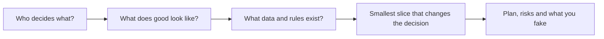

# Practise Breaking Down the Unknown

## How to use this practice

Decomposition rounds give you a vague problem and watch how you break it down. Interviewers listen for the order of your questions more than for a clever design. Each question below takes ten minutes:

1. Spend two minutes writing the questions you would ask.
2. Spend six minutes talking through the breakdown aloud.
3. Spend two minutes comparing with the outline.

The moves come from [judgement under uncertainty](/learn/fde-in-the-field/fde-role-and-boundaries/judgement-under-uncertainty). Every customer below is fictional.

> **What you'll practise**
>
> - Turning an unfamiliar problem into questions you can answer this week.
> - Choosing the smallest slice that would change someone's decision.
> - Talking through an end-to-end approach in a fixed order.

## The breakdown in one picture

Figure 1 is the order to follow in every question below. Interviewers notice when a candidate jumps straight to the last box.

*Figure 1: Five steps from an unfamiliar problem to a plan. Each step's answer narrows the next.*

## Practice questions

Practice question 1. A customer says, "Our operations are a mess. Can AI help?" Nothing else is known. How do you break the problem down?

- **Answer:** Do not propose AI yet. Ask who the operations people are and what decisions they make each day, then which of those decisions is slow, costly or error-prone, with a number if one exists. Ask what data and rules sit behind that decision. Pick one decision with a measurable cost and propose a two-week discovery to baseline it. AI may or may not be the answer.
- **Trade-off:** Narrowing to one decision ignores other problems for now. Trying to fix "operations" in one go produces a demo with no outcome.
- **Follow-up to expect:** "They want a roadmap, not one decision." Offer a ranked list of decisions with rough value, and start with the top one.

Practice question 2. You must deliver a working prototype in five days for a shipping insurer. You know nothing about marine insurance. How do you use the five days?

- **Answer:** Day one is questions: sit with an underwriter, learn the one decision the prototype supports and how they judge a good result, and collect five real examples and the policy rules. Days two to four build the smallest slice that helps that decision, faking anything around it. Day five is a run-through with the underwriter on their own examples, and a list of what is real and what is faked.
- **Trade-off:** A day of questions feels like lost build time. Without it, you build a convincing prototype of the wrong thing.
- **Follow-up to expect:** "The underwriter is only free for an hour." Use the hour for their decision and examples, and read their policy documents the rest of the day.

Practice question 3. Walk me through how you approach a customer problem from first conversation to production.

- **Answer:** Discover the real problem and measure a baseline. Agree a success metric with the sponsor. Scope the smallest useful system and what is out. Prototype on their data, then pilot with real users against a scorecard. Harden for production with monitoring, access and a runbook, hand over to a named owner, and iterate on what live use reveals.
- **Trade-off:** Following the stages slows the start. Skipping them usually means rebuilding after the pilot.
- **Follow-up to expect:** "Where do you spend most of your time?" Discovery and the pilot, because both decide whether the build is used.

Practice question 4. A hospital asks you to "reduce missed appointments". Break the problem into parts you can work on.

- **Answer:** Separate the parts: who misses appointments and why (forgetting, transport, cost, wrong slot), what the hospital can act on (reminders, rebooking, overbooking), and what data exists (booking history, contact details, past no-shows). Measure the current rate by clinic. Then pick one lever with data behind it, such as targeted reminders for clinics with the highest no-show rate, and pilot it in one clinic.
- **Trade-off:** One lever in one clinic is slow to scale. It gives a measured result the hospital can trust before spending more.
- **Follow-up to expect:** "Would you predict who will miss?" Only if a prediction changes an action, such as who gets a phone call, and only after the baseline shows where the misses are.

## Limits of this practice

- **Outlines are not scripts.** Your answer should use your own examples and words.
- **Fictional customers.** Every organisation and figure is illustrative.

## References

1. The site's [judgement under uncertainty](/learn/fde-in-the-field/fde-role-and-boundaries/judgement-under-uncertainty) lesson, for breaking down an unfamiliar problem.
2. The site's [what an FDE owns](/learn/fde-in-the-field/fde-role-and-boundaries/what-an-fde-owns) lesson, for the engagement stages.

## Key takeaways

- Start every decomposition with who decides what, not with technology.
- Turn "good" into a number or an example in the customer's words.
- Pick the smallest slice that would change a real decision, and fake the rest.
- Say what is real and what is faked when you show a prototype.

## Check yourself

1. Why does practice question 1 end with a discovery proposal instead of an AI design?

Because nothing is known yet about the decision, its cost or its data. Proposing AI before a baseline risks building something with no measurable outcome.

2. In the five-day prototype, what should day five produce besides a demo?

A run-through on the underwriter's own examples and a clear list of what is real and what was faked, so nobody mistakes the prototype for a production promise.

