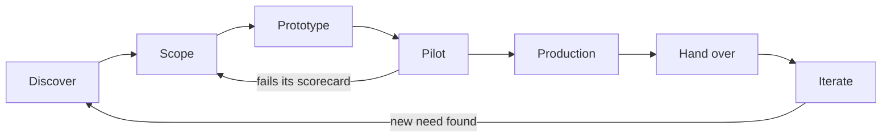

# What an FDE Owns

## Start with a project that shipped and changed nothing

Dana, a forward deployed engineer, joins Harlow Freight, a customs broker that files about 4,000 import declarations a month, each one read from a commercial invoice, given a tariff code and keyed into a government portal. A vendor team has already built an extraction tool in six weeks, and it passed every acceptance test in the statement of work. Three months on, the brokers still key most declarations by hand: the tool's output lands in a shared folder they never open, the tariff codes need a second check anyway, and nobody asked how the brokers' day runs. The contract was delivered in full and the customer's problem is untouched. Call this the **delivered-but-unused** failure: everyone did their job, and nobody owned the result.

> **What you'll learn**
>
> - State what a forward deployed engineer owns, in one sentence an interviewer can test.
> - Tell the role apart from software engineers, solutions engineers, solutions architects and consultants.
> - Name the stages of an engagement and what the FDE carries through each.
> - Explain why outcome ownership changes what the FDE does on day one.

## The one-sentence definition

A **forward deployed engineer (FDE)** is an engineer who works inside a customer's environment and owns getting a working system into use there, measured by the customer's outcome.

Three words in that sentence carry the weight:

- **Inside.** The FDE works where the problem lives: the customer's data, systems, security rules and people. Much of the job is learning an estate nobody documented.
- **Owns.** The FDE is accountable end to end, from the vague first request to a system someone else can run. When a step falls between teams, the FDE picks it up or gets it owned.
- **Outcome.** Success is a change in the customer's numbers, such as hours saved or errors avoided, not a feature list or a closed ticket.

An **output** is what you built. An **outcome** is what changed because of it. The Harlow tool was a good output with no outcome.

## Who owns what around the customer

Customers meet several technical roles. Each one is real and useful. They differ in what they are accountable for, and that difference shows up in what each does when something goes wrong. Table 1 compares them.

| Role | Accountable for | Typical horizon | Writes production code? | Done when |
| --- | --- | --- | --- | --- |
| Product software engineer | A product capability used by many customers | Quarters | Yes, in the company's codebase | The feature ships and works for most customers |
| Solutions engineer | Showing the product fits a buyer's need | Weeks, before the sale | Demos and prototypes | The customer decides to buy |
| Solutions architect | A design that fits the customer's estate | Weeks to months | Rarely | The design is approved |
| Consultant | Advice and a plan, sometimes delivery capacity | The contract term | Sometimes | The deliverables are accepted |
| **Forward deployed engineer** | **The customer's outcome from a working system** | **The engagement, then the handover** | **Yes, in and around the customer's systems** | **The customer's metric moves and someone can run it** |

*Table 1: Roles near the customer, compared by accountability. Titles vary by company, so compare duties rather than names.*

The rows overlap in skills. An FDE demos like a solutions engineer, designs like an architect and writes code like a product engineer. The last column is where they part. Only the FDE is done when the customer's metric moves.

Two further differences matter in interviews:

- **Against product engineering**, the FDE trades depth for breadth. A product engineer goes deep on one capability for many customers. An FDE goes wide across one customer's stack, then reports what recurs so the product team can build it once.
- **Against consulting**, the FDE leaves running software behind, not only a recommendation. The FDE also carries the product's interests into the room: a request that would fork the product for one customer gets pushed back on, even when the customer is paying.

The site's [three roles lesson](/learn/orientation/the-fde-role/three-roles-three-questions) compares the FDE with AI engineers and agentic engineers. This lesson covers the roles a customer meets.

## The same week under two ways of working

The switcher replays one week at Harlow under two ownership models. The inputs are identical: the tool passes its tests, and brokers ignore it.

Compare what happens in the same week when the team owns the contract and when someone owns the outcome.

<button type="button" data-mode="contract" aria-pressed="false" aria-controls="contract-result">Owns the contract</button>
<button type="button" data-mode="outcome" aria-pressed="false" aria-controls="outcome-result">Owns the outcome</button>

<section id="contract-result" class="mode-panel" data-announcement="Owns the contract selected. The tool is signed off and usage stays near zero."><h4>Owns the contract</h4><ul><li>Monday: acceptance tests pass. The team asks for sign-off.</li><li>Wednesday: the sponsor signs. Low usage is logged as a training issue for the customer.</li><li>Friday: the team moves to the next statement of work.</li></ul>
Declarations keyed by hand stay at about 90%. Nothing in the contract was missed.
</section>
<section id="outcome-result" class="mode-panel" data-announcement="Owns the outcome selected. The FDE sits with brokers and changes where the output lands."><h4>Owns the outcome</h4><ul><li>Monday: the FDE sits with two brokers for a morning and sees they never leave the portal screen.</li><li>Wednesday: the extracted fields move into the portal's import file, and only low-confidence tariff codes are flagged for review.</li><li>Friday: the FDE agrees a target with the operations lead: keyed-by-hand declarations below 40% in six weeks.</li></ul>
The metric is now the thing everyone watches. Sign-off waits for it.
</section>

The numbers are illustrative. The point is the difference in what each team does once the tool is ignored. One closes the work. The other treats the work as unfinished.

> **Key distinction:** Outcome ownership changes the first move. An FDE who owns the result watches the work before building, because the build is worthless if it lands where nobody looks.

## The engagement at a glance

An engagement is the full arc of one customer problem, from first request to a system the customer runs. Figure 1 shows the stages most engagements pass through. Real ones loop back, often more than once.

*Figure 1: The stages of an engagement. A pilot that misses its agreed scorecard returns to scoping, and live use often uncovers the next problem.*

Each stage has a different question, and the FDE carries the thread between them. The walkthrough follows Harlow through the stages.

Follow the Harlow engagement stage by stage. Each step shows the question, the FDE's work and what the customer has at the end.

<button type="button" data-step="0" aria-pressed="false" aria-controls="eng-step-0">1. Discover</button><button type="button" data-step="1" aria-pressed="false" aria-controls="eng-step-1">2. Scope</button><button type="button" data-step="2" aria-pressed="false" aria-controls="eng-step-2">3. Prototype</button><button type="button" data-step="3" aria-pressed="false" aria-controls="eng-step-3">4. Pilot</button><button type="button" data-step="4" aria-pressed="false" aria-controls="eng-step-4">5. Production</button><button type="button" data-step="5" aria-pressed="false" aria-controls="eng-step-5">6. Hand over</button>

<section id="eng-step-0" class="step-panel" aria-labelledby="eng-heading-0"><h4 id="eng-heading-0">1. Discover: what is the real problem?</h4><dl><dt>FDE work</dt><dd>Watch brokers file declarations. Count where time goes: reading invoices, choosing codes, rekeying.</dd><dt>Customer has</dt><dd>A measured baseline: 11 minutes per declaration, 6 of them rekeying.</dd></dl></section><section id="eng-step-1" class="step-panel" aria-labelledby="eng-heading-1"><h4 id="eng-heading-1">2. Scope: what is the smallest useful system?</h4><dl><dt>FDE work</dt><dd>Agree that the first release removes rekeying only. Tariff codes stay manual for now.</dd><dt>Customer has</dt><dd>A written scope, a success metric and what is out of scope.</dd></dl></section><section id="eng-step-2" class="step-panel" aria-labelledby="eng-heading-2"><h4 id="eng-heading-2">3. Prototype: can it work on their data?</h4><dl><dt>FDE work</dt><dd>Run extraction on 200 real invoices and write the portal's import file.</dd><dt>Customer has</dt><dd>Evidence that 94% of fields import cleanly, and a list of the layouts that fail.</dd></dl></section><section id="eng-step-3" class="step-panel" aria-labelledby="eng-heading-3"><h4 id="eng-heading-3">4. Pilot: does it work in their day?</h4><dl><dt>FDE work</dt><dd>Four brokers use it for three weeks. Track time per declaration, corrections and who stops using it.</dd><dt>Customer has</dt><dd>A scorecard: 5 minutes per declaration, and one broker who avoids it because of one supplier's layout.</dd></dl></section><section id="eng-step-4" class="step-panel" aria-labelledby="eng-heading-4"><h4 id="eng-heading-4">5. Production: can it run without the FDE in the room?</h4><dl><dt>FDE work</dt><dd>Add monitoring, an error queue, access through the customer's single sign-on, and a runbook.</dd><dt>Customer has</dt><dd>A system their IT team can watch and restart.</dd></dl></section><section id="eng-step-5" class="step-panel" aria-labelledby="eng-heading-5"><h4 id="eng-heading-5">6. Hand over: who owns it next?</h4><dl><dt>FDE work</dt><dd>Train the named owner, agree support boundaries, and report the recurring layout problem to the product team.</dd><dt>Customer has</dt><dd>An owner, a support route and a metric they track themselves.</dd></dl></section>

<button type="button" data-walk="previous">Previous</button>

<button type="button" data-walk="next">Next step</button>

The walkthrough is a scripted illustration with fictional figures. Iteration, the seventh stage in Figure 1, starts when live use shows the next problem, such as the tariff codes Harlow left for later.

Each stage has its own exit evidence. The [role-gated stage gates lesson](/learn/forward-deployed/delivery-stages-and-gates/role-gated-stage-gates) covers who signs each gate.

## Limits of this definition

- **Titles vary.** Some companies call this role solutions engineering, deployment engineering or applied AI engineering, and some FDE job posts describe pre-sales work. Judge a role by what it is accountable for.
- **Ownership is not doing everything.** Owning the outcome means making sure each piece has an owner. An FDE who personally fixes the customer's printers has drifted. Lesson 3 of this module, on where the role ends, takes that up.
- **Composite engagement.** Harlow Freight, Dana and every figure in the switcher and walkthrough are illustrative, not a real customer.

## Interview angle

Each answer is an outline to say in about two minutes. Open each question and try it aloud before reading.

Interview question 1. In one or two sentences, what does a forward deployed engineer own?

- **Answer:** A working system in use inside the customer's environment, judged by the customer's outcome. The FDE carries the problem from a vague request through to a handover someone else can run.
- **Trade-off:** Owning the outcome means owning gaps between teams. The cost is that the FDE must say no to work that does not move the metric.
- **Follow-up to expect:** "Give me an example of an outcome." A number the customer already cares about, such as minutes per declaration, not "the tool was delivered".

Interview question 2. How is a forward deployed engineer different from a product software engineer?

- **Answer:** A product engineer goes deep on one capability that serves many customers. An FDE goes wide across one customer's stack and owns that customer's result. The FDE also feeds back what recurs, so product builds it once.
- **Trade-off:** Breadth means less time to perfect any one component. The FDE often ships the simplest thing that works and leaves deep generalisation to product.
- **Follow-up to expect:** "When would you push a fix into the product instead of the customer's code?" When the same gap appears for several customers, or a local patch would be hard to maintain.

Interview question 3. How does the FDE role differ from a solutions engineer, a solutions architect and a consultant?

- **Answer:** A solutions engineer proves fit before the sale. An architect designs and gets approval. A consultant advises and plans. An FDE builds and runs the system after the sale and stays accountable until the customer's metric moves and someone owns it.
- **Trade-off:** The FDE overlaps all three in skills. The distinction is accountability, and titles vary by company.
- **Follow-up to expect:** "You are asked to promise a feature to close a deal." Say what can be delivered and by when, and flag the rest as a product request.

Interview question 4. How would you know your engagement succeeded?

- **Answer:** Agree the metric with the customer during discovery, measure its baseline, and check it after go-live. Add adoption, such as share of work going through the system, and whether a named owner can run it without you.
- **Trade-off:** Business metrics move slowly and have other causes. Pair them with leading signals, such as weekly usage and correction rates.
- **Follow-up to expect:** "The metric moved, but staffing changed too." Compare like with like, such as minutes per item, and state what you cannot separate.

Interview question 5. Walk me through the stages of an engagement, from first request to steady state.

- **Answer:** Discover the real problem and baseline. Scope the smallest useful system. Prototype on the customer's data. Pilot with real users against a scorecard. Harden for production. Hand over to a named owner. Iterate on what live use reveals.
- **Trade-off:** Stages give checkpoints, but real engagements loop. A failed pilot sends you back to scoping, not forward to production.
- **Follow-up to expect:** "Which stage do teams skip most?" Name one with a reason, such as handover, and how you would prevent it.

## References

1. The site's [three roles, three questions](/learn/orientation/the-fde-role/three-roles-three-questions) lesson, for the FDE compared with AI engineers and agentic engineers.
2. The site's [telling a delivery story in six stages](/learn/forward-deployed/delivery-stages-and-gates/telling-a-delivery-story-in-six-stages) lesson, for presenting an engagement in an interview.
3. The site's [role-gated stage gates](/learn/forward-deployed/delivery-stages-and-gates/role-gated-stage-gates) lesson, for exit evidence at each stage.
4. The author's own field experience of customer engagements, the basis for the role definition and Table 1.

## Key takeaways

- An FDE owns a working system in use inside the customer's environment, judged by the customer's outcome.
- An output is what you built. An outcome is what changed because of it.
- Compare roles by accountability, not title. Only the FDE is done when the customer's metric moves and someone can run the system.
- An engagement runs discover, scope, prototype, pilot, production, hand over and iterate, with loops back.
- Outcome ownership changes the first move: watch the work before you build.

## Check yourself

1. Harlow's vendor passed every acceptance test. Which word in the FDE definition did they not own?

Outcome. They owned the output, a tool that met its specification, but nothing tied their work to how many declarations brokers still keyed by hand.

2. A colleague says an FDE is "a consultant who codes". What does that miss?

Accountability for running software after the advice, and representing the product. An FDE stays until the system is in use and owned, and pushes back on customer requests that would fork the product.

3. A pilot misses its scorecard. Which stage comes next, and why?

Scoping. The pilot showed the scope or approach is wrong for the customer's day, so moving to production would harden the wrong system.

