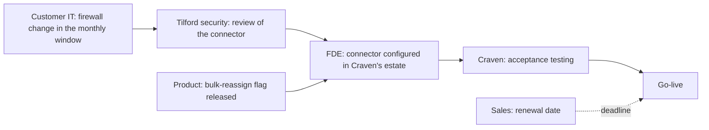

# Capacity and Cross-Team Delivery

## Start with four yeses on a Monday

Hana, a Tilford Software forward deployed engineer, covered two customers, Wenlow Water and Craven Council. On one Monday, four requests arrived: Wenlow's work orders had stopped reaching its field crews at 07:00; Craven's steering group expected a working pilot demonstration on Thursday, a date in the contract; Tilford's platform team wanted help reproducing a connector bug that affected four customers, all with a workaround; and sales wanted a tailored demonstration for a prospect on Wednesday. Hana said yes to all four and worked on whichever was loudest that hour, and nobody heard about the trade-offs. The incident ran into Tuesday, the sales demonstration was rushed, and Craven's sponsor learned at 08:30 on Thursday that the pilot was not ready. Every requester had assumed their work was in progress. Call this **the silent queue**.

> **What you'll learn**
>
> - Rank competing demands by what each day of delay costs.
> - Make your queue and its trade-offs visible to everyone waiting.
> - Run one plan across sales, product, security and customer IT.
> - Set support boundaries, and answer a delay wrongly blamed on engineering.

## Rank by what delay costs

When demands collide, the order they arrived in tells you nothing. Ask what each day of waiting costs, whether the date is fixed, and whether someone else can do the work. Cost of delay is the product-management name for the first question.

| Demand | Cost of each day's delay | Fixed date? | Only you? | Decision |
| --- | --- | --- | --- | --- |
| Wenlow incident | Crews idle, repairs missed | Now | Partly: you know the integration | First, until contained |
| Craven pilot | A contract milestone and the sponsor's trust | Thursday | Yes | Protect the time it needs |
| Platform fix | Low: a workaround exists | No | No: the platform team owns it | Give two hours to reproduce it, then hand back |
| Sales demonstration | One prospect meeting | Usually movable | No: the standard demonstration covers most of it | Hand to a solutions engineer or move the date |

*Table 1: Four demands ranked by cost of delay. The incident comes first because harm grows every hour.*

The switcher compares the Monday as it happened with the same Monday ranked.

The same four requests, handled two ways. Hana has about 30 working hours from Monday to Wednesday.

<button type="button" data-mode="loudest" aria-pressed="false" aria-controls="loudest-result">Loudest first</button>
<button type="button" data-mode="ranked" aria-pressed="false" aria-controls="ranked-result">Ranked and announced</button>

<section id="loudest-result" class="mode-panel" data-announcement="Loudest first selected. The pilot is not ready on Thursday."><h4>Loudest first</h4><ul><li>Time switches between all four. The incident runs into Tuesday.</li><li>The pilot gets about 6 hours against the 16 it needs.</li><li>Nobody is told. Craven finds out on Thursday morning.</li></ul>
All four requesters are let down, and none was asked.
</section>
<section id="ranked-result" class="mode-panel" data-announcement="Ranked selected. Incident contained Monday, pilot ready Thursday."><h4>Ranked and announced</h4><ul><li>Monday: the incident, contained by 14:00, with the platform team on the call.</li><li>Tuesday and Wednesday: 16 hours on the pilot, plus 2 hours to reproduce the platform bug.</li><li>The sales demonstration goes to a solutions engineer, agreed with sales on Monday.</li></ul>
Sales hears no on Monday, with a reason and an alternative. Craven hears nothing alarming.
</section>

Ranking is your call within one engagement. When two customers compete for the same hours, it belongs to your manager. Bring the table and a recommendation, and let them decide. Inside one engagement, more requests than the team can build is a scope negotiation, taught in [negotiating scope and deadlines](/learn/fde-in-the-field/stakeholder-communication/negotiating-scope-and-deadlines).

## Make the queue visible

The silent queue fails because each requester believes they are next. A short message fixes most of it:

- **What I am doing now**, and roughly until when.
- **When your request gets attention**, or that it will not, with an alternative.
- **Who decides if you disagree**, usually your manager or the account lead.

Plan capacity before the week starts, too. A plan that books every hour has no room for an incident. One workable split for an FDE on two engagements is half the week for the one with a near milestone, three-tenths for the other, and a fifth held back for the unplanned. On a 40-hour week that is 20, 12 and 8 hours. When the reserve is used up, the next request is a trade-off to raise, not extra hours to find.

## One plan across sales, product, security and customer IT

A delivery depends on teams that do not report to you and work to different calendars. Sales cares about renewal and deal dates. Product plans by quarter. Tilford's security team reviews in its own queue. The customer's IT team changes networks only in agreed windows. Each team sees its own part and rarely the path between them.

Hold one plan that shows every dependency, its owner and its date. Figure 1 shows the plan for Craven's go-live.

*Figure 1: The dependencies behind Craven's go-live. The firewall window and the security review sit on the critical path, so they get booked first.*

Run it with three habits:

- **One owner per dependency**, named in the plan and agreed with their lead. A responsibility chart such as RACI (responsible, accountable, consulted, informed) helps when ownership is unclear.
- **One short weekly meeting** with a representative of each team, about the next two weeks' dependencies only.
- **A decision log** that records what was agreed and by whom, so a missed date can be traced to a decision and not to a person.

Give each team what it needs to plan: sales gets dates it can promise, security gets the evidence pack early, and customer IT gets change requests before its window closes.

## Support boundaries

During an engagement the FDE often fixes everything, which teaches the customer to call the FDE for everything. Agree the boundary before go-live, and write it into the runbook:

| Issue | First call | Escalates to |
| --- | --- | --- |
| Platform outage or bug | Tilford support desk | Tilford product engineering |
| Integration built for this customer | FDE during the engagement, support after handover | FDE's team |
| Customer network, identity or devices | Customer IT | Customer IT's own suppliers |
| How-to and training | Customer's trained power users | Tilford support desk |

*Table 2: An illustrative support boundary for Craven. Each row has one first call.*

The full support split and the handover checklist are taught in [handover and ownership](/learn/forward-deployed/delivery-stages-and-gates/handover-and-ownership). When a request crosses the line, help the person reach the right team, and say why. The site's [where the role ends](/learn/fde-in-the-field/fde-role-and-boundaries/where-the-role-ends) lesson covers the drift into help-desk work in depth.

## When a security delay is blamed on engineering

Three weeks before Craven's go-live, Craven's director told the steering group that Tilford's engineering was late. The connector had been ready for two weeks. It was waiting on Craven's own security review, submitted five weeks earlier and not yet scheduled.

Arguing in the meeting would have made it a contest. Hana did four things instead:

1. **Wrote a dated timeline**: when the review was requested, what was sent, and what is still waiting and on whom.
2. **Met the security team** to ask what it needed and what was blocking it. It was short of staff that month.
3. **Offered help**: a completed evidence pack and a walkthrough session to shorten the review.
4. **Gave the sponsor options**: ask the security team to prioritise, accept a later date, or start the pilot with test data while the review finishes.

State facts without blame. The security team is doing its job and will review every later release. Keep it on your side. The site's [escalate, pause or stop](/learn/fde-in-the-field/fde-role-and-boundaries/escalate-pause-or-stop) lesson covers raising a blocked dependency. What a security review needs from you is taught in [threat modelling a deployment](/learn/fde-deploying-in-the-estate/security-reviews-and-compliance/threat-modelling-a-deployment).

## Limits of this lesson

- **Cost of delay is an estimate.** Rough numbers are enough to rank. Do not spend a day computing them.
- **Capacity splits vary.** The 50, 30 and 20 split is one example, not a rule.
- **Composite engagement.** Tilford Software, Wenlow Water, Craven Council and their figures are illustrative, not a real customer.

## Interview angle

Each answer is an outline to say in about two minutes. Open each question and try it aloud before reading.

Interview question 1. You support several customer engagements at once. How do you prioritise between them?

- **Answer:** For each demand I ask what a day of delay costs, whether the date is fixed, and whether someone else can do it. Live harm comes first, then contracted dates, then work others can pick up. I plan the week with a reserve for incidents. When two customers compete for the same hours, I bring the options and a recommendation to my manager. Then I tell every requester where they stand.
- **Trade-off:** Ranking means someone hears no or later. Saying yes to all means everyone is let down without warning.
- **Follow-up to expect:** "Both customers say theirs is urgent." Compare what delay costs each, in their terms, and escalate with that.

Interview question 2. Delivery depends on sales, product, security and the customer's IT team. How do you coordinate them?

- **Answer:** One plan showing every dependency with an owner and a date, agreed with each team's lead. I book the slow items on the critical path first, such as security reviews and the customer's change windows. A short weekly meeting covers the next two weeks only, and a decision log records what was agreed. Each team gets what it needs to plan: dates for sales, evidence for security, change requests early for IT.
- **Trade-off:** The plan and meeting take an hour or two a week. Without them, each team discovers the others' delays too late.
- **Follow-up to expect:** "One team will not commit to a date." Record it as a risk and escalate it through the sponsor.

Interview question 3. The customer starts calling you for every problem, including ones that belong to other teams. Where do you draw the support boundary?

- **Answer:** Before go-live I agree a table with the customer and our support desk: platform issues go to support, the integration I built goes to me during the engagement and support after handover, network and identity go to the customer's IT, and how-to questions go to trained power users. It goes in the runbook. When a request crosses the line, I connect them to the right team and say why.
- **Trade-off:** Redirecting feels unhelpful at first. Taking everything makes me the single point of failure when I leave.
- **Follow-up to expect:** "It is urgent and you can fix it in ten minutes." Fix it once, and log it so the owning team learns.

Interview question 4. The customer's director blames your engineering team for a delay that comes from their own security approval. What do you do?

- **Answer:** I do not argue in the meeting. Afterwards I send the sponsor a dated timeline: what was submitted, when, and what is waiting on whom. I meet their security team to learn what it needs, and offer an evidence pack and a walkthrough to speed the review. Then I give the sponsor options: prioritise the review, move the date, or pilot with test data meanwhile.
- **Trade-off:** Staying factual is slower than defending the team on the spot. Blaming security damages a relationship we need for every later release.
- **Follow-up to expect:** "The director repeats it." Share the timeline with them directly, politely, and ask the sponsor to settle it.

## References

1. ProductPlan, [Cost of Delay](https://www.productplan.com/glossary/cost-of-delay/), accessed 17 November 2026. Ranking work by the value lost while it waits.
2. Atlassian, [RACI chart](https://www.atlassian.com/work-management/project-management/raci-chart), accessed 17 November 2026. Responsible, accountable, consulted and informed roles.
3. Google, [Managing incidents](https://sre.google/sre-book/managing-incidents/), in Site Reliability Engineering, accessed 17 November 2026. Clear roles while an incident is live.
4. The site's [where the role ends](/learn/fde-in-the-field/fde-role-and-boundaries/where-the-role-ends) and [escalate, pause or stop](/learn/fde-in-the-field/fde-role-and-boundaries/escalate-pause-or-stop) lessons.

## Key takeaways

- Rank demands by what each day of delay costs, not by arrival or volume.
- Tell every requester where they stand, and who decides if they disagree.
- Hold back part of each week for the unplanned.
- Run one plan with an owner per dependency, and book the slow ones first.
- Agree support boundaries before go-live, and answer misplaced blame with a dated timeline.

## Check yourself

1. Why did the incident come before the contracted pilot milestone?

Its harm was happening now and grew every hour. The pilot's date was three days away, and the time it needed could still be protected.

2. In Figure 1, why book the firewall window and the security review first?

They are on the critical path and run to other teams' calendars, so a late booking moves the go-live date.

3. Why keep the security team on side when its delay was blamed on you?

It reviews every later release. A public contest now makes each future review slower.

