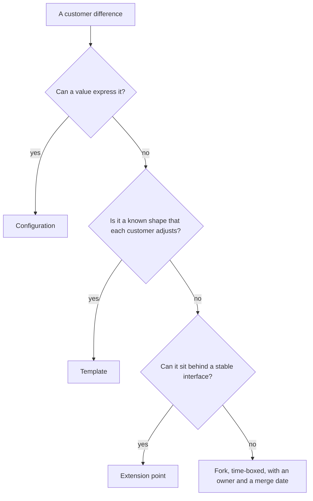

# Configure, Template or Custom

## Start with the fork nobody upgraded

Tilford Software, a fictional workflow-automation vendor, built a connector between its platform and Wenlow Water's asset-management system. Craven Council, a fictional local authority, ran the same asset product, but an older version with 14 extra fields. To meet Craven's date, an FDE copied the connector code into a separate Craven branch and changed the field names in the code.

Five months later, a Tilford platform release changed the interface every connector uses. The main connector was updated and tested against Wenlow. The Craven branch was not in the release pipeline. Nobody tested it. When Craven upgraded, its connector failed without raising an alert. For two days, 640 repair jobs never reached the asset system.

The copy had saved a week. It cost two days of lost data, an apology to Craven's director and a month of rework. Call this **the quiet fork**.

> **What you'll learn**
>
> - Choose between configuration, a template, an extension point and a fork.
> - Build one connector that serves customers whose systems differ.
> - Answer a request for a permanent fork with options.
> - Recover when a shared upgrade breaks one customer, and support a customer who validates slowly.

## Four homes for a difference

Every customer differs from the next. The question is where each difference lives, because that decides who carries it through every upgrade. From cheapest to most expensive:

| Home | What varies per customer | Who carries it through upgrades | Upgrade cost |
| --- | --- | --- | --- |
| Configuration | Values: field names, limits, endpoints, switches | The platform, tested once | Close to none |
| Template | A starting shape copied per customer, then configured | The platform team, with a version per template | Low, if customers stay on a supported version |
| Extension point | Customer code behind a stable, documented interface | Whoever owns the extension, tested against the interface | Medium |
| Fork | A copy of product code | The fork's owner, merging every release by hand | High, and it grows each release |

*Table 1: Four homes for a customer difference. Choose the highest row that can hold it.*

Ask the questions in Figure 1 in order. Stop at the first yes.

*Figure 1: Where a difference should live. A fork is the last answer, never the first.*

The Twelve-Factor App guidance on storing configuration outside the code applies here. So does feature-flag practice, which lets one code base behave differently per customer without copies.

## Connectors and deployment templates across customers

Two connectors to the same product can differ in ways that look small: the product version, custom fields, how it authenticates, its rate limits and the quality of its data. Copying the connector for each one is the quiet fork waiting to happen. Instead, split it in three:

- **A shared core** that handles paging, retries, errors and logging, written once.
- **A per-customer mapping file** that names fields, the product version, the authentication method and limits. Craven's 14 extra fields live here, not in code.
- **Version adapters** selected by configuration, when two product versions need different calls.

Then add a **contract test** per customer: run each customer's mapping against the shared core on every release, with a recorded sample of their data. A release that breaks Craven fails in Tilford's pipeline, not in Craven's estate.

Deployment works the same way. A **deployment template** describes the infrastructure each customer gets: network, sizes, single sign-on provider and region, with those as parameters. Version the template like code. Customers start from a released version and change only parameters. The site's [config, compute and Kubernetes choices](/learn/fde-deploying-in-the-estate/deployment-models-and-environments/config-compute-and-kubernetes-choices) lesson covers configuration per environment in depth.

## A request for a permanent fork

Customers ask for their own branch for understandable reasons: they want to move faster than the roadmap, control what changes, or avoid upgrades that broke them before. A permanent fork gives them that for a few months, then leaves them stranded:

- **Every release needs a manual merge**, and each merge is harder than the last.
- **Security fixes arrive late**, because someone must port them.
- **The customer drifts away from the product** others use, and from the support team's knowledge.

Answer with what they need, not the branch they asked for:

1. **Find the reason.** Speed, control and fear of upgrades each have a different remedy.
2. **Offer the cheaper homes.** Configuration, an extension point or a feature flag often covers the gap.
3. **Offer control over timing.** A pinned version inside a support window lets them upgrade when ready.
4. **If a fork is unavoidable**, make it temporary: an owner, a merge-back date, and a place in the release pipeline so it is tested like everything else.

If the customer needs a separate environment for isolation rather than different code, that is a tenancy question. The site's [tenancy and isolation](/learn/fde-deploying-in-the-estate/deployment-models-and-environments/tenancy-and-isolation) lesson covers it.

## When a shared upgrade breaks one customer

A release can work for every customer but one, because each customer exercises different configuration and data. The response has an order. The walkthrough steps through it for a later release that broke Craven's connector after it had moved onto the shared core.

A Tilford release breaks Craven's connector and no other customer's. Each step shows what to do and why it comes in that order.

<button type="button" data-step="0" aria-pressed="false" aria-controls="upgrade-step-0">1. Contain</button><button type="button" data-step="1" aria-pressed="false" aria-controls="upgrade-step-1">2. Diagnose</button><button type="button" data-step="2" aria-pressed="false" aria-controls="upgrade-step-2">3. Fix</button><button type="button" data-step="3" aria-pressed="false" aria-controls="upgrade-step-3">4. Test</button><button type="button" data-step="4" aria-pressed="false" aria-controls="upgrade-step-4">5. Roll out</button>

<section id="upgrade-step-0" class="step-panel" aria-labelledby="upgrade-heading-0"><h4 id="upgrade-heading-0">1. Contain</h4><dl><dt>Action</dt><dd>Move Craven back to the previous release, or switch off the changed behaviour with its flag, and replay the jobs that failed.</dd><dt>Why first</dt><dd>Stopping the harm comes before finding the cause.</dd></dl></section><section id="upgrade-step-1" class="step-panel" aria-labelledby="upgrade-heading-1"><h4 id="upgrade-heading-1">2. Diagnose</h4><dl><dt>Action</dt><dd>Compare Craven with the customers that worked: configuration, product version, data shape.</dd><dt>Why</dt><dd>The difference is the cause. Here, Craven's older product version returned dates in another format.</dd></dl></section><section id="upgrade-step-2" class="step-panel" aria-labelledby="upgrade-heading-2"><h4 id="upgrade-heading-2">3. Fix in the shared code</h4><dl><dt>Action</dt><dd>Fix the date handling in the version adapter, not in a Craven-only patch.</dd><dt>Why</dt><dd>A one-customer patch starts a new fork.</dd></dl></section><section id="upgrade-step-3" class="step-panel" aria-labelledby="upgrade-heading-3"><h4 id="upgrade-heading-3">4. Add the missing test</h4><dl><dt>Action</dt><dd>Add a sample of Craven's data to its contract test, so the pipeline would have caught this.</dd><dt>Why</dt><dd>The release passed because no test used Craven's version.</dd></dl></section><section id="upgrade-step-4" class="step-panel" aria-labelledby="upgrade-heading-4"><h4 id="upgrade-heading-4">5. Change the rollout</h4><dl><dt>Action</dt><dd>Release in rings: internal, then one low-risk customer, then the rest, watching connector errors at each ring.</dd><dt>Why</dt><dd>The next difference nobody has a test for fails for one customer, not all.</dd></dl></section>

<button type="button" data-walk="previous">Previous</button>

<button type="button" data-walk="next">Next step</button>

The walkthrough is a scripted illustration. Tell the customer what happened, what you changed and when the fixed release reaches them. The site's [roll out changes gradually](/learn/engineering-foundations/cloud-containers-deployment/roll-out-changes-gradually) lesson covers canary releases in depth.

## A customer whose validation lags

Tilford releases every quarter. Craven's change board approves upgrades twice a year, after eight weeks of acceptance testing. Craven runs up to two releases behind. That is a policy question, and it needs an answer before it becomes an incident:

- **Publish a support window.** For example, the current release and the two before it receive fixes. A customer outside the window is warned with dates, months ahead.
- **Make upgrades smaller.** Ship new behaviour behind flags that are off by default, so an upgrade changes less.
- **Shorten their testing.** Send release notes and a test pack early, and offer to run their contract tests in Tilford's pipeline.
- **Mark breaking changes.** Semantic versioning signals an incompatible interface change with a major version, which tells Craven where to look first.

## Limits of this lesson

- **Extension points cost design time.** A stable interface must be designed and kept stable. Build one when a second customer needs it.
- **Support windows are commercial terms.** The FDE proposes them, but contracts and product leadership set them.
- **Fictional data.** Tilford Software, Wenlow Water, Craven Council and their figures are illustrative.

## Interview angle

Each answer is an outline to say in about two minutes. Open each question and try it aloud before reading.

Interview question 1. How do you decide whether a customer difference is configuration, a template or custom code?

- **Answer:** I ask in order and stop at the first yes. Can a value express it? Configuration. Is it a known shape each customer adjusts, such as a deployment? A versioned template. Does it need code that can sit behind a stable interface? An extension point the customer or we own. Only then a fork, time-boxed with an owner. The test is who carries the difference through every upgrade.
- **Trade-off:** Configuration and extension points take design time up front. Custom code is faster now and costs more at every release.
- **Follow-up to expect:** "When is custom code right?" When the need belongs to one customer and is cheap to carry.

Interview question 2. Two customers need connectors to the same product, but their versions and fields differ. How do you build them?

- **Answer:** One shared core for paging, retries, errors and logging. A mapping file per customer for fields, version, authentication and limits. Version adapters chosen by configuration where calls differ. Then a contract test per customer, run on every release with a sample of their data, so a change that breaks one customer fails in our pipeline.
- **Trade-off:** The split takes longer than copying the first connector. Copies diverge, and each upgrade must be repeated per copy.
- **Follow-up to expect:** "A third customer's product is very different." Then it may need its own adapter, still behind the shared core.

Interview question 3. A shared platform upgrade works for every customer except one. What do you do?

- **Answer:** Contain first: roll that customer back or switch the new behaviour off, and replay what failed. Then diagnose by comparing it with customers that worked: configuration, version, data. Fix in the shared code, not a one-customer patch. Add their case to the contract tests. Then release in rings, and the next unseen difference hits one customer. Keep them updated throughout.
- **Trade-off:** Rolling back delays the release's benefits for that customer. Fixing forward under pressure risks a second failure.
- **Follow-up to expect:** "Why did your tests miss it?" No test used their version. That is the gap to close.

Interview question 4. A customer asks for a permanent fork of your product so they can move faster. How do you respond?

- **Answer:** Ask what they need: speed, control over changes, or protection from upgrades. Explain what a fork costs them: manual merges, late security fixes, drifting from the product. Then offer the cheaper homes: configuration, an extension point, a feature flag or a pinned version in a support window. If a fork is still needed, make it temporary, with an owner, a merge date and a place in our release pipeline.
- **Trade-off:** Refusing a fork may slow their roadmap. Granting one creates a cost that grows with every release.
- **Follow-up to expect:** "Sales already promised it." Take it to the account lead with the cost per release, in writing.

## References

1. The Twelve-Factor App, [III. Config](https://12factor.net/config), accessed 17 November 2026. Keeping configuration out of the code.
2. Pete Hodgson on martinfowler.com, [Feature Toggles (aka Feature Flags)](https://martinfowler.com/articles/feature-toggles.html), accessed 17 November 2026. Varying behaviour without branches.
3. Semantic Versioning, [Semantic Versioning 2.0.0](https://semver.org/), accessed 17 November 2026. Major versions for incompatible API changes.
4. Google, [Canarying releases](https://sre.google/workbook/canarying-releases/), in The Site Reliability Workbook, accessed 17 November 2026. Partial, time-limited releases.

## Key takeaways

- Put each difference in the cheapest home: configuration, template, extension point, then fork.
- Build connectors as a shared core, per-customer mapping and contract tests.
- Answer fork requests with the need behind them, and make any fork temporary.
- When an upgrade breaks one customer: contain, diagnose, fix shared code, add the test, release in rings.
- Publish a support window before a slow-validating customer falls behind.

## Check yourself

1. Why did the Craven branch fail without anyone noticing?

It was outside the release pipeline, so no test ran it, and it raised no alert when it stopped sending jobs.

2. Why fix the date handling in the version adapter rather than in a Craven-only patch?

A one-customer patch is the start of a new fork. A fix in shared code protects every customer on that product version.

3. What does a support window give a customer whose validation is slow?

A known period in which their release still receives fixes, and dates for when they must upgrade.

