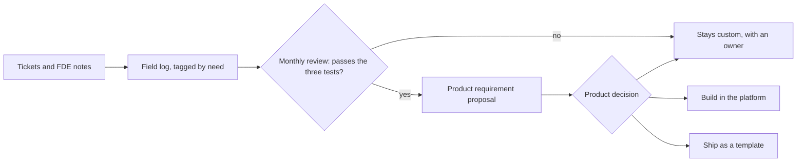

# Reusable Need or One-Off

## Start with the same script written twice

Tilford Software, a fictional workflow-automation vendor, sells a platform that routes work orders to field crews. At Wenlow Water, a fictional utility, supervisors moved work orders one at a time whenever a crew was off sick. That was about 300 moves a week at two minutes each, ten hours of supervisor time.

The Tilford FDE at Wenlow wrote a bulk-reassign script in three days and filed a one-line ticket: "Wenlow wants bulk reassign. Urgent." The product team read it as one customer's preference and closed it.

Two months later, another Tilford FDE wrote nearly the same script for Craven Council's highway repair teams. Support had logged 11 tickets from five customers asking to move many tasks at once. Nobody had connected them. Each field team solved the problem privately, so the product team never saw it. Call this **the invisible pattern**.

> **What you'll learn**
>
> - Separate what a customer asks for from the need behind it.
> - Test whether a need is reusable or one customer's case.
> - Gather evidence a product team will act on.
> - Write a product requirement proposal from recurring complaints.

## The request and the need behind it

Customers ask for solutions: "a bulk-reassign button", "an export to a spreadsheet", "a nightly email of open jobs". Each request hides a need, the job the customer is trying to get done. At Tilford, three of those requests came from the same need: move work quickly when a team is unavailable.

Record both every time you log feedback:

- **The request**, in the customer's words.
- **The need**, in your words: who is trying to do what, and what stops them.
- **The current workaround** and what it costs: hours, errors, a script someone must maintain.

Grouping by need, not by request, is what makes patterns visible. Five customers asking for five different features may share one need. One customer asking loudly for one feature may have a need nobody else shares.

## Three tests for a reusable need

A need is worth taking to product when it passes three tests. None is enough alone.

| Test | Points to one-off | Points to reusable |
| --- | --- | --- |
| Spread | One customer, however loud | Several unrelated customers, counted as customers, not tickets |
| Cause | Comes from that customer's own process or policy | Comes from how the platform works, so others will meet it |
| Cost of staying custom | Cheap to carry, rarely touched | Scripts that break on upgrades, repeated FDE time, deals at risk |

*Table 1: Three tests for a reusable need. Count customers, not tickets, because one customer can file many.*

At Tilford, the reassign need passed all three. Five customers had it. It came from the platform assigning work to one crew at a time. Two scripts already needed retesting at each of Tilford's four platform releases a year.

A need can fail the spread test and still matter. One customer whose renewal depends on it is a commercial question for your account team. Name it that way, and do not dress it up as a pattern.

## Evidence a product team will act on

Product teams weigh many requests against a fixed amount of engineering time. A one-line ticket asks them to trust you. Evidence lets them compare your request with the others. The switcher shows the same need filed two ways.

The same reassign need, as the product team at Tilford would receive it.

<button type="button" data-mode="ticket" aria-pressed="false" aria-controls="ticket-result">One-line ticket</button>
<button type="button" data-mode="proposal" aria-pressed="false" aria-controls="proposal-result">Proposal with evidence</button>

<section id="ticket-result" class="mode-panel" data-announcement="One-line ticket selected. Product closes it as a single-customer request."><h4>One-line ticket</h4><ul><li>"Wenlow wants bulk reassign. Urgent."</li><li>Names one customer and a feature, with no problem, size or cost.</li><li>Product cannot compare it with other work and closes it.</li></ul>
The second script gets written two months later.
</section>
<section id="proposal-result" class="mode-panel" data-announcement="Proposal selected. Product scopes it for next quarter."><h4>Proposal with evidence</h4><ul><li>Need: supervisors move work one order at a time when a crew is unavailable.</li><li>Spread: 11 tickets from five customers in six months, plus two FDE-built scripts.</li><li>Cost: about ten supervisor hours a week at Wenlow, and eight engineer-days a year retesting the two scripts.</li></ul>
Product scopes a bulk action for next quarter and asks the FDEs for test data.
</section>

The engineer-days come from the release count: two scripts, four releases a year and one day of retesting each is eight days.

Strong evidence has these features:

- **Counted customers and tickets**, with the period they cover.
- **The customer's own words**, quoted briefly, kept apart from your interpretation.
- **The workaround and its cost**, in hours, errors or money.
- **The commercial stake**, if any: a renewal, an expansion or a deal blocked by the gap.
- **What you do not know**, such as whether smaller customers have the same need.

Keep a shared field log so evidence accumulates across FDEs. A need noticed by one FDE is an anecdote. The same need tagged by four FDEs over a quarter is a pattern.

## Writing the product requirement proposal

A **product requirement proposal** is a short document that asks the product team to consider a need. It is not a full product requirements document, which product writes once it commits. Keep it to one page. Atlassian's guidance on requirements documents covers the longer form.

| Section | What it holds | Tilford example |
| --- | --- | --- |
| Problem | The need, in one or two sentences | Supervisors cannot move many work orders at once |
| Who has it | Customers, roles, counts and period | Five customers, 11 tickets, six months |
| Evidence | Quotes, workarounds, costs | Ten hours a week at Wenlow, two scripts |
| What good looks like | Testable outcome, not a design | Move 50 orders to another crew in under a minute |
| Out of scope | What you are not asking for | Automatic reassignment by rules |
| Options | What you considered, including staying custom | Template script, platform feature, do nothing |
| The ask | The decision you want and by when | A yes or no for next quarter's planning |

*Table 2: A one-page product requirement proposal. Describe the outcome and leave the design to the product team.*

Figure 1 shows how complaints become a proposal and what the product team can decide.

*Figure 1: From complaints to a product decision. Every path ends with an owner, including "stays custom".*

## When it stays custom

Often the answer is no, or not yet. That is a valid outcome if the custom work is kept honest:

- **Write it down.** Record the decision, the reason and the date to look again.
- **Isolate it.** Keep the custom code outside the core product, behind a documented interface, so upgrades do not break it silently.
- **Name an owner.** Someone at Tilford or the customer maintains it after the FDE moves on.
- **Tell the customer.** Explain what product decided and what they get meanwhile. Do not promise the feature is coming.

The long-term cost of work built for one customer is covered in the site's [judgement under uncertainty](/learn/fde-in-the-field/fde-role-and-boundaries/judgement-under-uncertainty) lesson. This lesson covers the step before it: deciding whether the work belongs to one customer at all.

## Limits of this lesson

- **Three tests are a judgement aid.** They do not replace the product team's own prioritisation, which weighs strategy you may not see.
- **Evidence can be gamed.** Counting tickets rewards customers who file many. Count customers.
- **Fictional data.** Tilford Software, Wenlow Water, Craven Council and their figures are illustrative.

## Interview angle

Each answer is an outline to say in about two minutes. Open each question and try it aloud before reading.

Interview question 1. A customer asks for a feature they say is essential. How do you decide whether it is a reusable need or a one-off?

- **Answer:** First find the need behind the request: who is trying to do what, and what stops them. Then test three things. Spread: do other unrelated customers have the same need, counted as customers? Cause: does it come from how our platform works or from this customer's own process? Cost: what does carrying it as custom work cost us over time? If it passes all three, it goes to product. If not, it stays custom, written down and owned.
- **Trade-off:** Taking every request to product floods the backlog. Taking none hides real patterns.
- **Follow-up to expect:** "Only one customer has it, but they are your largest." That is a commercial decision for the account team, not a pattern.

Interview question 2. You believe a field problem should become product work. What evidence do you bring to the product team?

- **Answer:** The need stated as a problem, not a feature. How many customers have it and over what period. Short quotes in their words, kept separate from my reading. The current workaround and its cost in hours, errors or maintenance. Any commercial stake, such as a renewal. And what I do not know yet. I put it on one page with a clear ask and a date, so product can compare it with everything else.
- **Trade-off:** Gathering evidence takes days. A one-line ticket is quick but is usually closed.
- **Follow-up to expect:** "Product still says no." Accept it, record the reason and keep counting. Bring it back if the evidence grows.

## References

1. Martin Fowler, [Yagni](https://martinfowler.com/bliki/Yagni.html), accessed 17 November 2026. The cost of carrying features built before they are needed.
2. Atlassian, [What is a product requirements document (PRD)?](https://www.atlassian.com/agile/product-management/requirements), accessed 17 November 2026. The longer document product writes after it commits.
3. The site's [judgement under uncertainty](/learn/fde-in-the-field/fde-role-and-boundaries/judgement-under-uncertainty) lesson, for the cost of work built for one customer.
4. The author's own field experience, the basis for the three tests and the one-page proposal.

## Key takeaways

- Record the request, the need behind it and the workaround's cost.
- Group feedback by need, so patterns across customers become visible.
- Test spread, cause and the cost of staying custom before going to product.
- Bring counted customers, quotes and costs, not a one-line ticket.
- Every outcome needs an owner, including "stays custom".

## Check yourself

1. Why did the product team close Wenlow's first ticket?

It named one customer and a feature, with no problem, size or cost. Product could not compare it with other work.

2. Why count customers rather than tickets?

One customer can file many tickets about the same thing. Spread across unrelated customers is what shows a reusable need.

3. A need fails the spread test but one large customer's renewal depends on it. What do you do?

Treat it as a commercial decision and take it to the account team, named plainly as one customer's need.

