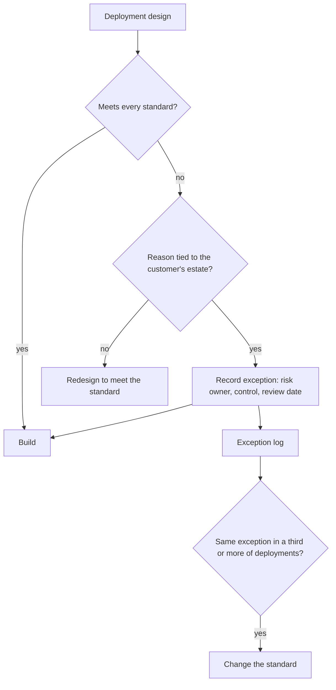

# Beyond One Engagement

## Start with the fix that stayed at one customer

Dunholme Systems, an AI platform company, had nine customer deployments live, each built by a different FDE team. In March, Imran, the FDE lead at Sedbergh Health, a hospital group, found a service account key stored in a plain configuration file. He moved it into the hospital's secrets vault, added a rotation job and closed the ticket. Nobody asked where the pattern came from: an internal starter repository that five of the other eight deployments had copied. In September, a support engineer at Wigton Ports, a port operator, attached that configuration file to a ticket in a shared tracker. The key was valid and had write access to the port's scheduling data, and the incident took two weeks to close and a letter to the port's board. Every team had done good work inside its own engagement, and the fix stayed at the customer where it was found.

Call this **the fix that stayed home**: a problem solved once and left unsolved everywhere else, because nobody's job covered the gap between deployments.

> **What you'll learn**
>
> - Describe what changes between a senior and a staff FDE.
> - Decide which decisions deserve a standard across deployments and which stay local.
> - Grant an exception with a reason, an owner and an expiry, and read the exception rate as a signal.
> - Run a portfolio architecture review that ends in owned actions.

## What changes at staff level

A senior FDE owns one engagement and its outcome. A staff FDE owns problems that span engagements: the patterns every team copies, the risks every deployment shares and the people who will lead the next engagements. The work moves from building one system well to making many systems better without building them yourself.

Will Larson describes four common shapes of staff-plus roles: the tech lead who guides one team, the architect who owns direction in an area, the solver who goes from hotspot to hotspot, and the right hand who extends an executive's reach. A staff FDE is often a blend of architect and solver. You set direction for how deployments are built, and you go where the field is struggling.

| Dimension | Senior FDE | Staff FDE |
|---|---|---|
| Scope | One engagement and its customer | Several deployments, or the FDE practice |
| Main output | A working system and a satisfied sponsor | Standards, shared patterns and people others rely on |
| Time horizon | This engagement's milestones | The next year of deployments |
| Influence | Own team and the customer | Other FDE teams, product and leadership, without authority over them |
| Evidence of impact | The customer outcome | Outcomes that improved across deployments, and engineers who grew |

*Table 1: The same role at two levels. The staff column does not replace delivery skill. It adds a wider scope on top of it.*

> **Key distinction:** Seniority in years or in technical depth is not the staff bar. The bar is scope: problems that cross engagements, solved in a way that lasts after you move on.

## Standards that travel

A **standard** is a short written rule that every deployment follows unless it holds a recorded exception. Too few standards and each team relearns the same lessons at a customer's expense. Too many and FDE teams cannot adapt to estates that differ, which is the reason the role exists.

Standardise a decision when it meets at least one of these tests:

- **A mistake is expensive or hard to undo**, such as how secrets are stored or how customer data leaves the estate.
- **Other teams depend on it**, such as the log format your support desk reads or the upgrade path product ships.
- **It has already gone wrong twice** in different deployments.

Leave a decision local when the customer's estate drives it, such as which ticketing tool to integrate or which cloud region to use.

At Dunholme, the staff FDE proposed four standards after the Wigton incident:

1. **S1:** secrets live in the customer's vault, never in configuration files or code.
2. **S2:** every model call is logged with a request ID and kept for the customer's retention period.
3. **S3:** an evaluation set runs before every release, and the result is kept with the release notes.
4. **S4:** customer-specific behaviour sits behind configuration or an extension point, never in a fork of the product.

Each standard states the rule, why it exists and how to check it. Write the reason down, because a team that understands the reason can spot when an exception is fair.

## Exceptions with a reason

Some estates cannot meet a standard. Wigton Ports runs its scheduling systems on a network with no route to a vault service. Forcing S1 there would block the deployment. Ignoring S1 there silently would repeat the incident.

An **exception** is a recorded, time-limited permission to depart from a standard. Each one names:

- the standard and the deployment;
- the reason, in one or two sentences;
- the risk accepted, and who accepted it (a named person at Dunholme and one at the customer);
- the compensating control, such as an encrypted key file on the host, owned by port IT and rotated monthly;
- a review date, after which the exception lapses unless renewed.

Figure 1 shows the path a design takes.

*Figure 1: The exception path. A recorded exception lets the deployment go ahead, and the log tells you when a standard itself is wrong.*

The log matters as much as each record. At Dunholme, the rule of thumb was that if three of the nine deployments hold the same exception, the staff FDE reviews the standard, not the deployments. A standard most estates cannot meet is a wish, and it teaches teams to ignore standards in general.

> **Pitfall:** Granting exceptions verbally in a design review. Six months later nobody remembers the reason, the control or who accepted the risk, and the exception has become the pattern.

## Running a portfolio architecture review

Standards and exceptions need a place where someone looks across all deployments at once. A **portfolio architecture review** is that place: a regular meeting, quarterly at Dunholme, where each deployment is compared with the standards and with each other.

Andrew Harmel-Law's advice process shapes how the review works. Anyone may make an architecture decision, but they must first seek advice from the people it affects and the people with relevant expertise. The review is where that advice happens at portfolio scale. It does not approve every decision. It finds patterns, shares fixes and records the decisions that cross deployments.

Follow Dunholme's quarterly review of its nine deployments. Each step shows the action, who is involved and what it produces.

<button type="button" data-step="0" aria-pressed="false" aria-controls="por-step-0">1. Collect</button><button type="button" data-step="1" aria-pressed="false" aria-controls="por-step-1">2. Compare</button><button type="button" data-step="2" aria-pressed="false" aria-controls="por-step-2">3. Decide</button><button type="button" data-step="3" aria-pressed="false" aria-controls="por-step-3">4. Follow up</button>

<section id="por-step-0" class="step-panel" aria-labelledby="por-heading-0"><h4 id="por-heading-0">1. Collect one page per deployment</h4><dl><dt>Action</dt><dd>A week before, each team sends a one-page architecture summary, its open exceptions, its incidents this quarter and any decision records it wrote.</dd><dt>Involved</dt><dd>The lead FDE of each deployment.</dd><dt>Produces</dt><dd>Nine comparable summaries instead of nine long presentations.</dd></dl></section><section id="por-step-1" class="step-panel" aria-labelledby="por-heading-1"><h4 id="por-heading-1">2. Compare against the standards</h4><dl><dt>Action</dt><dd>The staff FDE fills a matrix: deployments down the side, standards across the top, each cell marked meets, exception or gap. Incidents are tagged with the standard they touched.</dd><dt>Involved</dt><dd>The staff FDE, with a product engineer and a security engineer as reviewers.</dd><dt>Produces</dt><dd>A view of patterns: which gaps repeat and which exceptions are expiring.</dd></dl></section><section id="por-step-2" class="step-panel" aria-labelledby="por-heading-2"><h4 id="por-heading-2">3. Decide in a two-hour session</h4><dl><dt>Action</dt><dd>Discuss repeated gaps first, then expiring exceptions, then proposed changes to standards. Each lead hears the others' fixes.</dd><dt>Involved</dt><dd>All deployment leads, the reviewers and the FDE manager.</dd><dt>Produces</dt><dd>Findings, each with one owner and a date, and any change to a standard written as a decision record.</dd></dl></section><section id="por-step-3" class="step-panel" aria-labelledby="por-heading-3"><h4 id="por-heading-3">4. Follow up between reviews</h4><dl><dt>Action</dt><dd>Track the findings in the same tracker as delivery work. Start the next review with last quarter's findings and their status.</dd><dt>Involved</dt><dd>The staff FDE and each finding's owner.</dd><dt>Produces</dt><dd>Fixes that reach every deployment, and a record of why each standard changed.</dd></dl></section>

<button type="button" data-walk="previous">Previous</button>

<button type="button" data-walk="next">Next step</button>

Table 2 is part of the matrix from the first review after the incident.

| Deployment | S1 secrets | S2 call logging | S3 release evaluation | S4 no forks |
|---|---|---|---|---|
| Sedbergh Health | Meets | Meets | Meets | Meets |
| Wigton Ports | Exception, review in May | Meets | Gap | Meets |
| Ravenglass Insurance | Gap | Meets | Gap | Exception, review in March |

*Table 2: Three of nine rows. Two deployments skip the release evaluation, which points to a shared cause worth one fix, not two separate reminders.*

Michael Nygard's decision records keep the review honest over time. Writing one for a single engagement is taught in [decision records and design reviews](/learn/forward-deployed/requirements-and-solution-design/decision-records-and-design-reviews); here the same format records a change to a standard. Each changed standard gets a short record of its context, the decision and its consequences, so a new FDE can see why a rule exists before arguing to drop it.

## Limits of this lesson

- **Company shape varies.** Some employers have an architecture group that owns standards. The staff FDE then feeds field evidence into that group rather than running the review alone.
- **Small teams need less.** With three deployments, a shared checklist and a monthly conversation may do the job of a formal review.
- **Composite engagement.** Dunholme Systems, Sedbergh Health, Wigton Ports, Ravenglass Insurance and the incident are illustrative, not a real customer.

## Interview angle

Each answer is an outline to say in about two minutes. Open each question and try it aloud before reading.

Interview question 1. What separates a staff FDE from a strong senior FDE?

- **Answer:** Scope. A senior FDE delivers one engagement and its outcome. A staff FDE owns problems that cross engagements: shared patterns, repeated risks, standards and the growth of other FDEs. The evidence is outcomes that improved across several deployments, and engineers who now lead without them.
- **Trade-off:** Time on cross-deployment work is time away from your own delivery. The staff FDE still delivers, but chooses work by how far its effect spreads.
- **Follow-up to expect:** "Give an example." Describe one fix you turned into a standard and how many deployments it reached.

Interview question 2. How do you set architecture standards across customer deployments without blocking teams whose estates differ?

- **Answer:** Standardise only decisions that are costly to get wrong, that other teams depend on, or that have already failed twice. Write each standard with its reason and a check. Allow exceptions that name the reason, the risk owner, a compensating control and a review date. When a third of deployments hold the same exception, change the standard.
- **Trade-off:** More standards reduce repeated mistakes but slow teams in unusual estates. Fewer standards keep speed but let each team relearn old lessons.
- **Follow-up to expect:** "A team ignores a standard." Ask why first. The answer is either a missing exception or a standard that needs changing.

Interview question 3. You join as a staff FDE with nine live deployments. Walk me through the first architecture review you would run across them.

- **Answer:** Ask each team for a one-page architecture summary, open exceptions, incidents and decision records. Build a matrix of deployments against the standards, marking meets, exception or gap, and tag incidents by standard. In a two-hour session, take repeated gaps first, then expiring exceptions, then proposed changes. Leave with findings that each have one owner and a date, and track them like delivery work.
- **Trade-off:** A quarterly review catches patterns but is slow for urgent risks. Urgent issues go straight to the affected teams, and the review records them afterwards.
- **Follow-up to expect:** "There are no standards yet." Use the first review to find the three gaps that repeat most, and propose those as the first standards.

## References

1. Will Larson, [Staff archetypes](https://staffeng.com/guides/staff-archetypes/), StaffEng, accessed 17 November 2026. The tech lead, architect, solver and right hand shapes of staff-plus roles.
2. Andrew Harmel-Law, [Scaling the practice of architecture, conversationally](https://martinfowler.com/articles/scaling-architecture-conversationally.html), martinfowler.com, accessed 17 November 2026. The advice process: anyone may decide after consulting those affected and those with expertise.
3. Michael Nygard, [Documenting architecture decisions](https://cognitect.com/blog/2011/11/15/documenting-architecture-decisions), Cognitect, accessed 17 November 2026. The context, decision and consequences format for decision records.
4. The author's own field experience, the basis for the standards, the exception record and the review format.

## Key takeaways

- The staff bar is scope: problems that cross engagements, solved so the fix lasts after you move on.
- Standardise decisions that are costly to get wrong, that others depend on or that have failed twice.
- Every exception names a reason, a risk owner, a compensating control and a review date.
- A third of deployments holding the same exception means the standard needs to change.
- A portfolio review compares deployments against standards and ends in owned, tracked findings.

## Check yourself

1. Why did the Sedbergh fix not prevent the Wigton incident?

The fix stayed inside one engagement. Nobody traced the pattern to the starter repository or checked the other deployments, because no role or meeting covered the space between them.

2. What does a high exception rate for one standard tell you?

That the standard may be wrong for the estates you serve. Review the standard itself before pushing more teams to comply.

3. Why does the review not approve every architecture decision?

Approving everything would make the review a bottleneck and slow every deployment. Under the advice process, teams decide after seeking advice. The review looks for patterns across deployments and records decisions that cross them.

