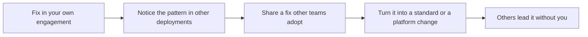

# Career Growth from FDE to Staff

## Start with the promotion case that described four good projects

Tom was a senior FDE at Dunholme Systems, a fictional AI platform company. In two years he led four engagements, including Sedbergh Health and Wigton Ports, both fictional. Every sponsor renewed. Two asked for him again by name. His manager put him forward for staff.

The committee turned the case down. The feedback was short: "Strong delivery. All the impact we can find sits inside engagements Tom led. We could not find evidence of scope beyond them."

Tom had done more than that. He had written the release rollback checklist other teams copied, and he had spent a month helping a struggling team at a third customer. None of it was in the case, because none of it was written down, and nobody on the committee had seen it.

Call this **the excellent-delivery plateau**: a record of strong engagements that proves you are a very good senior FDE, and nothing more.

> **What you'll learn**
>
> - Describe what a staff promotion case has to show.
> - Choose work with staff scope instead of work that only looks busy.
> - Keep evidence of impact as you go, in a form others can check.
> - Tell a mentor from a sponsor, and why you need both.

## What a staff case has to show

The [beyond one engagement](/learn/fde-in-the-field/staff-fde-leadership/beyond-one-engagement) lesson sets out the staff bar: problems that cross engagements, solved so the fix lasts. A promotion committee looks for evidence of that bar, usually from people who were not in the room when the work happened. It needs to see:

- **Scope.** Work whose effect reached several deployments, teams or the product.
- **Durable impact.** Changes that kept working after you moved on: a standard, a platform capability, a process.
- **Influence without authority.** Other teams, product or leadership changed course because of your evidence.
- **Others' growth.** Engineers who now lead work you once did.

Figure 1 shows how one piece of field work grows into staff-scope impact.

*Figure 1: The path from senior to staff scope. Tom stopped after the third box, and never wrote down that he had reached it.*

> **Key distinction:** Staff is not a reward for years or for a run of good engagements. It is a description of the scope you already work at, with evidence.

## Choosing work with staff scope

Will Larson warns against two traps when choosing work. **Snacking** is easy, low-impact work that feels productive. **Preening** is visible work that looks good but changes little. FDEs fall into a third: taking one more engagement because the customer is happy and asked for you.

Better sources of staff-scope work are close at hand:

- **The field gap log.** A gap three deployments share is a candidate for a [platform proposal](/learn/fde-in-the-field/staff-fde-leadership/platform-investment-from-field-evidence).
- **Portfolio review findings.** A repeated gap across deployments needs an owner.
- **The bottleneck you can remove.** Delegating a first engagement or opening a [one-door team](/learn/fde-in-the-field/staff-fde-leadership/growing-other-fdes) is staff work.
- **Incidents.** An incident that could happen in other deployments is a standard waiting to be written.

| Work | Looks busy | Staff scope |
|---|---|---|
| Another engagement for a happy customer | Yes | Only if it tests a pattern for others |
| Answering every team's questions on chat | Yes | No, until the answers become a written standard |
| Fixing the permission gap once, in the platform | No, at first | Yes |
| Growing the next engagement lead | No | Yes |

*Table 1: The same quarter spent four ways. Work that looks busy is often work only you could do, which is the opposite of scope.*

Agree the choice with your manager. Say what you will step back from to make room, so the trade is visible.

## Writing the evidence down as you go

Committees read documents, not memories. Keep an **impact log**: a short entry each time your work changes something beyond your own engagement. Each entry names what you did, who or what changed, the numbers and someone who can confirm it.

Larson's advice is to put your promotion packet together long before you are nominated, and use it to focus your work and your conversations with your manager. Written early, it shows the gaps in your evidence while there is still time to close them. The impact log feeds that packet.

Tom's second attempt covered the same twelve months. Compare two ways of writing the same quarter.

<button type="button" data-mode="tasks" aria-pressed="false" aria-controls="tasks-result">Task list</button>
<button type="button" data-mode="impact" aria-pressed="false" aria-controls="impact-result">Impact evidence</button>

<section id="tasks-result" class="mode-panel" data-announcement="Task list selected. Activity without scope."><h4>Task list</h4><ul><li>Led the Wigton Ports deployment.</li><li>Wrote a rollback checklist.</li><li>Helped the Ravenglass Insurance team.</li><li>Ran some onboarding sessions.</li></ul>
A reader sees a busy engineer. Nothing shows reach beyond one engagement or who it changed.
</section>
<section id="impact-result" class="mode-panel" data-announcement="Impact evidence selected. Scope with numbers and confirmers."><h4>Impact evidence</h4><ul><li>Wrote the release rollback checklist after a failed Wigton release. Five of nine deployments adopted it, and it became Dunholme standard S5. Confirmer: the FDE manager.</li><li>Spent four weeks with the Ravenglass team after a missed milestone. Their next two milestones landed on time, and their lead now runs the weekly risk review. Confirmer: the Ravenglass lead.</li><li>Ran onboarding sessions on past incidents for three new FDEs. All three joined the on-call rota within six weeks. Confirmer: their manager.</li></ul>
The same work, written as scope, durable change and others' growth, each with someone to ask.
</section>

The second write-up does not inflate anything. It records the effect of work Tom had already done, and it names people a committee can ask. Tom's second case passed.

## Mentors and sponsors

A **mentor** advises you: how to approach a problem, what the bar looks like, how to read a situation. A **sponsor** speaks for you in rooms you are not in: the calibration meeting, the planning session, the conversation about who leads the next hard engagement. Larson's guidance on getting the title where you already work includes activating your internal sponsors.

Sponsors come from people who have seen your work at scope. Your manager is the first. A product leader who accepted your platform proposal, or a sponsor at a customer who saw you fix a problem other teams had caused, can be stronger, because their view is independent.

Make it easy for them. Share your impact log with your manager each quarter. Tell a likely sponsor what you are aiming for and ask what evidence they would need to argue for you.

## Other paths from senior FDE

Staff FDE is one path, not the only one. Some senior FDEs move into product engineering, carrying field evidence into the roadmap. Some become engineering managers of FDE teams, where growing people is the whole job. Some take a solutions or field architecture role with less delivery and more design across customers. Each uses the same skills in a different mix. Choose by the work you want to do most days, not by title.

## Limits of this lesson

- **Ladders differ.** Some companies have no staff FDE level, or define it differently. Read your company's ladder and ask your manager how it is applied.
- **Evidence is necessary, not sufficient.** Budget and team needs affect promotions. A strong case can still wait a cycle.
- **Fictional data.** Dunholme Systems, Tom, the customers and the figures are illustrative.

## Interview angle

These questions often come up when you interview for a senior or staff FDE role. Open each one and try it aloud before reading.

Interview question 1. Tell me about work you did that reached beyond your own project.

- **Answer:** Pick one example from your impact log. Name the pattern you noticed across teams, what you built or wrote, how many deployments or teams adopted it and what changed, with a number. Say who else was involved and what happened after you moved on. Build the story with the [story bank](/practice/story-bank).
- **Trade-off:** A wide example shows scope but can sound like you took credit for others' work. Name the people who made it work.
- **Follow-up to expect:** "How did you get other teams to adopt it?" Describe the evidence you showed and who you asked first.

Interview question 2. Where do you want to be in three years, and how does this role get you there?

- **Answer:** Name the scope you want, not only a title: leading direction across several deployments, growing other FDEs and feeding the product. Then connect it to the role: the customers, the size of the team and the problems they mentioned. Mention one thing you are working on now that builds toward it.
- **Trade-off:** A precise answer shows intent but can sound like you plan to leave the role quickly. Frame growth as doing this job at a wider scope.
- **Follow-up to expect:** "What are you weakest at for that level?" Name one real gap and what you are doing about it.

## References

1. Will Larson, [Work on what matters](https://staffeng.com/guides/work-on-what-matters/), StaffEng, accessed 17 November 2026. Snacking and preening as traps when choosing work.
2. Will Larson, [Promotion packets](https://staffeng.com/guides/promo-packets/), StaffEng, accessed 17 November 2026. Writing the packet long before nomination and using it to focus your work.
3. Will Larson, [Getting the title where you are](https://staffeng.com/guides/getting-the-title-where-you-are/), StaffEng, accessed 17 November 2026. Internal sponsors and progression at your current company.
4. The author's own field experience, the basis for the impact log and the paths from senior FDE.

## Key takeaways

- Strong delivery proves you are a strong senior. Staff needs evidence of scope beyond your engagements.
- A staff case shows scope, durable impact, influence without authority and others' growth.
- Choose work from the gap log, review findings, bottlenecks and incidents, and avoid work that only looks busy.
- Keep an impact log with numbers and confirmers, and write the promotion packet early as a plan.
- A mentor advises you. A sponsor argues for you where you are not present.

## Check yourself

1. Why did Tom's first case fail when his work had reached other teams?

The work beyond his engagements was not written down, and the committee had not seen it. The case described four good projects, which is evidence of senior scope only.

2. Why can answering every team's questions be the opposite of staff scope?

It keeps knowledge with you and makes others depend on you. Staff scope means turning those answers into standards or tools others use without you.

3. What makes a sponsor's support stronger than a mentor's advice in a promotion?

A sponsor speaks for you in the meetings where the decision is made, using what they saw of your work. A mentor helps you prepare but is usually not in those rooms.

