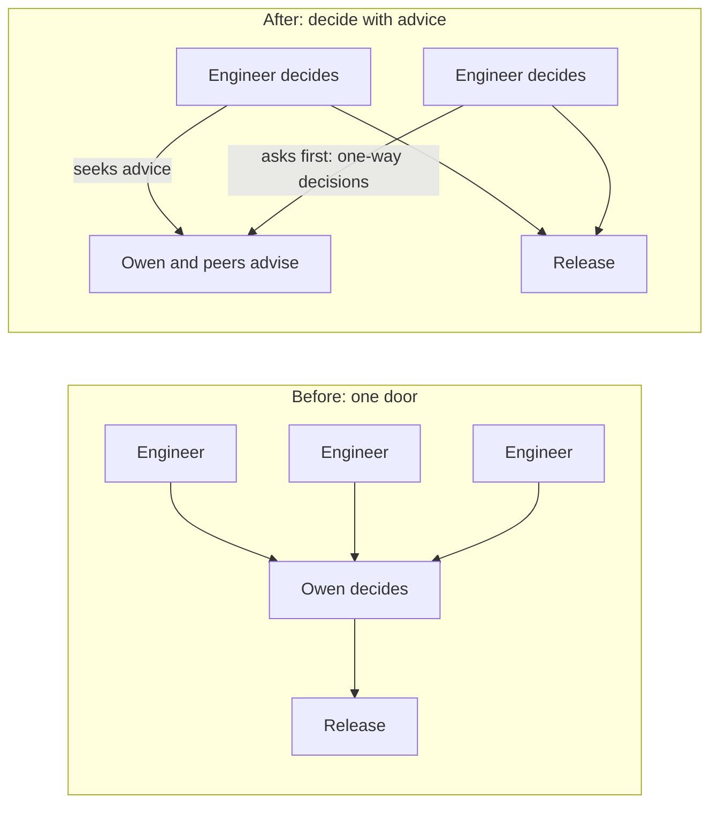

# Growing Other FDEs

## Start with the release that waited for one person

Owen was the strongest senior FDE at Dunholme Systems, an AI platform company, and led the engineering on three deployments: Sedbergh Health, Wigton Ports and Ravenglass Insurance. Customers asked for him by name. He reviewed every pull request on all three and made every design call, so his team of seven asked Owen whenever a question came up. Review requests waited an average of three working days, and Owen answered messages late at night and at weekends. In July he took two weeks of leave, and a Wigton Ports release stopped on a question about how many times to retry a failed call to the port's berth system. Two engineers on the team knew enough to decide, and neither felt they were allowed to. The release waited six working days, and the port's operations manager asked Dunholme's account lead whether the team was understaffed.

Call this **the one-door team**: every decision passes through one person's door, so the team moves at the speed of that person's calendar.

> **What you'll learn**
>
> - Recognise the signs that a senior engineer has become a bottleneck, and fix the system that made them one.
> - Delegate a first engagement with written decision rights and planned check-ins.
> - Mentor in a way that builds judgement, not dependence.
> - Connect growing people with the rest of the staff role.

## How a strong engineer becomes the bottleneck

Bottlenecks usually start with competence. Owen was right more often than others. People asked him first. Each answer saved a little time that day. Over a year, the team stopped making decisions, and Owen stopped noticing that he made all of them.

Watch for these signals:

- **Work waits in one person's queue.** Reviews, design questions or customer replies sit until one name is free.
- **People ask permission, not advice.** "Can I do X?" instead of "I plan to do X because Y. Any concerns?"
- **One person is the only one who can explain a system** to the customer or to support.
- **Hero hours.** The person works evenings to keep up, and the team treats that as normal.
- **Absence stops delivery.** Leave, illness or a sales trip pauses a deployment.

Figure 1 shows the shape of the problem and the shape of the fix.

*Figure 1: The same team before and after. Owen still advises, and still decides the few one-way decisions, but routine decisions no longer wait for him.*

> **Key distinction:** A bottleneck is a property of the system, not a character flaw. Owen did nothing wrong on any single day. The team never agreed who could decide what without him.

## Opening the door

As the staff FDE, your job is to fix the system with Owen, not to criticise him. He is also the person who loses the most from the current setup: he cannot take leave, cannot grow into wider work and burns out first.

1. **Name it with data.** Show Owen the review wait times and the six-day stall. Agree the goal together: releases that do not depend on one person.
2. **Write his judgement down.** Most of Owen's decisions follow patterns. Ask him to write the five he makes most often as short checklists, such as the retry policy, the default timeout and when to page the customer.
3. **Agree decision rights.** Use three levels: decide alone, decide and tell within a day, and ask first. Only decisions that are hard to undo stay in "ask first".
4. **Spread the reviews.** Rotate pull-request review across the team, with Owen reviewing a sample and the riskiest changes.
5. **Measure the change.** Track review wait time and how many decisions were made without Owen.

At Dunholme, review wait time fell from three days to under one within six weeks. Owen moved to the work that needed him most: the design of a shared connector two of the deployments needed.

## Delegating a first engagement

Delegation is how a staff FDE grows the next engagement lead. Leah, a Dunholme FDE with two years in the field, had never led an engagement. The next customer was a second Sedbergh Health site that needed the same referral-triage assistant as the first, adapted to its own scheduling system. A known pattern, a patient sponsor and a working reference made it a good first lead.

Choose a first engagement with these features: a pattern the company has delivered before, a sponsor who values steady progress, and failures that can be recovered from. Do not hand someone their first lead on the riskiest customer of the year.

Delegate the outcome, not the tasks. "The second site triages referrals with the same accuracy as the first by the end of week eight" lets Leah plan. A task list makes her your assistant.

| Decision | Leah decides alone | Leah decides and tells within a day | Leah asks first |
|---|---|---|---|
| Sprint plan and task split | Yes | | |
| Field mappings to the site's scheduling system | | Yes | |
| Scope change the sponsor requests | | | Yes |
| Exception to a Dunholme standard | | | Yes |
| What to tell the sponsor in the weekly update | Yes | | |

*Table 1: Leah's decision rights for the engagement. The "ask first" column holds only decisions that are expensive to undo or that commit the company.*

Follow the eight weeks of Leah's first engagement. Each step shows what the staff FDE does, what Leah does and what it protects.

<button type="button" data-step="0" aria-pressed="false" aria-controls="del-step-0">1. Before kickoff</button><button type="button" data-step="1" aria-pressed="false" aria-controls="del-step-1">2. Weeks 1 to 2</button><button type="button" data-step="2" aria-pressed="false" aria-controls="del-step-2">3. Weeks 3 to 7</button><button type="button" data-step="3" aria-pressed="false" aria-controls="del-step-3">4. Week 8</button>

<section id="del-step-0" class="step-panel" aria-labelledby="del-heading-0"><h4 id="del-heading-0">1. Before kickoff</h4><dl><dt>Staff FDE</dt><dd>Agrees the outcome, the decision rights table and two risks to watch. Tells the sponsor that Leah leads.</dd><dt>Leah</dt><dd>Writes her own plan and presents it. The staff FDE asks questions instead of rewriting it.</dd><dt>Protects</dt><dd>Leah's authority with the customer from day one.</dd></dl></section><section id="del-step-1" class="step-panel" aria-labelledby="del-heading-1"><h4 id="del-heading-1">2. Weeks 1 to 2: lead in the room</h4><dl><dt>Staff FDE</dt><dd>Attends discovery sessions but speaks only when asked. Debriefs for 20 minutes after each one.</dd><dt>Leah</dt><dd>Runs every customer meeting and owns the notes and decisions.</dd><dt>Protects</dt><dd>The customer learns to go to Leah, not to the more senior person in the room.</dd></dl></section><section id="del-step-2" class="step-panel" aria-labelledby="del-heading-2"><h4 id="del-heading-2">3. Weeks 3 to 7: weekly check-in</h4><dl><dt>Staff FDE</dt><dd>Holds a 30-minute weekly check-in on risks, decisions made and what Leah is unsure about. Steps in only for an "ask first" decision or a risk to the customer.</dd><dt>Leah</dt><dd>Brings decisions she made and why. Makes small, recoverable mistakes and fixes them.</dd><dt>Protects</dt><dd>Room to learn without risk to the outcome.</dd></dl></section><section id="del-step-3" class="step-panel" aria-labelledby="del-heading-3"><h4 id="del-heading-3">4. Week 8: review together</h4><dl><dt>Staff FDE</dt><dd>Runs a short retrospective with Leah: what went well, what she would change and what she wants to lead next.</dd><dt>Leah</dt><dd>Writes the handover, using the checklist in <a href="/learn/forward-deployed/delivery-stages-and-gates/handover-and-ownership">handover and ownership</a>, and presents the result to the sponsor herself.</dd><dt>Protects</dt><dd>Credit goes to the person who did the work, and the next delegation can be larger.</dd></dl></section>

<button type="button" data-walk="previous">Previous</button>

<button type="button" data-walk="next">Next step</button>

> **Pitfall:** Taking the work back at the first wobble. If Leah's sprint slips by two days and you step in, she learns that her decisions are provisional, and so does the customer.

## Mentoring for judgement

Mentoring is the slower, wider version of delegation. Its aim is engineers who make good decisions when you are not there.

- **Ask before you tell.** "What options did you consider?" teaches more than the answer.
- **Review reasoning, not only output.** Ask mentees to write short decision records. Comment on the reasoning, even when the decision is right.
- **Let them own a hard part.** Pair on the difficult piece, with the mentee at the keyboard.
- **Give them a learning path.** Google's SRE book describes onboarding new engineers with a structured path, practice on past failures and reverse engineering systems from first principles. The same applies to new FDEs: walk through past incidents and decisions from earlier deployments.

Growing people connects to the rest of the staff role. Owen's written checklists became candidates for Dunholme standards. Leah's handover showed a gap in the scheduling connector that three deployments had hit, which became field evidence for a platform proposal. The [platform investment](/learn/fde-in-the-field/staff-fde-leadership/platform-investment-from-field-evidence) lesson picks up that thread.

## Limits of this lesson

- **You may not be their manager.** A staff FDE often mentors without line authority. Agree with the engineer's manager what you are working on together.
- **Some decisions belong to one person.** On a fragile, high-stakes engagement, it can be right to keep decisions with the most experienced engineer for a period. Make that a choice with an end date, not a habit.
- **Composite engagement.** Dunholme Systems, its engineers, its customers and the figures are illustrative, not a real customer.

## Interview angle

Each answer is an outline to say in about two minutes. Open each question and try it aloud before reading.

Interview question 1. How does a staff FDE multiply their impact through other people and through the product?

- **Answer:** Three ways. Delegate engagements with clear decision rights so others learn to lead. Mentor for judgement by asking before telling and reviewing reasoning. Turn what the field learns into shared standards and platform work, so the next team starts further ahead. Each one makes outcomes depend less on you.
- **Trade-off:** Delegating and mentoring are slower in the short term than doing the work yourself. The return comes over quarters, not weeks.
- **Follow-up to expect:** "How do you know it worked?" Engagements led by people you grew, and fewer decisions waiting on you.

Interview question 2. A senior engineer on your team reviews every change and makes every design call. Releases stall when they are away. What do you do?

- **Answer:** Treat it as a system problem. Show them the data, such as review wait times and stalled releases, and agree a shared goal. Have them write their common decisions as checklists, agree three levels of decision rights, rotate reviews with them sampling the risky ones, and measure wait times. Give them wider work that needs their depth.
- **Trade-off:** Quality may dip at first while others learn. Keep them on the one-way decisions until the team's record earns more trust.
- **Follow-up to expect:** "They resist." Ask what they fear will go wrong, and make that a check in the checklist.

Interview question 3. You are handing a colleague their first engagement to lead. How do you set it up?

- **Answer:** Pick an engagement with a known pattern, a patient sponsor and recoverable failures. Delegate the outcome, not tasks. Write decision rights: decide alone, decide and tell, ask first. Tell the sponsor they lead. Attend early meetings silently, then hold a weekly check-in. Step in only for "ask first" decisions or real risk. End with a joint retrospective, and let them present the result.
- **Trade-off:** Staying close protects the customer but can undermine their authority. Stay close in private and quiet in the room.
- **Follow-up to expect:** "They are about to make a mistake." If it is recoverable, ask a question that points at it and let them decide.

## References

1. Google, [Accelerating SREs to on-call and beyond](https://sre.google/sre-book/accelerating-sre-on-call/), *Site Reliability Engineering*, accessed 17 November 2026. Structured learning paths, practice on past failures and reverse engineering from first principles.
2. Andrew Harmel-Law, [Scaling the practice of architecture, conversationally](https://martinfowler.com/articles/scaling-architecture-conversationally.html), martinfowler.com, accessed 17 November 2026. Deciding after seeking advice, which replaces the one-door pattern.
3. The site's [beyond one engagement](/learn/fde-in-the-field/staff-fde-leadership/beyond-one-engagement) lesson, for turning written checklists into standards.
4. The author's own field experience, the basis for the decision rights table and the delegation plan.

## Key takeaways

- A bottleneck is a property of the team's system, usually built from one person's competence.
- Fix it with data, written checklists, three levels of decision rights and rotated reviews.
- Delegate a first engagement on a known pattern, and delegate the outcome rather than tasks.
- Stay close in private and quiet in the customer's room.
- Mentor by asking before telling and by reviewing reasoning. The goal is people who decide well without you.

## Check yourself

1. Why did the Wigton release wait six days when two engineers could have decided?

Nobody had agreed who could decide what without Owen. The engineers had the knowledge but not the permission. The decision waited for his return.

2. Why delegate an outcome rather than a list of tasks?

An outcome lets the person plan and make decisions, which is the skill they need to lead. A task list keeps the planning with you and teaches them to follow.

3. Which decisions belong in the "ask first" column?

Decisions that are expensive to undo or that commit the company, such as a scope change or an exception to a standard. Everything else should be decided closer to the work.

