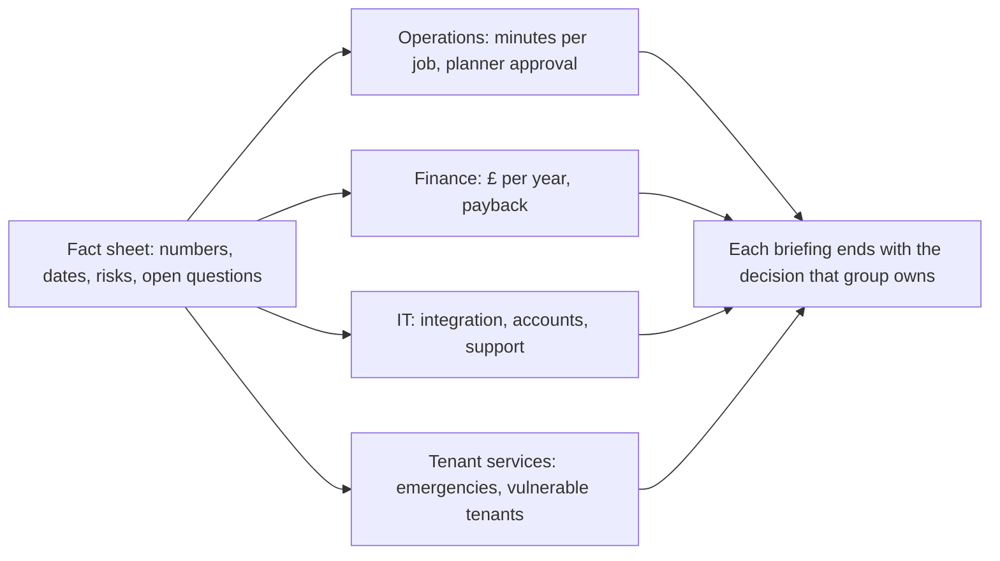

# One Design, Three Audiences

## Start with the deck everyone sat through

Saltcote Housing, a fictional housing association with 14,000 homes, asked an FDE team for a repairs triage assistant. Tenants report repairs by phone, email and an online portal. The assistant reads each report, suggests the trade, the priority and the contractor, and drafts a job for a repairs planner to approve.

After four weeks the FDE lead presented to the steering group: the director of finance, the head of repairs operations, the IT manager and the head of tenant services. She used one 30-slide deck for all four. The finance director asked what the assistant would cost each year, which no slide said. The head of tenant services asked what happens when the assistant misses an emergency, and the answer was a confidence threshold on slide 27. The IT manager had stopped listening by slide 10, because the first slides described the planners' screens. The group deferred the decision by a month.

Call this **the everyone deck**: one presentation built for all audiences, which answers nobody's question first.

> **What you'll learn**
>
> - Name the decision each stakeholder group owns and the units it thinks in.
> - Keep one set of facts and build each briefing from it.
> - Choose how much depth each audience needs and what to lead with.
> - Present one solution to four groups so each can say yes.

## Each audience owns a different decision

People listen for the part of a design that affects their own decision. A finance director decides whether the spend is justified. An engineer decides whether the system can be built, secured and run. The people who will use it decide, in practice, whether to trust it. If a briefing does not answer the listener's decision early, they stop listening or they ask for another meeting.

Table 1 maps Saltcote's four groups.

| Group | The decision they own | Units they think in | What worries them |
| --- | --- | --- | --- |
| Repairs operations | Whether planners change how they work | Minutes per job, backlog, first-time fix | Planners overruled by a tool they distrust |
| Finance | Whether the cost is justified | Pounds per year, payback, contractor spend | Running costs that grow without a ceiling |
| IT | Whether it can be integrated and supported | Systems, accounts, data flows, support hours | A new system nobody in IT can maintain |
| Tenant services | Whether tenants are treated safely and fairly | Complaints, response times, vulnerable tenants | An emergency or a vulnerable tenant missed |

*Table 1: Four stakeholder groups at Saltcote. The same assistant means a different decision to each.*

The classic three audiences, an executive, an engineer and an end user, are a shorthand for the same idea. An executive owns the money and the risk. An engineer owns feasibility and operation. An end user owns adoption. Most customers have more than three groups, and each still fits one of these roles.

> **Key distinction:** Tailoring a message changes the order, depth and units. It never changes the facts. If two groups would hear different numbers, the message is broken.

## One fact sheet, many briefings

Before writing any slides, write a **fact sheet**: one page holding the numbers, dates, risks and open questions that every briefing will draw from. At Saltcote it held these facts:

- Saltcote receives about 3,000 repair reports a month. Planners spend about 6 minutes triaging each, 300 hours a month.
- In a test on 600 past reports, the assistant suggested the right trade for 92 in 100.
- With the assistant, a planner checks each draft in about 2 minutes, 100 hours a month. The 8 in 100 wrong drafts, about 240 a month, take 4 more minutes each, 16 hours. Planner time falls from 300 to 116 hours, a saving of 184 hours a month.
- Running cost is about £2,400 a month for hosting and model usage.
- Every report that mentions gas, water leaks, electrics or no heating goes straight to a planner as an emergency, whatever the assistant suggests.

Figure 1 shows how each briefing draws on the same sheet.

*Figure 1: One fact sheet feeds every briefing. When a number changes, it changes once, and every group hears the same figure.*

The fact sheet also protects you. When the finance director quotes "92 per cent" back to the head of tenant services, both heard it from the same page, with the same caveat about the 8 in 100.

## Translate into their units

The same fact reads differently in each group's units. Take the 92 in 100 result:

- **Operations:** "About 8 jobs in 100 need a planner to change the trade. Today the planner keys every job by hand."
- **Finance:** "Planner time falls by about 184 hours a month. At £25 an hour that is about £4,600 a month, against £2,400 running cost."
- **IT:** "Measured on 600 labelled past reports. We re-run the test every month and alert if the result drops below 88 in 100."
- **Tenant services:** "The 8 in 100 are caught by the planner who approves every job. Emergency words bypass the assistant entirely."

Each line is true and comes from the fact sheet. None of them repeats the model's architecture, because only IT asked about how it works. Lead with the answer to their decision, then give the next layer only if asked. This is the inverted pyramid that news writers use: the most important point first, detail after, so a reader who stops early still has the main point.

> **Pitfall:** Using one group's units to persuade another. Telling tenant services about £4,600 a month saved sounds like money matters more than tenants. Answer the question they own.

## Four briefings in order

The order of briefings matters too. Saltcote's FDE lead reran the steering meeting as four short briefings before a joint decision meeting. The walkthrough shows the order she chose and why.

Saltcote's four briefings, in the order the FDE lead held them. Each step shows what the group decides, what she led with and what she kept for questions.

<button type="button" data-step="0" aria-pressed="false" aria-controls="brief-step-0">1. IT</button><button type="button" data-step="1" aria-pressed="false" aria-controls="brief-step-1">2. Tenant services</button><button type="button" data-step="2" aria-pressed="false" aria-controls="brief-step-2">3. Operations</button><button type="button" data-step="3" aria-pressed="false" aria-controls="brief-step-3">4. Finance</button>

<section id="brief-step-0" class="step-panel" aria-labelledby="brief-heading-0"><h4 id="brief-heading-0">1. IT first: can it be run?</h4><dl><dt>Decides</dt><dd>Whether the integration and support model are acceptable.</dd><dt>Led with</dt><dd>One data flow from the portal to the housing management system, sign-in through Saltcote's existing accounts, and who supports what.</dd><dt>Kept for questions</dt><dd>Model choice and the monthly accuracy test.</dd></dl></section><section id="brief-step-1" class="step-panel" aria-labelledby="brief-heading-1"><h4 id="brief-heading-1">2. Tenant services: is it safe?</h4><dl><dt>Decides</dt><dd>Whether the safeguards protect tenants.</dd><dt>Led with</dt><dd>Emergency words always reach a planner, every job is approved by a person, and tenants flagged as vulnerable are never handled by the assistant alone.</dd><dt>Kept for questions</dt><dd>The 600-report test and how the 8 in 100 errors were sampled.</dd></dl></section><section id="brief-step-2" class="step-panel" aria-labelledby="brief-heading-2"><h4 id="brief-heading-2">3. Operations: will planners use it?</h4><dl><dt>Decides</dt><dd>Whether planners change how they triage.</dd><dt>Led with</dt><dd>About 2 minutes to check a draft instead of 6 to key a job, and planners keep the final say.</dd><dt>Kept for questions</dt><dd>How corrections feed the monthly test.</dd></dl></section><section id="brief-step-3" class="step-panel" aria-labelledby="brief-heading-3"><h4 id="brief-heading-3">4. Finance: is it worth it?</h4><dl><dt>Decides</dt><dd>Whether to fund the next phase.</dd><dt>Led with</dt><dd>About £4,600 a month of planner time against £2,400 running cost, and a ceiling on model spend.</dd><dt>Kept for questions</dt><dd>The cost per report and what changes if volume doubles.</dd></dl></section>

<button type="button" data-walk="previous">Previous</button>

<button type="button" data-walk="next">Next step</button>

The order follows dependency. IT's answer decides whether the design is possible, and tenant services' answer decides whether it is acceptable. Finance went last because it needed both answers before the money question meant anything. In the joint meeting, each lead could say what their group had already agreed, and the decision took twenty minutes.

## When the groups disagree

Separate briefings surface conflicts early. At Saltcote, operations wanted routine jobs booked automatically once the assistant was confident, to save the 2-minute check. Tenant services wanted a person to approve every job for the first three months. Both positions came from the same fact sheet, so the disagreement was about risk, not about the facts.

Do not settle it by telling each group what it wants to hear. Bring both views, with their costs, to the person who owns the decision, usually the sponsor. The method for tracing each requirement to its reason is taught in [stakeholder and workflow maps](/learn/forward-deployed/customer-discovery/stakeholder-and-workflow-maps). For a single design decision explained to sponsors, engineers and operations, the [decision records and design reviews](/learn/forward-deployed/requirements-and-solution-design/decision-records-and-design-reviews) lesson shows the record that holds all three views.

## Limits of this lesson

- **Groups overlap.** A small customer may have one person who is both IT and operations. Brief the decisions, not the job titles.
- **Separate briefings take time.** Four 30-minute meetings cost more calendar time than one long one. Use them when a group can block the decision.
- **Fictional data.** Saltcote Housing, its volumes, costs and test results are illustrative.

## Interview angle

Each answer is an outline to say in about two minutes. Open each question and try it aloud before reading.

Interview question 1. How do you explain the same technical design to an executive, an engineer and the people who will use it every day?

- **Answer:** Start from the decision each one owns. The executive decides on money and risk. Lead with outcome, cost and the main risk in a minute. The engineer decides whether it can be built and run. Lead with components, data flows and failure handling. The users decide whether to trust it. Show what changes in their day and where they keep control. Every version comes from one fact sheet, so the numbers match.
- **Trade-off:** Short versions leave detail out, and someone may feel misled later. State the main caveat in every version.
- **Follow-up to expect:** "The executive asks a deep technical question." Answer it in one sentence and offer the detail afterwards.
- **Go deeper:** [Decision records and design reviews](/learn/forward-deployed/requirements-and-solution-design/decision-records-and-design-reviews).

Interview question 2. Your solution affects operations, finance, IT and a customer-facing team. How do you present it so all four can agree to it?

- **Answer:** Write one fact sheet first. Then brief each group on the decision it owns, in its units: minutes per job for operations, cost and payback for finance, integration and support for IT, safety and fairness for the customer-facing team. Hold the briefings in order of dependency: feasibility and safety before money. Close with a joint meeting where each lead states what their group has agreed.
- **Trade-off:** Separate briefings cost calendar time. One big meeting is faster to book and slower to decide.
- **Follow-up to expect:** "Two groups want opposite things." Take both views and their costs to the sponsor. Do not promise each group its preference.

## References

1. Nielsen Norman Group, [Inverted pyramid: writing for comprehension](https://www.nngroup.com/articles/inverted-pyramid/), accessed 17 November 2026. Start with the most important information so readers get the main point even if they stop early.
2. The site's [decision records and design reviews](/learn/forward-deployed/requirements-and-solution-design/decision-records-and-design-reviews) lesson, for one decision explained to three audiences in a single record.
3. The site's [stakeholder and workflow maps](/learn/forward-deployed/customer-discovery/stakeholder-and-workflow-maps) lesson, for mapping who decides and resolving conflicting requirements.
4. The author's own field experience, the basis for the fact sheet and the briefing order.

## Key takeaways

- Each stakeholder group owns a different decision and thinks in different units.
- Write one fact sheet and build every briefing from it, so every group hears the same numbers.
- Lead with the answer to the listener's decision and keep the mechanism for questions.
- Order briefings by dependency: feasibility and safety before money.
- Take disagreements between groups to the decision owner with both views and their costs.

## Check yourself

1. Why did the everyone deck fail at Saltcote, when every slide was accurate?

Each group's question was answered late or not at all. Finance never saw a yearly cost, tenant services found the emergency answer on slide 27, and IT stopped listening before its part. Accuracy did not help, because the order served nobody's decision.

2. What is the difference between tailoring a message and telling each group what it wants to hear?

Tailoring changes the order, depth and units while keeping the facts identical. Telling each group what it wants changes the facts or hides the caveats, which falls apart the first time two groups compare notes.

3. Why did the Saltcote lead brief finance last?

The money question only made sense once IT had confirmed the design could be run and tenant services had accepted the safeguards. Finance needed both answers to judge whether the cost was worth it.

