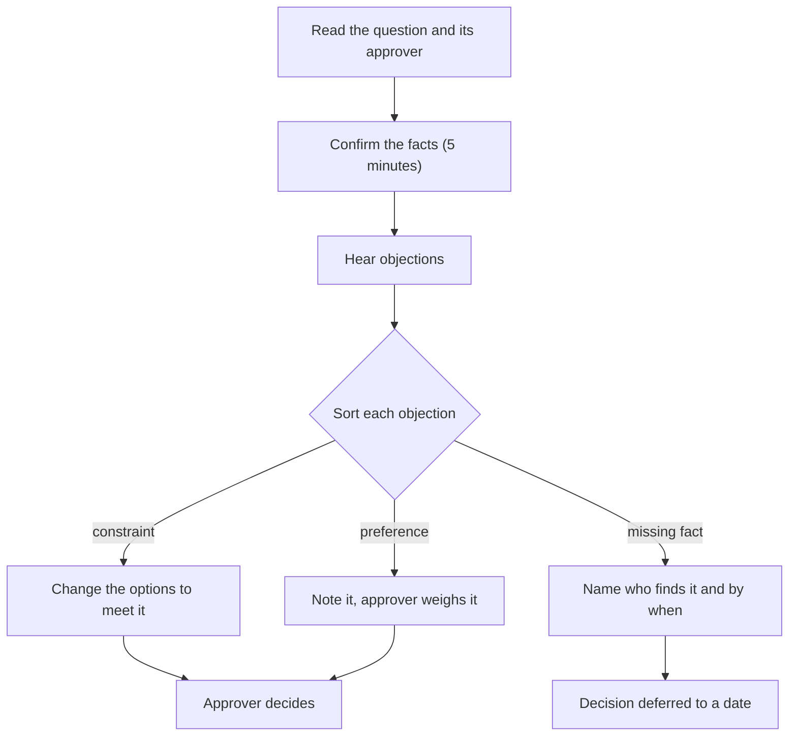

# Workshops and Reviews that Decide

## Start with forty sticky notes

Saltcote Housing, the fictional housing association from the [previous lesson](/learn/fde-in-the-field/stakeholder-communication/one-design-three-audiences), needed to agree how planners would work with its new repairs triage assistant. The FDE lead booked a two-hour workshop with twelve people from repairs, tenant services, IT and finance. The invitation said "Workshop: triage workflow. Let's discuss."

Nobody had read anything beforehand, because nothing had been sent. The first hour went on explaining the assistant. The second hour produced forty sticky notes about concerns, ideas and questions. The meeting ended with a request for a follow-up workshop. The follow-up revisited half the same notes. Three weeks after the first invitation, nothing had been decided, and the build team was waiting.

Call this **the sticky-note harvest**: a meeting that collects opinions well and decides nothing.

> **What you'll learn**
>
> - Turn a workshop topic into decision questions with one approver each.
> - Write pre-reading that people read before the meeting.
> - Run a session that sorts objections and ends with decisions.
> - Handle a review that drifts into implementation preferences.

## Name the decision before you book the room

Every meeting has one of three purposes. It **informs** people of something already decided, it **consults** them to gather views, or it **decides**. The sticky-note harvest was booked as a decision meeting and run as a consultation. Nobody knew which it was, so nobody felt able to decide.

Before booking a decision meeting, write each decision as a closed question with options. For Saltcote:

1. For the first three months, does a planner approve every job, or only drafts below a confidence level?
2. Which repair types are kept away from the assistant at launch?
3. Who owns the list of emergency words that send a report straight to a planner?

Each question names one **approver**, the single person whose decision it is. Atlassian's DACI framework names the roles: a driver who runs the process, one approver, contributors who give input and people who are informed. One approver matters. With two, a question can sit between them for weeks.

> **Key distinction:** A topic ("the triage workflow") invites discussion. A question with options and an approver ("planners approve every job: yes or no, decided by the head of repairs") invites a decision.

## Pre-reading people will read

Pre-reading moves the explanation out of the meeting. The meeting then spends its time on disagreement, which is the part that needs people in a room. Keep it short enough to read in ten minutes and send it two working days ahead. Table 1 shows the shape the Saltcote lead used.

| Part | What it holds | Length |
| --- | --- | --- |
| The decisions needed | The three questions, each with its approver | A few lines |
| Facts | Volumes, test results and costs from the one-page fact sheet | Half a page |
| Options per question | Each option with its cost, risk and who it affects | Half a page per question |
| Recommendation | What the FDE team recommends and why | A paragraph per question |
| What we need from you | Written comments by noon the day before, from named contributors | One line |

*Table 1: A decision pre-read. Two pages at most. The request for written comments is what gets it read.*

Asking named contributors for written comments by a deadline does two things. It makes reading the pre-read part of someone's job, and it shows you the objections before the meeting, so you can check facts in advance. For a design choice with long-term consequences, attach the decision record taught in [decision records and design reviews](/learn/forward-deployed/requirements-and-solution-design/decision-records-and-design-reviews).

## Running the session

The session has one job: get each question to a decision, or to a named gap that blocks it. Figure 1 shows the flow for one question.

*Figure 1: One decision question in a workshop. Sorting objections is the step that stops a discussion from circling.*

Sorting objections is the core skill. A **constraint** is a rule the design must meet, such as a published security standard or a legal duty. A **missing fact** is something nobody in the room knows yet, such as how many reports mention damp. A **preference** is a view about how things should be done, which the approver may weigh but nobody must satisfy. Saying aloud which kind an objection is often settles it.

The walkthrough replays Saltcote's rerun workshop.

Saltcote's second attempt, with the same people and the same 90 minutes. Each step shows what the FDE lead did and what it changed.

<button type="button" data-step="0" aria-pressed="false" aria-controls="ws-step-0">1. Before</button><button type="button" data-step="1" aria-pressed="false" aria-controls="ws-step-1">2. Open</button><button type="button" data-step="2" aria-pressed="false" aria-controls="ws-step-2">3. Decide</button><button type="button" data-step="3" aria-pressed="false" aria-controls="ws-step-3">4. After</button>

<section id="ws-step-0" class="step-panel" aria-labelledby="ws-heading-0"><h4 id="ws-heading-0">1. Before: send the pre-read</h4><dl><dt>Action</dt><dd>Sent the two-page pre-read two days ahead with three questions and their approvers. Asked four named contributors for comments by noon the day before.</dd><dt>What changed</dt><dd>Tenant services' main objection arrived in writing a day early, and the lead checked its facts before the meeting.</dd></dl></section><section id="ws-step-1" class="step-panel" aria-labelledby="ws-heading-1"><h4 id="ws-heading-1">2. Open: state the job of the meeting</h4><dl><dt>Action</dt><dd>Opened with "We are here to decide three questions. Each has an approver. We will spend 25 minutes on each."</dd><dt>What changed</dt><dd>People argued about the questions on the page, not about the whole project.</dd></dl></section><section id="ws-step-2" class="step-panel" aria-labelledby="ws-heading-2"><h4 id="ws-heading-2">3. Decide: sort and close each question</h4><dl><dt>Action</dt><dd>Sorted each objection aloud as a constraint, a missing fact or a preference, then asked the approver to decide.</dd><dt>What changed</dt><dd>Two questions were decided. The third, on repair types, needed a count of damp reports, which the repairs analyst agreed to bring by Friday.</dd></dl></section><section id="ws-step-3" class="step-panel" aria-labelledby="ws-heading-3"><h4 id="ws-heading-3">4. After: write it down the same day</h4><dl><dt>Action</dt><dd>Sent the decisions, approvers, recorded dissent and the one open action within a few hours.</dd><dt>What changed</dt><dd>The build team started on the approval screen the next morning.</dd></dl></section>

<button type="button" data-walk="previous">Previous</button>

<button type="button" data-walk="next">Next step</button>

The walkthrough is a scripted illustration. Not every question closes in one meeting. A question deferred to a named date, with an owner for the missing fact, is still progress.

## When a review slides into implementation taste

Design reviews have a common failure of their own. At Saltcote's technical review, the IT architect spent forty minutes arguing that the triage service should be written in C# instead of Python, because his team writes C#. The questions on the page, about data flows and access, were not reached.

Treat the objection the same way as any other: sort it. Ask one question, politely and in the room: **"Which requirement fails with the current choice?"**

- If the answer is a published standard, it is a constraint. Change the design or ask for an exception.
- If the answer is "my team will have to support it after you leave", it is a real support concern, not taste. It deserves a plan: who supports it, what they need to learn and what the handover includes.
- If no requirement fails, it is a preference. Note it in the record, give the approver the trade-off, and move to the next question.

At Saltcote the answer was support. Saltcote's data team already ran Python jobs and agreed to own the service, with a runbook and two training sessions in the handover. The architect's concern went into the record with its answer, and the review moved on.

Andrew Harmel-Law, writing on Martin Fowler's site, describes an **advice process** for architecture decisions: whoever takes a decision must seek advice from everyone meaningfully affected and from people with expertise, but need not follow it. The approver listens to the architect, and the decision is still theirs. That is what keeps a review from becoming a vote on taste.

> **Pitfall:** Winning the argument in the room. An engineer who loses a public argument about their own estate may say yes and block quietly later. Ask for the requirement, not for agreement.

## Close with a written record

End every decision meeting by reading the decisions back aloud, then send them in writing the same day. Each entry holds the decision, the approver, the date, any recorded dissent, and open actions with an owner and a due date. Recording dissent matters. It shows people they were heard, and if a concern later proves right, the record shows it was raised.

## Limits of this lesson

- **Some cultures decide outside meetings.** In some organisations the real decision happens in a one-to-one with the approver beforehand. Find out how your customer decides and work with it.
- **Workshops also explore.** A discovery workshop that gathers views is legitimate, if everyone knows that is its purpose.
- **Fictional data.** Saltcote Housing and its meetings are illustrative.

## Interview angle

Each answer is an outline to say in about two minutes. Open each question and try it aloud before reading.

Interview question 1. How do you run a workshop or review with a customer so that it ends with decisions, not only discussion?

- **Answer:** Before booking it, write each decision as a closed question with options and one approver. Send a short pre-read two working days ahead, with facts, options, a recommendation and a request for written comments from named people. In the room, take one question at a time, sort each objection as a constraint, a missing fact or a preference, and ask the approver to decide. Read the decisions back and send them in writing the same day.
- **Trade-off:** Preparation takes a day. Skipping it costs another meeting, often several.
- **Follow-up to expect:** "The approver will not decide in the room." Agree a date and what they need to decide, and write that down.

Interview question 2. In a design review, a senior customer engineer keeps arguing for a different framework, and to you it looks like a matter of taste. Time is running out. What do you do?

- **Answer:** Ask which requirement fails with the current choice. If it is a published standard, treat it as a constraint. If it is about who supports the system after handover, treat it as a real support question and plan for it. If no requirement fails, record the view and the trade-off, and ask the approver to decide so the review can move to the questions on the page.
- **Trade-off:** Moving on may leave the engineer feeling unheard. Recording their view and the reason it was not adopted keeps their trust.
- **Follow-up to expect:** "He is the person who will run it." Then support is a requirement. Plan the handover around it.
- **Go deeper:** [Decision records and design reviews](/learn/forward-deployed/requirements-and-solution-design/decision-records-and-design-reviews).

## References

1. Atlassian, [DACI: a decision-making framework](https://www.atlassian.com/team-playbook/plays/daci), Team Playbook, accessed 17 November 2026. Driver, a single approver, contributors and informed roles.
2. Andrew Harmel-Law, [Scaling the practice of architecture, conversationally](https://martinfowler.com/articles/scaling-architecture-conversationally.html), martinfowler.com, accessed 17 November 2026. The advice process: the decision-taker must consult those affected and those with expertise.
3. The site's [decision records and design reviews](/learn/forward-deployed/requirements-and-solution-design/decision-records-and-design-reviews) lesson, for the decision record and the design review checklist.
4. The author's own field experience, the basis for the pre-read shape and the objection sorting.

## Key takeaways

- Decide whether a meeting informs, consults or decides, and say so in the invitation.
- Write each decision as a closed question with options and one approver.
- Send a short pre-read two working days ahead and ask named people for written comments.
- Sort every objection as a constraint, a missing fact or a preference.
- Answer taste with one question: which requirement fails?
- Read decisions back, then record them with dissent and owners the same day.

## Check yourself

1. Why did Saltcote's first workshop produce forty sticky notes and no decision?

It had a topic instead of decision questions, no approver for each question and no pre-reading. The first hour went on explaining, and nobody knew who could decide.

2. An engineer objects that the design will be hard for her team to support. Is that a preference?

No. Support after handover is a requirement, because her team will run the system. It needs a plan for ownership, training and handover, not a note in the record.

3. Why ask for written comments before the meeting?

It makes reading the pre-read a task with a deadline, and it brings objections in early, so their facts can be checked before the meeting spends time on them.

