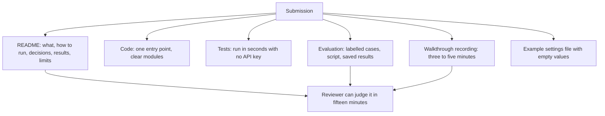

# Delivering the Submission

## Start with the silent submission

A candidate finishes the Whitby Outdoor slice on time. The drafts are good, the hand-off rules work and a 30-email evaluation sits in a notebook. They zip the folder and send it 20 minutes before the deadline.

The reviewer unzips it. There is no README at the top level. The setup fails because the code reads a key under a different name from the one in the example settings file. After ten minutes the reviewer finds the notebook, but its results were cleared before saving. They write: "Could not run. No evidence of quality."

The work was sound. The package said nothing about it. Call this **the silent submission**: good work handed over without the run instructions, results and limits that let a reviewer see it.

> **What you'll learn**
>
> - Know what goes into a take-home package.
> - Write a README in the order a reviewer reads it.
> - Report evaluation results with their failures.
> - State known limits and next steps.
> - Record a short walkthrough and run final checks from a clean copy.

## What the package contains

A submission is more than code. Figure 1 shows the parts and what each one proves.

*Figure 1: A take-home package. The README, the evaluation results and the walkthrough carry most of the evidence a reviewer scores.*

If the brief lists required parts, those come first and use its names. If it asks for a hosted demo, still include the code and a way to run it locally.

## Write the README in the order it is read

The README is the first thing a reviewer opens. Order it so that each section answers the next question they have.

| Section | What it says | Length |
| --- | --- | --- |
| What it does | The user, the need and what the slice does, in two or three sentences. | 3 lines |
| How to run it | Install, set one key, run one command. Then the test and evaluation commands. | 5 to 8 lines |
| Decisions | The three to five choices that shaped the design, each with its cost. | Half a page |
| Results | The evaluation table and the main failure patterns. | Half a page |
| Known limits | What it does not do or does badly, and what a user would see. | 5 to 8 lines |
| Next steps | What you would build next, in order, and why. | 5 lines |
| Time and tools | Time spent, and how you used AI assistants if the brief allows them. | 2 lines |

*Table 1: A README in reading order. One to two pages in total. Decisions and results get the most space.*

Write each decision with its cost. "Policies go into the prompt in full, not through an index, because six pages fit. Cost: more tokens per call. Switch when documents no longer fit." A decision without its cost reads as a default you did not question.

The comparison shows two READMEs for the same Whitby code.

The same Whitby Outdoor code, sent with two different READMEs. Choose one to see what the reviewer learns in their first two minutes.

<button type="button" data-mode="setup" aria-pressed="false" aria-controls="setup-result">Setup only</button>
<button type="button" data-mode="reader" aria-pressed="false" aria-controls="reader-result">Written for the reviewer</button>

<section id="setup-result" class="mode-panel" data-announcement="Setup-only README selected. The reviewer learns how to install it and nothing else."><h4>Setup only</h4><ul><li>Four install commands and "run main".</li><li>No word on why drafts are not sent, why there is no index, or which emails go to a person.</li><li>No results. The reviewer must run the evaluation, if they find it.</li></ul>
The reviewer scores the code against everything they can imagine it should do.
</section>
<section id="reader-result" class="mode-panel" data-announcement="README written for the reviewer selected. Scope, decisions, results and limits visible in two minutes."><h4>Written for the reviewer</h4><ul><li>Two lines on the user and the slice: drafts with policy citations, a person sends.</li><li>Four decisions with costs, including no auto-send and no index.</li><li>Results: 19 of 25 drafts acceptable, 5 of 5 hand-offs flagged, and the two failure patterns.</li><li>Limits and next steps, then "4 hours 15 minutes, assistant used for test scaffolding".</li></ul>
The reviewer scores the code against the scope you set, and arrives at the follow-up with questions about your choices.
</section>

The second README takes about 30 minutes to write. That is why the budget in [scoping the brief](/learn/fde-take-home/take-home-assignments/scoping-the-brief) protects 40 minutes for the write-up.

## Report results with their failures

Show the evaluation as a small table, then explain the failures. The Whitby results might look like Table 2. The numbers are illustrative.

| Check | Result | How it was judged |
| --- | --- | --- |
| Drafts acceptable to send with at most one small edit | 19 of 25 | By hand, against the labels |
| Cited policy section correct | 23 of 25 | By hand, against the labels |
| Cited section exists in the policy | 25 of 25 | In code |
| Hand-off emails flagged | 5 of 5 | In code |

*Table 2: Whitby evaluation results on 30 labelled emails, 25 to draft and 5 to hand off. A small set shows the method, not a rate to quote to a customer.*

Then name the failure patterns. Four of the six weak drafts mixed a return question with a warranty question and answered only one. Two had the wrong tone for an angry customer. Each pattern points to a fix, and listing them shows you read your own results.

Say what the numbers cannot tell you. With 25 drafts, one email changes the rate by four points. Write "19 of 25 on a small labelled set", not "76% accuracy".

## State known limits and next steps

A known limit is something the tool does not do, or does badly, written so a user knows what they would see. State each one before the reviewer finds it.

- **Mixed questions.** Emails that ask about a return and a warranty claim get an answer to one. Next step: split the email into questions before drafting.
- **Order numbers.** Only the "WO-" format is looked up. Others go to a person.
- **Language.** English only. Other languages go to a person.

Order the next steps by value, not by interest. The first should fix the largest failure pattern or remove the largest risk.

## Record a short walkthrough

Some briefs ask for a recording or a live walkthrough. Even when they do not, a three to five minute recording helps a reviewer who cannot get the code to run. Plan it before you record.

1. The user, the need and the slice: 30 seconds.
2. One email from input to draft, showing the citation: 60 seconds.
3. One email that goes to a person, and why: 30 seconds.
4. The results table and one failure: 60 seconds.
5. Limits and the first next step: 30 seconds.

That is three and a half minutes. Show a failure on purpose. A walkthrough that shows only the best cases is the take-home version of the demo problem in [demos that tell the truth](/learn/fde-in-the-field/stakeholder-communication/demos-that-tell-the-truth).

## Final checks before you send

Do these in the last 15 minutes, in this order.

- **Clean-copy test.** Clone or unzip the submission into a new folder and follow the README exactly. Fix anything that fails.
- **No secrets.** Search the files and the commit history for keys. A key in the history stays there after you delete the file.
- **Pinned dependencies.** Fix the versions you used so the reviewer installs the same ones.
- **Saved results.** The evaluation results are in a file, not only in a notebook's output.
- **No dead code.** Remove commented-out experiments and unused files.

## Limits of this lesson

- **Format rules.** When the brief sets a format, a page limit or a delivery method, follow it over this lesson.
- **Design-only take-homes.** A written design has no run step, but needs the same decisions, limits and next steps. The [contract review take-home brief](/interview/mock-interviews/contract-review-take-home-brief) shows that format.
- **Fictional data.** Whitby Outdoor and its results are illustrative.

## Interview angle

Each answer is an outline to say in about a minute. Open each question and try it aloud before reading.

Interview question 1. Your README says 19 of 25 drafts were acceptable. Is that good enough to ship?

- **Answer:** Not as an unreviewed system, and the README says so. In this design a person sends every draft, so a weak draft costs an edit, not a wrong reply. The six failures fall into two patterns with clear fixes. Before any wider use I would grow the set to a few hundred labelled emails and agree a target with the customer.
- **Trade-off:** A small set shows the method quickly but gives a wide range of uncertainty. A larger set takes labelling time the take-home did not have.
- **Follow-up to expect:** "What target would you set?" One the customer agrees, based on how much agent editing they will accept.

Interview question 2. You have ten minutes left and no README. What do you write?

- **Answer:** Three things, in order. How to run it in one command, so the reviewer can see it work. What the slice does and does not do, so they score it against my scope. The results table, even if rough. Decisions and next steps get one line each. I would also say plainly in the README that it was written in the last ten minutes.
- **Trade-off:** A short README loses the reasoning a reviewer would score. It still beats a missing one, which can end the review at the first run.
- **Follow-up to expect:** "Why were you out of time?" Name the planning mistake and what you would budget differently.

Interview question 3. Why include failures in your walkthrough recording?

- **Answer:** The reviewer will find failures anyway, by trying their own input. Showing one first, with why it happens and the fix, shows I tested the tool and know where it breaks. It also sets up the follow-up around my results instead of their surprise.
- **Trade-off:** Showing a failure costs a minute of the recording and can look weak to a reader who skims. Hiding it costs trust when they find it.
- **Follow-up to expect:** "Which failure worries you most?" The mixed-question emails, because the customer gets half an answer.

## References

1. Make a README, [Make a README](https://www.makeareadme.com/), accessed 17 November 2026. The sections a README needs, including installation and usage.
2. GitHub Docs, [About secret scanning](https://docs.github.com/en/code-security/secret-scanning/introduction/about-secret-scanning), accessed 17 November 2026. Why secrets in a repository's history need finding and removing.
3. scikit-learn, [Metrics and scoring](https://scikit-learn.org/stable/modules/model_evaluation.html), accessed 17 November 2026. Standard measures and the confusion matrix for reporting results.
4. The site's [three formats for one project](/learn/communication-and-behavioural/telling-the-build-story/three-formats-for-one-project) lesson, on writing up a build for different readers, and the [capstone build](/learn/capstone-and-portfolio/capstone-build/build-from-a-pinned-revision) module, which asks for the same package at portfolio scale.

## Key takeaways

- The package is the README, code, tests, evaluation results, a walkthrough and an example settings file.
- Order the README as it is read: what, how to run, decisions with costs, results, limits, next steps, time and tools.
- Report results as counts on a small set, then name the failure patterns.
- State each known limit before the reviewer finds it.
- Test the setup from a clean copy and check the history for secrets before you send.

## Check yourself

1. What turned sound work into the silent submission?

No README, a settings name that did not match the code, and evaluation results cleared from the notebook. The reviewer could not run it or see evidence.

2. Why write "19 of 25" rather than "76% accuracy"?

With 25 cases one email moves the rate by four points. Counts show the size of the set, a bare percentage hides it.

3. What is the clean-copy test?

Copy the submission to a new folder and follow the README exactly, fixing anything that fails, before you send it.

