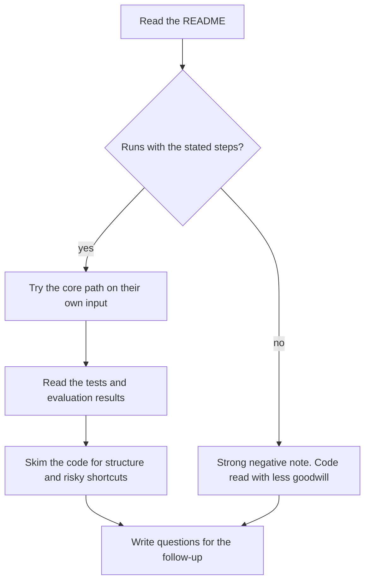

# How Take-homes Are Scored

## Start with the overtime showcase

A candidate receives a take-home from an FDE team. The brief is for Whitby Outdoor, a retailer that sells walking and camping gear online. It asks for a tool that drafts replies to customer support emails using the retailer's returns, delivery and warranty policies. The brief includes 150 anonymised emails and six policy pages, and suggests four hours.

The candidate spends eleven hours. The submission has a login page, a streaming chat window, dark mode and a container set-up. The README explains how to install it. It does not say how good the drafts are, which emails the tool should not answer, or why any choice was made.

The reviewer opens the app, pastes in an email about a broken tent pole and gets a confident reply that offers a refund the warranty policy does not allow. Nothing in the submission would have caught it. Call this **the overtime showcase**: spending extra hours on surface the reviewer does not score, while the evidence they do score is missing.

> **What you'll learn**
>
> - Know what a take-home stands in for and who reads it.
> - Name the signals reviewers score and what strong and weak look like for each.
> - Follow the order in which a reviewer reads a submission.
> - Treat the time box as part of the test.
> - Handle rules on AI assistants and outside help.

## What a take-home stands in for

A take-home is a work sample. It replaces, or comes before, a live design or coding round. The team wants to see how you work when nobody is watching the clock for you: what you choose to build, how you check it and how you explain it.

For an FDE role the brief is often written as a customer request, with gaps left in on purpose. The team is checking the same habits it needs on an engagement. Do you find the real problem, ship something that works inside a fixed time, show evidence and say plainly what it does not do?

The submission is then read by one or more engineers, usually before a follow-up session in which you present it and answer questions. That session is the Demo or Take-Home round. The written work and the follow-up are scored together.

## The signals reviewers score

Teams write their own rubrics, and no two match. The signals below are the ones the author has seen recur across them, because they are what an engineering team needs from a colleague. Table 1 lists each signal with what strong and weak look like.

| Signal | Strong | Weak |
| --- | --- | --- |
| Works end to end | One command runs it. The core path works on the reviewer's own input. | Setup fails, or only a demo script works. |
| Scope judgement | A thin slice that solves the core need, with cuts named and explained. | Many features half-built, or extras the brief never asked for. |
| Evidence it works | Tests for the deterministic parts and a small evaluation of the model's output, with results. | "It works well" with no numbers. |
| Clarity of the write-up | Decisions, assumptions, limits and next steps a busy reader finds in two minutes. | Setup steps only, or ten pages. |
| Code a teammate could maintain | Clear structure, names that say what things do, no dead code, no secrets. | One large file, commented-out experiments, keys in the repository. |
| Defence | Explains every choice and its cost. Changes the design for a good reason only. | Cannot explain a function. Folds or digs in under challenge. |

*Table 1: Six signals a take-home reviewer looks for. The first five come from the submission, the sixth from the follow-up.*

Look at what is missing. Visual polish, framework choice and extra features rarely appear on a rubric for an engineering role unless the brief asks for them. Google's published code review guidance points the same way: it asks reviewers to check design, functionality, complexity and tests, and warns against over-engineering.

## How a reviewer reads a submission

Reviewers have limited time and several submissions to read. A common path is Figure 1, and each step can end the review early.

*Figure 1: The usual reading path. The README and the first run shape everything after them.*

Three things follow from this order.

- **The README is read first.** It sets the reviewer's expectations. If it states your scope, assumptions and limits, the reviewer scores you against them. If it does not, they score you against everything they can imagine.
- **The first run is a gate.** A missing environment variable or an unpinned dependency can cost more than any feature gains. Test your setup steps from a clean copy before you submit.
- **The reviewer tries their own input.** For an AI feature, expect them to try an awkward case: an angry customer, a question outside the policies, an email in another language. Name how the tool handles such cases before they find out.

## Three submissions for the same brief

The comparison shows how a reviewer might score three submissions for the Whitby Outdoor brief against the signals in Table 1. The submissions and scores are illustrative.

Three candidates submit work for the same four-hour Whitby Outdoor brief. Choose one to see how a reviewer would score it.

<button type="button" data-mode="polished" aria-pressed="false" aria-controls="polished-result">Polished app</button>
<button type="button" data-mode="thin" aria-pressed="false" aria-controls="thin-result">Thin slice with evidence</button>
<button type="button" data-mode="broken" aria-pressed="false" aria-controls="broken-result">Ambitious and broken</button>

<section id="polished-result" class="mode-panel" data-announcement="Polished app selected. Works, but no evidence and eleven hours spent."><h4>Polished app, eleven hours</h4><ul><li>Works end to end: yes, with a login page and streaming chat.</li><li>Scope judgement: weak. Most of the time went on screens the brief did not ask for.</li><li>Evidence: none. The refund error on a warranty email goes unnoticed.</li><li>Write-up: setup steps only.</li></ul>
The reviewer's note: "Capable builder. No sign of how they would know it is right."
</section>
<section id="thin-result" class="mode-panel" data-announcement="Thin slice selected. Four hours fifteen, evaluated on 30 emails, limits named."><h4>Thin slice with evidence, four hours fifteen</h4><ul><li>Works end to end: a command-line tool and one endpoint. Each draft cites the policy section it relies on.</li><li>Scope judgement: strong. Warranty claims, legal threats and non-English emails go to a human, and the README says why.</li><li>Evidence: 30 emails labelled by hand: 19 of 25 drafts acceptable, all 5 hand-off cases flagged.</li><li>Write-up: decisions, limits and next steps on one page, with the extra 15 minutes declared.</li></ul>
The reviewer's note: "Knows what matters. Ask about the six weak drafts in the follow-up."
</section>
<section id="broken-result" class="mode-panel" data-announcement="Ambitious and broken selected. Agent design, setup fails, six hours."><h4>Ambitious and broken, six hours</h4><ul><li>Works end to end: no. Setup fails on a missing environment variable.</li><li>Scope judgement: weak. An agent with a mocked order-lookup tool and a fine-tuning plan, none finished.</li><li>Evidence: a plan for an evaluation, not results.</li><li>Write-up: a long design document about the target system.</li></ul>
The reviewer's note: "Interesting ideas. Could not see any of them work."
</section>

The thin slice is the smallest of the three and the only one that shows judgement and evidence. Its six weak drafts are not a problem. Knowing about them, and saying so, is the signal.

## The time box is part of the test

A suggested time box tells you how much the team expects, and it lets them compare candidates fairly. Going well over it hides the signal they want, which is what you choose when you cannot do everything.

- **Plan to the time box, not past it.** Lesson 2, [scoping the brief](/learn/fde-take-home/take-home-assignments/scoping-the-brief), shows how to fit a slice to four hours.
- **Declare the time you spent.** "About four hours fifteen, the extra on the README" reads as honest. Silence about eleven hours reads as hiding it once the follow-up begins.
- **Put the extra ideas in "next steps".** A short list of what you would build with another day shows ambition without spending the hours.

If the brief has no time box, ask for one. If you get no answer, choose one, state it in the README and keep to it.

## Rules on AI assistants and outside help

Teams differ on whether you may use AI coding assistants, libraries or starter templates. Read the brief's rules and follow them exactly. If the rules are silent, ask.

When assistants are allowed, say in the README what you used them for, for example "scaffolding and test cases, reviewed by me". The rule that matters in the follow-up is ownership: you must be able to explain every line you submit, why it is there and what would break without it. Lesson 5, [defending your take-home](/learn/fde-take-home/take-home-assignments/defending-your-take-home), covers how that is tested.

## Limits of this lesson

- **No single rubric.** Teams weight the signals differently. Some score code quality heavily, others the write-up. Read the brief for hints about which matters most.
- **Design-only take-homes.** Some take-homes ask for a written design with no code, such as the [contract review take-home brief](/interview/mock-interviews/contract-review-take-home-brief). The same signals apply, without the first run.
- **Composite example.** Whitby Outdoor, its brief, the candidates and the scores are illustrative, not a real customer.

## Interview angle

Each answer is an outline to say in about a minute. Open each question and try it aloud before reading.

Interview question 1. The brief said four hours and several parts are unfinished. Why did you stop?

- **Answer:** The time box is part of the brief, so I planned to it. I finished the core path end to end, a draft reply that cites its policy section, plus a 30-email evaluation, because those prove the idea works. Order lookup and the reviewer interface are in "next steps" with how I would build them. I spent about four hours fifteen and declared it.
- **Trade-off:** Stopping leaves visible gaps. Going on would have hidden how I prioritise under a fixed budget.
- **Follow-up to expect:** "What would you build first with another day?" Name one item and say why it beats the others.

Interview question 2. If you were reviewing take-homes for this team, what would you score?

- **Answer:** Whether it runs from the README, whether the scope fits the time and solves the core need, whether there is evidence it works, whether the write-up states decisions and limits, and whether the code is something a teammate could pick up. Then the follow-up: can the candidate explain and defend their choices.
- **Trade-off:** Weighting evidence and judgement above polish can undervalue candidates who are strong at interfaces. For an FDE role the customer cares first that the output is right.
- **Follow-up to expect:** "How would you keep scoring fair across reviewers?" A written rubric agreed before reading, with examples of each level.

Interview question 3. How did you decide what to leave out?

- **Answer:** I listed every feature the brief implied and asked of each one: does the core user need fail without it? Drafting grounded replies and flagging emails a human must handle passed. A login page, chat history and order lookup did not, so I cut them and named them in the README. I also cut anything I could not test inside the time box.
- **Trade-off:** A cut can remove something the reviewer wanted. Naming it lets them see it was a choice.
- **Follow-up to expect:** "Which cut are you least sure about?" Answer plainly and say what would change it.

## References

1. Google Engineering Practices, [What to look for in a code review](https://google.github.io/eng-practices/review/reviewer/looking-for.html), accessed 17 November 2026. Design, functionality, complexity and tests as review criteria, and the warning against over-engineering.
2. Hamel Husain, [Your AI product needs evals](https://hamel.dev/blog/posts/evals/), accessed 17 November 2026. Why an AI feature needs measured evidence, not impressions.
3. The site's [proof versus knowledge](/learn/communication-and-behavioural/telling-the-build-story/proof-versus-knowledge) lesson, on showing evidence for what you built, and the [capstone build](/learn/capstone-and-portfolio/capstone-build/choose-a-capstone-project) module, which applies the same signals to a longer project.
4. The author's own experience writing and reviewing take-homes, the basis for the six signals and the reading path.

## Key takeaways

- A take-home is a work sample scored on judgement, evidence and explanation, then on your defence of it.
- Reviewers read the README first, then try to run it. Both shape everything after.
- Evidence that the AI output is right outweighs polish nobody asked for.
- The time box is part of the test. Plan to it and declare what you spent.
- Follow the rules on AI assistants, and own every line you submit.

## Check yourself

1. Why did the polished app score badly despite working?

It had no evidence that the drafts were right, so a refund error went unnoticed. Its hours went on surface the brief did not ask for.

2. Why is the first run so important?

It is a gate. If setup fails, the reviewer may never see the core path, and they read the rest with less goodwill.

3. What should you do when the brief gives no time box?

Ask. If there is no answer, choose one, state it in the README and keep to it.

